<!-- ! Alteração de IA - Revisar: arquivo novo (03/11/2026): texto fonte da versão 1 provisória do documento do TCC, no molde do orientador (`Template_TCC_ABNT.docx`, estrutura de `TCC/README.md` do repositório da disciplina) e na NBR 14724, gerado em .docx por `ferramentas/gerar_tcc_docx.py`. As seções 1 a 5 e a 6.9, a 7, o glossário e os apêndices foram escritas a partir do projeto de pesquisa V3 (`Documentacao/Projeto de Pesquisa - ABNT 15287_2025 - V3.md`, itens 1 a 9 da revisão ABNT já aplicados) e do Memorial; as seções 4.1.7 a 4.2.4 e 6.1 a 6.7 foram redigidas por agentes de apoio a partir dos levantamentos e dos relatórios por fase, com cada número copiado da fonte indicada em comentário logo depois da frase. Os comentários não vão para o Word. Depois da montagem, um revisor (agente) conferiu cerca de 250 números das seções escritas pelo Claude e as 62 referências contra as chamadas do texto; as 35 correções dele (casos inéditos contados duas vezes no resumo, site legado cedido e não construído, probabilidade conjunta dos tokens do rótulo, as três camadas da trilha, letras das entradas AUTOPSIAS e ARIZE AI, entre outras) foram aplicadas por script em 03/11/2026 e estão listadas, com o trecho antigo, o novo e o motivo, em `Documentacao/memorial/5-metodo-e-ferramental/dados/revisao-tcc-v1-2026-11-03.json`.
     ! Motivo: o Eric fechou a ficha 25 pela opção (b) em 03/11/2026 (decisão 83): um documento provisório agora, para o grupo ver o que melhorar, já no molde e nas regras do documento final. O Markdown é a fonte versionada e revisável (tags de IA, origem dos números, revisão por script); o .docx é regenerado dele a cada versão. Números sem origem no Memorial ficaram marcados [conferir]. -->

<!-- ! Alteração de IA - Revisar: versão 2 (05/11/2026): o texto passa a ir até o que a Fase 4 mediu em 05/11/2026, pela lista da seção 15 de `Documentacao/memorial/3-resultados-e-analises/fase-4-relatorio.md`, com as respostas às fichas 42 a 45 (decisões 90 a 93), dadas no mesmo dia. Os 12 itens da lista estão feitos (resumo, abstract, siglas, 3, 5, 5.1, 5.3, 5.5 a 5.8, 6.7, 6.9, 7, referências, glossário e Apêndice B). As corridas 18c, 21c, 23 e 24, que as decisões 90 a 92 acrescentaram, ainda não rodaram e entram como pendentes, com as corridas 18b e 21b como leituras vigentes até lá; o trace, o painel ao vivo e o explorador entram como não feitos na Fase 4 (decisão 93). Cada trecho tocado tem tag própria logo acima. Um revisor (agente, só leitura) conferiu os números e as citações; o resultado está em `Documentacao/memorial/5-metodo-e-ferramental/dados/revisao-tcc-v2-2026-11-05.json`.
     ! Motivo: o Eric pediu a atualização do texto formal com o que a Fase 4 mediu. A versão 1 parava em 01/11/2026 e dizia que faltavam pacotes que já rodaram, e as decisões 82 e 85 a 93 mandam levar as limitações e as corridas novas ao documento; quando as corridas pendentes rodarem, os números delas entram na versão seguinte. -->
<!-- ! Alteração de IA - Revisar: versão 3 (05/11/2026): a seção 6 passa a contar os resultados com figuras e a explicação de como lê-las, e a análise aprofundada vira a seção 6.10. Nenhum número novo de corrida: as corridas 18c, 21c, 23 e 24 seguem pendentes.
     ! Motivo: pedido do Eric em 05/11/2026, depois da versão 2, para deixar o documento mais legível; a versão anterior tinha só tabelas e parágrafos com dezenas de números. -->
<!-- ! Alteração de IA - Revisar: (25/11/2026, decisão 158) o campo Orientador dos Dados abaixo passou a levar o nome e a titulação: "Prof. Me. Rafael Oliveira Cotrin".
     ! Motivo: o campo estava com "[conferir o nome completo e a titulação do orientador]", e é ele que o gerador do Word (`ferramentas/gerar_tcc_docx.py`) escreve na folha de rosto; o Eric disse o nome e a titulação ("Mestre") na sessão principal em 25/11/2026. -->
## Dados

- **Universidade:** Universidade Cidade de São Paulo - UNICID
- **Curso:** Curso de Ciência da Computação
- **Autores:** Eric Conde Derre | Erick do Carmo Esteves | Guilherme Penha dos Santos | João Victor Fonseca Silva | Kennedy Fernando de Oliveira Gundim | Leandro Henrique da Silva Patricio | Pedro Henrique Torres Gonçalves
- **Título:** Desenvolvimento de um agente de QA end-to-end (E2E) autônomo com capacidades de self-healing
- **Subtítulo:** Focado na fronteira de integração
- **Natureza:** Trabalho de Conclusão de Curso apresentado ao Curso de Ciência da Computação da Universidade Cidade de São Paulo (UNICID), como requisito parcial para obtenção do título de Bacharel em Ciência da Computação.
- **Orientador:** Orientador: Prof. Me. Rafael Oliveira Cotrin
<!-- ! Alteração de IA - Revisar: (25/11/2026, Pós-Fase 4, pacote Q8) chave nova `Grau` no bloco Dados.
     ! Motivo: a ficha catalográfica (decisão 158) traz o grau do curso; sem a chave o gerador escreve "Graduação". -->
- **Grau:** Bacharelado em Ciência da Computação
- **Local:** São Paulo
- **Ano:** 2026
- **Versão:** 3
- **Data:** 05/11/2026

# AGRADECIMENTOS

<!-- ! Alteração de IA - Revisar: (25/11/2026, Pós-Fase 4, pacote Q8) texto dos Agradecimentos, no lugar da frase provisória.
     ! Motivo: o Eric escolheu no quadro o texto curto proposto (ficha 104, decisão 165); a frase "[Opcional. Versão provisória: ...]" sairia assim no Word final. -->
Ao Prof. Me. Rafael Oliveira Cotrin, pela orientação e pelas reuniões de acompanhamento ao longo do semestre.

À Universidade Cidade de São Paulo e aos professores do Curso de Ciência da Computação.

Ao analista de QA que leu e avaliou os relatórios do agente e as propostas de edição da biblioteca, sem ter participado do projeto.

Às nossas famílias e aos colegas, pelo apoio durante o curso.

# RESUMO

<!-- ! Alteração de IA - Revisar: (05/11/2026, versão 2) resumo com o que a Fase 4 mediu até 05/11/2026: tira "em andamento", "resultados parciais" e "em investigação" e traz os números das corridas 18b, 19 e 21b, a medida com revisor humano que não foi feita e as corridas que ainda rodam antes da Fase 5.
     ! Motivo: o resumo é a primeira coisa que o orientador lê e dizia que os resultados eram parciais e que a diferença entre a tela e o arquivo estava em investigação, quando a decisão 82 já a registrou como limitação declarada e a decisão 90 manda encurtar o caso ao vivo e repetir as medidas. -->
<!-- ! Alteração de IA - Revisar: (24/11/2026, Fase 5, pacote F6) a frase "A Fase 5 medirá o tempo médio de reparo e o sucesso da tarefa contra uma linha de base manual" deu lugar ao resultado da fase: o tempo como o resultado central, e o sucesso da tarefa com a ressalva de que depende da sessão de um integrante. O resto do resumo não foi tocado.
     ! Motivo: o resumo dizia que a Fase 5 ainda ia medir, e a medida foi lida em 24/11/2026; o plano da fase (seção 6) manda o resumo levar o resultado central, e a decisão 151 manda o Task Success nunca aparecer sem a ressalva. Os números saem por script de `medicao.json`. As frases anteriores, que falam das corridas ainda por rodar antes da Fase 5, são do pacote Q8 da Pós-Fase 4 e continuam como estavam. -->
<!-- ! Alteração de IA - Revisar: (25/11/2026, Pós-Fase 4, pacote Q8) resumo reescrito para caber no limite de 500 palavras da NBR 6028, com as leituras vigentes da Fase 4 (corridas 18d e 21d), a Pós-Fase 4 e a Fase 5.
     ! Motivo: o resumo tinha 578 palavras, dava as corridas 18c, 21c, 23 e 24 como pendentes, trazia os números das corridas 18b e 21b e se dizia documento provisório; os números vêm das leituras citadas em cada comentário de fonte. -->
<!-- ! Alteração de IA - Revisar: (26/11/2026, Pós-Fase 4, pacote Q8) o resumo e o abstract passam a dizer que o hub é a central do projeto.
     ! Motivo: desde a decisão 170 (25/11/2026) o hub deixou de ser só a página de revisão: o `Cobaia.exe` abre o navegador nele, e é dele que se chega ao site, à API, às métricas e ao botão de rodar os cenários. -->
A automação de testes de ponta a ponta (end-to-end, E2E) tem custo alto de manutenção: uma mudança na interface quebra os localizadores dos roteiros, e uma mudança silenciosa no formato dos dados devolvidos por uma API (deriva de contrato) quebra a esteira de integração contínua sem apontar a causa. Este trabalho desenvolve e mede um agente de garantia de qualidade (QA) E2E autônomo, com autocura (self-healing) de localizadores e diagnóstico de causa raiz na fronteira entre a interface e a API, que executa um modelo de linguagem grande (LLM) inteiramente na máquina do usuário, sem GPU e sem serviço em nuvem. O método é experimental: duas aplicações-alvo sob controle do grupo, um front-end legado em PHP e uma API em FastAPI, recebem falhas injetadas de forma determinística, organizadas numa taxonomia de 23 causas em seis classes e três níveis de dificuldade, e as regras de leitura de cada medida são fixadas antes de ela rodar. A comparação de modelos locais quantizados, sem documentação, com uma biblioteca de documentação recuperada e com a biblioteca editada pelo próprio modelo atrás de validação em código, levou à escolha do qwen2.5:7b com a biblioteca que ele mesmo escreveu. Na tela, com interceptação de rede e da árvore de acessibilidade pelo Playwright, a cura de seletor resolveu as 160 quebras de localizador armadas, com tempo de reparo mediano de 0,639 s, sem o modelo <!-- fonte: roadmap.md §2.11 -->; o diagnóstico lido da tela acertou 32 de 37 casos, contra 30 dos mesmos casos lidos do arquivo <!-- fonte: resultados_alvo/fase4/tela_v4.md; roadmap.md §2.19 -->; e a probabilidade que o modelo dá ao rótulo serviu de sinal de triagem para revisão humana, e não de barreira. Cada caso sai com uma trilha de raciocínio aberta, um relatório no molde do relatório de defeitos do syllabus CTFL 4.0 e uma árvore de decisão, reunidos num hub local, a central do projeto, em que o veredito é sempre do analista; um analista de QA de fora do projeto avaliou 30 de 36 diagnósticos como o gabarito lendo esses relatórios, sem medida de tempo <!-- fonte: resultados_alvo/fase4/leitura_revisao_v3.md -->. Na medida de valor, em dez cenários com cinco repetições, o agente reparou mais rápido que três integrantes do grupo nos dez, com tempo médio de reparo de 66,3 s contra 219,7 s (diferença média por cenário de 153,4 s, intervalo de 95% de 109,0 a 196,1 s; teste dos sinais, p = 0,0020), o resultado central do trabalho <!-- fonte: resultados_alvo/fase5/medicao.md -->. O sucesso da tarefa foi de 49 em 50 execuções contra 14 em 30 tentativas das pessoas, resultado que depende da sessão de um integrante e é declarado com essa ressalva <!-- fonte: resultados_alvo/fase5/medicao.md; decisoes.md decisão 151 -->. As falhas são armadas, e não ocorridas, as medidas valem para uma máquina e para dez cenários escolhidos pelo grupo, e a linha de base são estudantes no começo da prática. O código, os registros de cada medida e a documentação são públicos.

Palavras-chave: testes end-to-end; self-healing; modelos de linguagem locais; diagnóstico de causa raiz; deriva de contrato de API.

# ABSTRACT

<!-- ! Alteração de IA - Revisar: (05/11/2026, versão 2) abstract acompanhando o resumo: números das corridas 18b, 19 e 21b, a medida com revisor humano que não foi feita e as corridas que ainda rodam antes da Fase 5.
     ! Motivo: o abstract dizia "partial results" e "under investigation", o que deixou de ser verdade com a decisão 82 e as corridas lidas até 05/11/2026. -->
<!-- ! Alteração de IA - Revisar: (24/11/2026, Fase 5, pacote F6) o abstract acompanha o resumo: a frase "Phase 5 will measure..." deu lugar ao resultado da fase, com o tempo como o resultado central e o sucesso da tarefa com a ressalva. Os números são os do resumo, com ponto decimal.
     ! Motivo: o abstract dizia que a Fase 5 ainda ia medir; o resumo mudou e os dois precisam dizer a mesma coisa. Os números saem por script de `medicao.json`. -->
<!-- ! Alteração de IA - Revisar: (25/11/2026, Pós-Fase 4, pacote Q8) abstract reescrito para acompanhar o resumo, frase a frase.
     ! Motivo: o abstract repetia o resumo antigo, acima de 500 palavras e com as corridas 18c, 21c, 23 e 24 como pendentes. -->
End-to-end (E2E) test automation is expensive to maintain: a user interface change breaks the locators used by test scripts, and a silent change in the data returned by an API (contract drift) breaks the continuous integration pipeline without pointing to the cause. This work develops and measures an autonomous E2E quality assurance (QA) agent with self-healing of locators and root-cause diagnosis at the boundary between the user interface and the API, running a large language model (LLM) entirely on the user's machine, with no GPU and no cloud service. The method is experimental: two target applications under the group's control, a legacy PHP front end and a FastAPI back end, receive deterministically injected faults, organized in a taxonomy of 23 causes in six classes and three difficulty levels, and the reading rules of each measurement are fixed before it runs. The comparison of quantized local models, without documentation, with a retrieved documentation library and with a library edited by the model itself behind code validation, led to the choice of qwen2.5:7b with the library it wrote itself. On the screen, with network and accessibility-tree interception through Playwright, locator healing resolved all 160 armed locator breakages, with a median repair time of 0.639 s, without the model; diagnosis read from the screen got 32 of 37 cases right, against 30 of the same cases read from a file; and the probability the model assigns to its label served as a triage signal for human review, not as a barrier. Each case comes with an open reasoning trail, a report shaped after the defect report of the CTFL 4.0 syllabus and a decision tree, gathered in a local hub, the project's central page, in which the verdict always belongs to the analyst; a QA analyst from outside the project rated 30 of 36 diagnoses in agreement with the answer key while reading these reports, with no time measurement. In the value measurement, on ten scenarios with five repetitions, the agent repaired faster than three group members in all ten, with a mean time to repair of 66.3 s against 219.7 s (mean difference per scenario of 153.4 s, 95% interval from 109.0 to 196.1 s; sign test, p = 0.0020), the central result of this work. Task success was 49 of 50 runs against 14 of 30 attempts by the people, a result that depends on one member's session and is reported with that caveat. The faults are armed rather than naturally occurring, the measurements hold for one machine and for ten scenarios chosen by the group, and the baseline consists of students at the beginning of their practice. The code, the records of every measurement and the documentation are public.

Keywords: end-to-end testing; self-healing; local language models; root-cause diagnosis; API contract drift.

# LISTA DE ABREVIATURAS E SIGLAS

- **API** Application Programming Interface (interface de programação de aplicações)
- **AUROC** Area Under the Receiver Operating Characteristic curve (área sob a curva ROC)
- **BM25** Best Matching 25 (função de ordenação por relevância lexical)

<!-- ! Alteração de IA - Revisar: (25/11/2026, Pós-Fase 4, pacote Q8) sigla BSTQB.
     ! Motivo: a seção 4.1.11 cita a tradução do syllabus feita pelo BSTQB. -->
- **BSTQB** Brazilian Software Testing Qualifications Board (conselho brasileiro de qualificação em teste de software)
- **CI/CD** Continuous Integration / Continuous Delivery (integração e entrega contínuas)
- **CoT** Chain of Thought (cadeia de pensamento)
- **CPU** Central Processing Unit (unidade central de processamento)
- **CSS** Cascading Style Sheets (folhas de estilo em cascata)

<!-- ! Alteração de IA - Revisar: (25/11/2026, Pós-Fase 4, pacote Q8) sigla CTFL.
     ! Motivo: as seções 4.1.11 e 5.8 citam o syllabus CTFL 4.0. -->
- **CTFL** Certified Tester Foundation Level (certificação de testador, nível fundamental)
- **DOM** Document Object Model (modelo de objetos do documento)
- **E2E** End-to-End (de ponta a ponta)
- **GBNF** GGML BNF (formato de gramática que restringe a saída do modelo a uma lista fechada)
- **GPU** Graphics Processing Unit (unidade de processamento gráfico)
- **HTML** HyperText Markup Language (linguagem de marcação de hipertexto)
- **HTTP** HyperText Transfer Protocol (protocolo de transferência de hipertexto)
- **IA** Inteligência Artificial
- **IC** Intervalo de Confiança

<!-- ! Alteração de IA - Revisar: (25/11/2026, Pós-Fase 4, pacote Q8) sigla ISTQB.
     ! Motivo: as seções 4.1.11 e 5.8 citam o syllabus do ISTQB. -->
- **ISTQB** International Software Testing Qualifications Board (conselho internacional de qualificação em teste de software)
- **JSON** JavaScript Object Notation (notação de objetos em JavaScript)
- **JSONL** JSON Lines (arquivo com um objeto JSON por linha)
- **LLM** Large Language Model (modelo de linguagem grande)
- **MoE** Mixture of Experts (mistura de especialistas)
- **MTTR** Mean Time To Repair (tempo médio de reparo)
- **NVMe** Non-Volatile Memory Express (interface do disco de estado sólido)

<!-- ! Alteração de IA - Revisar: (25/11/2026, Pós-Fase 4, pacote Q8) sigla ODS.
     ! Motivo: a seção 3 cita os ODS desde 25/11/2026 e a sigla não estava na lista. -->
- **ODS** Objetivos de Desenvolvimento Sustentável
- **PHP** PHP: Hypertext Preprocessor (linguagem de programação do front-end legado)
- **QA** Quality Assurance (garantia de qualidade)
- **RAG** Retrieval-Augmented Generation (geração aumentada por recuperação)
- **RAM** Random Access Memory (memória de acesso aleatório)
- **SDLC** Software Development Life Cycle (ciclo de vida de desenvolvimento de software)
- **SVG** Scalable Vector Graphics (gráfico vetorial)
<!-- ! Alteração de IA - Revisar: (05/11/2026, versão 2) siglas novas TNR e TPR.
     ! Motivo: as seções 5.7, 6.7 e 6.9 passaram a usar a medida TPR vezes TNR da avaliação da trilha. -->
- **TNR** True Negative Rate (parcela dos acertos que um sinal deixa em paz)
- **TPR** True Positive Rate (parcela dos erros que um sinal pega)
- **UNICID** Universidade Cidade de São Paulo

<!-- ! Alteração de IA - Revisar: (25/11/2026, Pós-Fase 4, pacote Q8) sigla WSL.
     ! Motivo: a seção 6.1 passou a citar o WSL. -->
- **WSL** Windows Subsystem for Linux (subsistema do Windows para Linux)

# 1 INTRODUÇÃO

## 1.1 Contextualização e Delimitação do Tema

<!-- ! Alteração de IA - Revisar: (26/11/2026, decisão 173) a seção 1.1 passou a ter o contexto escrito por um coautor (pull request #1, commit `761c777f`, entregue no Word `TCC_v4_20261105.docx`), em quatro parágrafos com três fontes novas (HAMMOUDI, 2016; LERCHER et al., 2024; HUSAKOVSKYI, 2025), e manteve a delimitação que já estava aqui, no presente, com o que ele acrescentou (conferir que o fluxo voltou a passar e a revisão humana). As três entradas foram para as Referências.
     ! Motivo: o Word do coautor foi feito sobre a versão de 05/11/2026, sem a Fase 5, a Pós-Fase 4, o instalador, o hub e os ODS, então trocar um Word pelo outro perderia tudo isso; a junção é nesta fonte. Em relação ao texto dele: a citação de Lercher estava com 2023 (ano da versão prévia) e a referência com 2024; havia dois travessões; a delimitação voltava ao futuro ("deverá", "utilizará") para um agente já construído e medido; e "supervisão humana", atribuída a Husakovskyi, não está no resumo do artigo, que fala de execução adaptativa e de colaboração entre o especialista e a IA. A frase da esteira de CI/CD ficou porque é onde a sigla é explicada pela primeira vez. -->
<!-- ! Alteração de IA - Revisar: (26/11/2026, Pós-Fase 4, pacote Q8) o ponto em aberto de Hammoudi (2016), no segundo parágrafo da seção 1.1, ganha a marca RECONFERIR NA GERAÇÃO, em comentário.
     ! Motivo: a decisão 173 deixou em comentário de fonte que as oito aplicações, os 73,62% e os exemplos só foram vistos em fonte secundária; a geração do Word e do PDF procura essa marca para não sair sem que o ponto tenha sido olhado de novo. -->
A automação de testes end-to-end (E2E) desempenha um papel importante na verificação da qualidade e na prevenção de regressões em aplicações web. Entretanto, sua manutenção representa um desafio recorrente, principalmente devido à fragilidade dos roteiros de teste diante da evolução das aplicações. Alterações aparentemente simples na interface podem comprometer a execução de testes anteriormente funcionais. Quando isso acontece, a esteira de CI/CD (integração contínua e entrega contínua) para, e a equipe gasta tempo em triagens manuais.

Hammoudi (2016), ao analisar oito aplicações web, identificou que 73,62% das 1.065 quebras observadas estavam relacionadas aos localizadores dos elementos da interface <!-- fonte: HAMMOUDI (2016). As 1.065 quebras e as 453 versões estão na página da dissertação, conferida em 26/11/2026; as oito aplicações, os 73,62% e os exemplos desta frase e das duas seguintes só foram vistos em fonte secundária, porque o PDF não abriu: falta o coautor que trouxe a fonte dizer a página --> <!-- RECONFERIR NA GERAÇÃO: Hammoudi (2016): se o coautor tiver dito a página das oito aplicações, dos 73,62% e dos exemplos, a fonte passa a conferida; se não, levar ao Eric se as três frases ficam como estão -->. Entre as situações identificadas, destaca-se a alteração de atributos HTML, como a mudança de um identificador de `firstname` para `firstName`, que faz o teste deixar de localizar o campo esperado mesmo quando a funcionalidade continua disponível. O estudo também identificou problemas decorrentes da remoção de opções em listas suspensas e de alterações nos valores aceitos pelos campos. Essas situações mostram como a evolução da aplicação pode gerar falhas nos testes automatizados e exigir trabalho adicional de investigação e manutenção.

O problema também se estende à integração entre sistemas por meio de interfaces de programação de aplicações (APIs). Durante a evolução de arquiteturas baseadas em serviços, alterações incompatíveis nas estruturas ou no comportamento das interfaces podem comprometer os sistemas consumidores. Lercher et al. (2024), a partir de entrevistas com profissionais de 11 empresas, identificaram dificuldades na análise do impacto dessas mudanças e na comunicação entre as equipes responsáveis pelos serviços. Os autores observaram que alterações incompatíveis podem provocar falhas nos sistemas consumidores, especialmente quando seus impactos não são identificados ou comunicados adequadamente. Nesse contexto, divergências entre o contrato esperado e a resposta efetivamente disponibilizada pela API, também associadas ao conceito de *contract drift* (deriva de contrato), representam um ponto relevante para a confiabilidade dos testes de integração.

Diante desses desafios, abordagens baseadas em inteligência artificial têm sido exploradas para ampliar a capacidade de automação dos processos de garantia da qualidade (*Quality Assurance*, QA). Em vez de substituir os profissionais envolvidos, essas soluções podem auxiliar na execução de tarefas repetitivas, na identificação de anomalias e na análise de falhas. Husakovskyi (2025) discute o potencial da IA na evolução das estratégias de automação de testes, incluindo a execução adaptativa dos testes e a colaboração entre o especialista humano e a IA. Dessa forma, atividades como a identificação de elementos equivalentes após alterações na interface ou a análise de divergências nas respostas de APIs podem ser apoiadas por agentes inteligentes, enquanto decisões sobre alterações funcionais, critérios de aceitação e riscos permanecem sob responsabilidade dos profissionais.

Neste escopo, o presente trabalho delimita-se ao desenvolvimento de um agente de QA E2E autônomo com capacidades de *self-healing* (autocura), focado na fronteira de integração entre a interface e a API (front-to-back). O agente executa um modelo de linguagem grande (LLM) inteiramente na máquina do usuário, sem GPU dedicada e sem serviço em nuvem, e trata duas famílias de falha: a quebra do localizador que o roteiro de teste usa para encontrar um elemento na tela, em que ele busca um elemento equivalente, aplica a correção numa reexecução e confere se o fluxo previsto voltou a passar; e a quebra do contrato da API, que ele diagnostica e entrega ao desenvolvedor com a causa raiz, a evidência e o grau de confiança. O trabalho investiga, assim, se a inteligência artificial local é viável no apoio à manutenção de testes E2E, sem dispensar a revisão técnica humana.

## 1.2 Problema de Pesquisa

Diante do cenário de fragilidade dos testes automatizados e das limitações de infraestrutura corporativa, levanta-se a seguinte questão de pesquisa: como um modelo de linguagem grande (LLM), aliado à interceptação bidimensional (a árvore de acessibilidade da interface e o tráfego de rede entre ela e a API), pode diagnosticar autonomamente falhas na fronteira de integração front-to-back, sem a necessidade de acoplamento à lógica interna do servidor, operando sob restrições de hardware local?

A pergunta tem três partes, e cada uma recebe uma resposta medida neste trabalho: se um modelo pequeno, quantizado e rodando em CPU acerta a causa raiz com frequência suficiente para ser útil (Fases 2-A, 2-B e 3); se o agente sabe quando não sabe, para chamar o humano em vez de errar com confiança (Pré-Fase 4 e Fase 4); e se a cura de localizador e o diagnóstico ao vivo funcionam na tela de verdade, com o tempo de reparo medido (Fases 4 e 5).

## 1.3 Estrutura do Trabalho

<!-- ! Alteração de IA - Revisar: (25/11/2026, Pós-Fase 4, pacote Q8) a seção 1.3 passa a citar a Pós-Fase 4, o que chega ao analista e os trabalhos futuros.
     ! Motivo: a estrutura descrita não trazia a Pós-Fase 4 nem as seções 4.1.11, 4.1.12 e 5.8, e prometia apontar "o que falta" num documento que deixou de ser provisório. -->
O documento segue a estrutura do modelo do curso. A seção 2 enuncia o objetivo geral e os objetivos específicos; a seção 3 justifica o trabalho. A seção 4 reúne a fundamentação teórica: a evolução da automação E2E e o conceito de autocura, o aprendizado de máquina como base dos sistemas adaptativos, a gestão da janela de contexto dos modelos de linguagem, a detecção de quebra de contrato, a recuperação de conhecimento, o raciocínio aberto e a confiança por probabilidade, a memória mantida pelo próprio modelo, o relatório de defeitos e a seleção de testes de regressão, e os trabalhos relacionados, inclusive os que foram avaliados e descartados. A seção 5 descreve a metodologia: as fases do trabalho (1 a 5, com 2-A, 2-B, 3-B, a Pré-Fase 4 e a Pós-Fase 4), a infraestrutura local, as aplicações-alvo e a injeção de falhas, o protocolo de escolha do modelo, o diagnóstico ao vivo com a trilha de raciocínio aberta, a cura de seletor, as métricas e a inferência estatística, e o que o agente entrega a quem revisa. <!-- ! Alteração de IA - Revisar: (05/11/2026, versão 3) a frase da seção 6 cita as figuras e a seção 6.10. ! Motivo: a seção 6 foi reorganizada e a estrutura descrita aqui precisa acompanhar. -->A seção 6 apresenta e discute os resultados, fase a fase, com uma figura e a explicação de como lê-la em cada pergunta, e reúne na seção 6.10 a análise aprofundada dos dados, com os números copiados dos relatórios gerados por script no Memorial de Desenvolvimento do projeto. A seção 7 retoma os objetivos, declara as limitações e aponta os trabalhos futuros. Seguem as referências, o glossário e os apêndices.

# 2 OBJETIVOS

## 2.1 Objetivo Geral

Desenvolver, implementar e mensurar a eficácia de um agente de QA E2E autônomo, utilizando um LLM executado localmente para realizar o *self-healing* dos localizadores de scripts de teste e para produzir o diagnóstico de causa raiz a partir da análise conjunta da interface e da interceptação de rede, facilitando a depuração pela equipe.

## 2.2 Objetivos Específicos

- Levantar a fundamentação teórica e preparar o ambiente base, pesquisando metodologias de automação com LLMs, extração de árvores de acessibilidade e quebra de contrato de APIs;
- Prototipar a camada de inferência local, configurando o orquestrador e o runtime de modelos (Ollama) para executar um modelo da família Qwen2.5 em variante quantizada, com porte e variante (instrução geral ou código) definidos experimentalmente, integralmente na máquina do usuário, sem dependência de infraestrutura em nuvem;
- Implementar o módulo de filtragem de contexto (poda da árvore de acessibilidade) para impedir o estouro da janela de contexto do LLM;
- Desenvolver o agente de interceptação e self-healing, integrando a automação do navegador para capturar as requisições HTTP e codificar a lógica autônoma de correção de localizadores e de diagnóstico;
- Mensurar e validar a precisão e o desempenho do agente contra as aplicações de teste, utilizando injeção determinística de falhas, com fuzzing de mutação de API reservado a fases posteriores como complemento.

# 3 JUSTIFICATIVA

Este trabalho justifica-se pela necessidade de desenvolver ferramentas de assistência focadas em acelerar a análise de causa raiz para as equipes técnicas. Tradicionalmente, quando ocorre uma falha silenciosa na integração cliente-servidor, perdem-se horas cruzando capturas de tela com logs de servidor para entender o desvio.

O agente proposto atua como um copiloto de depuração: ao unir a leitura estruturada da interface renderizada à interceptação nativa de rede do framework Playwright, ele pré-processa a falha e entrega ao desenvolvedor um diagnóstico rápido de onde o contrato da API divergiu do esperado pela interface. O projeto visa melhorar o tempo de resposta da equipe frente a bugs de API e reduzir o desgaste com a manutenção de rotinas frágeis, permitindo que o profissional foque na revisão da qualidade e na garantia da integridade da arquitetura de software.

<!-- ! Alteração de IA - Revisar: (05/11/2026, versão 2) "Os resultados parciais" passa a "Os resultados até a Fase 4".
     ! Motivo: os números da frase já são de corridas feitas e lidas, e a palavra "parciais" não dizia em relação a quê; o que ainda falta, as corridas pendentes e a medição contra a linha de base, está nas seções 6.7 e 7. -->
Há ainda uma justificativa de viabilidade. A maior parte das equipes não dispõe de GPU nem pode enviar dados da aplicação a um serviço externo; se o agente só funcionasse com uma GPU em nuvem, a ferramenta não seria utilizável fora do ambiente acadêmico. Por isso o trabalho mede o que um modelo quantizado consegue fazer em uma máquina corporativa comum, sem direitos de administrador, e declara onde ele não basta. Os resultados até a Fase 4 sustentam a aposta: a cura de seletor curou todas as 160 quebras de localizador armadas na corrida 19, com tempo de reparo do agente de 0,639 s na mediana, sem modelo de linguagem e sem GPU <!-- fonte: roadmap.md §2.11, bloco tb_f4_cura_resumo -->, e o diagnóstico de causa raiz com o modelo escolhido, lendo a biblioteca original, alcançou 75,0% de acerto nos 36 casos de avaliação numa repetição de controle em outra versão do runtime (ponte de versão 0.34.4) <!-- fonte: roadmap.md §2.3, tabela da ponte de versão 0.34.4, linha qwen2.5:7b -->.

<!-- ! Alteração de IA - Revisar: (25/11/2026, ficha 98, decisão 159) parágrafo novo, o último da Justificativa, com os três Objetivos de Desenvolvimento Sustentável a que o trabalho se relaciona, e a entrada NAÇÕES UNIDAS (2015) nas Referências.
     ! Motivo: o orientador pediu que cada equipe informe o ODS considerado no projeto, nos slides e no banner, e o documento não dizia nenhum; o Eric escolheu os três em 25/11/2026 ("Os 3, enfatizando na questão de código fonte aberto e documentado, facilitando o acesso"). O texto das metas 9.5, 8.2 e 17.6 foi conferido na página das Nações Unidas no Brasil, e o levantamento está em `Documentacao/memorial/2-pesquisa-e-literatura/ods-do-projeto.md`. -->
O trabalho também se relaciona com três Objetivos de Desenvolvimento Sustentável (ODS) da Agenda 2030 (NAÇÕES UNIDAS, 2015), por afinidade e sem medir os indicadores de nenhum deles. O primeiro é o ODS 9, na meta 9.5, que trata de fortalecer a pesquisa científica, melhorar as capacidades tecnológicas e incentivar a inovação: o agente é pesquisa aplicada em teste de software, que roda em CPU, sem GPU e sem serviço externo. O segundo é o ODS 8, na meta 8.2, de produtividade por modernização tecnológica e inovação: nos dez cenários da Fase 5, o agente reparou em 66,3 s em média o que as pessoas repararam em 219,7 s <!-- fonte: Programacao/AgenteCore/experimentos/resultados_alvo/fase5/medicao.md, tabela do tempo de reparo: 66,3 s e 219,7 s -->, resultado que vale para esses cenários e não para a produtividade de uma empresa. O terceiro, e o que o grupo quis destacar, é o ODS 17, na meta 17.6, de acesso à ciência, à tecnologia e à inovação e de compartilhamento de conhecimentos: o código, os registros de cada medida e a documentação são públicos, sob licença MIT, para que outra equipe consiga reproduzir, conferir e reaproveitar o que foi feito. A meta 17.6 fala de cooperação entre países, que este trabalho não fez; o vínculo é com o acesso aberto ao conhecimento.

# 4 FUNDAMENTAÇÃO TEÓRICA

Este trabalho fundamenta-se nos avanços documentados na literatura técnico-científica sobre a adoção de modelos generativos no ciclo de vida de desenvolvimento de software (SDLC), nos fundamentos clássicos de aprendizado de máquina e em cinco rodadas de levantamento bibliográfico feitas ao longo do projeto, cujas afirmações foram verificadas uma a uma contra as fontes antes de entrar no Memorial de Desenvolvimento. A seção 4.1 apresenta os conceitos que sustentam o desenho do agente; a seção 4.2 situa o trabalho entre os trabalhos relacionados, inclusive os que foram avaliados e descartados, com o motivo.

## 4.1 Conceitos Fundamentais

### 4.1.1 Evolução da automação E2E e o conceito de self-healing

A automação de testes de software transitou de scripts manuais lineares para abordagens complexas de ponta a ponta (end-to-end, E2E), projetadas para simular o comportamento de um usuário real em toda a pilha tecnológica da aplicação. Inicialmente, a automação E2E baseava-se em localizadores estáticos dentro do Document Object Model (DOM), a estrutura HTML da página. Contudo, essa dependência tornava os testes frágeis e suscetíveis a quebras mediante qualquer alteração visual ou estrutural na interface gráfica.

Para mitigar esse problema, o conceito de autocura (*self-healing*) emergiu na interseção entre engenharia de software e inteligência artificial. Em sistemas distribuídos, a autocura refere-se à capacidade de um sistema detectar falhas ativamente, diagnosticar sua causa raiz e aplicar correções de forma autônoma. No contexto de testes de qualidade (QA), um agente dotado de self-healing utiliza algoritmos de busca e processamento de linguagem natural para identificar dinamicamente novos localizadores na interface ou interpretar desvios nas respostas do servidor (deriva de contrato) quando o script original falha, restaurando assim o fluxo de execução sem a necessidade de intervenção humana imediata.

Cabe delimitar o grau de autonomia adotado neste trabalho. A correção de localizador é gerada e **aplicada automaticamente** pelo agente em uma reexecução de verificação, o que permite medir objetivamente se o fluxo do teste foi de fato restaurado (Task Success). Contudo, a alteração não é incorporada de forma definitiva ao repositório de testes sem revisão: ela é registrada e **apresentada ao desenvolvedor como sugestão**. Essa delimitação preserva o caráter de copiloto descrito na justificativa, sem abrir mão da verificação automática necessária à avaliação quantitativa.

### 4.1.2 Fundamentos de aprendizado de máquina e adaptação

A transição de sistemas baseados em regras estritas para sistemas adaptativos (como os testes com self-healing) encontra sua base teórica no aprendizado de máquina. Segundo Faceli et al. (2025), os algoritmos de aprendizado de máquina permitem que sistemas computacionais extraiam padrões intrínsecos a partir de dados para a tomada de decisão autônoma, superando as limitações da programação puramente determinística. Em vez de falhar imediatamente ante uma mudança no DOM, o sistema dotado de inteligência artificial utiliza o reconhecimento de padrões para inferir a intenção original do teste e sugerir a correção.

A mesma obra fornece o instrumental de avaliação adotado neste projeto. O Capítulo 10, dedicado à avaliação de modelos preditivos, trata da partição dos dados entre treino e teste, da matriz de confusão e das métricas dela derivadas (acurácia, precisão, revocação e F1), bem como de suas médias macro e micro em problemas de classificação multiclasse, que é a forma assumida pela tarefa de diagnóstico deste trabalho: atribuir à falha observada uma entre várias causas raiz possíveis. O Capítulo 7, sobre métodos conexionistas, cobre as redes neurais profundas que servem de base à arquitetura de transformadores empregada pelos LLMs, situando o modelo de linguagem utilizado no mesmo arcabouço teórico (FACELI et al., 2025; capítulos identificados pelo sumário da 3. ed.; conteúdo a conferir no exemplar).

### 4.1.3 Automação E2E e inteligência artificial

Estudos recentes, como o GenIA-E2ETest (JÚNIOR et al., 2025), compõem a base metodológica que atesta a eficácia dos LLMs na interpretação de intenções textuais e tradução para comandos automatizados de interação com elementos de interface. A implementação do Playwright Healer Agent (BISWAS, 2026) sustenta o diferencial arquitetural deste trabalho, ao indicar que a interceptação do tráfego de rede aliada à IA reduz os falsos positivos do diagnóstico.

### 4.1.4 Gestão da janela de contexto em LLMs

A literatura mostra que sobrecarregar a memória de contexto (*context window*) dos LLMs com HTML puro degrada seu raciocínio, fenômeno conhecido como diluição de atenção (*attention dilution*). Metodologias focadas em podar e limpar a árvore de elementos antes do processamento, como o Prune4Web (ZHANG, J. et al., 2026), formam a espinha dorsal das técnicas de filtragem utilizadas neste projeto para viabilizar inferências precisas com custo computacional reduzido.

Complementarmente, Joseph (2026) mostra que a extração da árvore de acessibilidade (*accessibility tree*) constitui, por si só, uma estratégia de redução de contexto de baixo custo, por expor apenas a projeção semântica dos elementos (seu papel, nome acessível e valor) em vez da árvore HTML completa. Este projeto adota essa abordagem como substrato: a poda é aplicada **sobre a árvore de acessibilidade**, e não sobre o DOM bruto, que passa a ser consultado apenas pontualmente, durante a resolução de um localizador na etapa de autocura.

O limite dessa janela não é contado em caracteres, e sim em *tokens*, as unidades discretas em que o texto é convertido pela tokenização, etapa que antecede qualquer processamento pelo modelo. A correspondência entre caracteres e tokens, e a fertilidade (tokens por palavra) que dela decorre, variam conforme o idioma e o tokenizador empregado. Para o português, Corrêa et al. (2026) medem, em corpus de cerca de 600 mil palavras, 2,88 caracteres por token no tokenizador nativo do modelo Tucano 2 e entre 2,71 e 2,72 caracteres por token nos tokenizadores de três modelos abertos recentes, faixa compatível com os 2,6 a 2,8 caracteres por token apurados nos ensaios preliminares deste projeto com os tokenizadores reais do Granite e do Qwen2.5 (o phi4-mini deu 3,19) <!-- fonte: Projeto de Pesquisa V3 §2.4, que cita tokenizacao-e-arquitetura.md (§6.7) -->. A diferença entre tokenizadores não é marginal: segundo Corrêa et al. (2024), o mesmo texto de 7.400 palavras em português consumiu 9.937 tokens com o tokenizador do TeenyTinyLlama e 14.813 com o do Sabiá-7B. A consequência prática é que o orçamento de contexto não pode ser fechado pela regra prática de estimar um token a cada quatro caracteres, formulada para o inglês: a estimativa por caracteres serve para montar o prompt, e é a contagem real de tokens devolvida pelo runtime depois de cada inferência que confirma se o orçamento foi respeitado.

Disso decorre a distinção entre a janela nominal e a janela efetivamente útil. Quando o prompt excede o limite configurado, o runtime Ollama descarta silenciosamente o início da conversa, sem qualquer campo de aviso na resposta de sua interface de programação, registrando o corte apenas em log de depuração (KULIGOWSKI, 2026), e é justamente no início do prompt que ficam as instruções e o esquema da resposta esperada. Ainda que o conteúdo caiba na janela, a posição em que é colocado altera o desempenho. Liu et al. (2024) medem uma curva em U de aproveitamento no GPT-3.5-Turbo: com vinte documentos fornecidos ao modelo, o acerto é de 75,8% quando o documento relevante está na primeira posição, cai para 53,8% quando está na décima posição, no meio da lista, e sobe para 63,2% na última; no meio do contexto, o desempenho fica abaixo dos 56,1% obtidos pelo mesmo modelo sem contexto algum. Cuconasu et al. (2024) reproduzem o efeito em modelos abertos: no Llama2-7B, com um documento correto e 18 distratores, a acurácia é de 0,3781 quando o documento correto está junto à pergunta e de 0,1795 quando está no meio do contexto, comportamento consistente também em Falcon-7B, MPT-7B e Phi-2 (2,7B). As duas constatações, corte silencioso no início e perda no meio, sustentam duas providências adotadas neste projeto: ordenar o prompt do conteúdo mais estável para o mais variável, e estimar, no início de cada época, o consumo de tokens do maior prompt da época, conferindo a contagem real devolvida pelo runtime depois de cada inferência (um caso que ultrapasse o orçamento interrompe a época em vez de ser truncado em silêncio), em vez de confiar na capacidade nominal declarada pelo runtime.

### 4.1.5 Detecção de quebra de contrato de API

A verificação automatizada de contratos entre cliente e servidor é discutida em texto técnico da InstaTunnel (2026), que caracteriza a deriva de contrato (*API drift*) como uma classe de falha que escapa aos testes unitários de cada lado isoladamente, por se manifestar apenas na fronteira de integração. O texto destaca que alterações silenciosas de tipo, remoção de campos e renomeações são detectáveis por comparação estrutural da resposta observada contra o contrato esperado, princípio que fundamenta o gatilho de erro adotado neste projeto, no qual a interceptação de rede compara a forma (chaves e tipos) do dado recebido com a esperada pela interface consumidora.

### 4.1.6 Recuperação de conhecimento prévio e base mantida pelo próprio modelo

Shi, Li e Chen (2025) mostram que a geração aumentada por recuperação (*retrieval-augmented generation*, RAG), quando sensível à funcionalidade do trecho analisado, melhora a localização de falhas por LLMs ao fornecer ao modelo apenas o conhecimento pertinente ao defeito em questão, em vez de ampliar indiscriminadamente o contexto. Neste trabalho, o princípio é aplicado por meio de uma base de conhecimento curada sobre a aplicação-alvo, organizada por módulo e por entidade de negócio, contendo regras de negócio e defeitos previamente conhecidos, recuperada seletivamente no momento do diagnóstico. Essa base é construída previamente, de forma análoga ao conhecimento acumulado por um analista de QA sobre o sistema que testa, e não implica inspeção da lógica interna do servidor em tempo de execução, preservando a delimitação de escopo da seção 1.2.

A recuperação, porém, transfere ao material recuperado parte da responsabilidade pelo diagnóstico, e a literatura mede o custo de recuperar material incorreto. Wu, Wu e Zou (2024), em seis modelos de ponta e mais de mil e duzentas perguntas distribuídas por seis domínios, observam que os modelos abandonam conhecimento interno correto e adotam o conteúdo recuperado incorreto em mais de 60% dos casos, com adesão tanto maior quanto menor a confiança do modelo na própria resposta. Pelo lado da segurança, Zou et al. (2025) mostram que bastam cinco textos maliciosos por pergunta-alvo, inseridos em uma base com milhões de textos, para induzir em 90% dos casos a resposta escolhida pelo atacante. Daí a exigência, adotada neste trabalho, de que todo item da base de conhecimento, tanto os escritos à mão quanto os acrescentados depois, passe por uma conferência determinística, escrita em código, e não pelo julgamento do próprio modelo, antes de ficar disponível para recuperação.

Uma extensão natural dessa base é deixar que o próprio modelo a mantenha, acrescentando o que apura ao longo das execuções sem que seus pesos sejam alterados. Suzgun et al. (2025) demonstram que essa forma de aprendizado em tempo de teste produz ganho expressivo em modelos grandes, mas registram o limite que interessa diretamente a este projeto: em modelos menores os ganhos são atenuados por falta de competência para escrever bons registros, e o desempenho chega a cair quando material de baixa qualidade é recuperado; o gargalo está em quem escreve, e não em quem lê. Zhang, G. et al. (2026) quantificam o efeito de um portão de admissão calculado majoritariamente em código, que rejeitou 63,1% dos itens candidatos e elevou o F1 da tarefa de 0,541 para 0,583 com 31% menos latência, sendo que quatro dos cinco sinais avaliados são regras determinísticas que custam menos de 65 ms, contra 2.580 ms do único sinal julgado por outro modelo de linguagem. É esse arranjo, base mantida pelo modelo com a admissão de cada item decidida em código, que a Fase 3 deste trabalho submeteu a teste (seção 6.4).

<!-- ! Alteração de IA - Revisar: trecho novo (03/11/2026) da seção 4 do documento provisório do TCC, com as subseções 4.1.7 a 4.1.10 e 4.2.1 a 4.2.4, escrito a partir dos levantamentos de 11/09, 29/09 e 01/10/2026, do relatório da Pré-Fase 4 e da lista de referências do Memorial.
     ! Motivo: a seção 4 do documento provisório parava na 4.1.6, e o resumo e a seção 1.3 já anunciam o raciocínio aberto, a confiança por probabilidade, a memória mantida pelo modelo e os trabalhos relacionados descartados; sem este trecho o texto prometeria o que não entrega. Cada número vem copiado da fonte indicada no comentário logo depois da frase; onde a fonte marca a afirmação como parcial, o comentário diz isso. -->

### 4.1.7 Raciocínio aberto: o que o modelo escreve é o que decidiu a resposta?

O raciocínio aberto é o registro bruto de tudo o que o agente fez em cada diagnóstico, do qual se gera um relatório para humanos. Abrir o raciocínio supõe que o texto escrito pelo modelo para justificar uma resposta seja o que a decidiu (a fidelidade da explicação), e a literatura mostra que, por padrão, não é. Turpin et al. (2023) inseriram vieses no prompt: o modelo mudou de resposta, a explicação quase nunca os mencionou e o acerto caiu até 36%. <!-- fonte: levantamento-2026-10-01-pre-fase-4.md §6.14.6 --> Modelos com modo de raciocínio não resolveram o problema: o Claude 3.7 Sonnet mencionou a dica que usou em 25% dos casos e o DeepSeek-R1 em 39% (CHEN et al., 2025). <!-- fonte: levantamento-2026-10-01-pre-fase-4.md §6.14.6; o §6.14.7 repete as médias de 25% e 39% como parciais, por não conferidas no corpo do artigo --> As citações sofrem do mesmo mal: até 57% foram pós-racionalizações, isto é, o modelo citou o documento que continha a afirmação já decidida, num teste adverso com um único modelo (WALLAT et al., 2024). <!-- fonte: levantamento-2026-10-01-pre-fase-4.md §6.14.6 e §6.14.16; valor inferido de figura, afirmação marcada como parcial na fonte --> Pedir raciocínio antes da resposta pouco ajuda: o ganho da cadeia de raciocínio está em matemática e lógica simbólica (SPRAGUE et al., 2025), e o raciocínio em estágios não ajudou modelos de 1,5 a 8B nas medições do projeto. <!-- fonte: levantamento-2026-10-01-pre-fase-4.md §6.14.6 -->

Por isso o qwen2.5:7b responde em quatro linhas fixas (CAUSA_RAIZ, CAMPO, IMPACTO e FONTE), sem escrever raciocínio. A linha FONTE, em que ele diz quais verbetes da biblioteca usou, entra na trilha como declaração e só passa a verificada quando uma intervenção em código muda o rótulo ou a probabilidade: remover o verbete citado, trocá-lo por um errado ou refazer a inferência sem documentação (MADSEN; CHANDAR; REDDY, 2024). O resultado chama-se consistência medida, e não fidelidade, pois mede a autoconsistência da saída, não o mecanismo interno (PARCALABESCU; FRANK, 2024). Nenhum trabalho encontrado mede a fidelidade de um classificador de rótulo fechado de 7B quantizado, sem cadeia de raciocínio.

### 4.1.8 Trilha de raciocínio, relatório para humanos e atribuição ao contexto

A trilha é um arquivo JSONL (uma linha JSON por evento) local, sem coletor nem servidor, com cabeçalho por corrida e um registro por caso. Nenhum padrão de registro para agentes de IA serve de esquema para o nó de decisão: as operações das convenções do OpenTelemetry estão todas em status Development (OPENTELEMETRY GENAI SIG, 2026), e o tipo de registro (span) DECISION do OpenInference não tem campo de justificativa (ARIZE AI, 2026). <!-- fonte: levantamento-2026-10-01-pre-fase-4.md §6.14.7 --> O projeto definiu então um nó tipado por decisão (alternativas, evidência, resultado e um campo obrigatório de divergência entre o declarado pelo modelo e o medido pelo código), ligado por arestas do vocabulário de proveniência W3C PROV, que permitem seguir um diagnóstico errado até o verbete de origem (SOUZA et al., 2025).

O relatório para o desenvolvedor sai da trilha por código, sem segunda chamada ao modelo, porque uma explicação fluente aumenta a adesão à resposta errada; ela só reduziu a dependência excessiva quando conferir custava menos que resolver a tarefa sozinho (VASCONCELOS et al., 2023), e a inconsistência visível baixou a concordância com a resposta errada de 83,3% para 69,7% (KIM et al., 2025). <!-- fonte: levantamento-2026-10-01-pre-fase-4.md §6.14.8 --> Por isso o relatório abre com o veredito e o selo de confiança (seção 4.1.9) e deixa a árvore recolhida, ordem inferida pelo projeto. O ponto do erro é localizado por regras em código: o melhor modelo no benchmark TRAIL acertou 11% na métrica conjunta de categoria e local do erro (DESHPANDE et al., 2025). <!-- fonte: levantamento-2026-10-01-pre-fase-4.md §6.14.11 -->

A atribuição ao contexto distingue a fonte que causou a resposta da que apenas a sustenta (COHEN-WANG et al., 2024); mede-se removendo um verbete do prompt, refazendo a inferência e vendo a queda da probabilidade do rótulo. Com os três verbetes da busca lexical BM25 (ROBERTSON; ZARAGOZA, 2009), que ordena os verbetes pelo quanto as palavras do caso aparecem em cada um, com mais peso para as palavras raras e com desconto para o tamanho do verbete, isso soma de 141 a 234 s por caso, estimativa sobre os 47 a 78 s de cada diagnóstico, e por isso a remoção roda só por gatilho ou em amostra. <!-- fonte: levantamento-2026-10-01-pre-fase-4.md §6.14.9 --> A remoção mede influência, não correção: como a documentação errada plantada no prompt foi seguida em 93% a 96% das respostas no pior cenário da Fase 2-B (seção 6.3), deve apontar o verbete errado como causa. <!-- fonte: memoria-gerida-pelo-modelo.md §6.6 e fase-2b-relatorio-por-modelo.md §6 (93,3% e 95,6%); o levantamento §6.14.9 escreve a faixa como 81% a 96% -->

### 4.1.9 A probabilidade do rótulo como sinal de incerteza

A probabilidade que o modelo atribui ao token do rótulo (a causa raiz escolhida entre 23), guardada como logprob (seu logaritmo), é o sinal de confiança mais barato do agente: sai da mesma inferência e não custa CPU a mais. Na corrida 12, com o qwen2.5:7b em quantização de 4 bits (Q4_K_M), esse sinal separou acerto de erro com AUROC de 0,78 (a área sob a curva ROC, que é a probabilidade de um caso certo receber escore maior que um errado: 0,5 equivale ao acaso e 1, à separação perfeita; FAWCETT, 2006), embora metade dos erros tenha saído confiante. <!-- fonte: levantamento-2026-10-01-pre-fase-4.md §6.14.10; pre-fase-4-relatorio.md §5 (metade dos erros com probabilidade acima de 0,85) --> Serve, portanto, de triagem para a revisão humana, e não de barreira: revisar os 10% de menor probabilidade pega 14 dos 46 erros. <!-- fonte: pre-fase-4-relatorio.md §5 -->

Três achados da literatura orientam o uso do sinal. A quantização em 4 bits (GPTQ) diminuiu a confiança no rótulo verdadeiro em tarefas de escolha fechada (PROSKURINA et al., 2024), e não se encontrou estudo de calibração para o formato Q4_K_M; por isso a AUROC é uma medida local. <!-- fonte: levantamento-2026-10-01-pre-fase-4.md §6.14.10 --> Em modelos ajustados por instrução, a probabilidade do primeiro token e a resposta escrita chegam a discordar em 51,4% das questões (WANG, X. et al., 2024); por isso o agente lê o token que inicia o rótulo depois de CAUSA_RAIZ:. <!-- fonte: levantamento-2026-10-01-pre-fase-4.md §6.14.10 --> A entropia semântica exige 10 gerações por pergunta (FARQUHAR et al., 2024), de 8 a 13 minutos por caso nesta CPU. <!-- fonte: levantamento-2026-10-01-pre-fase-4.md §6.14.10 -->

Na trilha, a probabilidade é selo de confiança, útil porque refletir no texto a confiança interna do modelo melhorou a discriminação humana (STEYVERS et al., 2025), e gatilho das intervenções da seção 4.1.7 e da revisão humana, nunca verificador. O limiar de abstenção sai da curva risco-cobertura, que mostra a fração de casos respondidos e o erro entre eles, aceitando perder alcance para ganhar precisão (HSU et al., 2024), e é recalibrado quando mudam o modelo, a quantização ou a biblioteca. Cada corrida registra a versão do Ollama e o modo de leitura: a documentação não diz se o valor vem antes ou depois da temperatura, e o projeto verificou por experimento que vem antes (OLLAMA, 2025).

### 4.1.10 Memória mantida pelo próprio modelo e os filtros da documentação autogerida

A biblioteca de documentação do agente é uma memória mantida pelo próprio modelo: na Fase 3, cada modelo ganhou uma cópia própria dos verbetes, os registros da biblioteca, e pôde acrescentar e alterar texto, nunca apagar nem esvaziar. Esse aprendizado em tempo de teste, sem alterar pesos, tem precedente medido no Voyager (WANG, G. et al., 2023) e no ExpeL (ZHAO et al., 2024), mas também riscos. Reescrever a memória inteira a cada passo pode colapsá-la: o contexto do Dynamic Cheatsheet passou de 18.282 para 122 tokens num único passo (ZHANG, Q. et al., 2025). <!-- fonte: memoria-gerida-pelo-modelo.md §6.6 --> O modelo tende ainda a copiar o que a memória diz em vez de julgar o fato, o *experience following* de Xiong et al. (2025), e o projeto mediu algo equivalente: a documentação errada plantada no prompt foi seguida em 93% a 96% das respostas no pior cenário da Fase 2-B (seção 6.3). <!-- fonte: memoria-gerida-pelo-modelo.md §6.6 e fase-2b-relatorio-por-modelo.md §6 (93,3% e 95,6%) --> No mesmo estudo, só a adição estrita, com experiências validadas, ganhou de 15,5 a 25,5 pontos sobre acrescentar tudo. <!-- fonte: levantamento-2026-10-01-pre-fase-4.md §6.14.11 -->

Para a documentação autogerida da Fase 4, os filtros foram separados em adotados, adiados e descartados, sob uma regra: o modelo propõe e o código decide, como já faz o validador da Fase 3, com 30 regras de rejeição. <!-- fonte: memoria-gerida-pelo-modelo.md §6.6 --> Entre os adotados estão exigir, de toda retificação (correção de trecho de verbete existente), o trecho apontado e o caso de origem, pois foi a operação de pior resultado da Fase 3, com 4 corretas, 3 parciais e 15 erradas; e dirigir a revisão humana pelo risco, pois 41% das edições aceitas estavam erradas apesar do validador. <!-- fonte: levantamento-2026-09-29-documentacao-autogerida.md §6.13.10 --> Ficam adiadas a restrição da saída por gramática e a verificação por execução, até medir o custo nesta CPU. São descartados o corte pela confiança declarada, o modelo como juiz final e a autocrítica do próprio modelo, que piorou o resultado até em modelos maiores: o GPT-4 caiu de 95,5% para 89,0% no GSM8K após duas rodadas (HUANG et al., 2024). <!-- fonte: levantamento-2026-09-29-documentacao-autogerida.md §6.13.2 e §6.13.10 -->

<!-- ! Alteração de IA - Revisar: (25/11/2026, Pós-Fase 4, pacote Q8) seções novas 4.1.11 e 4.1.12, com a fundamentação da Pós-Fase 4: o syllabus CTFL 4.0 (níveis de teste e relatório de defeitos), a explicação contrastiva, a legibilidade, o indicador de progresso e a seleção de testes de regressão.
     ! Motivo: o plano da Pós-Fase 4 (pacote Q8) pede a fundamentação da fase na seção 4; o documento não citava o syllabus, que é a base do relatório por caso (decisão 104), nem a literatura da seleção de testes, que é a base da integração com o Git. As citações e as páginas vêm do plano aprovado e do levantamento §6.15, conferidos contra a fonte em 07/11/2026. -->
### 4.1.11 Níveis de teste, relatório de defeitos e o que chega a quem revisa

O syllabus Certified Tester Foundation Level (CTFL) 4.0 do International Software Testing Qualifications Board (ISTQB, 2023), lido na tradução do BSTQB, não define teste de ponta a ponta como um nível de teste. Os níveis são cinco, e é o teste de sistema que, pelo texto, "geralmente inclui o teste funcional de tarefas de ponta a ponta", enquanto o teste de integração de sistema cobre "as interfaces do sistema e de outros sistemas e serviços externos" (ISTQB, 2023, p. 26); a pirâmide de testes põe no alto os testes "complexos, de alto nível e de ponta a ponta" (ISTQB, 2023, p. 45). Por essa leitura, o agente deste trabalho executa testes funcionais, de caixa-preta, automatizados, de regressão e de confirmação, no nível de sistema e de integração de sistema, sobre tarefas de ponta a ponta. O syllabus separa ainda o teste da depuração, e a falha, que se observa, do defeito, que está no produto, e da causa-raiz, "um motivo fundamental para a ocorrência de um problema" (ISTQB, 2023, p. 16): o agente observa a falha na tela, localiza o defeito na resposta da API e nomeia uma causa entre 23 categorias, e a causa-raiz no sentido pleno, que pode ser humana ou de processo, fica fora do alcance dele. Entre os riscos da automação, o texto lista "confiar demais em uma ferramenta, ignorando a necessidade do pensamento crítico humano" (ISTQB, 2023, p. 54), o que sustenta a regra de que o agente nunca aprova sozinho <!-- fonte: plano-aprovado-pos-fase-4.md §4, citações do syllabus com as páginas; levantamento-2026-11-07-pos-fase-4.md §6.15.6 -->.

<!-- ! Alteração de IA - Revisar: (25/11/2026, Pós-Fase 4, pacote Q8) (revisão) a frase sobre Miller (2019) passa a dizer só o que o resumo do artigo sustenta.
     ! Motivo: o levantamento §6.15.3 registra que a afirmação das explicações contrastivas vem do corpo do artigo, que não foi aberto; o texto a atribuía a Miller como verificada. -->
A seção 5.5 do mesmo syllabus lista os campos de um relatório de defeitos de teste dinâmico: identificador, título com resumo, data, organização e autor, objeto de teste e ambiente, contexto, descrição que permita reproduzir, resultado esperado e resultado real, severidade, prioridade, estado e referências (ISTQB, 2023, p. 50). É o esqueleto do relatório por caso que o agente entrega (seção 5.8). Para a forma da explicação, Miller (2019) defende que a explicação de um sistema de inteligência artificial se apoie no que a filosofia, a psicologia e as ciências cognitivas sabem sobre como as pessoas explicam umas às outras, e Amershi et al. (2019) propõem diretrizes de interação entre pessoas e sistemas de inteligência artificial, entre elas deixar claro quão bem o sistema faz o que faz e por que fez o que fez. Como o texto que um modelo escreve sobre a própria decisão não é garantia do que a decidiu (seção 4.1.7), cada afirmação entregue a quem revisa leva a sua origem: o que o código mediu, o que o código conferiu e o que o modelo só declarou <!-- fonte: plano-aprovado-pos-fase-4.md §3.1 e §3.4 -->.

<!-- ! Alteração de IA - Revisar: (25/11/2026, Pós-Fase 4, pacote Q8) (revisão) sai a chamada a Martins et al. (1996), e a entrada dela sai da lista de referências.
     ! Motivo: o levantamento §6.15.4 marca Martins et al. (1996) como parcial: o original é imagem sem texto e não foi lido, e as faixas vieram de uma dissertação que o cita; o texto do TCC não usa a faixa, só o índice como alarme. -->
Dois cuidados com quem lê têm medida. A legibilidade de um texto pode ser estimada pelo índice de Flesch (FLESCH, 1948), que desconta da nota o comprimento médio das frases e o número médio de sílabas por palavra; a adaptação ao português usada aqui é a do NILC-Metrix (LEAL et al., 2023). O projeto usa o índice só como alarme, e não como critério de aprovação, e mede ao lado dele o comprimento das frases, o preenchimento, a repetição e o jargão sem explicação, porque o tamanho do texto, sozinho, infla a nota que avaliadores automáticos dão a uma resposta (DUBOIS et al., 2024). A espera também tem literatura: Nielsen (1993) põe em cerca de dez segundos o limite para manter a atenção de quem espera sem retorno do sistema, Myers (1985) mediu que a maioria das pessoas prefere um indicador de progresso, e Harrison et al. (2007) mostram que uma barra que desacelera perto do fim parece mais lenta. Um diagnóstico deste agente leva cerca de um minuto, e por isso a espera ganhou uma barra de progresso com a etapa nomeada e o tempo estimado <!-- fonte: plano-aprovado-pos-fase-4.md §3.3 e §3.5 -->.

### 4.1.12 Seleção de testes de regressão pelo que mudou no código

<!-- ! Alteração de IA - Revisar: (25/11/2026, Pós-Fase 4, pacote Q8) (revisão) a frase sobre o Test Impact Analysis passa a dizer o que a página da Microsoft diz.
     ! Motivo: "arquivo fora do mapa roda tudo" é a regra deste projeto, tirada do levantamento §6.15.5; a página fala em tipo de arquivo desconhecido e em commits que a ferramenta não entende. -->
Rodar todos os testes a cada mudança é o mais seguro e o mais caro. A seleção de testes de regressão escolhe, a partir do que mudou no código, os testes que precisam rodar. Rothermel e Harrold (1997) definem a seleção segura como a que inclui todo teste capaz de expor uma falha no programa modificado. Gligoric, Eloussi e Marinov (2015) mostram, com a ferramenta Ekstazi, que acompanhar a dependência no nível do arquivo, e não da linha, cortou o tempo de teste em 32% na média e em 54% nas suítes mais longas, em 615 revisões de 32 projetos, e Memon et al. (2017) descrevem a seleção pelos arquivos modificados na integração contínua do Google. Na prática de mercado, o Test Impact Analysis do Azure DevOps aceita um mapa escrito à mão entre arquivos e testes, roda todos os testes quando a mudança traz um tipo de arquivo que ele não reconhece e volta à rodada completa em intervalos fixos (MICROSOFT, [2026]). O syllabus CTFL recomenda a análise de impacto antes do teste de regressão (ISTQB, 2023, p. 28). O que o projeto faz de diferente é a origem do mapa: ele sai dos campos que os verbetes da biblioteca de documentação já declaram, os arquivos e as rotas da API, e essa ponte pela documentação em linguagem natural não tem respaldo direto na literatura consultada, de modo que a seleção é conferida contra a rodada completa (seção 5.8) <!-- fonte: plano-aprovado-pos-fase-4.md §1.4, §3.7 e §4; resultados_alvo/fase4/conferencia_git.md, linha Fontes -->.

## 4.2 Trabalhos Relacionados

### 4.2.1 Self-healing de localizadores e agentes autônomos de QA

O reparo automático de testes antecede os modelos de linguagem: o reparo visual de testes web corrigiu em média 81% das quebras, em 2.672 casos de teste (STOCCO; YANDRAPALLY; MESBAH, 2018). <!-- fonte: levantamento-2026-09-11-fase-3.md §6.9.7 --> Boa parte da cura é determinística: Joseph (2026) monta uma hierarquia de dez níveis de localizadores a partir da árvore de acessibilidade e passou 31 de 31 testes, redescobrindo o seletor obsoleto em menos de 1 s, sem modelo de linguagem e com custo de API zero. <!-- fonte: levantamento-2026-09-11-fase-3.md §6.9.7 --> Com agentes de linguagem o quadro é mais modesto: um pipeline multiagente com Playwright aprovou 204 de 636 execuções (32,1%), e 2 das 7 famílias que convergiram o fizeram por atalho, como enfraquecer uma asserção (LEE, 2026). <!-- fonte: levantamento-2026-09-11-fase-3.md §6.9.7; afirmação marcada como parcial na fonte --> O healer do Playwright, agente de reparo da ferramenta, não tem medida de eficácia publicada (MICROSOFT, 2025). Para este trabalho, a cura de seletor só vale depois de verificada em código e reexecutada. Num levantamento de 102 estudos sobre modelos de linguagem em teste de software, dominam a preparação de casos de teste e o reparo de programas (WANG, J. et al., 2024); nenhuma fonte verificada avalia modelos de 1,5 a 8B quantizados, só em CPU, no diagnóstico de causa raiz de quebra de contrato, lacuna que este trabalho ocupa. <!-- fonte: levantamento-2026-09-11-fase-3.md §6.9.16 e §6.9.7 (lacunas) -->

### 4.2.2 Modelos grandes lendo os pesos do disco: o repositório colibri

O colibri é um motor de inferência em C, mantido pela comunidade, para modelos de mistura de especialistas (MoE) maiores que a memória da máquina: num MoE, um roteador escolhe poucos blocos de pesos (os especialistas) por token, e o motor deixa na RAM a parte comum e lê do disco os especialistas fora do cache (JUSTVUGG, 2026). A ideia vem da mistura de especialistas de Jacobs et al. (1991), tornada esparsa por Shazeer et al. (2017); para modelos densos, o "LLM in a flash" explora a esparsidade de ativações ReLU (ALIZADEH et al., 2024), que o qwen2.5:7b, com ativação SwiGLU, não tem. O projeto concluiu que o colibri não serve de motor do agente nesta máquina: o qwen2.5:7b é denso e cabe na RAM livre. O GLM-5.2, modelo de referência do repositório, pede cerca de 400 GB livres em NVMe segundo o repositório (372,0 GB na conta do projeto, seção 6.6), e a máquina tem 218 GB; a RAM instalada, 16 GB, é exatamente o mínimo declarado. <!-- fonte: levantamento-2026-10-01-pre-fase-4.md §6.14.1; pre-fase-4-relatorio.md §2.2, bloco tb_viab_familias (372,0 GB); o pano de fundo de MoE e de LLM in a flash vem de §6.14.2 e §6.14.3 --> A medição mais próxima (i5-12600K, 32 GB, Windows 11, só CPU) deu 0,08 tok/s (tokens por segundo), cerca de 13 minutos para os 61 tokens da resposta mediana do agente, contra 47 a 78 s por diagnóstico (BOPOF, 2026). <!-- fonte: levantamento-2026-10-01-pre-fase-4.md §6.14.1 --> Como a conclusão usa medidas de terceiros, sem revisão por pares, ela entra como limitação. Do colibri se aproveitam, sem trocar de motor, a separação entre otimizações exatas e com perda e a escolha entre opções fechadas por probabilidade.

### 4.2.3 Segundo cérebro local e grafos do código (Brainiac e codebase-memory)

O Brainiac guarda notas em Markdown, com um índice reconstruível, e funde a busca lexical BM25 com a busca por vetores (AUTOPSIAS, 2026a). O projeto não o adotou: reintroduziria a busca híbrida que já havia descartado; o ganho dela sobre a busca vetorial, que o próprio Brainiac mede em texto científico, é modesto, de 0,673 para 0,699 de nDCG@10, medida da qualidade dos 10 primeiros resultados (AUTOPSIAS, 2026c); e o modelo de embeddings, de cerca de 568 MB, disputaria RAM com o qwen2.5:7b, enquanto o histórico de versões registra falhas específicas de Windows (AUTOPSIAS, 2026b). <!-- fonte: levantamento-2026-10-01-pre-fase-4.md §6.14.12 --> Ficam três princípios, sem a ferramenta: registro só por acréscimo, com hash (impressão digital do conteúdo); Markdown como fonte da verdade; e falha explícita em artefato derivado, lição do caso em que a busca rodou 36 minutos sobre vetores efetivamente aleatórios, sem aviso (AUTOPSIAS, 2026b). <!-- fonte: levantamento-2026-10-01-pre-fase-4.md §6.14.12 --> O codebase-memory-mcp expõe o código como um grafo de conhecimento: o agente que o consulta teve 83% de qualidade de resposta, contra 92% do que explora arquivo por arquivo, com cerca de 10 vezes menos tokens (VOGEL et al., 2026), e foi retirado do projeto porque a economia medida ficou abaixo de 20%. <!-- fonte: levantamento-2026-10-01-pre-fase-4.md §6.14.13 --> Como figura de diagnóstico o grafo também é arriscado: visualizações úteis levaram profissionais a confiar demais em saídas erradas do modelo (LI, H. et al., 2025). O painel de resultados do projeto recebe só um grafo pequeno do conhecimento, em SVG, ao lado da probabilidade do rótulo.

### 4.2.4 O que a literatura descartou para este projeto

A pesquisa da Pré-Fase 4 cobriu catorze tópicos e classificou cada opção como adotada, adiada (serviria com outra máquina, outro motor ou depois da Fase 4) ou descartada, sempre com o motivo. <!-- fonte: levantamento-2026-10-01-pre-fase-4.md §6.14 e §6.14.16 -->

Tabela: Opções avaliadas na Pré-Fase 4 e o veredito do projeto
| Opção avaliada | Veredito | Motivo principal |
|---|---|---|
| Ler do disco os pesos de um MoE gigante (colibri) | Descartado | Não cabe nos 218 GB livres, e a medição mais próxima deu 0,08 tok/s |
| Cadeia de raciocínio antes do rótulo | Descartado | Ganho concentrado em matemática e lógica simbólica, e o texto não prova a decisão |
| Segunda chamada ao modelo para explicar, localizar o erro ou julgar | Descartado | Somaria de 47 a 78 s por caso, e o melhor modelo no benchmark TRAIL acertou 11% |
| Probabilidade do rótulo como selo e gatilho de revisão | Adotado | Sai da mesma inferência e serve de triagem, não de verificador |
| Remoção de verbete por gatilho ou amostra | Adotado | Três inferências extras, de 141 a 234 s por caso |
| Pontuar as 23 causas, gramática GBNF e Shapley exato | Adiado | Exigem outro motor, medição prévia ou custo que só cabe depois da Fase 4 |
Fonte: levantamento da Pré-Fase 4, seção 6.14.16 (mapas), elaborado pelos autores.
<!-- fonte: levantamento-2026-10-01-pre-fase-4.md §6.14.16, mapas da parte A (colibri, confiança por amostragem) e da parte B, ondas 1 e 2 (raciocínio, intervenções, atribuição) -->

# 5 METODOLOGIA

<!-- ! Alteração de IA - Revisar: (05/11/2026, versão 2) a lista do que a seção descreve passa a citar a biblioteca em produção.
     ! Motivo: a seção 5.5 ganhou o método da biblioteca em produção, que rodou na corrida 20 e não estava descrito. -->
<!-- ! Alteração de IA - Revisar: (25/11/2026, Pós-Fase 4, pacote Q8) a abertura da seção 5 cita a seção 5.8 nova.
     ! Motivo: a lista de subseções não trazia o que o agente entrega a quem revisa. -->
A pesquisa caracteriza-se como aplicada e experimental: constrói uma arquitetura de software e a submete a medições pré-registradas, com as regras de leitura fixadas antes de cada corrida. Esta seção descreve as etapas do trabalho, a infraestrutura, as aplicações-alvo e a injeção de falhas, o protocolo de escolha do modelo e da biblioteca, o diagnóstico ao vivo, a biblioteca em produção e a trilha de raciocínio aberta, a cura de seletor, as métricas e a inferência estatística, o que o agente entrega a quem revisa, e a rastreabilidade do que foi feito. A figura a seguir resume como o agente trabalha.

<!-- ! Alteração de IA - Revisar: (05/11/2026, versão 3) figura do fluxo do agente, com a explicação de como lê-la.
     ! Motivo: o método estava só em texto, e o leitor precisa ver onde o modelo entra e onde o código confere antes de ler as medidas. -->
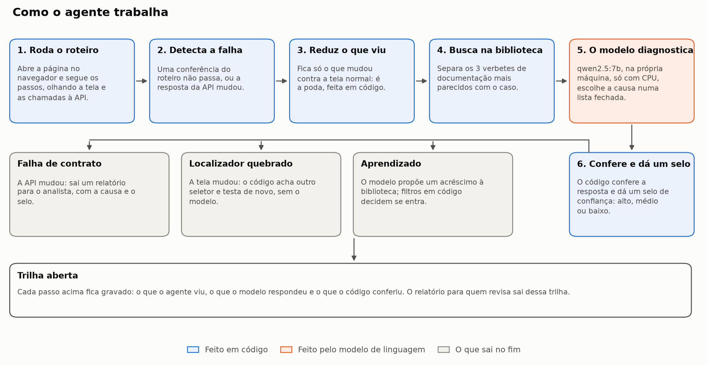

Fonte: elaborado pelos autores.

**Como ler:** siga as setas a partir do passo 1. O azul é código comum, que dá sempre o mesmo resultado, e o laranja é o passo em que o modelo responde. As caixas cinza são o que sai no fim, e a trilha, embaixo, guarda tudo para quem for revisar. O modelo dá a opinião, e o código confere.

## 5.1 Etapas do Trabalho

<!-- ! Alteração de IA - Revisar: (05/11/2026, versão 2) estado da Fase 4 até 05/11/2026, no texto e na tabela (data do título e linhas das Fases 4 e 5): P0 a P8 e corridas 16 a 22 feitos e lidos, corridas 18c, 21c, 23 e 24 pendentes.
     ! Motivo: a tabela ainda dizia P0 a P4 e corridas 16 a 19; o roadmap §1 registra a fase em andamento, com o que as decisões 90 a 92 acrescentaram antes da Fase 5. -->
<!-- ! Alteração de IA - Revisar: (24/11/2026, Fase 5, pacote F6) a última frase do parágrafo e a linha da Fase 5 na tabela passaram de "medirá" e "Não iniciada" à etapa medida e lida (corrida 28b e as três sessões); o título da tabela passou a dizer que a linha da Fase 5 é de 24/11/2026 e as outras, de 05/11/2026.
     ! Motivo: a tabela dizia que a Fase 5 não tinha começado, e o roadmap §1 registra a medida feita e lida em 24/11/2026. A frase e a linha da Fase 4, que ainda dão as corridas 18c, 21c, 23 e 24 como pendentes, são do pacote Q8 da Pós-Fase 4 e não foram tocadas; por isso o título separa as duas datas, em vez de datar a tabela inteira de 24/11/2026. -->
<!-- ! Alteração de IA - Revisar: (25/11/2026, Pós-Fase 4, pacote Q8) a Fase 4 passa a concluída e a Pós-Fase 4 entra na descrição das etapas.
     ! Motivo: o parágrafo dizia que a Fase 4 tinha quatro corridas por rodar antes da Fase 5; as corridas 18c, 18d, 18e, 21c, 21d, 23 e 24 rodaram de 05 a 06/11/2026 e a fase fechou em 06/11/2026 (roadmap, seção 1), e a Pós-Fase 4 não aparecia. -->
A execução organiza-se em fases numeradas, cada uma ligada a um objetivo específico da seção 2.2. A Fase 1 preparou o ambiente e as duas aplicações-alvo, com o instalador único, os modos de injeção de falha e o banco de 90 casos (primeiro objetivo). As Fases 2-A, 2-B e 3 compararam os modelos de linguagem locais em três condições, primeiro sem documentação, depois com uma biblioteca de documentação recuperada e, por fim, com a biblioteca editada pelo próprio modelo em épocas atrás de validação em código, e decidiram o modelo e o estado da biblioteca a adotar (segundo objetivo). A Fase 3-B rodou os testes complementares que a análise da Fase 3 pediu: pontes de versão do runtime, casos inéditos, troca cruzada de bibliotecas, sonda de correção, experimento do recuperador e ablação entre modelo base e modelo de instrução. A Pré-Fase 4 foi uma pausa de pesquisa em três frentes antes de levar o agente à tela: modelos grandes lendo os pesos do disco, atlas visual das competências do modelo e raciocínio aberto. A Fase 4 implementou e mediu a filtragem de contexto, a interceptação de rede, o diagnóstico ao vivo e a autocura de localizadores (terceiro e quarto objetivos), e fechou em 06/11/2026, com as corridas 16 a 24 lidas (seção 6.7). A Pós-Fase 4 cuidou do que chega a quem revisa, sem mudar o que o agente mede: o relatório por caso, a árvore de decisão, a barra de progresso, a revisão por um analista de fora do projeto, três experimentos em texto e, depois da Fase 5, o hub de revisão e a seleção de cenários pelo que mudou no Git (seções 5.8 e 6.7) <!-- fonte: roadmap.md §1 -->. A Fase 5 mediu o tempo médio de reparo (MTTR) e o Task Success do agente contra a linha de base manual (quinto objetivo): o agente na corrida 28b, em 18/11/2026, e as pessoas em três sessões, de 18 a 24/11/2026, com a leitura dos dois lados em 24/11/2026 (seção 6.8) <!-- fonte: fase-5-relatorio.md, estado em 24/11/2026, §2.3 e §2.4; roadmap.md §1 -->.

<!-- ! Alteração de IA - Revisar: (25/11/2026, Pós-Fase 4, pacote Q8) tabela das fases com o estado de 25/11/2026: a Fase 4 e a Fase 5 concluídas e a linha nova da Pós-Fase 4.
     ! Motivo: a tabela dava a Fase 4 como em andamento, com corridas pendentes, e não tinha a Pós-Fase 4; o estado vem da seção 1 do roadmap. -->
Tabela: Fases do trabalho, o que cada uma mede e o estado em 25/11/2026
| Fase | O que é | Estado |
|---|---|---|
| 1, ambiente e cobaias | Instalador único, CobaiaFront (PHP legado) e CobaiaAPI (FastAPI) com 7 modos de injeção de falha, banco de 90 casos | Concluída |
| 2-A, prompts sem documentação | 6 modelos e estratégias de prompt, na máquina de desenvolvimento | Concluída |
| 2-B, biblioteca recuperada | 6 modelos nas condições A0 a A2 e 3 deles nas A3 a A5, na máquina-alvo | Concluída (07 a 09/09/2026) |
| 3, biblioteca gerida pelo modelo | 4 modelos, 3 épocas, 90 casos (13 a 15/09/2026, 57h59 de máquina) | Concluída e analisada; decisão 52 |
| 3-B, testes complementares | Pontes de versão, casos inéditos, troca cruzada, sonda de correção, recuperador e ablação | Concluída (21/09 a 06/10/2026, mais as corridas 14 e 15 de 23/10/2026) |
| Pré-Fase 4, pesquisa | Modelos grandes pelo disco, atlas das competências, raciocínio aberto | Concluída em 26/10/2026 |
| 4, agente na tela | Interceptador Playwright, poda em código, diagnóstico ao vivo, cura de seletor, biblioteca em produção com ciclo de correção | Concluída em 06/11/2026: pacotes de trabalho P0 a P8 e corridas 16 a 24 feitos e lidos; regra R2 cumprida no limite exato na corrida 18d, pela leitura fixada antes dela (decisão 98) |
| Pós-Fase 4, o que chega ao analista | Relatório por caso no molde do relatório de defeitos do syllabus CTFL 4.0, camada de leitura dos verbetes, filtros de texto em código, árvore de decisão, barra de progresso, revisão humana, hub de revisão e seleção de cenários pelo Git | Pacotes Q0 a Q7 feitos de 07 a 25/11/2026, com as corridas 25, 26 e 27 lidas em 16/11/2026; nenhuma medida mudou o agente (seção 6.7) |
| 5, medição de valor | MTTR e Task Success contra linha de base manual, nas duas cobaias | Concluída em 25/11/2026: o agente na corrida 28b (18/11/2026), a frio, e as pessoas em três sessões pela página (18 a 24/11/2026); leitura pelas regras L1 a L15 (seção 6.8) |
Fonte: roadmap do projeto (Memorial), seção 1, estado por fase.
<!-- fonte: roadmap.md §1 (tabela "Onde estamos, por fase"), colunas O que é e Estado -->

## 5.2 Infraestrutura e Orquestração Local

A ferramenta de orquestração do navegador é o Playwright, em Python, com o Chromium que ele mesmo instala. O Playwright comunica-se com o navegador por protocolo nativo e tem suporte embutido à interceptação de chamadas de rede e à leitura da árvore de acessibilidade, o que permite ao agente ver, ao mesmo tempo, o que a tela mostra e o que a API respondeu. O processamento semântico usa um modelo da família Qwen2.5 em variante quantizada, executado integralmente na máquina local pelo runtime Ollama; a quantização reduz a precisão numérica dos pesos do modelo e o consumo de memória a ponto de viabilizar a inferência em CPU, sem GPU dedicada. A comunicação entre o orquestrador e o modelo ocorre pela interface HTTP do próprio runtime, restrita à interface de loopback da máquina, sem exposição à rede externa e sem serviço de tunelamento. O framework FastAPI permanece em uso no projeto, porém no papel de API da aplicação-alvo submetida aos testes.

As medições valem para a máquina-alvo, um notebook corporativo com processador Intel Core i5, 16 GB de memória instalada (o Windows enxerga 15,7 GB, valor citado na seção 6.3), sem GPU utilizável e sem direitos de administrador; o modelo compete por memória com o navegador automatizado, o servidor da aplicação e o banco de dados, e por isso só um modelo é carregado por vez. Para as aplicações-alvo subirem nessa máquina, o instalador do projeto passou a cobrir o PHP instalado pelo gerenciador de pacotes do Windows e um MariaDB portátil na pasta do usuário, sem administrador <!-- fonte: roadmap.md §1, célula da Fase 4 (PHP 8.2.35 pelo winget e MariaDB 11.8.9 portátil) -->. Duas regras de desenho vieram da Fase 3-B e valem para todas as medições seguintes: uma ponte de versão antes de toda medição, porque o runtime de inferência se atualiza sozinho e a mesma configuração pode dar rótulos diferentes entre versões; e o padrão de usar o modelo com a biblioteca que ele mesmo escreveu, porque o ganho da biblioteca não acompanha quando muda quem a lê (decisão 69) <!-- fonte: decisoes.md, decisão 69; roadmap.md §7 -->.

<!-- ! Alteração de IA - Revisar: (25/11/2026, Pós-Fase 4, pacote Q8) parágrafo novo na seção 5.2: como o instalador único é provado em máquina limpa (os quatro níveis e a célula de teste).
     ! Motivo: o documento citava o instalador único desde a Fase 1 e não dizia que ele foi posto à prova fora da máquina do projeto nem como (decisões 138 a 143). -->
O ambiente inteiro sobe por um instalador único: um núcleo em Python, com um lançador para o Windows e outro para o Linux e o macOS, que traz o Python quando ele falta e guarda, num arquivo só, a versão testada e a faixa aceita de cada ferramenta (decisões 139 e 140). A instalação é provada por um comando do próprio instalador, em quatro níveis: o site e a API no ar, com os dados de exemplo (N1); o navegador do agente abrindo a página (N2); o Ollama respondendo com um modelo pequeno (N3); e o modelo do projeto respondendo (N4). Cada sistema é uma célula de teste: a máquina nasce limpa, o instalador roda primeiro como estava, para a falha ficar gravada, e só depois o conserto é escrito, com o teste antes do código (decisão 143) <!-- fonte: relatorio-instalador-maquina-limpa.md §1 e §2 -->.

## 5.3 Aplicações-alvo, Taxonomia e Injeção de Falhas

<!-- ! Alteração de IA - Revisar: (11/11/2026) o parágrafo passa a citar a origem do site legado, o Projeto CHULETA (GONÇALVES, 2024), e a dizer as duas mudanças que este trabalho fez nele; a seção 6.1, o apêndice B e a lista de referências ganharam a mesma citação.
     ! Motivo: o Eric pediu, em 11/11/2026, que o texto do TCC também cite o projeto de onde veio a parte PHP da cobaia (decisão 128). O texto dizia só "cedido por um integrante", sem nome nem endereço, e "mantido sem alteração, salvo a variante de quebra", quando o histórico do Git mostra também o item de menu da aba que lê a API (`Programacao/CobaiaFront/ORIGEM.md`). -->
São utilizadas duas aplicações de características deliberadamente distintas, ambas controladas pelo grupo: uma aplicação monolítica legada em PHP, com renderização no servidor e acesso direto ao banco de dados (CobaiaFront), e uma API JSON em FastAPI consumida por requisições assíncronas (CobaiaAPI). O site legado é o Projeto CHULETA (GONÇALVES, 2024), cedido pelo autor, integrante do grupo, e mantido como veio, salvo o item de menu da aba que lê a API e a variante de quebra da Fase 4, desligada por padrão; a API foi construída para o projeto. A primeira exercita a abrangência do agente frente a sistemas legados; a segunda concentra os cenários de quebra de contrato, objeto central do trabalho.

As quebras de contrato são simuladas, de forma dominante, por injeção determinística de falhas por modo: a aplicação-alvo expõe modos de falha fixos, e cada cenário é gravado como caso fixo, de modo que o mesmo caso seja idêntico entre modelos e entre rodadas. A Fase 1 entregou 7 modos de injeção na CobaiaAPI e a Fase 4 acrescentou 14 modos novos, para que a tela reproduza as causas que antes só existiam no caso escrito <!-- fonte: roadmap.md §1 (Fase 1: 7 modos; Fase 4: 14 modos novos na CobaiaAPI) -->. Técnicas de fuzzing (injeção de dados anômalos) e de mutação dinâmica ficam reservadas a fases posteriores, como complemento, e não como base da comparação.

<!-- ! Alteração de IA - Revisar: (05/11/2026, versão 2) os 36 inéditos da Fase 4 deixam de contar como parte de um conjunto de 108 casos já avaliado: até aqui eles só passaram pela reprodução na tela, e a corrida 24 está pendente (decisão 92).
     ! Motivo: a ficha 44 mostra que nenhuma corrida com modelo leu esses 36 e que a conferência prevista não está registrada; sem a correção, o documento diria que a Fase 4 avaliou 108 casos, quando os resultados com modelo falam em 72 (fase-4-relatorio.md §12). -->
<!-- ! Alteração de IA - Revisar: (25/11/2026, Pós-Fase 4, pacote Q8) os 36 inéditos da ficha 27 passam a lidos e conferidos.
     ! Motivo: a frase dizia que nenhuma corrida com modelo tinha lido esses casos e que a conferência e a corrida 24 estavam pendentes; a conferência foi feita em 06/11/2026 (decisão 100) e as corridas 18e e 24 rodaram no mesmo dia. -->
Os casos seguem uma taxonomia de 23 causas raiz, nomes de domínio que o modelo escolhe de uma lista fechada, organizadas em seis classes inspiradas nas fases de um compilador (léxica, sintática, semântica, tradução, tempo de execução e efeito) e em três níveis de dificuldade, do sinal local e explícito ao defeito que só aparece cruzando duas requisições ou a requisição contra a tela. A taxonomia completa está no Apêndice A. O banco oficial tem 90 casos fixos, divididos em 54 casos de aprendizado, nos quais o modelo recebe a causa correta e pode propor edições na biblioteca, e 36 casos de avaliação, que nunca recebem retorno. A Fase 3-B acrescentou 36 casos inéditos, nunca vistos por nenhum modelo nem por nenhuma biblioteca, que, com os 36 de avaliação, formam os 72 casos de avaliação usados na Fase 4 <!-- fonte: fase-4-relatorio.md §3; pendencias.md ficha 44 -->. A Fase 4 criou outros 36 inéditos (ficha 27), para o conjunto chegar a 108 casos. Eles foram conferidos por um dos autores, que leu um a um os 10 apontados por uma pré-análise e passou os olhos nos outros 26, sem mudar nenhum (decisão 100); os 25 que reproduzem na tela foram lidos na corrida 18e, e os 36, em texto, na corrida 24 (seção 6.7) <!-- fonte: decisoes.md decisão 100; roadmap.md §2.21 e §2.22 --> <!-- fonte: roadmap.md §4.6 ("mais 36 inéditos (108 casos)") e §2, linha 24; pendencias.md fichas 27 e 44; fase-4-relatorio.md §12 -->.

## 5.4 Escolha do Modelo e da Biblioteca de Documentação

A escolha do modelo e do seu porte foi definida experimentalmente, por comparação entre as variantes sob o mesmo hardware, segundo uma regra fixada antes da execução dos testes (decisões 36 e 46): a acurácia balanceada do diagnóstico nos casos de avaliação nunca vistos pelo modelo, com veto às configurações em que a biblioteca editada pelo próprio modelo reduza acertos anteriores (autoenvenenamento) e desempate pela licença de uso. Latência por inferência e pico de memória entram na análise de robustez da escolha (fronteira de custo contra acerto e sensibilidade aos pesos), e não como critério primário.

O regime de biblioteca mantida pelo próprio modelo, discutido na seção 4.1.6, foi submetido a teste na Fase 3: cada modelo avaliado recebe uma cópia própria da biblioteca, permanecendo a original (L0) intocada como ponto de partida comum. A edição autorizada é apenas por acréscimo (nota em um item existente, retificação que aponte o trecho equivocado ou item novo), nunca por remoção, de modo que toda alteração permaneça auditável pela comparação entre versões sucessivas. Nenhuma proposta de edição é incorporada sem passar antes por uma conferência escrita em código, e não pelo julgamento de outro modelo de linguagem. O ciclo é repetido por três épocas, guardando-se a cópia da biblioteca ao final de cada uma (L1, L2 e L3), para que o desempenho possa ser lido época a época. A recuperação dos verbetes no momento do diagnóstico usa a função de ordenação lexical BM25 com sinais calculados em código, com k igual a 3 verbetes por consulta, valor escolhido na Fase 4 depois de medir k igual a 3 e k igual a 5 na calibração <!-- fonte: roadmap.md §4.6 (k = 3 e k = 5 medidos na calibração) e §2.9 -->.

Uma amostra das edições aceitas na biblioteca, até trinta por modelo, sorteadas de forma determinística, foi avaliada segundo rubrica escrita previamente (correta, parcial ou errada): a rubrica é aplicada em primeira passada por um assistente de inteligência artificial, que confere cada edição contra o código da aplicação-alvo, e ratificada por um único revisor do grupo; por haver um só revisor, o resultado é reportado como proporção, sem medida de concordância. A cópia da biblioteca L1 do modelo escolhido foi curada para uso em produção, com o veredito de cada edição dado em primeira passada por um assistente de inteligência artificial e conferido por um integrante do grupo (decisão 60): 23 das 40 edições foram mantidas <!-- fonte: roadmap.md §7 (curadoria da cópia L1 em biblioteca_producao/) -->, e a cópia curada foi medida antes de ser usada (decisão 71).

<!-- ! Alteração de IA - Revisar: (05/11/2026, versão 2) seção 5.5 conferida contra o que rodou (item 10 da seção 15 do relatório da Fase 4): título com a biblioteca em produção; só as corridas na tela levam o trecho da poda ao prompt; o corte do caso ao vivo que a decisão 90 manda fazer antes da Fase 5; parágrafo novo da biblioteca em produção (filtros da decisão 65, regra R5, recuperação por id e ciclo de correção); o trace que não foi feito; parágrafo novo da avaliação da trilha; e o prompt, que o texto dizia congelado "desde a Fase 3", passa a ser descrito como é.
     ! Motivo: o texto dizia que a poda reduz o que vai ao modelo em todo caso, o que a decisão 89 mostrou não valer para os casos de texto, e não descrevia o método das corridas 20 e 22. A recuperação por id foi conferida no código: só o modo biblioteca de executar_fase4.py e a sonda de correção passam os verbetes do caso ao contexto. O revisor da versão 2 apontou a divergência sobre o prompt (texto "desde a Fase 3", ficha 34 "desde a Fase 2-A"); a comparação do corpo das funções em cada commit de estrategias.py mostrou que linear não muda desde o primeiro commit e linear_com_biblioteca, desde que foi criada, antes da corrida da Fase 2-B. -->
## 5.5 Diagnóstico ao Vivo, Biblioteca em Produção e Trilha de Raciocínio Aberta

<!-- ! Alteração de IA - Revisar: (25/11/2026, Pós-Fase 4, pacote Q8) os três ajustes do caso ao vivo feitos depois das primeiras corridas na tela (decisões 90, 96, 97 e 99), no passado.
     ! Motivo: a frase anunciava o corte do caso ao vivo como coisa a fazer antes da Fase 5 e não trazia os sinais novos da busca nem o teto das listas, que são o agente das leituras vigentes (corridas 18d e 21d). -->
Na Fase 4 o diagnóstico deixa o caso escrito e passa a ser feito sobre a tela. O fluxo de um caso é o seguinte: o navegador executa um roteiro de teste; o interceptador grava cada chamada de rede e a árvore de acessibilidade da página; a poda em código reduz a árvore e o corpo da resposta ao que importa para o passo em curso, encurtando listas e textos longos sem suprimir chaves nem tipos, porque a quebra de contrato se manifesta na forma do dado, e não na sua quantidade; o caso ao vivo é montado com o sintoma descrito por molde e com o que mudou contra uma corrida de referência em modo normal (forma e contagem da lista, itens a menos, a mais ou repetidos, valores item a item e o tempo da chamada), no corpo e no sintoma (decisão 81); a recuperação traz os verbetes da biblioteca; e o modelo responde com o prompt congelado byte a byte, o prompt linear da Fase 2-A com o bloco da biblioteca da Fase 2-B, para que os resultados continuem comparáveis <!-- fonte: estrategias.py (corpo de linear sem mudança desde o commit 0f4b010e e de linear_com_biblioteca desde o 603c423e, comparados por script); pendencias.md ficha 34 -->. Só nas corridas na tela o trecho da poda vai ao prompt: nos casos lidos do arquivo (fixture), o prompt leva o corpo inteiro, e a poda não chega ao modelo, porque só alimenta a trilha, a tabela do contrato e a justificativa do relatório (decisão 89) <!-- fonte: decisoes.md decisão 89; fase-4-relatorio.md §9.6 -->. Três ajustes vieram depois das primeiras corridas na tela, todos em código e nenhum no prompt fixo. O caso ao vivo foi encurtado para o prompt caber no limite do plano (seção 5.7): o corte alcança a árvore, a linha OBSERVAÇÃO ADICIONAL e as listas de itens a menos e a mais do sintoma, e a árvore podada inteira continua na trilha (decisão 90). A busca na biblioteca passou a ler o corpo inteiro da resposta e a usar o que o caso mede contra a referência em modo normal, traduzido em código para as palavras dos verbetes, sem nada a mais no prompt (decisões 96 e 97). E as listas do caso ganharam um teto, com até 3 identificadores por cláusula e o restante como contagem (decisão 99) <!-- fonte: decisoes.md decisões 90, 96, 97 e 99 --> <!-- fonte: decisoes.md decisão 90 -->.

A resposta do modelo tem quatro linhas conferidas em código (CAUSA_RAIZ, CAMPO, IMPACTO e FONTE: a causa raiz, o campo afetado, o impacto para o usuário e os verbetes da biblioteca que o modelo diz ter usado), e a probabilidade é lida no primeiro token do rótulo da causa, antes de qualquer amostragem. Essa probabilidade é o sinal de triagem para revisão humana: a Pré-Fase 4 mediu que a probabilidade conjunta dos tokens do rótulo separa acertos de erros com área sob a curva ROC (AUROC) de 0,78 <!-- fonte: roadmap.md §7 (confiança pela probabilidade do rótulo, AUROC 0,78, corrida 12) -->, e a Fase 4 a usa como selo de confiança em três faixas (alto, médio e baixo), com os limiares lidos da curva risco-cobertura na corrida de calibração, não escolhidos à mão. A saída restrita por gramática (lista fechada das causas imposta na decodificação) foi adiada, porque a literatura mostra que a restrição muda a probabilidade do rótulo, o único sinal interno barato do projeto (decisão 78).

A biblioteca em produção parte da cópia curada da L1 e cresce só por acréscimo. Nos casos de aprendizado, o modelo diagnostica e, na continuação do mesmo prompt, propõe edições. Cada proposta passa pelo validador da Fase 3 e, depois dele, pelos 13 filtros em código da decisão 65, sem chamada adicional ao modelo para julgá-la: evidência obrigatória, atomicidade, abstenção válida, fonte confiável, granularidade, peso por tipo de edição, redundância, proveniência, auditoria por etapa, resolução determinística de conflito, métricas por rodada, revisão humana amostral e a regra dos 40%, que segura para revisão humana a nota em verbete presente em 40% ou mais dos contextos da calibração <!-- fonte: biblioteca_fase4.py (cabeçalho e FILTROS); fase-4-relatorio.md §7, bloco tb_f4_biblioteca_filtros; decisoes.md decisão 65 -->. O lote é reavaliado nos 36 inéditos da Fase 3-B e entra se o número de casos que passam a acertar for maior ou igual ao dos que passam a errar (regra R5); senão, fica em espera com o motivo <!-- fonte: plano-aprovado-fase-4.md §5 (R5) -->. A revisão do lote decide o que é promovido: as edições marcadas como erradas não entram, e os verbetes aprendidos que a busca nunca entregou saem do índice para uma pasta de espera, sem ser apagados (ficha 32) <!-- fonte: roadmap.md §2.12; pendencias.md ficha 32 -->. Nos casos de aprendizado e na sonda de correção, a recuperação por id leva ao contexto, depois dos verbetes da busca, os verbetes ligados ao caso pelas notas ou pelo caso de origem, sem depender da busca por palavras; as demais corridas de diagnóstico usam só a busca <!-- fonte: biblioteca_fase4.py (verbetes_do_caso e com_recuperacao_por_id); executar_fase4.py (modo biblioteca); roadmap.md §2.12 -->. O ciclo de correção também é em código: cada verbete de defeito tem um estado (não corrigido ou corrigido), o gatilho marca a correção só com a reexecução passando e com o fio e a árvore mudados entre a corrida que falhava e a que passou, e a operação acrescenta as seções de solução sugerida e de solução aplicada, com data, sem remover texto (regra R4) <!-- fonte: plano-aprovado-fase-4.md §3.7; biblioteca_fase4.py (cabeçalho); fase-4-relatorio.md §7 -->.

<!-- ! Alteração de IA - Revisar: (25/11/2026, Pós-Fase 4, pacote Q8) o trace na falha passa a feito na Pós-Fase 4, e a remissão vai para a seção 5.8.
     ! Motivo: a frase dizia que a interface para o analista estava prevista para depois da Fase 4 e remetia à Conclusão; o relatório, a árvore e o hub foram feitos e estão descritos na seção 5.8. -->
<!-- ! Alteração de IA - Revisar: (26/11/2026, Pós-Fase 4, pacote Q8) a frase do trace passa a dizer que ele foi gravado numa corrida com as aplicações-alvo.
     ! Motivo: até a corrida curta de 25/11/2026 (ficha 99) o trace só tinha sido provado numa página local que falha de propósito; a corrida gravou 8 traces, um por cenário em que o roteiro falhou. -->
Tudo o que o agente faz fica numa trilha de raciocínio aberta, especificada na Pré-Fase 4 e aprovada como base da Fase 4 (decisão 77): um arquivo de linhas JSON com cabeçalho de corrida; três camadas em cada nó (o que o programa fez, o que o modelo declarou e o que o código conferiu); um nó por decisão, com as alternativas consideradas, a evidência de cada uma, o contraste, a divergência entre o declarado pelo modelo e o medido pelo código e a probabilidade do rótulo; conferências em código; intervenções e atribuição ao contexto por gatilho ou por amostra; uma justificativa por molde, que não deixa o modelo escrever prosa livre sobre a própria decisão; uma taxonomia de falhas do próprio agente; e regressão contra trilhas de referência. Da trilha sai um relatório por caso para o desenvolvedor, em seis seções em ordem fixa <!-- fonte: Memorial, índice (especificacao-trilha-e-relatorio.md); roadmap.md §1, célula da Fase 4 (P1) -->. Das evidências previstas, o trace do Playwright gravado só na falha (ficha 33), a gravação passo a passo que o navegador faz do roteiro, não foi feito na Fase 4: as corridas guardam a árvore, o corpo e os eventos na própria trilha, e a Fase 5 rodou sem trace (decisão 93). Ele entrou depois, com o hub de revisão, como opção desligada por padrão, e foi gravado pela primeira vez com as aplicações-alvo numa corrida curta, em 25/11/2026 (seção 6.10.12). A trilha é também a matéria-prima do que a Pós-Fase 4 entrega a quem revisa (seção 5.8).

A própria trilha é avaliada nos 36 casos oficiais de avaliação, lidos do arquivo e sem gabarito no agente, com três perguntas da especificação: se a divergência sinalizada coincide com os erros reais; se a trilha aponta o nó certo quando verbetes, contratos e seletores são mutados; e se o relatório ajuda um revisor humano, pelo acerto da localização do erro, pelo tempo até a decisão e pela adesão apropriada (aceitar o diagnóstico quando está certo e recusar quando está errado), com a utilidade percebida como medida secundária <!-- fonte: especificacao-trilha-e-relatorio.md §12; fase-4-relatorio.md §9 -->. Nessa avaliação, as três intervenções em código (remover o verbete citado, trocá-lo por um verbete errado e refazer a inferência sem documentação) e a repetição da inferência de base rodam em todos os casos, porque os 36 são a amostra fixa; fora da avaliação, as intervenções só rodam por gatilho, quando a probabilidade do rótulo é baixa ou a FONTE diverge <!-- fonte: especificacao-trilha-e-relatorio.md §6.1; fase-4-relatorio.md §9.1 -->. A sonda de pós-racionalização planta um trecho que afirma a causa respondida num verbete entregue que a FONTE não citou, e a repetição da base, sem nada plantado, é o controle; isso mede a consistência da FONTE, não fidelidade ao que o modelo faz por dentro <!-- fonte: fase-4-relatorio.md §9.2 -->.

## 5.6 Cura de Seletor

<!-- ! Alteração de IA - Revisar: (05/11/2026, versão 2) frase nova sobre a verificação dos candidatos numa página refeita quando há diagnóstico no meio.
     ! Motivo: a corrida 21 mostrou que a página da detecção pode mudar enquanto o modelo pensa (recarregamento de 30 s da tela de login), e o conserto `Cura._refazer_ate_o_passo` mudou o método dos cenários; a seção descrevia só o fluxo da corrida 19, sem modelo. -->
A cura de seletor trata a quebra de localizador, a primeira família de falha da seção 1.1. Em cada célula do experimento, uma corrida de referência registra o alvo de cada passo do roteiro; a quebra é então armada de duas formas, comparadas entre si (decisão 80): pelo próprio ambiente de teste, que muda o DOM da página no navegador antes de o roteiro rodar, e por uma variante do front-end PHP, ligada só por parâmetro de URL ou cookie, que entrega o HTML já alterado. Quatro modos de quebra são usados: identificador renomeado, classe trocada, texto alterado e estrutura alterada. O roteiro roda até o passo do alvo falhar (detecção); seis estratégias geram candidatos a localizador a partir da árvore de acessibilidade podada (papel e nome, papel e nome parecido, texto contido, atributo de dados, caminho a partir de um ancestral com identificador e posição entre irmãos); cada candidato passa por quatro verificações estáticas em código na página aberta, e o primeiro que passa é aplicado numa reexecução do roteiro desde o começo, com a quebra armada de novo. O roteiro chegar ao fim é a cura (regra R3), e a impressão do elemento no DOM (tag, tipo, nome, ação do formulário, atributo de dados e endereço) diz se o candidato resolveu o mesmo elemento da referência ou outro <!-- fonte: roadmap.md §2.11 (protocolo da corrida 19) -->. O MTTR do agente é medido da detecção à reexecução validada, descontado o tempo de restaurar o banco entre as duas; a linha de base manual é a Fase 5. Com um diagnóstico no meio, como nos cenários da Fase 5, os candidatos são verificados numa página nova, refeita até o passo que falhou com a quebra armada, e o tempo de refazer entra no MTTR, porque a página da detecção pode mudar sozinha enquanto o modelo pensa (seção 6.7) <!-- fonte: roadmap.md §2.13; fase-4-relatorio.md §8 -->.

## 5.7 Métricas, Inferência Estatística e Regras Pré-registradas

<!-- ! Alteração de IA - Revisar: (11/11/2026) cada método desta seção passa a vir com um resumo na chamada, com o que o projeto faz de diferente e com a citação original: acurácia balanceada (Brodersen et al., 2010), Wilson (1927), McNemar (1947), Q de Cochran (1950), Holm (1979), g de Cohen (1988), e o efeito mínimo detectável, que a seção 6.4 usava sem definir. O mesmo foi feito na primeira chamada da AUROC (seção 4.1.9), do BM25 (seção 4.1.8) e da reamostragem (seção 6.10.3), e as referências entraram na lista.
     ! Motivo: o Eric pediu, em 11/11/2026, que todo método tenha um pequeno trecho que o resuma onde é chamado, com a explicação de cada ponto em que o projeto diverge do método e a citação necessária. A seção citava os métodos pelo nome, com a fonte de quem os recomenda, mas sem dizer o que cada um faz nem a fonte original. O que o projeto faz em cada teste foi lido no código (`avaliar.py`: `wilson`, `mcnemar_exato`; `avaliar_fase3.py`: `cochran_q`, `holm`, `g_cohen`, `efeito_minimo_detectavel`), e as referências originais foram conferidas em 11/11/2026 (bloco "Métodos clássicos de medida" de `referencias.md`). -->
A métrica primária de comparação entre modelos e entre versões da biblioteca é a acurácia balanceada (BRODERSEN et al., 2010), isto é, a média das revocações obtidas em cada classe: calcula-se o acerto dentro de cada causa raiz e tira-se a média, de modo que todas as causas pesam o mesmo, qualquer que seja o número de casos de cada uma. A escolha é justificada, e não herdada: Opitz (2024) mostra que acurácia, F1 micro, macro e ponderada, kappa e coeficiente de correlação de Matthews diferem sistematicamente em viés e em sensibilidade à prevalência das classes, de modo que a métrica principal precisa ser argumentada e acompanhada das demais; e Collot et al. (2026) demonstram que a acurácia balanceada é a métrica alinhada à comparação de modelos sob desbalanceamento, por não depender da escolha arbitrária de uma classe positiva, propriedade decisiva aqui, porque o modo de falha previsto é o colapso do modelo em um único rótulo, que a acurácia simples não distingue de acerto genuíno.

Toda proporção é reportada com intervalo de confiança de 95% pelo método de escore de Wilson (WILSON, 1927), e não pelo intervalo de Wald. O intervalo de confiança é a faixa em que a proporção verdadeira provavelmente está, dado o número de casos medidos. O de Wald, o mais difundido, soma e subtrai uma margem em torno da proporção observada; o de Wilson é obtido invertendo o teste da proporção, o que o mantém entre 0% e 100% e mais perto da cobertura prometida quando os casos são poucos ou a proporção fica perto dos extremos. A troca é justificada: Bowyer, Aitchison e Ivanova (2025) medem que, com cerca de cem itens, o intervalo de Wald entrega apenas 92,5% de cobertura real, degradando em amostras menores.

Como todos os contrastes incidem sobre os mesmos casos, a comparação entre duas condições usa o teste de McNemar (McNEMAR, 1947). O teste deixa de lado os casos em que as duas condições concordam e olha só os discordantes: conta os que só a condição nova acertou (b) e os que só a antiga acertou (c), e calcula a probabilidade de uma divisão tão desigual entre b e c aparecer por acaso, que é o valor-p. O projeto usa a forma exata do teste, bilateral e calculada pela distribuição binomial, e não a aproximação mais difundida, porque os casos discordantes são poucos (RASCHKA, 2018). Para as quatro versões da biblioteca (L0 a L3), o teste conjunto é o Q de Cochran (COCHRAN, 1950), a extensão do teste de McNemar para mais de duas condições medidas nos mesmos casos: ele responde, de uma vez, se alguma das versões difere das outras. Quando ele é significativo, seguem as comparações par a par com correção de Holm (HOLM, 1979), que ordena os valores-p do menor para o maior e aperta o corte de cada um, para que a chance de ao menos um falso positivo no conjunto das comparações não passe do nível escolhido; García e Herrera (2008) apontam o procedimento como mais potente que as alternativas conservadoras de uso corrente (suporte parcial na revisão da literatura: a leitura do artigo quanto ao conjunto exato de procedimentos comparados permanece a conferir). Ao lado de cada valor-p é reportado o tamanho de efeito pelo g de Cohen (COHEN, 1988), a parcela dos casos discordantes que favorece a condição nova, menos 0,5. O projeto usa a forma com sinal, em que zero indica trocas que se anulam, +0,5 indica que toda troca foi para melhor e −0,5, que toda troca foi para pior (MANGIAFICO, 2024; suporte parcial na revisão da literatura: as duas implementações consultadas definem o g de formas diferentes, uma com sinal e outra sem). Como a amostra é pequena, a leitura traz ainda o efeito mínimo detectável: a menor diferença, em pontos percentuais, que o teste de McNemar exato consegue apontar como significativa a 5% com aquele número de casos, supondo que um quinto deles discorde entre as duas condições. É a régua que impede ler "sem diferença significativa" como "sem efeito". Além do acerto agregado, é contabilizado o número de trocas de rótulo (*flips*), casos individuais que mudam de resposta entre duas condições ainda que a média se mantenha: Dutta et al. (2024) medem que até 13,6% das respostas individuais trocam de rótulo entre esquemas de quantização do mesmo modelo com diferença de acurácia de até dois pontos percentuais. A comparação entre etapas só é feita com prompts idênticos, byte a byte: Sclar et al. (2024), avaliando 320 formatos semanticamente equivalentes em cerca de 53 tarefas, medem variação de até 76 pontos de acurácia e amplitude mediana de 6,4 pontos decorrentes apenas do formato do prompt.

<!-- ! Alteração de IA - Revisar: (05/11/2026, versão 2) o MTTR e o Task Success passam a ter o critério da ficha 35 por tipo de cenário, a linha de base fica como no protocolo (três integrantes, cada um nos dez cenários; as cinco repetições são do agente), e entram a medida TPR vezes TNR e, no parágrafo das regras, a regra R1 como rodou e o limite do prompt da seção 3.3 do plano.
     ! Motivo: o texto definia o MTTR só como reexecução validada, o que não existe nas quebras de contrato (a ficha 35 fixou que nelas o resultado é o diagnóstico conferido em código), atribuía as cinco repetições à sessão manual e citava as regras R1 a R8 sem dizer que a R1 rodou mais larga que o texto do plano (fase-4-relatorio.md §3). -->
<!-- ! Alteração de IA - Revisar: (24/11/2026, Fase 5, pacote F6) na última frase do parágrafo, "serão resolvidos" e "o agente roda" passaram ao passado.
     ! Motivo: a frase falava da linha de base manual e da noite do agente como coisas por fazer, e as duas foram medidas (corrida 28b em 18/11/2026; sessões de 18 a 24/11/2026). Nenhuma definição do parágrafo mudou. -->
Para a autocura e a medição de valor, o Tempo Médio de Reparo (MTTR) é o intervalo entre a detecção da falha pelo agente e a restauração verificada do fluxo de execução, isto é, o instante em que a correção proposta é validada com sucesso na reexecução. O Task Success é a proporção de cenários em que o fluxo foi restaurado e o roteiro de teste concluiu sem erro, sobre o total de cenários de falha injetados. Essas definições valem para a quebra de localizador, a única que tem cura. Nas quebras de contrato o agente não corrige a API, ele diagnostica; por isso, nesses cenários, o resultado é o diagnóstico conferido em código (quatro linhas válidas, causa dentro das 23 e campo existente no caso), o MTTR vai da detecção até esse diagnóstico e o Task Success é o diagnóstico com a causa e o campo certos (ficha 35, decisão 79). Os dois MTTR não medem a mesma coisa, e a leitura os separa por tipo de cenário <!-- fonte: pendencias.md ficha 35; fase-4-relatorio.md §8 -->. Como grupo de controle, na Fase 5 os mesmos dez cenários, seis de contrato e quatro de localizador (ficha 36), foram resolvidos manualmente por três integrantes do grupo, cada um nos dez cenários, com o tempo cronometrado desde a apresentação da falha até a correção do teste; o agente rodou os dez cenários com cinco repetições cada, com o banco de dados restaurado ao estado inicial entre execuções, o modo de falha fixado por cenário e a versão do navegador mantida constante pelo próprio orquestrador <!-- fonte: Projeto de Pesquisa V3 §3.4; protocolo-linha-de-base-manual.md §1 e §2; fase-4-relatorio.md §8 e §11 -->.

<!-- ! Alteração de IA - Revisar: (16/11/2026, Fase 5, adiantamento do pacote F6) cinco parágrafos novos com o método da linha de base manual como o protocolo versão 3 o prevê: quem participa e o perfil; o tutorial e o treino sem cronômetro; a sessão por uma página publicada, com o material de cada cenário capturado antes; o limite de 10 minutos e como o tempo é gravado; e como a sessão é trazida para a máquina-alvo e conferida. O parágrafo acima, de 05/11/2026, fica como está. Em 17/11/2026, o quarto e o quinto parágrafos ganharam uma frase cada um sobre o aviso do integrante de que algo de fora atrapalhou um cenário (decisão 137).
     ! Motivo: o texto dizia só que três integrantes resolveriam os dez cenários com o tempo cronometrado, e desde então o protocolo mudou (decisões 131, 135 e 136): o tempo deixou de ser anotado à mão, entraram o perfil, o treino e o tutorial, e a sessão passou a ser feita por uma página, sem facilitador ao lado. Sem estes parágrafos o leitor não saberia como o tempo das pessoas é obtido nem por que ele pode ser posto ao lado do MTTR do agente. As sessões ainda não aconteceram: o texto descreve o que o protocolo prevê, a forma presencial ficou como reserva, e a redação final é acertada no pacote F6, depois das sessões. Nenhum número de resultado entra aqui. As duas frases de 17/11/2026 entraram porque a página e o comando que traz a sessão mudaram com a decisão 137: sem elas, a descrição do que a página faz no fim de cada cenário e do que o comando pede antes de gravar ficaria incompleta. -->
<!-- ! Alteração de IA - Revisar: (24/11/2026, Fase 5, pacote F6) a frase que dizia que as sessões ainda não tinham acontecido passou a apontar para o parágrafo novo, mais abaixo, que conta como elas aconteceram; a forma presencial aparece como reserva que não foi usada.
     ! Motivo: as três sessões foram feitas de 18 a 24/11/2026, pela página, e trazidas para o registro em 24/11/2026; a frase de 16/11/2026 deixou de ser verdade. -->
A linha de base manual segue um protocolo escrito, na versão 3 desde 16/11/2026 (decisões 131, 135 e 136) <!-- fonte: protocolo-linha-de-base-manual.md, cabeçalho e §11; decisoes.md decisões 131, 135 e 136 -->. O que segue é o que o protocolo prevê, e o último parágrafo desta descrição diz como as sessões aconteceram e o que fugiu dele; a forma presencial da versão 2, na máquina-alvo e com um facilitador ao lado, ficou como reserva e não foi usada. Participam três integrantes do grupo, identificados só por número, porque o repositório é público, cada um nos dez cenários e numa ordem sorteada com semente fixa, para o que a pessoa aprende num cenário se espalhar entre os outros <!-- fonte: protocolo-linha-de-base-manual.md §4, itens 2 e 4; plano-aprovado-fase-5.md §4.1 -->. Antes de começar, cada um responde três perguntas de perfil: quanto tempo de prática tem com teste de software ou com programação para a web, se já usou as ferramentas do desenvolvedor do navegador e se já leu a lista dos dez cenários ou as causas esperadas. Quem já leu a lista não serve de integrante; se não houver substituto, participa, e isso fica declarado na leitura. Ao perfil soma-se uma anotação de quem conduz a medida, que diz se o integrante escreveu ou conhece o código das aplicações-alvo <!-- fonte: protocolo-linha-de-base-manual.md §10 (texto fixo, item 8) e §11; linha_de_base_manual.py (PERGUNTAS_DE_PERFIL e o comando perfil) -->.

Os três recebem o mesmo tutorial, no mesmo dia, antes da primeira sessão (decisão 135). O tutorial explica os quatro combinados (não abrir o repositório, o painel do projeto, o README nem este documento; não conversar com os outros integrantes sobre os cenários; não usar assistente de inteligência artificial; fazer a sessão num computador, com teclado, e de uma vez só), os dois tipos de cenário, como ler o material de um cenário e como responder, e repete as 23 causas com a explicação de uma linha de cada uma (Apêndice A). Ele não traz nome de cenário, modo de falha, página, seletor nem texto das aplicações-alvo: os exemplos são de um sistema inventado, e o exemplo resolvido usa uma causa que não é resposta de nenhum cenário nem do treino <!-- fonte: protocolo-linha-de-base-manual.md §4, item 9; tutorial-do-integrante.md; decisoes.md decisão 135 -->. Antes dos dez cenários há um treino sem cronômetro, com um cenário de contrato e um exercício de seletor que não estão entre os dez, e só no treino a resposta certa é dita. O treino existe para o primeiro cenário medido não cronometrar a pessoa aprendendo a forma da resposta <!-- fonte: protocolo-linha-de-base-manual.md §5 (Treino) e §11; plano-aprovado-fase-5.md §4.3 -->.

A sessão é feita por uma página publicada, uma por integrante, sem ninguém instalar nada (decisão 136). Uma página publicada não alcança as aplicações-alvo nem o navegador da máquina-alvo, e por isso tudo o que precisa rodar é rodado antes: cada um dos dez cenários e o treino são executados na máquina-alvo, sem o modelo, com a falha armada pelas mesmas funções da corrida do agente, e o que o teste e o navegador registraram é guardado. Nos cenários de contrato, guardam-se a chamada à API (status, tempo e corpo) e a foto da tela; nos de localizador, a foto da tela, o HTML da página no passo que quebrou e a posição do elemento desse passo. A captura usa o mesmo navegador e o mesmo estado do banco da corrida 21d, o ensaio vigente dos dez cenários, e um teste confere isso <!-- fonte: protocolo-linha-de-base-manual.md §11 ("O que roda antes, nesta máquina"); sessao_pelo_artefato.py (capturar_material); decisoes.md decisão 136 -->. A página de cada integrante leva o tutorial e, para cada cenário, esse material, a ficha da falha (a frase que a detecção do agente acusou naquele cenário no ensaio), o roteiro do teste passo a passo e, nos cenários de contrato, o contrato esperado e a lista das 23 causas. Ela não leva o nome do cenário, o modo de falha nem a resposta esperada, e a biblioteca do agente não é entregue <!-- fonte: protocolo-linha-de-base-manual.md §5 e §11 ("O que a página leva"); sessao_pelo_artefato.py (dados_da_pagina) -->.

O limite é de 10 minutos por cenário. O tempo de um cenário começa quando a pessoa abre o cenário na página, o equivalente da detecção, onde o MTTR do agente começa. No cenário de contrato, a pessoa escolhe uma causa na lista das 23 e escreve o campo afetado, ou nenhum; a entrega é uma só, o tempo para nela, esteja a resposta certa ou errada, e a página não diz se acertou, porque saber disso mudaria o que a pessoa responde nos cenários seguintes. No de localizador, a resposta é um seletor CSS para o elemento do passo que quebrou: a página o confere contra a fotografia do HTML, o tempo para quando o seletor passa, e a pessoa pode tentar de novo até o limite. A página avisa quando faltam dois minutos e fecha o cenário no limite; o cenário que estoura fica como não corrigido e sem tempo de fim. Com o cenário fechado e o tempo parado, ela pergunta se alguma coisa de fora atrapalhou, para a pessoa avisar do que não é do cenário (regra L14, adiante nesta seção). Cada evento (a abertura do cenário, a entrega, cada tentativa de seletor, o aviso de que algo atrapalhou) é gravado pela própria página, com a hora do relógio do aparelho da pessoa, e ninguém anota horário à mão: como o MTTR do agente, o tempo das pessoas sai de um registro, e não de digitação <!-- fonte: protocolo-linha-de-base-manual.md §6, §7 e §11 ("Como a sessão corre"); linha_de_base_manual.py (LIMITE_S e AVISO_FINAL_S); sessao_pelo_artefato.py (cabeçalho) -->.

A sessão fica guardada em três lugares: no navegador da pessoa, para ela voltar de onde parou; no banco de dados da página, quando a pessoa tem permissão de gravar nele; e num código que a página mostra no fim, para a pessoa enviar. Na máquina-alvo, com as aplicações-alvo no ar, um comando traz a sessão para o registro da linha de base. Se a pessoa deixou algum aviso de que algo de fora atrapalhou, o comando pede antes a decisão sobre a anulação (regra L14, adiante nesta seção). Ele confere a sessão inteira antes de gravar, acha o cenário de cada posição pelo sorteio, refaz em código o resultado dos cenários de contrato pela mesma regra do agente, já que a resposta esperada não está na página, e roda o roteiro de verdade do agente com o seletor que passou na página. É esse resultado que vale: o seletor que passa na página e não passa no roteiro deixa o cenário como não corrigido, sem nova tentativa. Cada integrante entra no registro uma vez só <!-- fonte: protocolo-linha-de-base-manual.md §11 ("Onde a sessão fica guardada" e "Como a sessão vem para cá"); sessao_pelo_artefato.py (eventos_do_registro e importar_sessao) -->. Do registro sai, por comando, a planilha com uma linha por integrante e cenário, e a leitura da Fase 5 recusa a planilha incompleta, fora da ordem do sorteio, com tempo que não fecha com o início, o fim e o desconto, com causa fora das 23 ou com o resultado diferente do que a regra dá <!-- fonte: protocolo-linha-de-base-manual.md §8; plano-aprovado-fase-5.md §4.6; avaliar_fase5.py (conferir_planilha) -->.

<!-- ! Alteração de IA - Revisar: (24/11/2026, Fase 5, pacote F6) parágrafo novo com o que de fato aconteceu nas sessões da linha de base manual, no lugar da frase "Esta descrição é a do protocolo e será acertada depois das sessões", que saiu do parágrafo acima: os dias, como as sessões chegaram, a substituição de um integrante (decisão 149), a sessão que entrou declarada (decisão 150), nenhuma linha anulada, o perfil dos três e a importação.
     ! Motivo: os cinco parágrafos de 16/11/2026 descrevem o que o protocolo prevê, e o texto prometia acertar a descrição depois das sessões. Duas coisas fugiram do protocolo, e o leitor precisa sabê-las antes de ler o resultado, porque a ressalva do Task Success (seção 6.8) vem de uma delas. Nenhum nome é ligado a número ou a página, e o texto não diz quem substituiu quem. -->
As sessões aconteceram de 18 a 24/11/2026, cada integrante no seu aparelho e sem facilitador ao lado, e chegaram pelo código que a página mostra no fim; o banco de dados das páginas ficou vazio, porque quem entra só pelo endereço não grava nele. Duas coisas fugiram do protocolo, e as duas foram decididas antes de qualquer tempo ser aberto. Um dos três integrantes previstos respondeu no perfil que já tinha lido a lista dos cenários, e um quarto integrante do grupo fez a mesma página depois, como substituto e, segundo o grupo, sem ver a sessão da primeira pessoa nem conversar com ela. Entra só a sessão do substituto, que é o que o protocolo manda quando há substituto; a outra ficou guardada como chegou, sem ser trazida para o registro e sem os tempos abertos (decisão 149). Em outra sessão a pessoa também respondeu que já tinha lido a lista, e o treino veio sem o exercício de seletor; não havia substituto, e a sessão entra com as duas coisas declaradas (decisão 150). Nenhuma das três sessões que entram traz aviso de que algo de fora atrapalhou um cenário, e nenhuma linha foi anulada. Pelo perfil, a prática dos três vai de "não muito tempo" a seis meses de programação para a web, dois nunca tinham usado as ferramentas do desenvolvedor do navegador, e nenhum conhece o código das aplicações-alvo. Quando as sessões foram trazidas para o registro, o roteiro de verdade foi rodado com os seletores que passaram na página e não acusou diferença, e a planilha saiu com as 30 linhas preenchidas <!-- fonte: fase-5-relatorio.md §2.4 ("Como as sessões aconteceram", o perfil dos três e a importação); decisoes.md decisões 149 e 150; resultados_alvo/fase5/manual.json, campo linhas (preenchidas, anuladas e anotadas_a_mao) -->.

Para avaliar a própria trilha, a medida é TPR (a parcela dos erros que o sinal pega) vezes TNR (a parcela dos acertos que ele deixa em paz), em que um sinal jogado ao acaso dá 0,250; é a métrica de monitorabilidade usada por Guan et al. (2025) (suporte parcial na revisão da literatura) <!-- fonte: especificacao-trilha-e-relatorio.md §12; fase-4-relatorio.md §9.1; levantamento-2026-10-01-pre-fase-4.md, tópico r5-fidelidade-do-raciocinio, afirmação 12 [parcial] -->.

As corridas da Fase 4 têm regras de leitura pré-registradas no plano da fase, numeradas de R1 a R8, com o que conta como cumprido e o limite a partir do qual o resultado vira limitação declarada; a seção 6.7 reporta cada corrida contra a sua regra. A regra R1, como rodou, é mais larga que o texto do plano: o plano pedia o roteiro falhando no passo esperado e o campo do gabarito no caso ao vivo; as duas primeiras execuções da corrida 17 calibraram a regra, e o código final conta como reprodução a chamada sair do normal (status, contrato, tempo, corpo ou árvore diferentes da referência em modo normal) ou uma conferência do roteiro falhar, sem conferir o campo do gabarito <!-- fonte: plano-aprovado-fase-4.md §5 (R1) e anexo de desvios; fase-4-relatorio.md §3 -->. O plano fixou ainda, fora da numeração, um limite para o prompt na tela: não passar o maior prompt da calibração em mais de 10%; se passar, a poda aperta antes da próxima corrida, o que a decisão 90 fez valer antes da Fase 5 (seção 6.7) <!-- fonte: plano-aprovado-fase-4.md §3.3; decisoes.md decisão 90 -->.

<!-- ! Alteração de IA - Revisar: (16/11/2026, Fase 5, adiantamento do pacote F6) sete parágrafos novos com as regras de leitura da Fase 5 (L1 a L15 do plano da fase): o que é uma medida e por que a unidade é o cenário; como o tempo e o Task Success de cada lado são resumidos; o que acontece com a medida sem fim e com a anulada; o intervalo por reamostragem dos cenários dentro de cada tipo; o teste dos sinais, com o resumo e com o que o projeto faz de diferente (o empate de menos de 5 s e o cenário em que só um lado chegou ao fim); quando a leitura dá veredito; por que não há veredito por tipo de cenário; e o que é só descrição. Os valores de p foram calculados por script com `avaliar.mcnemar_exato`, a função que a leitura usa, e conferidos contra este texto; as 2000 reamostras, os 5 s, os 600 s e os 10 minutos foram conferidos contra as constantes do código. A chamada do teste dos sinais leva a citação original (DIXON; MOOD, 1946), e a entrada dela na lista de referências foi copiada por script de `referencias.md`, pela chave. Em 17/11/2026, o parágrafo da regra L14 passou a dizer como o integrante avisa, na sessão pela página, de que algo de fora atrapalhou um cenário, e como a anulação é decidida quando a sessão é trazida para a máquina-alvo (decisão 137); saiu a frase que dizia que o protocolo ainda não previa esse aviso.
     ! Motivo: a seção trazia as regras da Fase 4 (R1 a R8) e, da Fase 5, só as definições do MTTR e do Task Success. A regra que diz quando um lado foi mais rápido foi fixada no plano da fase em 16/11/2026 (decisões 132 e 133) e escrita em código antes de qualquer medida, e o documento precisa dizê-la antes de trazer os números, para o leitor ver que a comparação não foi escolhida depois de vê-los. Vale aqui o pedido de 11/11/2026: todo método com o resumo e a citação original na chamada. A referência original do teste dos sinais entrou em `referencias.md` em 16/11/2026, conferida no registro do DOI pela sessão que cuida desse arquivo, e este trecho só a copia; a reamostragem já tinha a sua (EFRON, 1979). Nenhum número de resultado entra aqui: a corrida 28 e as sessões ainda não aconteceram. A frase de 16/11/2026 sobre o aviso de falha deixou de ser verdade no dia seguinte: a ficha 77 foi fechada (decisão 137), e o protocolo, o tutorial e a página passaram a ter a pergunta "Alguma coisa de fora atrapalhou este cenário?" no fim de cada cenário; mantida, a frase faria o documento negar o que o protocolo prevê. -->
A Fase 5 também tem regras de leitura pré-registradas, numeradas de L1 a L15 no plano da fase (a letra é de leitura; não são as cópias L0 a L3 da biblioteca), fixadas antes de qualquer medida (decisões 132 e 133) e escritas em código e testadas com dados de mentira antes da noite do agente e da primeira sessão com pessoa <!-- fonte: plano-aprovado-fase-5.md §2 (princípio 1) e §5; decisoes.md decisões 132 e 133; avaliar_fase5.py e testar_fase5.py -->. Uma conta que só for pensada depois de ver os números entra no relatório marcada como exploratória (regra L15). Uma medida do agente é cada uma das 50 execuções, dez cenários com cinco repetições, e uma medida das pessoas é cada uma das 30 tentativas, dez cenários com três integrantes; uma pessoa não repete cenário, porque depois da primeira vez já sabe a resposta (regra L1). A unidade da comparação, porém, é o cenário, e são dez, seis de contrato e quatro de localizador (regra L2). As cinco repetições do agente no mesmo cenário não são independentes entre si, porque o prompt é o mesmo e a temperatura é baixa: quando o ensaio dos dez cenários foi repetido, o rótulo do diagnóstico se repetiu de uma corrida para a outra. Os três integrantes, por sua vez, resolvem a mesma falha. Contar as 50 execuções como 50 medidas independentes daria intervalos estreitos demais, e por isso todo intervalo do tempo e todo veredito tratam o cenário como a unidade <!-- fonte: plano-aprovado-fase-5.md §5, regras L1, L2 e L15; roadmap.md §2, linha da corrida 21c (o rótulo igual ao da 21b nos dez cenários) -->.

Os dois lados são resumidos pela mesma conta. Por execução do agente vale o MTTR que o executor grava, e por tentativa de uma pessoa, o fim menos o início, descontado o tempo de restaurar o banco quando houver. Por cenário, a leitura traz a média das medidas que chegaram ao fim, com o mínimo e o máximo ao lado; no geral e por tipo de cenário, a média das médias dos cenários, e não a média de todas as medidas (regras L3 e L4). O Task Success é contado sobre as 50 execuções e sobre as 30 tentativas, no geral e por tipo, com o intervalo de Wilson de 95%; ao lado vai a contagem por cenário: em quantos dos dez o agente acertou as cinco repetições, e em quantos os três integrantes acertaram (regra L5) <!-- fonte: plano-aprovado-fase-5.md §5, regras L3 a L5; avaliar_fase5.py (resumir_lado) -->.

A execução do agente em que o cronômetro não chega ao fim e a tentativa que estoura os 10 minutos ficam fora da média do tempo e continuam no Task Success, como não corrigidas. Como esse corte esconde o tempo de quem não termina, a leitura traz uma segunda conta, declarada como piso: cada medida sem fim entra com 600 s, o próprio limite, dos dois lados (regra L6). Uma medida das pessoas só é anulada por falha do protocolo anotada na hora, antes de qualquer número ser lido, como equipamento que travou, falha armada errado ou interrupção de fora; as anuladas são contadas à parte e não são substituídas. Do lado do agente nenhuma execução é anulada: o que falhar aparece como falhou (regra L14) <!-- fonte: plano-aprovado-fase-5.md §5, regras L6 e L14; protocolo-linha-de-base-manual.md §8 ("Linha anulada"); avaliar_fase5.py (LIMITE_S e MARCA_ANULADA) -->. A regra foi escrita para a sessão com alguém ao lado, que anota a falha. Na sessão pela página quem avisa é a própria pessoa (decisão 137): no fim de cada cenário, com o tempo já parado e antes de abrir o próximo, a página pergunta se alguma coisa de fora atrapalhou, numa caixa de texto que pode ficar vazia. Conta o que não é do cenário, como o computador ou o navegador que travou, a página que não carregou ou alguém que interrompeu; não conta cenário difícil, dúvida sobre a resposta nem tempo curto. O aviso é gravado com a hora. Quando a sessão é trazida para a máquina-alvo, o comando mostra cada aviso, com a posição do cenário e o texto e sem tempo nenhum, e não grava a sessão enquanto quem conduz a medida não disser, só pelo motivo escrito, quais avisos são falha do protocolo: é assim que a decisão sai antes de qualquer número ser lido. A linha anulada vai marcada para a planilha, com o aviso nas observações, e o tempo e a resposta dela continuam no registro; o cenário sem aviso escrito na hora não pode ser anulado <!-- fonte: protocolo-linha-de-base-manual.md §8 ("Linha anulada") e §11 ("Quando algo de fora atrapalha um cenário"); tutorial-do-integrante.md §3 ("Se algo de fora atrapalhar"); linha_de_base_manual.py (PERGUNTA_DA_OCORRENCIA e a opção de anular do comando importar); sessao_pelo_artefato.py (ocorrencias_da_sessao e importar_sessao); decisoes.md decisão 137 -->.

O Task Success leva o intervalo de Wilson, já descrito. O tempo médio de cada lado e a diferença entre os dois levam um intervalo de 95% por reamostragem, o bootstrap (EFRON, 1979): os cenários são sorteados de novo, com reposição, a média é refeita em cada sorteio, e o intervalo vai do percentil 2,5 ao percentil 97,5 das médias de 2000 reamostras, com semente fixa, para que a conta se repita. O projeto faz duas coisas de diferente. Sorteia os cenários, e não as execuções ou as tentativas, porque a unidade é o cenário. E sorteia dentro de cada tipo, de modo que toda reamostra tenha seis cenários de contrato e quatro de localizador: como o MTTR do contrato e o do localizador não medem a mesma coisa, uma reamostra com outra mistura mudaria a média só por causa da mistura. Por cenário não há intervalo: com cinco ou três medidas, mostram-se o mínimo, a média e o máximo (regra L7) <!-- fonte: plano-aprovado-fase-5.md §5, regra L7; avaliar_fase5.py (reamostrar_por_tipo); avaliar_fase4.py (REAMOSTRAS e SEMENTE_DA_REAMOSTRAGEM) -->.

A comparação do tempo é feita cenário a cenário: a diferença entre o tempo médio das pessoas e o MTTR médio do agente, e a razão entre os dois. No geral, a leitura traz a média das dez diferenças com o intervalo por reamostragem, a razão entre as duas médias e o teste dos sinais (DIXON; MOOD, 1946) <!-- fonte: referencias.md, bloco "Métodos clássicos de medida", chave `DIXON, W. J.` (conferida em 16/11/2026 no registro do DOI no Crossref pela sessão que cuida desse arquivo); a entrada está na lista de REFERÊNCIAS deste documento, copiada por script -->. O teste dos sinais olha só para que lado cada par pendeu, e não para o tamanho da diferença: conta em quantos cenários o agente foi mais rápido e em quantos as pessoas foram, e calcula, pela distribuição binomial, a probabilidade de uma divisão tão desigual aparecer por acaso se nenhum dos lados fosse de fato mais rápido, caso em que cada cenário cairia para um lado ou para o outro com a mesma chance; essa probabilidade é o valor-p. Por usar só a direção, o teste não supõe nada sobre a forma como os tempos se distribuem, o que convém a dez cenários de dois tipos, com tempos que não medem a mesma coisa. O projeto usa a forma exata e bilateral, que é a mesma conta binomial do teste de McNemar exato descrito acima, com os cenários no lugar dos casos discordantes, e faz duas coisas de diferente. O cenário em que a diferença das médias é menor que 5 s conta como empate e sai do teste, porque 5 s é a folga dada ao cronômetro das pessoas, que inclui o tempo de registrar a resposta; no uso comum do teste, só a diferença igual a zero é empate. E o cenário em que só um lado chegou ao fim conta para esse lado no teste e fica fora da média das diferenças; o cenário em que nenhum dos dois lados chegou ao fim também sai do teste (regra L8) <!-- fonte: plano-aprovado-fase-5.md §5, regra L8, e §12, item 10; avaliar_fase5.py (direcao_do_tempo, teste_dos_sinais e EMPATE_S); avaliar.py (mcnemar_exato) -->.

A leitura só afirma que um lado repara mais rápido quando três condições valem juntas: o intervalo de 95% da diferença média não contém zero, o teste dos sinais dá valor-p abaixo de 0,05, e a maioria dos cenários aponta para o mesmo lado que a média. O plano fixou as duas primeiras; a terceira cobre um caso que ele não escreveu, a média de um lado com a maioria dos cenários do outro, e a leitura em código, escrita antes de qualquer medida, ficou com a saída conservadora <!-- fonte: plano-aprovado-fase-5.md §5, regra L9; avaliar_fase5.py (regra_l9: o veredito pede o p abaixo de ALFA e a maioria do mesmo lado da média) -->. Com dez cenários e nenhum empate, a segunda condição pede nove ou dez cenários na mesma direção (p = 0,0215 e p = 0,002); com oito de dez, p = 0,1094 <!-- fonte: avaliar.py (mcnemar_exato), calculado por script em 16/11/2026 com (9, 1), (10, 0) e (8, 2); os mesmos valores estão em plano-aprovado-fase-5.md §5, regra L9 -->. Se o intervalo contém zero, a leitura diz que a diferença está dentro do ruído. Se o intervalo não contém zero e uma das outras duas condições falha, porque o teste não chega a 0,05 ou porque a maioria dos cenários aponta para o lado contrário ao da média, a leitura diz que a média pende para um lado sem que a direção se repita em cenários suficientes, e não dá veredito. Nos três casos os números são mostrados, e a frase de cada caso sai do código, para a conclusão não ser redigida depois de ver os números (regra L9). A segunda conta, a do piso, mostra também o que essa regra daria, com o aviso de que não é o veredito da leitura <!-- fonte: plano-aprovado-fase-5.md §5, regra L9; avaliar_fase5.py (regra_l9 e comparar) -->.

Por tipo de cenário não há veredito, e o motivo é de conta: com seis cenários, o teste dos sinais só chega a 0,05 com os seis na mesma direção (p = 0,0312), e com quatro não chega nunca (quatro de quatro dá p = 0,125) <!-- fonte: avaliar.py (mcnemar_exato), calculado por script em 16/11/2026 com (6, 0) e (4, 0); plano-aprovado-fase-5.md §5, regra L10 -->. Contrato e localizador são mostrados lado a lado, com os intervalos, e o texto não afirma diferença por tipo (regra L10). O Task Success dos dois lados também é mostrado lado a lado, com o intervalo de Wilson; por cenário, compara-se a parcela do agente, sobre cinco, com a das pessoas, sobre três, e o teste dos sinais é feito sobre os cenários em que as duas parcelas diferem. Com menos de seis cenários diferentes o teste não tem como chegar a 0,05 (cinco de cinco dá p = 0,0625), e a leitura diz que não há veredito (regra L11) <!-- fonte: avaliar.py (mcnemar_exato), calculado por script em 16/11/2026 com (5, 0); plano-aprovado-fase-5.md §5, regra L11; avaliar_fase5.py (minimo_de_cenarios_para_veredito) -->. O resto é descrição, e não regra de veredito: em cada cenário, a amplitude entre as repetições do agente e a amplitude entre as pessoas, com a indicação de se as duas faixas se cruzam (regra L12); o tempo das pessoas pela posição na ordem, do primeiro ao décimo cenário de cada uma, para mostrar o aprendizado; o tempo total da execução do agente, que inclui a detecção; uma segunda leitura do tempo só com as medidas que tiveram Task Success, que é a leitura estrita da definição do projeto de pesquisa; e o rótulo do diagnóstico em cada repetição (regra L13) <!-- fonte: plano-aprovado-fase-5.md §5, regras L12 e L13; avaliar_fase5.py (comparar) -->.

<!-- ! Alteração de IA - Revisar: (24/11/2026, Fase 5, pacote F6) parágrafo novo, no fim das regras de leitura da Fase 5, com o que entrou na leitura depois de o plano ser aprovado: a conferência de que a noite do agente rodou a frio, repetição por repetição (decisões 145 e 146), e a conta exploratória sem a sessão de cada integrante (decisão 151).
     ! Motivo: os sete parágrafos de 16/11/2026 trazem as regras L1 a L15 como o plano as fixou, e a leitura que rodou tem duas coisas a mais. Sem dizê-las aqui, o leitor encontraria na seção 6.8 uma noite "a frio" e uma conta "exploratória" que o método não explica, e poderia tomá-las por regra escolhida depois de ver os números. O texto diz que nenhuma das duas muda um veredito e quando cada uma foi fixada. -->
Depois de fixadas as regras, duas coisas entraram na leitura, e nenhuma delas muda um veredito. A primeira é uma conferência de validade da noite do agente, escrita e testada antes da noite que vale. Na primeira noite, a corrida 28, o Ollama guardou o prompt já lido de cada cenário e o reaproveitou nas repetições 2 a 5, o que encurta o tempo do agente; uma falha de verdade aparece uma vez, e nela o agente lê o prompt inteiro. Por isso a noite que vale, a corrida 28b, roda a frio: uma repetição por vez, com o modelo descarregado do Ollama entre elas, depois de uma sondagem curta confirmar que descarregar o modelo apaga o prompt guardado (decisões 145 e 146). A leitura confere, repetição por repetição, que o prompt foi lido de novo: a repetição vale a frio quando a primeira inferência dela não reaproveitou nenhum token do que o Ollama tinha guardado e, no máximo, metade dos tokens de entrada da repetição veio guardada. O limite foi fixado antes da corrida 28b, sobre os registros da corrida 28, e a leitura só grava a noite completa e a frio. É conferência de validade, e não regra de comparação: as regras L1 a L15 não mudaram <!-- fonte: fase-5-relatorio.md §2.3, §4 (bloco tb_f5_agente_frio) e §8 (desvios 29 e 30); resultados_alvo/fase5/agente.json, campo noite.frio (limite_da_parcela_em_cache); decisoes.md decisões 145 e 146 -->. A segunda é uma conta exploratória, das que a regra L15 manda marcar: a comparação refeita sem a sessão de um integrante por vez, com as regras L2 a L11 aplicadas às medidas que sobram (decisão 151). Ela foi pensada depois de ver os números, serve para dizer do que cada veredito depende e não é o veredito da leitura <!-- fonte: fase-5-relatorio.md §6 (bloco tb_f5_medicao_sem_um_integrante) e §8 (desvio 35); resultados_alvo/fase5/medicao.json, campos sem_um_integrante e nota_sem_um_integrante; decisoes.md decisão 151 -->.

<!-- ! Alteração de IA - Revisar: (25/11/2026, Pós-Fase 4, pacote Q8) seção nova 5.8, com o método da Pós-Fase 4: relatório por caso no molde do syllabus, camada de leitura, filtros de texto, árvore de decisão, barra de progresso, revisão humana, os três experimentos em texto, o hub de revisão e a seleção pelo Git; a antiga 5.8 passa a 5.9.
     ! Motivo: o plano da Pós-Fase 4 (pacote Q8) pede o método da fase na seção 5, e o documento não descrevia nenhuma dessas entregas; a revisão humana e a revisão às cegas ficam declaradas como feitas por um analista de QA de fora do projeto, e não por um dos autores (decisões 114, 117 e 129). -->
## 5.8 Relatório por Caso, Árvore de Decisão, Hub de Revisão e Seleção pelo Git

A Pós-Fase 4 muda o que chega a quem revisa, sem mudar o que o agente mede: o prompt, a biblioteca, a busca, a poda e a cura ficam como estavam nas corridas vigentes da Fase 4, e toda saída nova é gerada em código a partir da trilha e dos registros já gravados, sem segunda chamada ao modelo (decisões 101 a 105) <!-- fonte: plano-aprovado-pos-fase-4.md §2 -->. A fase teve duas partes: o que muda a leitura do analista veio antes da Fase 5, e o hub e a integração com o Git, depois dela (decisões 101 e 152).

O relatório por caso passou a seguir os campos do relatório de defeitos do syllabus CTFL 4.0 (seção 4.1.11; decisão 104). O que o código sabe é preenchido por código: o identificador, o título com a causa em palavras e o campo afetado, a data e o autor, que é o agente com o modelo e a versão da biblioteca, o objeto de teste e o ambiente, o contexto, os passos para reproduzir, o resultado esperado contra o real e as referências. Severidade, prioridade e estado ficam em branco, para o analista. Os verbetes da biblioteca não mudam, porque trocar o que o modelo lê obrigaria a medir de novo: o relatório cita uma camada de leitura, com um texto por verbete, gerado por código e curado por uma pessoa, que não entra no prompt (decisão 103) <!-- fonte: plano-aprovado-pos-fase-4.md §3.1 e §3.2 -->.

Todo texto que chega ao analista passa por filtros em código, sem modelo: palavras por frase, o índice de Flesch adaptado ao português como alarme, o preenchimento e o jargão sem explicação na primeira menção, os dois por listas fechadas, a repetição interna e a taxa de compressão (seção 4.1.11). Os limiares que não vêm de fonte foram calibrados no percentil 95 de um corpus de referência, os textos de motivo dos comentários do próprio repositório, e são declarados como calibração; o tamanho do texto nunca entra como critério (decisão 108) <!-- fonte: plano-aprovado-pos-fase-4.md §3.3; resultados_alvo/fase4/texto.md, cabeçalho; decisoes.md decisão 108 -->.

A árvore de decisão conta o caso na ordem em que o agente decidiu: o que a poda tirou e manteve, que verbetes entraram no prompt, a causa escolhida contra a segunda e, quando há, a cura. Cada afirmação leva um rótulo de origem: observado, quando o código mediu; conferido, quando o código checou o que o modelo disse; declarado, quando o modelo escreveu sem garantia; e desconhecido, quando faltou dado. A confiança sai em palavras, com a taxa de acerto da mesma faixa na calibração, e não como probabilidade crua (decisão 110) <!-- fonte: plano-aprovado-pos-fase-4.md §3.4; decisoes.md decisões 109 e 110 -->.

Enquanto o modelo responde, uma barra de progresso estima o tempo restante em duas etapas, a leitura do prompt e a geração da resposta, com as taxas medidas nas respostas anteriores do mesmo modelo na mesma máquina. A chamada ao modelo não mudou, e por isso a estimativa da geração não é corrigida token a token (decisão 111) <!-- fonte: plano-aprovado-pos-fase-4.md §3.5 e anexo, desvio 3 -->.

A medida com revisor humano, que a Fase 4 deixou em aberto (decisão 95), foi feita sobre os 36 relatórios da corrida 24, cada um com a árvore de decisão, numa página que esconde o nome do caso, a classe e o nível. Quem leu não foi um dos autores: os 36 relatórios foram respondidos por um analista de QA da empresa em que um dos autores trabalha, que não participou do projeto nem conhecia o agente, e as respostas foram passadas à página por esse autor (decisões 114 e 117). Por isso o tempo até a decisão não foi medido, e o que o analista recebeu para ler e se usou alguma ferramenta não foi declarado <!-- fonte: resultados_alvo/fase4/leitura_revisao_v3.md, cabeçalho; decisoes.md decisões 113, 114 e 117 -->.

Antes da Fase 5, três experimentos em texto perguntaram se valia mudar o agente, cada um com a regra do veredito fixada antes de rodar e com código fora do agente: a biblioteca sem as notas que o modelo escreveu (corrida 25, decisão 116); um segundo pedido ao modelo com os verbetes seguintes da mesma busca, só nos casos em que um sinal em código acendeu (corrida 26, decisão 120); e o modelo no papel de analista de documentação, propondo uma edição a partir de uma ficha curta do caso, com as propostas julgadas às cegas, misturadas a edições antigas (corrida 27, decisão 121). O julgamento às cegas também foi feito pelo analista de QA, e não por um dos autores (decisão 129). Nos três, o agente só mudaria se a diferença saísse do ruído, pelo teste exato com corte de 0,05 <!-- fonte: roadmap.md §2.23 a §2.25; decisoes.md decisões 116, 120, 121 e 129 -->.

<!-- ! Alteração de IA - Revisar: (25/11/2026, Pós-Fase 4, pacote Q8) (revisão) "sugestão em linha", como está no levantamento, no lugar de "sugestão presa a um trecho".
     ! Motivo: o levantamento §6.15.1 registra "sugestão em linha foi o maior preditor de resolução"; "presa a um trecho" era leitura minha do termo. -->
<!-- ! Alteração de IA - Revisar: (26/11/2026, Pós-Fase 4, pacote Q8) a frase do botão que lança a corrida passa a contar os dois casos em que ele funciona, e vem depois dela o parágrafo novo do hub como central.
     ! Motivo: a frase dizia que o botão só funcionava com uma opção própria (decisão 157); a decisão 170 liberou o botão também quando o hub é aberto pelo `Cobaia.exe`. -->
O hub de revisão é uma página local, servida só para a própria máquina, à imagem da revisão de uma pull request, o pedido de revisão de uma mudança de código: o relatório do caso com a evidência ao lado, comentário preso ao trecho, conversa com estado, veredito do analista, a sugestão estruturada de que a causa é outra e os campos de severidade, prioridade e estado. Bacchelli e Bird (2013) mostram que a revisão de código moderna depende mais de compreender a mudança do que de caçar defeitos, e Cynthia et al. (2026) medem que a sugestão em linha é o maior preditor de o comentário de um agente ser resolvido, e que comentário longo é menos atendido. Por isso o hub mostra o artefato e a evidência juntos, e o agente só comenta, sem aprovar (decisão 157). A página monta cada caso na hora, da trilha gravada, e não escreve nas pastas das corridas: a revisão fica num arquivo por caso, só com acréscimo. Aberto sozinho, o hub só mostra o comando que lança uma corrida, para copiar; o botão só a lança quando o hub é aberto com uma opção própria ou pelo `Cobaia.exe` (decisão 170) <!-- fonte: plano-aprovado-pos-fase-4.md §3.6 e anexo, desvio 9; decisoes.md decisão 157 -->.

<!-- ! Alteração de IA - Revisar: (26/11/2026, Pós-Fase 4, pacote Q8) parágrafo novo: o hub como central aberta pelo `Cobaia.exe`, com as vistas Início, Métricas e Corrida ao vivo e o botão de rodar os cenários.
     ! Motivo: o Eric pediu em 25/11/2026 que o hub seja a central de tudo, aberta quando o `.exe` roda, de onde se rodam os testes e se veem as métricas (ficha 109, decisão 170); o texto descrevia um hub que só abria pela linha de comando e só servia à revisão. -->
<!-- ! Alteração de IA - Revisar: (26/11/2026, Pós-Fase 4, pacote Q8) o parágrafo da central passa a descrever as vistas como ficaram com o molde visual e com o painel servido pelo hub, e vem depois dele o parágrafo novo do molde.
     ! Motivo: o texto descrevia a vista Início como cartões de estado, a vista Métricas sem os gráficos e o painel como página de fora; o hub foi refeito em diagramas (decisão 175) e o botão do painel passou a abrir o arquivo da máquina (decisão 177). -->
Desde 25/11/2026 o hub é também a central do projeto (decisão 170). O `Cobaia.exe`, o executável do Windows que instala o ambiente, sobe as aplicações-alvo e abre o navegador, passa a subir também o hub e a abrir uma aba só, nele; se o hub não subir, abre o site e a documentação da API, como antes. A página abre na vista Início, com o desenho de como as peças se ligam, em que o que está no ar aparece aceso (o site, a API, o Ollama e o próprio hub), e com os caminhos para rodar os cenários, ver as métricas e abrir o painel do projeto, que o hub serve a partir do arquivo da própria máquina (decisão 177). A vista Métricas mostra em gráficos de barras, por corrida, o tempo de reparo, o Task Success e a confiança dos diagnósticos, lidos na hora dos registros gravados, e, no alto, o resultado da Fase 5 com a ressalva do Task Success (seção 6.8). A vista Corrida ao vivo acompanha a corrida em andamento na linha de produção do agente, descrita no parágrafo seguinte, com a barra de progresso e o último diagnóstico, e diz o que a seleção pelo Git rodaria. Aberto pelo `Cobaia.exe`, o hub libera o botão que roda os dez cenários, e a corrida usa o site, a API e o banco de dados que já estão no ar, por uma opção do executor desligada por padrão; o agente não muda. Uma corrida lançada pela página é uso do produto na máquina de quem clicou: as corridas que valem como medida neste trabalho continuam sendo lançadas à parte, pela linha de comando, nas condições de cada fase <!-- fonte: pendencias.md, ficha 109; decisoes.md, decisão 170; run.py (start_hub), Cobaia.py e Programacao/AgenteCore/experimentos/hub.py -->.

<!-- ! Alteração de IA - Revisar: (26/11/2026, Pós-Fase 4, pacote Q8) parágrafo novo: o molde visual do hub em diagramas (a linha de produção do agente e a rede da decisão) e de onde vem o tempo de cada etapa.
     ! Motivo: o hub foi refeito em diagramas em 26/11/2026 e aprovado sem ajustes (decisões 175 e 177), e o agente passou a gravar a hora de cada etapa só nas corridas do botão (decisão 176); sem o parágrafo, o texto descreveria a página antiga e deixaria o leitor supor que o tempo das seis etapas vale para as corridas medidas. -->
Em 26/11/2026, depois de um dos autores usar a página, o hub foi refeito em diagramas (decisão 175): a tela tinha informação demais, campos sem explicação e uma árvore de decisão em texto corrido, cansativa de ler. Os diagramas são desenhados por código na própria página, a partir da trilha gravada, sem biblioteca de terceiros e sem internet. Cada caso abre com a linha de produção do agente, que repete a figura que abre a seção 5: as seis etapas (rodar o roteiro, detectar a falha, reduzir o que viu, buscar na biblioteca, diagnosticar com o modelo e conferir), as três saídas (falha de contrato, localizador quebrado e aprendizado) e a trilha, cada uma num cartão que amplia ao clique. A árvore de decisão aparece como uma rede, que liga o que o agente viu aos verbetes da biblioteca, às causas possíveis e ao resultado, com a espessura de cada linha acompanhando a pontuação do verbete ou a probabilidade da causa; o texto da árvore fica recolhido logo abaixo. A lista de casos vem em grupos por corrida, com a legenda de cada campo. O tempo que cada cartão mostra depende do que a corrida gravou. A trilha das corridas medidas neste trabalho só cronometra os passos do roteiro, a inferência do modelo e a cura do localizador, e nelas as outras etapas aparecem como sem tempo gravado. Nas corridas lançadas pelo botão do hub, uma opção do executor, desligada por padrão, grava a hora em que cada etapa começa, e o diagrama mostra o tempo das seis etapas e acende a que está rodando (decisão 176). As corridas de medida não usaram essa opção, de modo que o agente medido não mudou, e um teste confere que o diagnóstico responde igual com as marcas ligadas e desligadas <!-- fonte: pendencias.md, fichas 113 e 114; decisoes.md, decisões 175 e 176; Programacao/AgenteCore/experimentos/hub_molde.py e etapas_ao_vivo.py -->.

A seleção de cenários pelo Git decide o que rodar a partir do que mudou no código das aplicações-alvo (seção 4.1.12). A corrida grava o commit que testou; na seguinte, os arquivos alterados desde então são cruzados com os arquivos e as rotas que os verbetes da biblioteca e os cenários declaram, e o resultado diz quais cenários rodar e por quê. Três regras valem: arquivo da aplicação fora do mapa roda tudo; a rodada completa volta em prazo fixo, de sete dias, escolha desta implementação; e o que a seleção deixa de rodar fica registrado e é conferido contra a rodada completa seguinte. A seleção é desligada por padrão <!-- fonte: plano-aprovado-pos-fase-4.md §3.7 e anexo, desvio 11; roadmap.md §4.8, parágrafo do Q7 -->.

## 5.9 Rastreabilidade e Apoio de Inteligência Artificial

<!-- ! Alteração de IA - Revisar: (05/11/2026, versão 2) contagem das decisões numeradas de 84 para 93.
     ! Motivo: as decisões 85 a 89 saíram na sessão de revisão e no fechamento da Fase 4, e as 90 a 93 são as respostas às fichas 42 a 45; a última de decisoes.md é a 93. -->
<!-- ! Alteração de IA - Revisar: (25/11/2026, Pós-Fase 4, pacote Q8) contagem das decisões numeradas em 25/11/2026.
     ! Motivo: a frase dizia 93 decisões, o total de 05/11/2026; a última decisão numerada de decisoes.md em 25/11/2026 é a 162. -->
<!-- ! Alteração de IA - Revisar: (26/11/2026, Pós-Fase 4, pacote Q8) a contagem das decisões numeradas passa de 169, em 25/11/2026, a 172, em 26/11/2026.
     ! Motivo: entraram as decisões 170 (o hub como central), 171 (o que da corrida curta entra no git) e 172 (quando saem o Word e o PDF); o número é lido da tabela de `decisoes.md` por script. -->
<!-- ! Alteração de IA - Revisar: (26/11/2026, Pós-Fase 4, pacote Q8) a contagem das decisões numeradas passa de 172 a 174, no mesmo dia.
     ! Motivo: entraram as decisões 173 (a seção 1.1 com o texto de um coautor) e 174 (o Word e o PDF finais como versão 5); o número é lido da tabela de `decisoes.md` por script. -->
Todo o trabalho fica registrado num Memorial de Desenvolvimento versionado junto com o código, no repositório público do projeto: as decisões numeradas (174 até 26/11/2026 <!-- fonte: decisoes.md, última decisão numerada -->), com quem decidiu e o fundamento; os achados experimentais; os relatórios por fase; os levantamentos bibliográficos, com cada afirmação verificada contra a fonte e as rejeitadas registradas com o motivo; e as pendências, uma ficha por decisão em aberto. Nenhum número de resultado é digitado à mão: as tabelas são geradas por script a partir dos registros das corridas, com uma opção de conferência que falha se o texto divergir do arquivo de origem, e este documento copia os números dos relatórios e anota a origem de cada um em comentário do texto fonte.

<!-- ! Alteração de IA - Revisar: (25/11/2026, Pós-Fase 4, pacote Q8) frase sobre os arquivos entregues não levarem as marcações de revisão.
     ! Motivo: a decisão 158 manda entregar o PDF e o Word sem marcação; o texto diz onde elas ficam, para a frase anterior ("toda alteração leva uma marcação") não parecer falsa a quem só lê o PDF. -->
O desenvolvimento contou com um agente de apoio de inteligência artificial (Claude Code), usado para escrever código, documentação e as rodadas de pesquisa bibliográfica. Toda alteração feita por ele leva uma marcação fixa no próprio arquivo, com o que foi feito e o motivo, para revisão humana, e as regras de uso (o que o agente pode e não pode fazer, a economia de tokens, os verificadores em código) estão documentadas no Memorial. O grupo mantém também uma cópia fiel do repositório no repositório da disciplina, atualizada commit a commit, e o quadro de tarefas do orientador. Os arquivos deste documento entregues em PDF e em Word são gerados do texto fonte sem essas marcações, que continuam no repositório.

<!-- ! Alteração de IA - Revisar: (05/11/2026, versão 3) seção 6 reorganizada: as seções 6.1 a 6.7 passam a trazer a pergunta, a figura, como lê-la e o que ela mostra; as tabelas, os testes estatísticos e os valores de cada corrida foram para a seção 6.10, nova, com os parágrafos da versão 2 sem mudança de letra e o comentário de origem de cada número; a seção 6.10.1 relaciona os resultados entre si.
     ! Motivo: o Eric pediu (05/11/2026) a documentação principal mais legível, com gráficos e a explicação de como lê-los no lugar de dados crus, e a análise aprofundada num tópico próprio, "onde realmente os relacionamentos acontecem". A seção 6 tinha 45 mil caracteres e parágrafos com dezenas de números. -->
# 6 RESULTADOS E DISCUSSÃO

<!-- ! Alteração de IA - Revisar: (24/11/2026, Fase 5, pacote F6) com a seção nova da Fase 5 (6.8), a Discussão passou de 6.8 a 6.9 e a Análise aprofundada, de 6.9 a 6.10, com as subseções 6.10.1 a 6.10.9. As remissões a essas duas seções foram trocadas por script no documento inteiro (53 trocas), inclusive nas tags mais antigas, que passam a citar a numeração de hoje; as citações de seção de outros arquivos (os `§6.9.N` dos levantamentos) não mudaram. Esta frase passou a dizer "6.1 a 6.8".
     ! Motivo: o plano da Fase 5 (seção 6) põe a seção nova depois da 6.7 e manda empurrar em uma casa a Discussão e a Análise aprofundada. Feita à mão, a troca deixaria remissão apontando para a seção errada: "seção 6.8" passaria a levar ao resultado da Fase 5 onde o texto queria a Discussão. A regra de `.claude/rules/documentacao.md` que citava a seção 6.9 do TCC como destino do dado cru passou a citar a 6.10 em 25/11/2026, com a autorização do Eric. -->
Esta seção apresenta os resultados fase a fase, na ordem em que foram obtidos. Para que a leitura acompanhe o que cada fase respondeu sem se perder nos valores, as seções 6.1 a 6.8 trazem a pergunta, a figura, como lê-la e o que ela mostra; a seção 6.9 discute os resultados à luz da fundamentação teórica; e a seção 6.10 reúne a análise aprofundada: como os resultados se relacionam, as tabelas, os testes estatísticos e os valores de cada corrida. Todos os números vêm dos relatórios do Memorial de Desenvolvimento, gerados por script a partir dos registros das corridas; a origem de cada número está anotada no texto fonte deste documento. Os tempos de inferência valem só para a máquina-alvo descrita na seção 5.2.

## 6.1 Fase 1: ambiente, aplicações-alvo e injeção de falhas

A Fase 1 montou o ambiente das medições: um instalador único; o site legado cedido (CobaiaFront, em PHP; GONÇALVES, 2024), mantido intocado; a CobaiaAPI (Python e FastAPI), que serve JSON sobre o mesmo banco; 7 modos de injeção de falha (defeitos provocados de propósito); e um banco de 90 casos. <!-- fonte: roadmap.md §1 --> Como o site cedido não fazia nenhuma requisição JSON, a fronteira de contrato que a pesquisa exige teve de ser construída. <!-- fonte: achados-do-ambiente-cobaia.md §4.1 -->

O banco do site estava incompleto: a tabela tbusuarios não tinha as colunas nome e cpf que a view exige e seu ENUM de nível só admitia 'sup', o que tornava uma conta de cliente fisicamente impossível, e o esquema foi reconstruído por engenharia reversa das consultas reais, sem alterar nenhum arquivo PHP. <!-- fonte: achados-do-ambiente-cobaia.md §4.2 -->

Ficaram fixadas as decisões 1 a 4 (dois alvos separados, FastAPI, banco único, aba de API no próprio site), 6 (instalador único para Windows e Linux), 9 (Chromium do Playwright) e 17 (.gitignore revisto porque o ambiente virtual versionado, de 67 MB, era inutilizável fora da máquina de origem). <!-- fonte: decisoes.md, decisões 1 a 4, 6, 9 e 17; achados-do-ambiente-cobaia.md §4.11 --> Limitações declaradas: o alvo é em parte construído pelo projeto; quatro fixtures (casos de teste fixos) tinham sintomas que o código real não produz (achado 4.20), corrigidos antes da Fase 3 (decisão 34); e os 7 modos produzem 6 das 23 causas (a Fase 4 acrescentou 14 modos). <!-- fonte: decisoes.md, decisões 34 e 79; roadmap.md §1 -->

<!-- ! Alteração de IA - Revisar: (25/11/2026, Pós-Fase 4, pacote Q8) parágrafo novo na seção 6.1: o que o instalador único provou em cada sistema e o que ficou sem teste.
     ! Motivo: o documento não contava o teste do instalador em máquina limpa; os níveis vêm da tabela tb_inst_resumo do relatório do instalador, escrita por script. A frase do GitHub Actions espera a segunda execução do fluxo. -->
<!-- ! Alteração de IA - Revisar: (25/11/2026, Pós-Fase 4, pacote Q8) o parágrafo do instalador ganha a segunda execução do GitHub Actions, e sai a marca A_PREENCHER.
     ! Motivo: a sessão do instalador leu a segunda execução (45727470052, commit `f305dee1`) em 25/11/2026, às 21h35; os níveis são lidos por script da tabela tb_inst_resumo do relatório do instalador, e a causa da falha do Windows vem da seção 4 dele (linha HW9). -->
O instalador foi posto à prova fora da máquina em que o projeto foi feito, em novembro de 2026 (seção 5.2). No Linux, em instâncias limpas criadas da imagem oficial pelo WSL, o instalador como estava não chegou ao nível N1 em nenhuma distribuição <!-- fonte: roadmap.md §6, item 6 -->. Depois dos consertos, chegou ao N3 no Ubuntu 22.04, 24.04 e 26.04 e no Debian 12 e 13, e ao N4, com o qwen2.5:7b respondendo, no Ubuntu 24.04. O Fedora 45, tratado como melhor esforço, parou no N1, e o Arch Linux e o openSUSE, sem suporte, ficaram no N0. Na máquina-alvo, com Windows 11, a prova passou até o N4 sobre a instalação que já existia <!-- fonte: relatorio-instalador-maquina-limpa.md §3, bloco tb_inst_resumo -->. No Windows e no macOS de máquina nova, a prova é a do GitHub Actions, em máquinas que o GitHub cria para cada execução e que não são limpas, porque já trazem o Python, o PHP ou o gerenciador de pacotes. Na primeira execução, em 25/11/2026, o instalador falhou nas quatro máquinas, todas no banco de dados, e os três defeitos achados foram consertados com teste (decisões 160 a 162). Na segunda, na mesma noite, a prova passou até o N4 no Ubuntu 24.04 e no macOS 15 com processador Intel, este tratado como melhor esforço, e até o N3, o nível pedido, no macOS 15 com Apple Silicon. No Windows Server 2025 a prova em máquina nova não passou: a instalação parou ao criar a pasta de dados do MariaDB, e o conserto foi escrito sem ter sido visto rodando <!-- fonte: relatorio-instalador-maquina-limpa.md §3, bloco tb_inst_resumo, e §4 --> <!-- RECONFERIR NA GERAÇÃO: se a terceira execução do instalador estiver lida, a frase do Windows muda -->. Ficaram sem teste um Windows recém-instalado, o Windows 10 e um Linux instalado fora do WSL (decisão 153).

## 6.2 Fase 2-A: diagnóstico sem documentação, seis modelos locais

A Fase 2-A perguntou o que um modelo local consegue diagnosticar sem nenhuma documentação do sistema. Seis modelos responderam aos 90 casos do banco, cada um em três formas de prompt, só em CPU <!-- fonte: fase-2a-relatorio-por-modelo.md §1 -->.

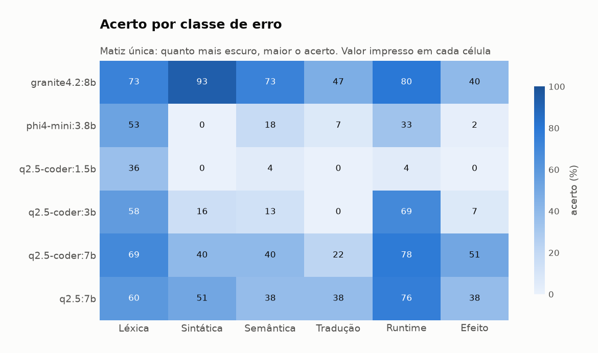

Fonte: elaborado pelos autores a partir dos registros da Fase 2-A (figura 03 de `Programacao/AgenteCore/experimentos/graficos/`).

**Como ler:** cada linha é um modelo e cada coluna, uma classe de defeito. O número é a porcentagem de casos em que o modelo apontou a causa certa, juntas as três formas de prompt, e quanto mais escura a célula, maior o acerto.

**O que a figura mostra:** a dificuldade acompanha o tipo de defeito: a coluna de runtime é a mais escura, e a de tradução, a mais clara. Os modelos menores quase não acertam fora de poucas classes. No prompt linear, só o granite4.2:8b chegou perto da meta de 70–80%, com 67,8% <!-- fonte: fase-2a-relatorio-por-modelo.md §2 -->. Estruturar o raciocínio em etapas não ajudou, e a fase fixou o prompt linear para as seguintes (decisão 19) <!-- fonte: fase-2a-relatorio-por-modelo.md §3; decisoes.md, decisão 19 -->. Os valores por modelo e por estratégia, os modos de erro e as limitações estão na seção 6.10.2.

## 6.3 Fase 2-B: biblioteca de documentação recuperada

A Fase 2-B perguntou se entregar ao modelo a documentação certa faz diferença. Os 90 casos foram repetidos na máquina-alvo, com uma biblioteca de 36 verbetes (fichas curtas sobre o sistema testado) em seis condições, desde nenhuma documentação até só o verbete certo, passando por verbetes errados de propósito <!-- fonte: fase-2b-relatorio-por-modelo.md §1 -->.

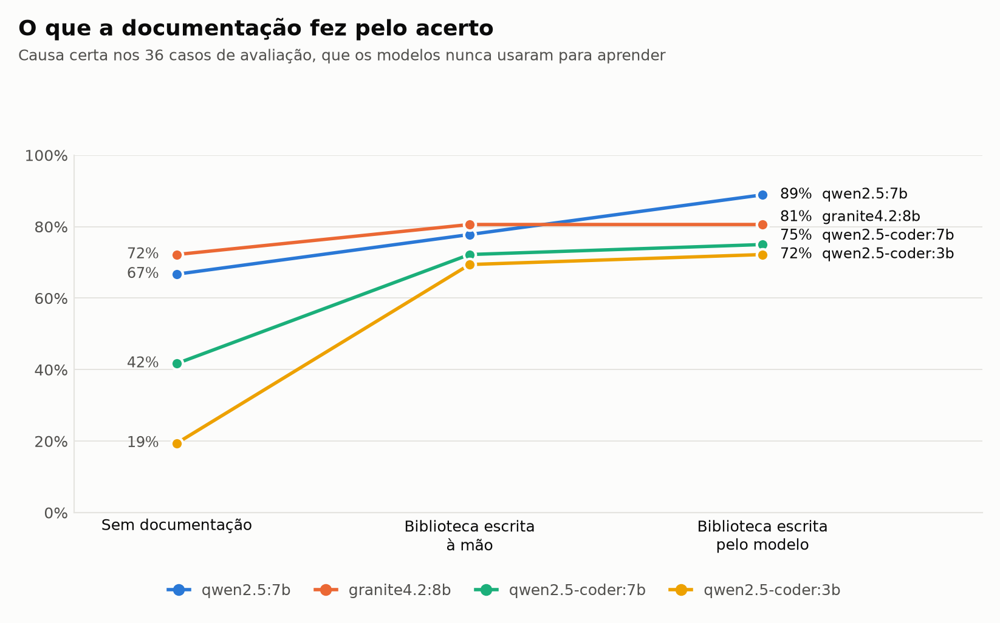

Fonte: elaborado pelos autores a partir de `fase3/comparacao_fases.json`; dados em `Documentacao/figuras/dados-das-figuras.md`.

**Como ler:** cada linha é um modelo e cada ponto é quanto ele acertou nos mesmos 36 casos. Da esquerda para a direita, o modelo recebe mais ajuda: nenhuma documentação, a biblioteca escrita pelo grupo e a biblioteca com o que ele mesmo escreveu. Linha subindo quer dizer mais causas certas. O último trecho é assunto da seção 6.4.

**O que a figura mostra:** a biblioteca ajuda os quatro modelos da figura, e quem acertava menos ganha mais: o qwen2.5-coder:3b vai de 19,4% a 69,4% nesses 36 casos <!-- fonte: comparacao_fases.json, nos_36_avaliacao, 2B_A0 e 2B_A2 -->. Entregar só os 3 verbetes mais parecidos com o caso rendeu igual ou mais que entregar a biblioteca inteira nos seis modelos, e esse virou o modo de operação <!-- fonte: fase-2b-relatorio-por-modelo.md §3 e §12 -->.

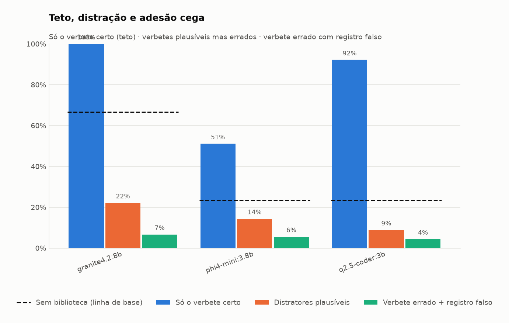

Fonte: elaborado pelos autores a partir dos registros da Fase 2-B (figura 08 de `resultados_alvo/graficos/`).

**Como ler:** cada grupo é um modelo, e a linha tracejada é o acerto dele sem documentação. A barra azul recebe só o verbete certo; a laranja, verbetes parecidos, mas errados; a verde, um verbete errado com um registro de incidente falso.

**O que a figura mostra:** com só o verbete certo, o granite4.2:8b chega a 100,0%; é o teto da recuperação, e não o que o agente alcança, que é 76,7% com a biblioteca recuperada. A documentação errada o derruba para bem abaixo do que ele acertava sem documentação nenhuma <!-- fonte: fase-2b-relatorio-por-modelo.md §3, §4 e §6 -->. Documentação errada é obedecida, e foi por isso que a gestão da biblioteca pelo próprio modelo ficou condicionada a validação em código (decisão 28) <!-- fonte: decisoes.md, decisão 28 -->. A tabela por condição, a recuperação e as limitações estão na seção 6.10.2.

## 6.4 Fase 3: biblioteca editada pelo próprio modelo e a escolha do modelo

A Fase 3 perguntou se o próprio modelo melhora a documentação que consulta, sem estragá-la. Quatro modelos diagnosticaram os 90 casos e, em três rodadas chamadas épocas, propuseram acréscimos à própria cópia da biblioteca, aceitos só depois de validação em código (decisões 30 a 33) <!-- fonte: fase-3-relatorio-por-modelo.md §1; decisoes.md, decisões 30 a 33 -->. Em 54 casos o modelo via a resposta certa, para aprender, e os outros 36 ficaram só para avaliar (decisão 31) <!-- fonte: fase-3-relatorio-por-modelo.md §1; decisoes.md, decisão 31 -->.

O último trecho da figura da seção 6.3 mostra o resultado: nos 36 casos de avaliação, só o qwen2.5:7b ganhou mais de um caso, de 77,8% a 88,9% de acerto com a primeira versão da biblioteca escrita por ele (L1). Mesmo esse ganho fica abaixo do efeito mínimo detectável com 36 casos, de 19,4 pontos, isto é, abaixo do que esse número de casos consegue comprovar <!-- fonte: fase-3-relatorio-por-modelo.md §3, bloco curva_acerto, e §4, bloco mde -->. O granite4.2:8b, o mais caro, não escreveu nada que entrasse, e por isso a linha dele fica reta <!-- fonte: fase-3-relatorio-por-modelo.md §6 -->. Das seis hipóteses fixadas antes da bateria, duas se confirmaram, três não e uma ficou parcial (seção 6.10.3) <!-- fonte: fase-3-relatorio-por-modelo.md §2 -->. O ganho também não pode ser creditado à verdade do que foi escrito: das 63 edições revisadas, 23 estavam erradas <!-- fonte: fase-3-relatorio-por-modelo.md §7 -->.

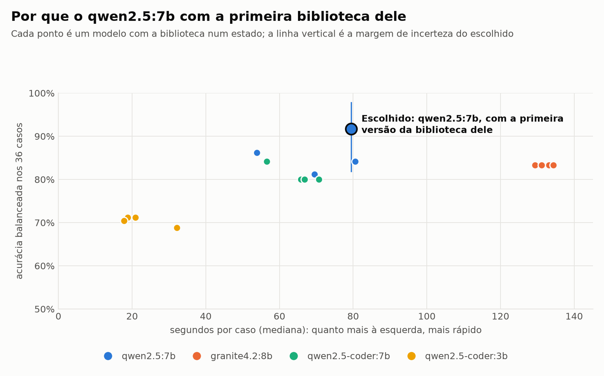

Fonte: elaborado pelos autores a partir de `fase3/decisao_modelo.json`; dados em `Documentacao/figuras/dados-das-figuras.md`.

**Como ler:** cada ponto é um modelo com a biblioteca num certo estado. Quanto mais alto, mais acerta; quanto mais à esquerda, mais rápido. A acurácia balanceada é o acerto calculado causa por causa, com o mesmo peso para todas, para que responder sempre a causa mais comum não pareça bom. A linha vertical no ponto escolhido é a margem de incerteza. Entre versões da biblioteca de um mesmo modelo, o tempo não se compara, porque foi medido em momentos diferentes da corrida.

**O que a figura mostra:** pela regra fixada antes da bateria (decisão 36), venceu o qwen2.5:7b com a L1, com 91,7% de acurácia balanceada, e a margem é larga porque são só 36 casos <!-- fonte: analise-decisoria-modelo-final.md §3 e §4, blocos dm_regra_36 e dm_bootstrap -->. Confirmada em 22/09/2026 (decisão 52), a escolha leva à Fase 4 esse modelo com a cópia L1, depois da curadoria humana das 40 edições da época 1 (decisões 52 e 60) <!-- fonte: decisoes.md, decisões 52 e 60 -->. A tabela por versão, os testes pareados e os vereditos estão na seção 6.10.3.

## 6.5 Fase 3-B: pontes de versão, casos inéditos, troca cruzada e o confronto qwen2.5:7b contra qwen2.5-coder:7b

A Fase 3-B testou as dúvidas que a Fase 3 deixou e que tinham teste barato (decisão 56) <!-- fonte: fase-3b-relatorio.md §1 -->. Como o Ollama, servidor local que executa os modelos, se atualiza sozinho, toda medição nova passa antes por uma ponte de versão, que confere se a versão nova reproduz a antiga (decisão 47) <!-- fonte: decisoes.md decisão 47; fase-3b-relatorio.md §7 -->. A primeira dúvida é se o ganho se repete em casos nunca vistos.

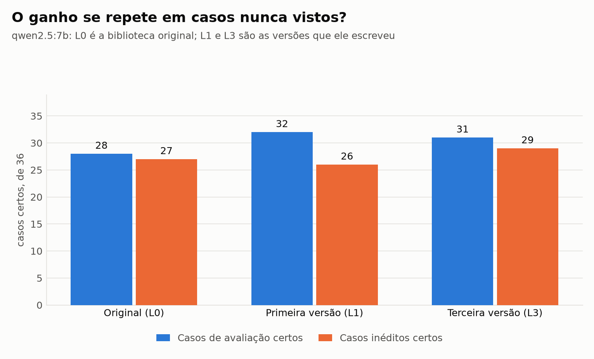

Fonte: elaborado pelos autores a partir de `fase3/analise_fase3b.json`; dados em `Documentacao/figuras/dados-das-figuras.md`.

**Como ler:** cada par de barras é uma versão da biblioteca do qwen2.5:7b. A barra azul conta os certos nos 36 casos de avaliação, e a laranja, nos 36 casos inéditos, escritos só a partir do código do sistema.

**O que a figura mostra:** o ganho da primeira versão não se repete: ela faz 32 certos nos casos de avaliação e 26 nos inéditos, abaixo dos 27 da biblioteca original. Somados os 72 casos, as diferenças ficam abaixo do que esse número de casos consegue detectar, e a hipótese H1, de que a última versão da biblioteca escrita pelo modelo acerta mais que a original, segue não confirmada <!-- fonte: fase-3b-relatorio.md §4 -->. A segunda dúvida é se a biblioteca serve para outro modelo.

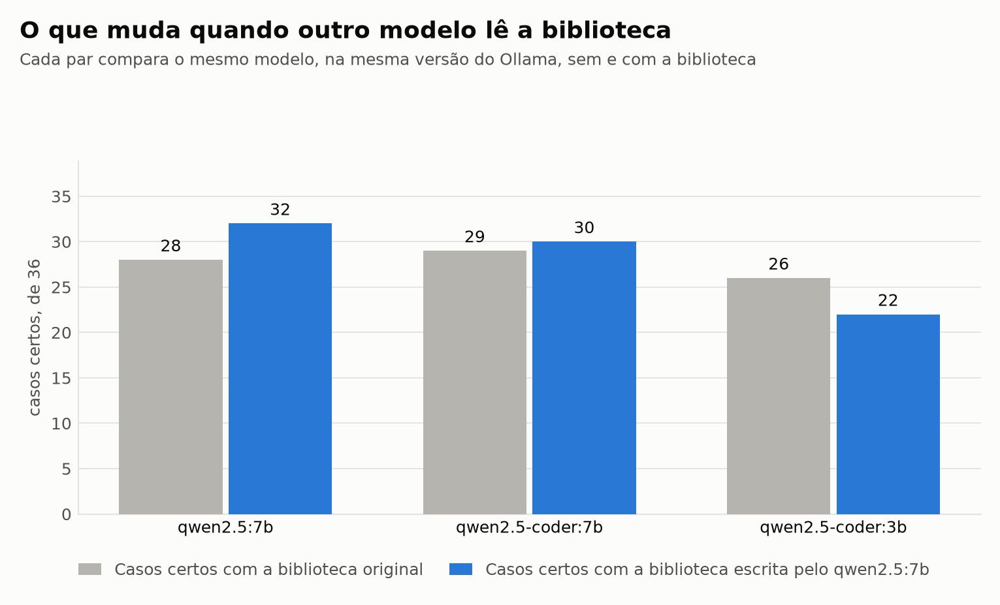

Fonte: elaborado pelos autores a partir de `fase3/analise_fase3b.json`; dados em `Documentacao/figuras/dados-das-figuras.md`.

**Como ler:** cada par de barras é o mesmo modelo nos mesmos 36 casos, na mesma versão do Ollama. A barra cinza usa a biblioteca original, e a azul, a que o qwen2.5:7b escreveu.

**O que a figura mostra:** quem escreveu ganha 4 casos, o qwen2.5-coder:7b ganha 1 e o qwen2.5-coder:3b perde 4 <!-- fonte: analise_fase3b.json, cruzada.celulas -->. Por isso a decisão 69 fixou o padrão do agente: o modelo com a biblioteca que ele mesmo escreveu, e trocar o modelo que lê exige medir de novo <!-- fonte: decisoes.md decisão 69 -->. Diferenças pequenas pedem cuidado, porque entre corridas iguais de 0 a 3 casos em 36 mudam de acerto <!-- fonte: fase-3b-relatorio.md §3 e §4.3 -->. Nos inéditos, o qwen2.5-coder:7b passa à frente dentro dessa variação, e a decisão 73 manteve a escolha, com esse saldo como limitação declarada <!-- fonte: decisoes.md decisão 73 -->. Os pareamentos, as pontes e o confronto caso a caso estão na seção 6.10.4.

## 6.6 Pré-Fase 4: modelos grandes pelo disco, atlas das competências, confiança por probabilidade e a especificação da trilha

A Pré-Fase 4, de 01/10/2026 (decisão 70) a 26/10/2026, foi uma pausa de pesquisa, sem código do agente, com três frentes <!-- fonte: decisoes.md decisão 70; roadmap.md §3.1 -->:

- modelos grandes lendo os pesos do disco: nesta máquina só um deles roda com folga, e a decisão 75 fechou essa via como motor do agente, mantendo a pesquisa <!-- fonte: pre-fase-4-relatorio.md §2.2; decisoes.md decisão 75 -->
- atlas das competências: mapear que verbetes a busca entrega para cada classe de defeito mostrou que os verbetes novos escritos pelo modelo não são entregues pela busca <!-- fonte: pre-fase-4-relatorio.md §3.2 e §3.3 -->
- raciocínio aberto: a probabilidade que o modelo dá ao rótulo separa acertos de erros o bastante para triagem, não como barreira, e a especificação da trilha foi aprovada como base da Fase 4 (decisão 77) <!-- fonte: pre-fase-4-relatorio.md §4.2; decisoes.md decisão 77 -->

As medidas de cada frente estão na seção 6.10.5.

<!-- ! Alteração de IA - Revisar: (05/11/2026, versão 2) seção 6.7 refeita até o fechamento da Fase 4: tira "em andamento até 01/11/2026" e o parágrafo "Faltam o P5...", acrescenta as corridas 20, 21, 21b e 22, a regra R1 como rodou, a regra R2 e o limite do prompt da seção 3.3 do plano com a decisão 90, a medida com revisor humano que não foi feita (decisões 85, 86 e 87), a poda consertada depois das corridas (decisão 89), a tabela das regras, as corridas pendentes 18c, 21c, 23 e 24 (decisões 90 a 92) e o que não foi feito na Fase 4 (decisão 93): itens 1, 2, 4, 5, 6 e 11 da seção 15 do relatório da fase. As corridas 18 e 21 entram com as repetições 18b e 21b como leituras vigentes até a 18c e a 21c rodarem. Números copiados do relatório da fase, do roadmap e das fichas, com a origem em comentário antes do ponto de cada frase.
     ! Motivo: o texto parava em 01/11/2026 e dizia que faltavam pacotes que já rodaram; sem a atualização, o documento não traria o que as corridas 20 a 22 mediram nem as limitações e as corridas novas que as decisões 82 e 85 a 93 mandam levar ao TCC. -->
## 6.7 Fase 4 e Pós-Fase 4: o agente na tela e o que chega ao analista

A Fase 4 faz o qwen2.5:7b com a L1 curada diagnosticar o que o navegador vê. O plano foi aprovado em 26/10/2026 como escrito (decisão 79): interceptador Playwright, poda da árvore de acessibilidade (a página descrita por papel e nome dos elementos), diagnóstico ao vivo, cura de seletor, biblioteca em produção e cenários para a Fase 5, em nove pacotes (P0 a P8) e nas corridas 16 a 22, com ponte de versão do Ollama antes de toda medição <!-- fonte: roadmap.md §4.6 -->. A ficha 29 foi a única fora da recomendação (decisão 80): a quebra de localizador (o seletor de um elemento deixa de achá-lo) é armada de duas formas, pelo harness (código que executa os cenários) no navegador e por uma variante do front PHP legado, e o relatório da fase compara as duas <!-- fonte: roadmap.md §4.6 -->.

<!-- ! Alteração de IA - Revisar: (25/11/2026, Pós-Fase 4, pacote Q8) a seção 6.7 passa a contar a Fase 4 como concluída, com as corridas 18c a 18e, 21c, 21d, 23 e 24 lidas, e a trazer a Pós-Fase 4 no título e no fim.
     ! Motivo: o parágrafo dizia que as corridas 18c, 21c, 23 e 24 estavam pendentes antes da Fase 5; elas rodaram em 05 e 06/11/2026 (roadmap §2.16 a §2.22), e o documento não contava a Pós-Fase 4. -->
A fase fechou em 06/11/2026, com os pacotes P0 a P8 feitos e as corridas 16 a 24 lidas <!-- fonte: roadmap.md §1, linha da Fase 4 -->. As corridas 16 a 22 são as do plano; as decisões 90 a 92 e 97 acrescentaram a repetição das medidas na tela com o caso ao vivo encurtado (18c e 21c) e com sinais novos na busca (18d e 21d), a conferência em casos que a busca nunca tinha visto (18e), um experimento de prompt (23) e os 36 inéditos em texto (24). As leituras vigentes são as das corridas 18d, 21d e 24, e as anteriores ficam como histórico. Depois da fase veio a Pós-Fase 4, que não mudou o agente e cuidou do que chega a quem revisa (seção 5.8); os resultados dela estão no fim desta seção. Cada pergunta abaixo corresponde a uma ou mais corridas, e os valores estão nas seções 6.10.6 a 6.10.12.

**Quantos casos a tela consegue mostrar?** A corrida 17 rodou sem modelo, só para conferir se a falha injetada aparece quando o roteiro roda na página.

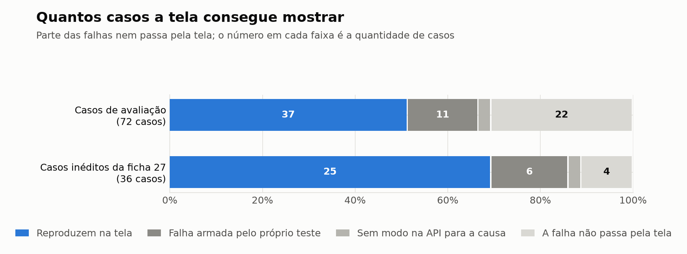

Fonte: elaborado pelos autores a partir de `fase4/reproducibilidade.json`; dados em `Documentacao/figuras/dados-das-figuras.md`.

**Como ler:** cada barra soma 100% dos casos de um conjunto. O azul são os casos em que a falha aparece ao rodar o roteiro, e os tons de cinza, os que ficam de fora, pelo motivo da legenda. O número na faixa é a quantidade de casos; as faixas estreitas demais ficam sem número, e o valor delas está na tabela da figura.

**O que a figura mostra:** dos 72 casos de avaliação, 37 reproduzem; dos 36 inéditos, 25. Nos casos de avaliação, a maior parte do que sobra não passa por nenhuma página; nos inéditos, a maior parte depende de uma falha armada pelo próprio teste <!-- fonte: fase-4-relatorio.md §3; reproducibilidade_ineditos.json, fora_por_motivo -->. A regra R1 rodou mais larga que o texto do plano: esses números dizem que a falha muda o tráfego de rede ou a tela, não que o campo certo aparece no caso montado a partir da tela <!-- fonte: fase-4-relatorio.md §3 e §10 -->.

**O agente sabe quando pode estar errado?** A corrida 16 calibrou o selo de confiança nos 90 casos oficiais e fixou em 3 o número de verbetes entregues ao modelo (regra R8) <!-- fonte: roadmap.md §2.9 -->.

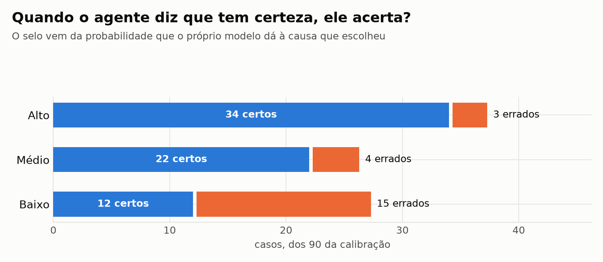

Fonte: elaborado pelos autores a partir de `fase4/calibracao.json`; dados em `Documentacao/figuras/dados-das-figuras.md`.

**Como ler:** cada barra reúne os casos que receberam o mesmo selo. O azul são os certos, e o laranja, os errados. O selo vem da probabilidade que o próprio modelo dá à causa que escolheu.

<!-- ! Alteração de IA - Revisar: (25/11/2026, Pós-Fase 4, pacote Q8) o selo de confiança conferido nos 36 inéditos da corrida 24.
     ! Motivo: o parágrafo terminava dizendo que o resultado ainda precisava se repetir em casos novos; a corrida 24 leu 36 casos que não entraram na calibração. -->
**O que a figura mostra:** no selo alto são 3 erros em 37 casos; no baixo, 15 em 27 <!-- fonte: roadmap.md §2.9 -->. O sinal serve para triagem, não como barreira, porque ainda há erros com selo alto. Os cortes foram calculados nesses mesmos casos, e por isso o resultado ainda precisa se repetir em casos novos <!-- fonte: calibracao.json, limiares, origem fase4_calibracao/k3 -->. Nos 36 inéditos lidos em texto na corrida 24, que não entraram na calibração, o selo alto acertou 12 de 13 casos, o médio, 9 de 15, e o baixo, 4 de 8: a ordem se manteve <!-- fonte: roadmap.md §2.22, linha Selo -->.

<!-- ! Alteração de IA - Revisar: (25/11/2026, Pós-Fase 4, pacote Q8) a pergunta sobre a tela passa a trazer as corridas 18c, 18d e 18e: a figura, o "Como ler", o resultado e a regra R2.
     ! Motivo: o texto e a legenda citavam só as corridas 18 e 18b, com 26 acertos na tela contra 31 e a regra R2 não cumprida; a figura do repositório já mostra as cinco corridas, e a leitura vigente é a da 18d (32 contra 30, regra R2 no limite exato). -->
**Ler da tela é tão bom quanto ler o caso escrito?** As corridas 18, 18b, 18c e 18d diagnosticaram os 37 casos que reproduzem, lidos da tela e do caso escrito (fixture), na mesma sessão do modelo; a corrida 18e fez o mesmo com os 25 inéditos que reproduzem <!-- fonte: roadmap.md §2.10, §2.16, §2.19 e §2.21 -->.

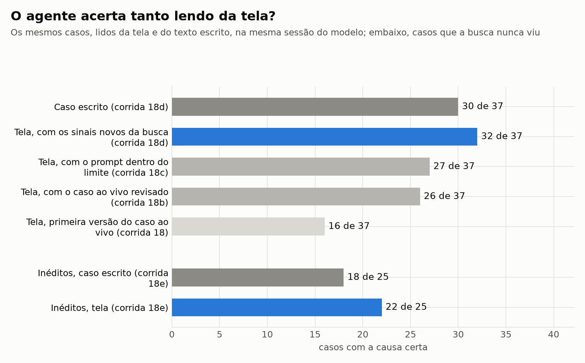

Fonte: elaborado pelos autores a partir de `fase4/tela.json`, `tela_v2.json`, `tela_v3.json`, `tela_v4.json` e `tela_ineditos.json`; dados em `Documentacao/figuras/dados-das-figuras.md`.

**Como ler:** as cinco barras de cima são os mesmos 37 casos. A primeira é o modelo lendo o caso escrito, e as outras, o mesmo caso montado a partir da tela, da versão mais nova para a primeira. As duas de baixo são os 25 casos inéditos, que a busca nunca tinha visto. Mais casos certos é melhor.

**O que a figura mostra:** a primeira versão deu 16 certos, porque em boa parte dos casos a poda, o corte em código do que vai para o modelo, levava a ele o primeiro produto normal da lista. Levar ao caso o que mudou contra a tela normal (decisão 81) subiu para 26; encurtar o caso para o prompt caber no limite (decisão 90) deixou em 27; e fazer a busca usar o que o caso mede contra a tela normal (decisão 97) levou a 32, contra 30 no caso escrito, com o verbete certo chegando ao modelo em 36 dos 37 casos, e não mais em 21 <!-- fonte: dados-das-figuras.md, "O agente acerta tanto lendo da tela?"; roadmap.md §2.16 e §2.19 -->. Nos 25 inéditos foram 22 na tela e 18 no caso escrito <!-- fonte: roadmap.md §2.21 -->. Isso não quer dizer que o modelo lê melhor da tela: o caso da tela leva uma medida que o caso escrito não tem, e com tão poucos casos a diferença entre os dois lados não se separa do acaso (p = 0,727 nos 37 casos e p = 0,125 nos inéditos).

<!-- ! Alteração de IA - Revisar: (25/11/2026, Pós-Fase 4, pacote Q8) parágrafo novo com a regra R2 lida pela decisão 98.
     ! Motivo: o texto dizia que a regra R2 não tinha sido cumprida e que a corrida 18b era a leitura vigente até a 18c rodar; pela leitura fixada antes da corrida 18d, a regra fecha no limite exato, e o texto diz também que a leitura mudou e quando. -->
<!-- ! Alteração de IA - Revisar: (25/11/2026, Pós-Fase 4, pacote Q8) (revisão) a soma dos dois lados da regra R2 passa a vir corrida a corrida.
     ! Motivo: a frase juntava "até a corrida 18c" com o 8, que é a soma da corrida 18d; as somas são 9 na 18b, 7 na 18c e 8 na 18d (roadmap §2.16 e §2.19). -->
A regra R2 admite que a tela perca no máximo 3 casos para o caso escrito. Na corrida 18d ela perdeu 3 e ganhou 5, e nos inéditos perdeu 0 e ganhou 4: a regra fecha, no limite exato (decisões 97 e 98). Até a corrida 18c a conta somava os dois lados: foram 9 casos na corrida 18b e 7 na 18c, e seriam 8 na 18d, sempre acima do limite, e por isso a regra tinha ficado como limitação declarada (decisão 82); a leitura que olha só o que a tela perde foi fixada antes da corrida 18d, sem conhecer o resultado dela, e a soma continua ao lado em toda leitura. Os 3 casos perdidos são a mesma confusão, item faltando na lista lido como resposta cortada. Os sinais da busca foram escritos olhando esses 37 casos, e a conferência em casos novos é a da corrida 18e <!-- fonte: roadmap.md §2.19 e §2.21; decisoes.md decisões 82, 97 e 98 -->.

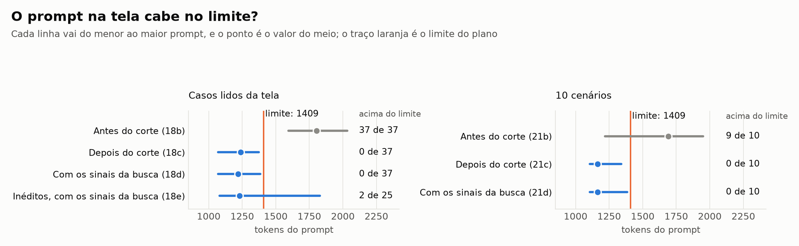

Fonte: elaborado pelos autores a partir dos tokens de entrada medidos em `fase4/tela_v2.json`, `tela_v3.json`, `tela_v4.json` e `tela_ineditos.json` e nos registros das corridas 21b, 21c e 21d; dados em `Documentacao/figuras/dados-das-figuras.md`.

**Como ler:** cada linha vai do menor ao maior prompt de uma corrida, e o ponto é o valor do meio. O traço laranja é o limite que o plano fixou antes de rodar: o maior prompt da calibração mais 10%. Ao lado de cada linha, quantos prompts passam dele. À esquerda estão os casos lidos da tela, e à direita, os dez cenários; a linha cinza é a corrida de antes do corte, e as azuis, as de depois.

<!-- ! Alteração de IA - Revisar: (25/11/2026, Pós-Fase 4, pacote Q8) a figura do limite do prompt passa a ser lida com as corridas de depois do corte.
     ! Motivo: o texto dizia que a decisão 90 ia encurtar o caso antes da Fase 5 e repetir as corridas; o corte foi feito e as corridas 18c, 18d, 21c e 21d ficaram dentro do limite. A figura do repositório mudou em 06/11/2026 e a legenda descrevia a versão antiga, com os cortes estimados. -->
**O que a figura mostra:** a revisão do caso custou tamanho: na corrida 18b os 37 prompts passaram do limite de 1409 tokens, e na 21b, 9 de 10. A decisão 90 encurtou o caso ao vivo, sem tocar no prompt fixo, e as corridas seguintes ficaram dentro do limite: nenhum prompt acima dele na 18c, na 18d, na 21c e na 21d. Nos 25 inéditos da corrida 18e passaram 2, o maior com 1829 tokens, porque a lista do caso não tinha teto; com o teto (decisão 99), os dois ficam em 1367 e 1387 tokens, medidos sem corrida nova <!-- fonte: dados-das-figuras.md, "O prompt na tela cabe no limite?"; roadmap.md §2.21, linha Prompt -->.

<!-- ! Alteração de IA - Revisar: (25/11/2026, Pós-Fase 4, pacote Q8) o ensaio dos dez cenários passa a trazer as corridas 21c e 21d, com a 21d como leitura vigente, na figura e no texto.
     ! Motivo: o texto dava a corrida 21b como leitura vigente até a 21c rodar, com 105,2 s de média; a 21c e a 21d rodaram em 05 e 06/11/2026, e a figura do repositório já é a da 21d (74,0 s). -->
**Quanto tempo o agente leva?** A cura de seletor, só em código, curou as 160 quebras armadas na corrida 19, pelo mesmo elemento da referência, com mediana de 0,639 s; os 100% vêm do desenho da corrida <!-- fonte: roadmap.md §2.11 -->. Nas corridas 21, 21b, 21c e 21d, o agente inteiro rodou os dez cenários da ficha 36, seis de contrato e quatro de localizador, com uma repetição em cada corrida <!-- fonte: fase-4-relatorio.md §8 -->.

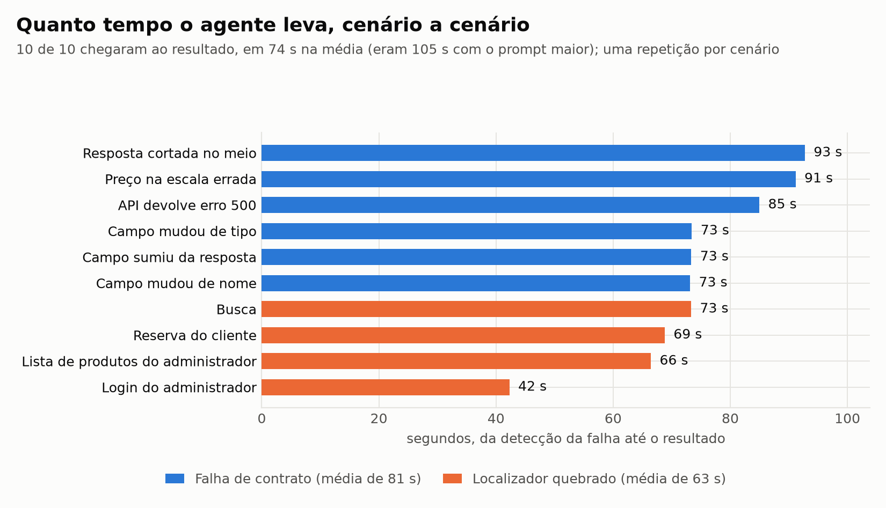

Fonte: elaborado pelos autores a partir de `fase4/cenarios_v4.json`; dados em `Documentacao/figuras/dados-das-figuras.md`.

**Como ler:** cada barra é um cenário de falha, rodado uma vez, do momento em que o agente percebe a falha até ter o resultado. No azul, o resultado é o diagnóstico conferido em código; no laranja, é o teste passando de novo depois da cura.

<!-- ! Alteração de IA - Revisar: (24/11/2026, Fase 5, pacote F6) a última frase ganhou a remissão à seção 6.8, onde está a comparação que ela anuncia.
     ! Motivo: a frase dizia que a comparação do tempo do agente com uma linha de base era a Fase 5, sem dizer onde lê-la; a medida foi feita e está na seção nova. Os números do parágrafo, que são da corrida 21b, não foram tocados (pacote Q8). -->
**O que a figura mostra:** os 10 cenários chegaram ao resultado, com 74,0 s em média na corrida 21d, a leitura vigente <!-- fonte: roadmap.md §2.20 -->. A primeira rodada, a corrida 21, deu 9 de 10 e achou um defeito: a tela de login se recarrega sozinha em 30 s enquanto o modelo pensa; o conserto foi conferido na 21b, com 10 de 10 e 105,2 s em média <!-- fonte: roadmap.md §2.13 e §2.14 -->. Encurtar o prompt levou a média a 72,5 s na corrida 21c, 31% a menos, sem mudar a causa respondida em nenhum cenário, e os sinais novos da busca não mudaram esse resultado <!-- fonte: roadmap.md §2.17 e §2.20 -->. Com uma repetição por cenário e sem linha de base, esse tempo ainda não diz se é bom; a comparação é a Fase 5 (seção 6.8).

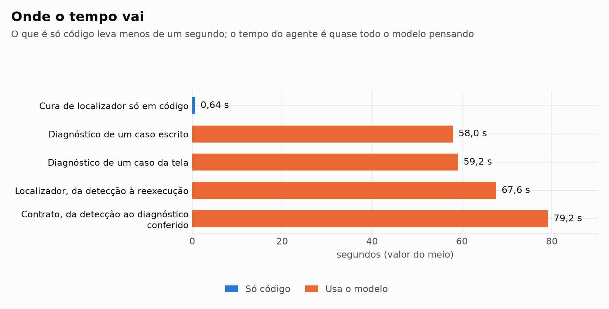

Fonte: elaborado pelos autores a partir de `fase4/cura.json`, `fase4/tela_v4.json` e `fase4/cenarios_v4.json`; dados em `Documentacao/figuras/dados-das-figuras.md`.

**Como ler:** cada barra é uma etapa, e o valor é o do meio entre as execuções. O azul é só código, e o laranja usa o modelo.

**O que a figura mostra:** quase todo o tempo é o modelo: a cura só em código leva menos de um segundo, e as etapas com o modelo, de 58,0 a 79,2 s no valor do meio <!-- fonte: dados-das-figuras.md, "Onde o tempo vai" -->. A maior parte desse tempo é a leitura do prompt (mediana de 83,1% do tempo do diagnóstico nos dez cenários da corrida 21b), o que amarra o tempo ao tamanho do prompt <!-- fonte: fase-4-relatorio.md §8 -->.

**O que o agente propõe melhora a biblioteca?** Na corrida 20, o modelo diagnosticou os 54 casos de aprendizado e propôs acréscimos, filtrados em código antes de chegar a um lote <!-- fonte: fase-4-relatorio.md §7, bloco tb_f4_biblioteca_resumo -->.

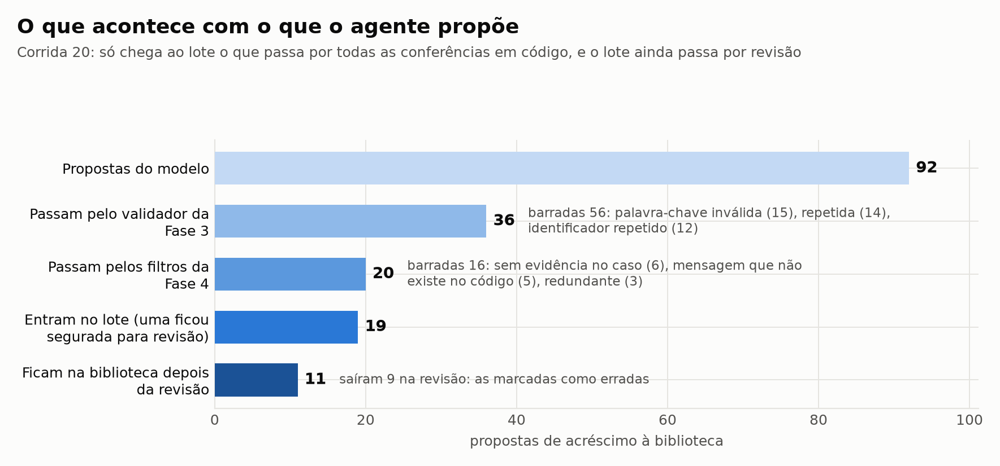

Fonte: elaborado pelos autores a partir de `fase4/biblioteca.json`; dados em `Documentacao/figuras/dados-das-figuras.md`.

**Como ler:** de cima para baixo, quantas propostas sobrevivem a cada conferência. Ao lado de cada etapa, os motivos mais comuns de quem ficou pelo caminho.

<!-- ! Alteração de IA - Revisar: (25/11/2026, Pós-Fase 4, pacote Q8) a biblioteca final deixa de estar sem medida em casos inéditos.
     ! Motivo: a frase dava a corrida 24 como pendente; ela rodou em 06/11/2026. -->
**O que a figura mostra:** das 92 propostas, 19 chegaram ao lote, e 11 ficaram na biblioteca depois da revisão, que foi a pré-revisão do agente de apoio, aprovada por um integrante do grupo <!-- fonte: fase-4-relatorio.md §7 -->. Nos 36 inéditos da Fase 3-B, o lote não mudou nenhum caso (b = 0, c = 0): não piorou, e também não ajudou <!-- fonte: fase-4-relatorio.md §7 -->. A biblioteca final foi medida em casos inéditos na corrida 24, a pergunta seguinte.

<!-- ! Alteração de IA - Revisar: (25/11/2026, Pós-Fase 4, pacote Q8) pergunta nova, com a figura `ineditos-por-classe.png`: a corrida 24, os 36 inéditos em texto com a biblioteca de produção.
     ! Motivo: a corrida 24 rodou em 06/11/2026 e não aparecia no documento, e a figura dela existia em `Documentacao/figuras/` sem ser usada; o texto do "Como ler" é o mesmo do README. -->
**E em casos que a biblioteca nunca viu?** Na corrida 24, o agente leu em texto, com a biblioteca de produção, os 36 inéditos da ficha 27, seis de cada classe de defeito <!-- fonte: roadmap.md §2.22 -->.

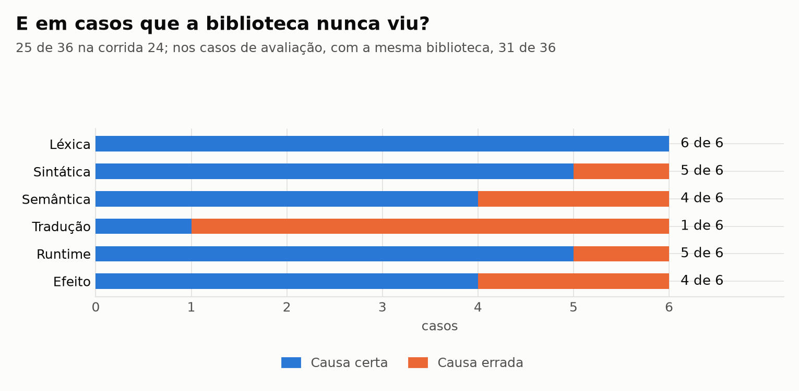

Fonte: elaborado pelos autores a partir de `fase4/ineditos.json`; dados em `Documentacao/figuras/dados-das-figuras.md`.

**Como ler:** cada barra é uma classe de defeito, com seis casos que nenhuma biblioteca tinha visto, lidos em texto. O azul são as causas certas, e o laranja, as erradas. Mais azul é melhor.

**O que a figura mostra:** a biblioteca final acerta 25 dos 36, contra 31 de 36 nos casos de avaliação da corrida 22. Não são os mesmos casos, e por isso a diferença não mede só a biblioteca; o número fica perto do que a Fase 3-B mediu em outros 36 inéditos, 26 de 36. O que mais pesa é de novo o verbete certo: quando ele chega ao modelo, são 18 de 20; quando não chega, 7 de 16. A classe de tradução é a mais fraca, com 1 de 6. A corrida tem uma condição só, e por isso não diz quanto a biblioteca ajuda nesses casos, que não foram lidos sem ela <!-- fonte: roadmap.md §2.22; dados-das-figuras.md, "E em casos que a biblioteca nunca viu?" -->.

**A trilha aponta os erros de verdade?** Na corrida 22, o agente leu os 36 casos oficiais de avaliação com a biblioteca de produção: 31 certos e 5 errados. A pergunta é se os sinais de alerta da trilha coincidem com esses erros <!-- fonte: fase-4-relatorio.md §7 e §9 -->.

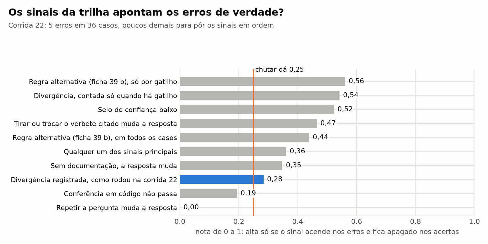

Fonte: elaborado pelos autores a partir de `fase4/trilha.json`; dados em `Documentacao/figuras/dados-das-figuras.md`.

**Como ler:** cada barra é uma forma de contar um sinal de alerta. A nota multiplica duas proporções: os erros que o sinal pegou e os acertos que ele deixou em paz (TPR vezes TNR). Vai de 0 a 1, e acender ao acaso dá 0,25, o traço laranja. A barra azul é a conta como a corrida rodou.

<!-- ! Alteração de IA - Revisar: (25/11/2026, Pós-Fase 4, pacote Q8) a medida com revisor humano deixa de ser "não feita": remete à pergunta seguinte.
     ! Motivo: a frase dizia que não se sabia se o relatório ajuda quem revisa; a Pós-Fase 4 mediu isso com um analista de QA de fora do projeto (decisões 114 e 117). -->
**O que a figura mostra:** como a corrida rodou, com as intervenções em todos os casos, a nota é 0,284, quase sem separar erro de acerto. Contada só onde um gatilho dispararia, dá 0,542, mas essa conta sai de uma corrida que não rodou assim (decisão 88) <!-- fonte: fase-4-relatorio.md §9.1, bloco tb_f4_trilha_sinais; decisoes.md decisão 88 -->. Com só 5 erros, nenhuma conta põe os sinais em ordem. A medida com revisor humano não foi feita nesta corrida (decisões 85, 86 e 87); ela veio na Pós-Fase 4, e é a pergunta seguinte.

<!-- ! Alteração de IA - Revisar: (25/11/2026, Pós-Fase 4, pacote Q8) quatro perguntas novas, com os resultados da Pós-Fase 4: a revisão humana dos relatórios, os três experimentos em texto (corridas 25, 26 e 27), o hub de revisão e a seleção de cenários pelo Git.
     ! Motivo: o documento não contava a Pós-Fase 4 (pacotes Q1 a Q7); a revisão humana e a revisão às cegas ficam declaradas como feitas por um analista de QA de fora do projeto, e não por um dos autores (decisões 114, 117 e 129). Os números vêm das leituras citadas em cada comentário de fonte. A frase da seleção pelo Git espera a corrida curta da ficha 99. -->
**O relatório ajuda quem revisa?** A Pós-Fase 4 refez o relatório por caso no molde do relatório de defeitos do syllabus CTFL 4.0, com a árvore de decisão ao lado (seção 5.8), sem rodar o agente de novo: os 120 relatórios das corridas 18d, 21d e 24 foram regerados das trilhas gravadas. Nos filtros de texto em código, os 120 passam, e da versão anterior não passava nenhum <!-- fonte: resultados_alvo/fase4/texto.md, tabela tb_f4_texto_resumo -->. Um analista de QA de fora do projeto leu os 36 relatórios da corrida 24, sem ver o nome do caso, a classe nem o nível, e disse, de cada um, se aceitava o diagnóstico.

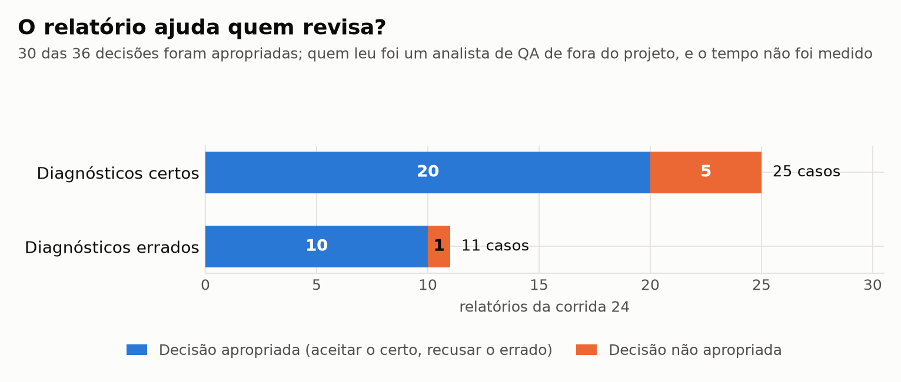

Fonte: elaborado pelos autores a partir de `fase4/leitura_revisao_v3.json`; dados em `Documentacao/figuras/dados-das-figuras.md`.

**Como ler:** a barra de cima são os 25 diagnósticos certos da corrida, e a de baixo, os 11 errados. O azul é a decisão apropriada de quem revisou: aceitar o que está certo e recusar o que está errado. O laranja é o contrário. Mais azul é melhor.

**O que a figura mostra:** a decisão do analista foi a apropriada em 30 dos 36 relatórios (83,3%; intervalo de Wilson de 95% de 68,1 a 92,1), e nos 11 diagnósticos errados ele apontou onde estava o erro em 10. A utilidade percebida teve mediana 5,0, na nota de 1 a 5. O tempo até a decisão não foi medido, porque o analista leu fora da página, e a medida tem um leitor só, que não é um dos autores (decisões 114 e 117) <!-- fonte: resultados_alvo/fase4/leitura_revisao_v3.md, tabela tb_f4_revisao_v3_resumo -->. A medida diz que a evidência para decidir está no relatório; não diz quanto tempo a decisão leva nem se ela se repete com outros leitores.

**Mudar o agente melhora o diagnóstico?** Antes da Fase 5, três experimentos em texto testaram mudanças no agente, cada um com a regra do veredito fixada antes de rodar (seção 5.8).

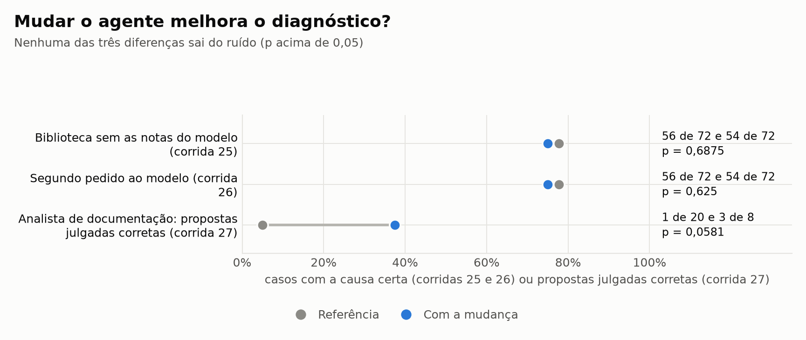

Fonte: elaborado pelos autores a partir de `fase4/sem_notas.json`, `fase4/segundo_passe.json` e `fase4/analista.json`; dados em `Documentacao/figuras/dados-das-figuras.md`.

**Como ler:** cada linha é um experimento. O ponto cinza é a referência, e o azul, a mudança testada; à direita, as contagens e o valor-p do teste. Quanto mais à direita o ponto, maior a parcela de acertos. As duas primeiras linhas contam diagnósticos certos em 72 casos, e a terceira, propostas de edição julgadas corretas.

**O que a figura mostra:** nenhuma das três diferenças sai do ruído, e o agente ficou como estava. Sem as notas que o modelo escreveu na biblioteca, o agente acertou 54 de 72 casos, contra 56 com a biblioteca inteira (p = 0,6875); o que mudou foi o custo, com o tempo do meio por caso de 66,35 para 57,63 s (corrida 25) <!-- fonte: roadmap.md §2.23 -->. Com o segundo pedido, a resposta trocou em 8 dos 24 casos em que um sinal acendeu, 1 passou a acertar e 3 a errar, e o agente iria de 56 a 54 acertos em 72 (p = 0,625): fica a primeira resposta (corrida 26) <!-- fonte: roadmap.md §2.24 -->. No papel de analista de documentação, o modelo escreveu propostas mais afirmativas, 14 de 15 contra 6 de 92 na corrida 20, diferença que sai do ruído; mas na revisão às cegas foram julgadas corretas 3 de 8, contra 1 de 20 nas edições antigas (p = 0,0581), dentro do ruído. Quem julgou foi o mesmo analista de QA, que não conhece o código das aplicações-alvo, de modo que o veredito mede mais a clareza da frase do que a verdade dela (corrida 27; decisão 129) <!-- fonte: roadmap.md §2.25 -->.

<!-- ! Alteração de IA - Revisar: (26/11/2026, Pós-Fase 4, pacote Q8) o parágrafo do hub ganha a central aberta pelo `Cobaia.exe` e o limite do botão de rodar os cenários.
     ! Motivo: a decisão 170 fez do hub a central do projeto; o botão que lança a corrida foi provado em teste, sem o modelo, e nenhuma corrida com o modelo sai de dentro do aplicativo do agente de apoio, de modo que o texto tem de dizer que ele não foi visto rodando. -->
<!-- ! Alteração de IA - Revisar: (26/11/2026, Pós-Fase 4, pacote Q8) o parágrafo do hub passa a dizer como o caso abre depois do molde visual e a contar a prova do botão com o modelo; sai a marca RECONFERIR.
     ! Motivo: o parágrafo dizia que o botão de rodar os cenários não tinha sido visto lançando uma corrida com o modelo; ele lançou duas em 26/11/2026, registradas em `resultados_alvo/fase4/botao_do_hub.json`, como uso do produto. E a página deixou de abrir na árvore em texto (decisão 175). -->
**Como o analista chega a tudo isso?** O hub de revisão reúne, numa página local, os casos das corridas 18d, 21d, 24 e 28b: 170 diagnósticos de 83 casos distintos, porque o mesmo caso diagnosticado mais de uma vez aparece como iterações. Em 43 deles o que o modelo declarou não bate com o que o código conferiu, e em 24 houve cura de localizador <!-- fonte: resultados_alvo/fase4/hub.md -->. Cada caso abre com a linha de produção do agente no alto e, embaixo, o relatório com a evidência ao lado, a rede da decisão e a trilha, e o analista comenta no trecho, dá o veredito e preenche severidade, prioridade e estado; o agente só comenta. Desde 25/11/2026 a mesma página é a central do projeto: o `Cobaia.exe` sobe o hub junto com o site e a API e abre o navegador nele, e dali se chega ao site, à API, às métricas de cada corrida e ao botão que roda os dez cenários (seção 5.8). O hub foi testado em código, com a página aberta num navegador sem janela, e o botão de rodar os cenários lançou 2 corridas com o modelo em 26/11/2026, de 10 execuções cada, todas com Task Success; são uso do produto, e não medida deste trabalho (seção 6.10.12) <!-- fonte: resultados_alvo/fase4/botao_do_hub.json -->. O hub ainda não foi usado por um analista numa revisão de verdade.

<!-- ! Alteração de IA - Revisar: (25/11/2026, Pós-Fase 4, pacote Q8) figura do hub de revisão (captura de tela), com o "Como ler".
     ! Motivo: a regra da documentação principal pede uma relação visual em cada pergunta da seção 6, e o hub só tinha texto; a captura foi feita com o hub aberto sem a opção de lançar corrida e sem gravar nenhuma revisão. -->
<!-- ! Alteração de IA - Revisar: (26/11/2026, Pós-Fase 4, pacote Q8) a captura do hub aberto num caso foi refeita em 26/11/2026, e o "Como ler" ganha os botões do alto.
     ! Motivo: a captura de 25/11/2026 era de antes do hub como central: o cabeçalho dizia outra coisa e não tinha os botões Início, Métricas e Corrida ao vivo. A nova foi feita do mesmo jeito, com o hub aberto numa porta própria, sem a opção de lançar corrida e com as revisões numa pasta de rascunho. -->
<!-- ! Alteração de IA - Revisar: (26/11/2026, Pós-Fase 4, pacote Q8) a captura do hub aberto num caso foi refeita depois do molde visual, agora num caso da corrida 28b, e o "Como ler" e "O que a figura mostra" foram reescritos; entra em seguida a figura nova da rede da decisão.
     ! Motivo: a captura anterior era de antes do molde (decisão 175): mostrava o relatório logo no alto, sem a linha de produção, e os filtros no cabeçalho. O caso passou a ser da corrida 28b porque num caso em texto, como os da corrida 24, as três primeiras etapas não se aplicam. A captura foi feita numa segunda instância do hub, numa porta própria e com as revisões numa pasta de rascunho, sem gravar nada no repositório. -->
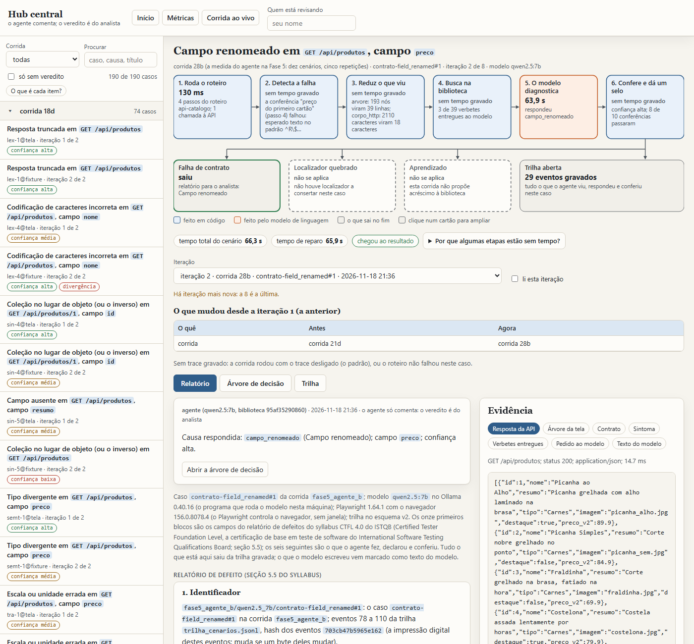

Fonte: captura de tela do hub de revisão do projeto (`Programacao/AgenteCore/experimentos/hub.py`), feita pelos autores em 26/11/2026.

**Como ler:** à esquerda fica a lista dos casos, em grupos por corrida, cada um com a iteração e a confiança em palavras, e a marca de divergência quando o que o modelo declarou não bate com o que o código conferiu. No alto do caso, a linha de produção: seis cartões, um por etapa do agente, em azul os feitos em código e em laranja o do modelo. Embaixo deles ficam as três saídas e a trilha, com a saída que este caso teve em verde e as que não se aplicam em linha tracejada. Cada cartão traz o tempo, quando a corrida o gravou, e amplia ao clique. Mais abaixo vêm as abas do relatório, da árvore de decisão e da trilha, com a evidência à direita: a resposta da API, a árvore da tela, o contrato, o sintoma, os verbetes entregues, o pedido ao modelo e o texto que ele escreveu.

**O que a figura mostra:** o analista vê de relance o que o agente fez em cada etapa e onde o caso terminou, e lê o diagnóstico e a evidência na mesma tela, sem abrir arquivo. O caso é da corrida 28b, uma corrida de medida, e por isso só o roteiro e o modelo têm tempo: as outras quatro etapas aparecem como sem tempo gravado (seção 5.8). O cabeçalho lembra a regra da página: o agente comenta, e o veredito é do analista.

<!-- ! Alteração de IA - Revisar: (26/11/2026, Pós-Fase 4, pacote Q8) figura nova: a rede da decisão de um caso, no hub (captura de tela), com o "Como ler".
     ! Motivo: o molde visual trocou a árvore de decisão em texto corrido por uma rede (decisão 175), e a seção só mostrava a árvore como texto; a captura é um recorte da aba "Árvore de decisão" do mesmo caso da figura anterior. -->
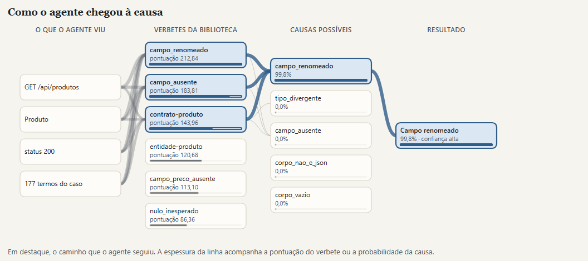

Fonte: captura de tela do hub do projeto (`Programacao/AgenteCore/experimentos/hub.py`), feita pelos autores em 26/11/2026; é a aba da árvore de decisão do mesmo caso da figura anterior.

**Como ler:** são quatro colunas, da esquerda para a direita: o que o agente viu (a rota, o recurso, o status e os termos do caso), os verbetes da biblioteca que a busca trouxe, com a pontuação de cada um, as causas possíveis, com a probabilidade que o modelo deu a cada uma, e o resultado. Em destaque, em azul, o caminho que o agente seguiu. A espessura de cada linha acompanha a pontuação do verbete ou a probabilidade da causa.

**O que a figura mostra:** a decisão que antes só se lia em texto corrido aparece como um caminho. Neste caso, os três verbetes de maior pontuação foram entregues ao modelo, uma causa ficou com quase toda a probabilidade, e a resposta saiu com confiança alta. A árvore por escrito, com a origem de cada frase, continua na página, recolhida embaixo da rede.

<!-- ! Alteração de IA - Revisar: (26/11/2026, Pós-Fase 4, pacote Q8) figura nova: o hub central aberto na vista Início (captura de tela), com o "Como ler".
     ! Motivo: o hub virou a central do projeto (decisão 170), e a seção só mostrava a tela de revisão de um caso; a captura foi feita sem subir o site, a API nem o banco, que não podem ser subidos de dentro do aplicativo do agente de apoio, e o texto diz por que os dois aparecem fora do ar. -->
<!-- ! Alteração de IA - Revisar: (26/11/2026, Pós-Fase 4, pacote Q8) a captura da vista Início foi refeita depois do molde visual, com as aplicações no ar, e o "Como ler" e "O que a figura mostra" foram reescritos.
     ! Motivo: a captura anterior era de antes do molde (decisão 175) e mostrava o site e a API fora do ar; a nova foi feita com o site, a API e o banco de dados subidos pelo `Cobaia.exe`, numa segunda instância do hub aberta com a mesma opção que o `Cobaia.exe` passa, numa porta própria e sem clicar no botão de rodar. -->
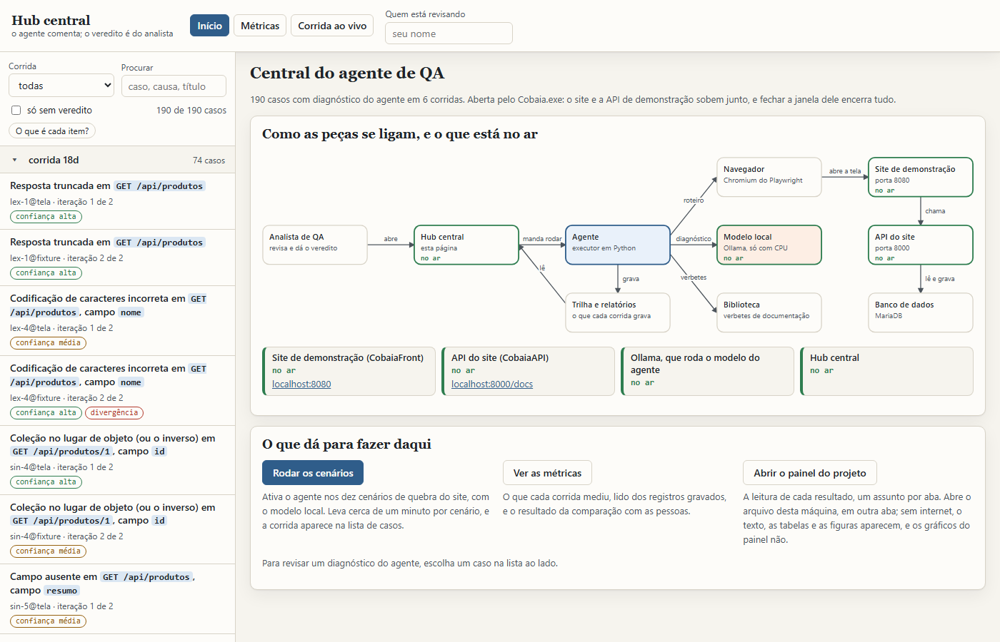

Fonte: captura de tela do hub do projeto (`Programacao/AgenteCore/experimentos/hub.py`), feita pelos autores em 26/11/2026, com o site, a API e o banco de dados no ar pelo `Cobaia.exe`.

**Como ler:** o desenho de cima mostra como as peças se ligam: o analista abre o hub, o hub manda o agente rodar, e o agente usa o navegador, que abre o site, o modelo local, a biblioteca de verbetes e a trilha que ele grava. A borda verde marca o que está no ar; o agente aparece em azul, e o modelo, em laranja. Embaixo do desenho, quatro cartões repetem o estado do site, da API, do Ollama e do próprio hub, com o endereço dos dois primeiros. Por fim vêm os três caminhos da página: rodar os cenários, ver as métricas e abrir o painel do projeto. À esquerda continua a lista dos casos, para revisar um diagnóstico.

**O que a figura mostra:** a central reúne num lugar só o estado dos serviços, as corridas e a revisão. Na captura está tudo no ar, porque o site, a API e o banco de dados tinham sido subidos pelo `Cobaia.exe`, e o botão de rodar os cenários está liberado. A lista traz 190 casos de 6 corridas: os 170 das quatro corridas de medida e os 20 das duas corridas lançadas pelo botão (seção 6.10.12) <!-- fonte: resultados_alvo/fase4/hub.json, campo total.casos, e resultados_alvo/fase4/botao_do_hub.json --> <!-- RECONFERIR NA GERAÇÃO: se a ficha 116 mudar o texto do cartão do painel na tela Início, ou se houver corrida nova do botão, refazer esta captura e este número -->.

<!-- ! Alteração de IA - Revisar: (26/11/2026, Pós-Fase 4, pacote Q8) sai a marca A_PREENCHER do parágrafo da seleção pelo Git, que ganha o resultado da corrida curta de 25/11/2026.
     ! Motivo: a ficha 99 foi fechada: a corrida curta rodou, a seleção decidiu a corrida (a regra mandou rodar os dez cenários) e o commit testado entrou no registro; continua sem prova uma seleção parcial, e o texto diz isso. -->
**Dá para rodar só o que a mudança atinge?** A seleção de cenários pelo Git foi conferida numa conta retrospectiva sobre o histórico do próprio repositório, contra a rodada completa da corrida 28b. Dos 8 pares de commits que mexeram nas aplicações-alvo, em 3 a seleção manda rodar tudo, 6 não deixam de fora nenhum cenário com falha, e 2 deixariam de fora o cenário que teve uma execução sem sucesso na rodada completa <!-- fonte: resultados_alvo/fase4/conferencia_git.md -->. Nesses 2 a seleção não escolheu nenhum cenário, e a execução sem sucesso veio de uma resposta do modelo sem a linha FONTE (seção 6.10.10), e não da mudança no código: a seleção por arquivo não vê uma falha assim, e é para isso que a rodada completa volta em prazo fixo. É uma conta sobre o histórico: nenhuma dessas seleções rodou de verdade. A seleção decidiu uma corrida pela primeira vez em 25/11/2026, numa corrida curta com uma execução de cada cenário: como nenhuma rodada completa estava registrada, a regra da rodada completa mandou rodar os dez, nenhum ficou de fora, o commit testado entrou no registro, e a decisão seguinte, com ele registrado, foi não rodar nada <!-- fonte: resultados_alvo/fase4_fumaca_q7/impacto_git.json e conferencia_git.json; resultados_alvo/hub/commits_testados.jsonl; pendencias.md, ficha 99 -->. Uma seleção parcial, que roda só parte dos cenários, continua sem ter rodado, porque entre o commit de partida e o da corrida nenhum arquivo das aplicações-alvo mudou (seção 6.10.12).

As regras da fase, uma a uma, estão na seção 6.10.9, e os valores da Pós-Fase 4, nas seções 6.10.11 e 6.10.12.

<!-- ! Alteração de IA - Revisar: (24/11/2026, Fase 5, pacote F6) o item do MTTR e do Task Success, na lista abaixo, ganhou a remissão à medida da Fase 5 (seção 6.8).
     ! Motivo: o item continua verdadeiro para a Fase 4, mas lido sozinho dava a entender que o trabalho não tem linha de base manual; ela foi medida na Fase 5. Os outros itens da lista não foram tocados. -->
<!-- ! Alteração de IA - Revisar: (25/11/2026, Pós-Fase 4, pacote Q8) a lista de limitações passa ao estado de 25/11/2026 e ganha as da Pós-Fase 4.
     ! Motivo: a lista dizia que a regra R2 não tinha sido cumprida, que o limite do prompt não valia e que a medida com revisor humano não tinha sido feita, e não trazia os limites da revisão pelo analista, dos experimentos em texto, do hub e da seleção pelo Git. -->
<!-- ! Alteração de IA - Revisar: (26/11/2026, Pós-Fase 4, pacote Q8) o último item da lista de limitações passa ao que a corrida curta de 25/11/2026 provou e ao limite do hub como central, e sai a marca A_PREENCHER.
     ! Motivo: o item dizia que o hub e a seleção pelo Git não tinham passado por uma corrida com o modelo; a corrida curta (ficha 99) rodou, e o que continua sem prova é o uso por um analista, o botão do hub lançando uma corrida e uma seleção parcial. -->
<!-- ! Alteração de IA - Revisar: (26/11/2026, Pós-Fase 4, pacote Q8) o último item da lista de limitações deixa de dizer que o botão do hub não foi visto rodando e passa a dizer o que as corridas do botão são.
     ! Motivo: o botão lançou duas corridas com o modelo em 26/11/2026 (`botao_do_hub.json`); o que fica como limite é que elas são uso do produto, e que o tempo das seis etapas só existe nelas (decisão 176). -->
Ficam como limitações declaradas da Fase 4 e da Pós-Fase 4:

- a medida com revisor humano não foi feita na Fase 4 (decisões 85, 86 e 87); a da Pós-Fase 4 tem um leitor só, de fora do projeto, sem tempo medido, e o que ele recebeu para ler e se usou alguma ferramenta não foi declarado (decisões 114 e 117)
- a regra R1 rodou mais larga que o texto do plano; a regra R2 só fechou na corrida 18d, no limite exato e pela leitura fixada depois da corrida 18c e antes da 18d (decisão 98), e os sinais da busca que a fecharam foram escritos olhando os mesmos 37 casos, com a conferência em casos novos na corrida 18e
- o limite do prompt na tela não foi cumprido nas corridas 18b e 21b e passou a valer da corrida 18c em diante (decisão 90), com a ressalva de 2 prompts da corrida 18e, corrigidos pelo teto das listas (decisão 99); os limiares do selo vêm do Ollama 0.40.2 e não foram recalibrados
- a conta do carimbo de conflito por gatilho não vem de uma corrida que rodou assim (decisão 88), e 5 erros não sustentam ordenar os sinais
- a poda foi consertada depois das corridas, sem corrida nova (decisão 89)
- a quebra de localizador é armada, não ocorrida, e os 100% da corrida 19 vêm do desenho dela
- o MTTR e o Task Success são de um ensaio, com uma repetição por cenário, intervalos largos e nenhuma linha de base manual; a medida com cinco repetições e com a linha de base manual é a da Fase 5 (seção 6.8)
- a revisão do lote foi a pré-revisão do agente de apoio, aprovada sem mudança, e a biblioteca promovida só foi medida em casos inéditos numa condição, sem a comparação com e sem ela (corrida 24)
- só 37 dos 72 casos têm tela e modo, e os outros seguem avaliados só em texto
- o caso da tela leva uma medida que o caso escrito não tem, e por isso o acerto maior na tela não diz que o modelo lê melhor da tela
- os três experimentos em texto da Pós-Fase 4 têm de 24 a 72 casos, e neles uma diferença pequena não sairia do ruído; a revisão às cegas da corrida 27 tem um revisor só, que não conhece o código das aplicações-alvo (decisão 129)
- o hub ainda não foi usado por um analista numa revisão de verdade; as corridas lançadas pelo botão dele são uso do produto, fora das condições de medida, e o tempo de cada etapa que elas gravam não é resultado deste trabalho; a seleção pelo Git só decidiu uma corrida curta, em que a regra mandou rodar os dez cenários, e nenhuma seleção parcial rodou (seção 6.10.12)
<!-- fonte: fase-4-relatorio.md §12 -->

<!-- ! Alteração de IA - Revisar: (25/11/2026, Pós-Fase 4, pacote Q8) as corridas acrescentadas ao plano passam a lidas, com o resultado da corrida 23; saem os três itens que as davam como pendentes.
     ! Motivo: o parágrafo e a lista diziam que as corridas 18c, 21c, 23 e 24 estavam pendentes em 05/11/2026 e que os números entrariam quando rodassem. -->
As corridas que as respostas às fichas 42 a 46 acrescentaram ao plano rodaram em 05 e 06/11/2026 e estão lidas acima: a 18c e a 21c, com o caso ao vivo encurtado (decisão 90); a 18d, a 21d e a 18e, com os sinais novos da busca (decisão 97); a 24, com os 36 inéditos em texto (decisão 92); e a 23, o experimento de prompt que a ficha 34 mandou fazer. Na corrida 23, nos 90 casos, um exemplar resolvido no prompt deu 70 acertos, e a lista das causas escrita em palavras, 67, contra 68 do prompt do agente, sem se separar do acaso (p = 0,754 e p = 1,000); o prompt continuou congelado (decisão 91) <!-- fonte: roadmap.md §2.18 -->.

<!-- ! Alteração de IA - Revisar: (25/11/2026, Pós-Fase 4, pacote Q8) as três entregas que a decisão 93 deixou para depois passam a feitas, com o hub.
     ! Motivo: o parágrafo dizia que elas entrariam na interface para o analista depois da Fase 5; o pacote Q6 as fez em 25/11/2026. -->
<!-- ! Alteração de IA - Revisar: (26/11/2026, Pós-Fase 4, pacote Q8) o parágrafo das três entregas da decisão 93 ganha a frase do trace gravado na corrida curta.
     ! Motivo: sem a frase, o leitor da seção 6.7 ficaria só com "entraram com o hub", sem saber que o trace foi visto gravando numa corrida com as aplicações-alvo (ficha 99). -->
Três entregas do plano não foram feitas na Fase 4 e ficaram para a interface do analista (decisão 93): o trace do Playwright gravado na falha, a visão ao vivo da probabilidade do rótulo e o explorador de casos lendo a trilha versão 2. As três entraram com o hub de revisão, em 25/11/2026 <!-- fonte: roadmap.md §4.8, parágrafo do Q6, etapa 3 -->. O trace foi gravado com as aplicações-alvo na corrida curta do mesmo dia (seção 6.10.12). Nenhuma delas muda número, e a Fase 5 rodou sem trace.

## 6.8 Fase 5: o agente contra as pessoas

<!-- ! Alteração de IA - Revisar: (24/11/2026, Fase 5, pacote F6) seção nova, a 6.8, com o resultado da Fase 5: o que foi medido e como (corrida 28b do agente, a frio, e as três sessões da linha de base manual), a figura do tempo por cenário com o "Como ler" e o que ela mostra, o veredito do tempo pela regra L9, a segunda conta, o tempo por tipo de cenário sem veredito, o Task Success pela regra L11 com a ressalva da decisão 151 e a resposta à expectativa do projeto de pesquisa. A Discussão e a Análise aprofundada passaram a 6.9 e 6.10.
     ! Motivo: é a seção que o plano da Fase 5 (seção 6) manda entrar depois da 6.7, e sem ela o documento não respondia ao quinto objetivo. Todo número foi copiado por script de `resultados_alvo/fase5/agente.json`, `manual.json` e `medicao.json`, e a figura é a que `gerar_figuras_documentos.py` desenha do mesmo `medicao.json`. O tempo é o resultado central; o Task Success não aparece sem a ressalva de que o veredito depende da sessão de um integrante (decisão 151). Nenhum nome é ligado a número de integrante. -->
A Fase 5 responde ao quinto objetivo específico (seção 2.2): o agente repara mais rápido que uma pessoa, e resolve tantos cenários quanto ela? As medidas são o MTTR e o Task Success, nos dez cenários da ficha 36, seis de contrato e quatro de localizador, e a leitura segue as regras L1 a L15 da seção 5.7, fixadas antes de qualquer medida <!-- fonte: fase-5-relatorio.md §1 e §3; plano-aprovado-fase-5.md §5 -->. O agente foi medido na corrida 28b, em 18/11/2026: os dez cenários com cinco repetições, 50 execuções, a frio, isto é, uma repetição por vez e com o modelo descarregado do Ollama entre elas, com o aplicativo do agente de apoio e o editor de código fechados (decisões 145 e 146). É o mesmo agente do ensaio vigente dos dez cenários, a corrida 21d, o que o lançador confere em código antes de a noite começar. A noite anterior, a corrida 28, não vale como medida (seção 6.9). As pessoas são três integrantes do grupo, cada um nos dez cenários, 30 tentativas, em sessões feitas pela página publicada de 18 a 24/11/2026 (seção 5.7) <!-- fonte: fase-5-relatorio.md §2.2, §2.3 e §2.4; resultados_alvo/fase5/agente.json, campos metadados, noite e geral.n; resultados_alvo/fase5/manual.json, campo geral.n; decisoes.md decisões 145 e 146 -->.

**O agente repara mais rápido que uma pessoa?** Em cada cenário, o tempo do agente é a média das cinco repetições, e o das pessoas, a média dos integrantes que chegaram ao fim do cronômetro.

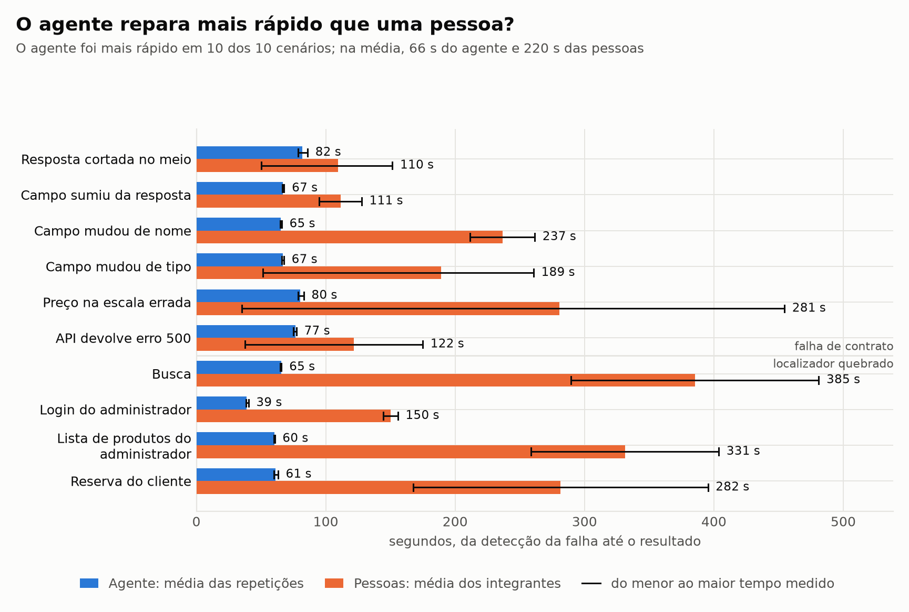

Fonte: elaborado pelos autores a partir de `fase5/medicao.json`; dados em `Documentacao/figuras/dados-das-figuras.md`.

**Como ler:** cada cenário de falha tem duas barras. A azul é o tempo médio do agente nas cinco repetições, e a laranja, o tempo médio das três pessoas, cada uma resolvendo o cenário uma vez. O traço preto vai do menor ao maior tempo medido de cada lado, e barra mais curta é reparo mais rápido. Nos seis cenários de cima, de falha de contrato, o resultado é o diagnóstico conferido em código; nos quatro de baixo, de localizador quebrado, é o teste passando de novo.

**O que a figura mostra:** o agente foi mais rápido nos 10 cenários, sem empate. O MTTR médio do agente foi de 66,3 s (intervalo de 95% de 60,9 a 71,5 s), e o tempo médio das pessoas, de 219,7 s (de 172,3 a 264,7 s): o agente levou cerca de um terço do tempo, com razão de 3,31 entre as médias. A diferença média por cenário foi de 153,4 s, com intervalo de 95% de 109,0 a 196,1 s, que não contém zero, e o teste dos sinais deu p = 0,0020. As três condições da regra L9 valem juntas, e a leitura afirma que o agente reparou mais rápido que as pessoas. É o resultado central da fase (decisão 151) <!-- fonte: resultados_alvo/fase5/medicao.json, campos lados.agente.geral e lados.pessoas.geral (tempo_media_s, tempo_ic_lo_s e tempo_ic_hi_s) e tempo.geral (diferenca_media_s, ic_lo_s, ic_hi_s, razao_das_medias, sinais, caso e lado); decisoes.md decisão 151 -->.

A segunda conta, o piso, põe 600 s no lugar de cada medida que não chegou ao fim: a diferença sobe para 213,1 s (de 149,2 a 272,8 s), o agente fica mais rápido em 9 cenários, e a regra daria o mesmo veredito (p = 0,0215). O cenário que muda de lado é o que a figura chama de "Resposta cortada no meio": a execução do agente que não fechou o cronômetro entra com o limite, e ali as pessoas ficam na frente. Por tipo de cenário a leitura mostra os números e não dá veredito (regra L10): no contrato a diferença média foi de 101,9 s (de 52,0 a 156,4 s), e no localizador, de 230,6 s (de 138,5 a 295,4 s). Em 4 dos seis cenários de contrato as faixas dos dois lados se cruzam, isto é, pelo menos uma pessoa foi mais rápida que o agente naquele cenário; nos quatro de localizador nenhuma faixa se cruza <!-- fonte: resultados_alvo/fase5/medicao.json, campos tempo.piso, tempo.por_tipo, tempo.por_cenario (faixas_se_cruzam) e regras.limite_s -->.

**E resolve tantos cenários quanto ela?** O agente teve Task Success em 49 de 50 execuções (98,0%, intervalo de Wilson de 95% de 89,5% a 99,6%), e as pessoas, em 14 de 30 tentativas (46,7%, de 30,2% a 63,9%). A parcela do agente foi maior nos 10 cenários, e o teste dos sinais deu p = 0,0020: pela regra L11, o agente resolveu mais cenários que as pessoas, veredito que só vale com a ressalva do parágrafo seguinte <!-- fonte: resultados_alvo/fase5/medicao.json, campo task_success (agente, pessoas, sinais, caso e lado) -->.

Esse segundo resultado tem uma ressalva, e não é lido sem ela (decisão 151): o veredito depende da sessão de um integrante só. O integrante 2 não corrigiu nenhum dos dez cenários e deixou 6 sem entrega, enquanto os outros dois corrigiram 5 e 9 de 10. É a sessão que entrou declarada, de quem já tinha lido a lista dos cenários e não fez o treino de seletor (decisão 150). Numa conta exploratória, feita depois de ver os números, a comparação foi refeita sem a sessão de um integrante por vez. Sem a do integrante 2, as pessoas ficam com 14 de 20, a parcela do agente é maior em 5 cenários e igual em 5, e o Task Success fica sem veredito: a regra pede pelo menos 6 cenários diferentes, e o teste dos sinais daria p = 0,0625. No tempo nada muda, e o agente continua mais rápido nos 10 cenários. Sem a sessão de qualquer um dos outros dois, os dois vereditos continuam. A regra L14 só deixa anular uma medida por falha do protocolo anotada na hora, e não pelo resultado. Por isso a leitura fica como as regras deram, e o trabalho afirma o resultado do tempo e declara a ressalva no do Task Success <!-- fonte: resultados_alvo/fase5/medicao.json, campo sem_um_integrante; resultados_alvo/fase5/manual.json, campos por_integrante e linhas.sem_fim; fase-5-relatorio.md §6 ("A ressalva do Task Success"); decisoes.md decisões 150 e 151 -->.

A expectativa do projeto de pesquisa era que o agente reduzisse o MTTR significativamente em relação à correção manual dos mesmos cenários. Nos dez cenários medidos ela se confirmou, com o agente na frente em todos e pela regra fixada antes da medida. O que o resultado não cobre está na seção 6.9, e as tabelas por cenário, por tipo e por integrante, com a segunda conta e a conta exploratória, estão na seção 6.10.10 <!-- fonte: Projeto de Pesquisa V3 §4; fase-5-relatorio.md §1 e §6 ("Contra a expectativa do projeto de pesquisa") -->.

## 6.9 Discussão

<!-- ! Alteração de IA - Revisar: (05/11/2026, versão 2) o prompt, que o texto dizia congelado "desde a Fase 3", passa a congelado desde as Fases 2-A e 2-B.
     ! Motivo: a mesma correção da seção 5.5: o corpo de linear não muda desde o primeiro commit de estrategias.py e o de linear_com_biblioteca, desde que foi criada, antes da corrida da Fase 2-B; "desde a Fase 3" fazia a comparação entre etapas parecer mais curta do que é. -->
Os resultados respondem à pergunta de pesquisa em três partes. A primeira, se um modelo pequeno, quantizado e rodando em CPU acerta a causa raiz com frequência útil, tem resposta positiva com limites: o modelo escolhido, qwen2.5:7b (decisão 52, que o adota com a biblioteca que ele mesmo escreveu), chegou, lendo a biblioteca original, a 75,0% de acerto (intervalo de confiança de 95% de 58,9 a 86,2) e 79,6% de acurácia balanceada nos 36 casos de avaliação na ponte de versão 0.34.4, e o qwen2.5-coder:7b, a 80,6% (65,0 a 90,2) e 82,5% na mesma ponte <!-- fonte: roadmap.md §2.3, tabela da ponte de versão 0.34.4 -->. A diferença entre os dois fica dentro do ruído entre corridas iguais, e a decisão 73 manteve a escolha, declarando o saldo do Coder nos casos inéditos como limitação <!-- fonte: decisoes.md, decisão 73 -->. O que a literatura previa serviu de premissa em um ponto, se confirmou em outro e se mostrou menor em um terceiro. Serviu de premissa a sensibilidade ao formato do prompt (SCLAR et al., 2024), razão pela qual o prompt ficou congelado desde as Fases 2-A e 2-B <!-- fonte: estrategias.py (corpo de linear e de linear_com_biblioteca, comparados por script em cada commit); pendencias.md ficha 34 -->; e confirmou-se o risco de aderir a material recuperado incorreto (WU; WU; ZOU, 2024), razão da validação em código de cada edição. Mostrou-se menor do que o esperado o ganho da biblioteca editada pelo próprio modelo: como Suzgun et al. (2025) apontam para modelos pequenos, o gargalo está em quem escreve, e o ganho não acompanha a biblioteca quando muda quem a lê (decisão 69); a cópia curada rende como a biblioteca inteira (decisão 71).

A segunda parte, se o agente sabe quando não sabe, tem uma resposta medida: a probabilidade conjunta dos tokens do rótulo separa acertos de erros com AUROC de 0,78 na sonda de confiança <!-- fonte: roadmap.md §7 (corrida 12) -->, o que a torna um sinal de triagem, não uma barreira; é a leitura que o selo de confiança da Fase 4 adota, com os limiares calibrados na corrida 16 e não escolhidos à mão. A trilha de raciocínio aberta, por sua vez, foi desenhada a partir do que a literatura sustenta sobre fidelidade do raciocínio: o texto que o modelo escreve sobre a própria decisão não é prova de que a decisão foi tomada por aquele motivo, e por isso a trilha registra o que o agente viu, o que fez e as conferências em código, com a justificativa por molde no lugar da prosa livre (seções 4.1.7 e 4.1.8).

<!-- ! Alteração de IA - Revisar: (05/11/2026, versão 2) dois parágrafos novos na segunda parte: as duas contas do carimbo de conflito, dizendo que a segunda sai de uma corrida que não rodou assim (decisão 88), e a medida com revisor humano que não foi feita (decisões 85, 86 e 87). Itens 2 e 3 da seção 15 do relatório da Fase 4.
     ! Motivo: a decisão 88 manda o TCC reportar as duas contas juntas, e a decisão 87 manda declarar a limitação nas seções 6.7 e 6.9; sem isso, quem lesse só a discussão levaria o 0,542 como medido e o relatório por caso como validado com um humano. -->
A Fase 4 acrescentou um segundo sinal, o carimbo de conflito do relatório por caso, que acende por conferência em código que não confere ou por intervenção que muda o rótulo; a regra fica como está, e o documento reporta as duas contas juntas (decisão 88) <!-- fonte: decisoes.md decisão 88; fase-4-relatorio.md §9.1 -->. Com as intervenções em todos os casos, como a corrida 22 rodou por causa da amostra fixa, a divergência pegou 4 dos 5 erros e acusou 20 dos 31 acertos: TPR vezes TNR de 0,284, contra 0,250 do acaso, quase sem separar erro de acerto, porque as intervenções mudam o rótulo também quando o modelo está certo, e a documentação pesar na resposta é o esperado <!-- fonte: fase-4-relatorio.md §9.1, bloco tb_f4_trilha_sinais -->. Por gatilho, como o agente roda fora da avaliação, a conta dá 0,542, com 3 dos 5 erros e 3 dos 31 acertos, mas essa contagem sai da corrida 22, que não rodou assim: as intervenções rodaram nos 36 casos, a conta só olha onde a probabilidade baixa ou a FONTE divergente as dispararia, e nenhuma corrida mediu o agente rodando por gatilho nesses casos <!-- fonte: fase-4-relatorio.md §9.1, bloco tb_f4_trilha_sinais; decisoes.md decisão 88 -->. O selo baixo sozinho, sem nenhuma inferência a mais, dá 0,523 <!-- fonte: fase-4-relatorio.md §9.1, bloco tb_f4_trilha_sinais -->. Com só 5 erros, nenhuma conta ordena os sinais: o intervalo de Wilson do TPR vai de 37,6 a 96,4% na divergência e de 23,1 a 88,2% por gatilho <!-- fonte: fase-4-relatorio.md §9.1 -->.

<!-- ! Alteração de IA - Revisar: (25/11/2026, Pós-Fase 4, pacote Q8) a discussão da medida com revisor humano passa a trazer a revisão da Pós-Fase 4.
     ! Motivo: o parágrafo terminava em "a limitação fica declarada, sem nova sessão"; a decisão 95 reabriu a medida, e ela foi feita em 09 e 10/11/2026 por um analista de QA de fora do projeto. -->
<!-- ! Alteração de IA - Revisar: (25/11/2026, Pós-Fase 4, pacote Q8) quem respondeu o relatório 1 da sessão de 05/11/2026 passa a ser o analista de QA, e não um integrante do grupo.
     ! Motivo: o Eric declarou no quadro, em 25/11/2026, que o relatório 1 foi respondido pelo analista de QA, que leu fora da página (ficha 105, decisão 166); o texto dizia "um integrante do grupo". -->
Se esses sinais e o relatório por caso ajudam um revisor humano a decidir ficou sem resposta na Fase 4: a sessão de 05/11/2026 tem 1 resposta, de um analista de QA de fora do projeto, que leu fora da página, e 10 pareceres do agente de apoio aprovados por um dos autores, sem resposta própria, e o parecer acertar 11 de 11 não é essa medida, porque quem o escreveu sabia quantos erros a amostra tem e consultou a biblioteca (decisões 85, 86, 87 e 166) <!-- fonte: fase-4-relatorio.md §9.5 -->. A Pós-Fase 4 deu uma resposta parcial, com o relatório refeito e a árvore de decisão: um analista de QA de fora do projeto tomou a decisão apropriada em 30 de 36 relatórios (seção 6.7) <!-- fonte: resultados_alvo/fase4/leitura_revisao_v3.md -->. É um leitor só, sem tempo medido: a medida diz que a evidência para decidir está no relatório, e não quanto tempo a decisão leva nem se ela se repete com outros leitores (decisões 114 e 117).

<!-- ! Alteração de IA - Revisar: (05/11/2026, versão 2) terceira parte refeita: sai a frase "o ciclo de correção da biblioteca (pacote P5) é a próxima tentativa de fechar essa distância"; entram o resultado do P5 (lote sem mudança de acerto nos inéditos), a revisão do caso ao vivo como o que encurtou a distância, a cura com o modelo no meio (corridas 21 e 21b), o MTTR com modelo e o limite do prompt da seção 3.3 do plano, com a decisão 90 e as corridas 18c e 21c pendentes. Itens 6 e 7 da seção 15 do relatório da Fase 4.
     ! Motivo: a frase ficou velha quando o P5 rodou em 03 e 04/11/2026, e a parte terminava sem o resultado das corridas 20 e 21b. -->
<!-- ! Alteração de IA - Revisar: (24/11/2026, Fase 5, pacote F6) na última frase, "ainda sem linha de base que diga se é bom" passou a dizer que a linha de base veio na Fase 5 (seção 6.8).
     ! Motivo: a frase afirmava que o MTTR com o modelo no meio não tinha termo de comparação, o que deixou de valer com a medida de 24/11/2026. Os números do parágrafo, que são das corridas 19 e 21b, não foram tocados (pacote Q8). -->
<!-- ! Alteração de IA - Revisar: (25/11/2026, Pós-Fase 4, pacote Q8) o MTTR do ensaio passa ao da corrida 21d, a leitura vigente.
     ! Motivo: a frase citava os 105,2 s da corrida 21b, que deixou de ser a leitura vigente em 05/11/2026. -->
A terceira parte, se a cura e o diagnóstico funcionam na tela, tem resposta parcial. A cura de seletor curou 160 das 160 quebras armadas na corrida 19, com MTTR do agente de 0,639 s na mediana (mínimo 0,355, máximo 0,887), sem modelo de linguagem, e as duas formas de armar a quebra deram a mesma árvore de acessibilidade e o mesmo resultado em 16 das 16 células comparadas <!-- fonte: roadmap.md §2.11, blocos tb_f4_cura_resumo e tb_f4_cura_formas -->. A taxa de 100% vem do desenho da corrida, e está declarada como limitação: cada modo de quebra ataca o estilo de localizador que ele quebra, e a mudança de texto acrescenta uma palavra; um sinônimo no lugar do texto ficaria abaixo do limiar do nome e não seria curado <!-- fonte: roadmap.md §2.11, limitações declaradas -->. Com o modelo no meio, a corrida 21 achou o que a 19 não via: a tela de login se recarrega sozinha em 30 s, enquanto o modelo pensa, e os candidatos eram verificados numa página que já era outra; o conserto verifica os candidatos numa página refeita até o passo que falhou, e a corrida 21b o conferiu, com 4 de 4 cenários de localizador curados <!-- fonte: fase-4-relatorio.md §8, bloco tb_f4_cenarios_por_tipo; roadmap.md §2.13 e §2.14 -->. O MTTR com o modelo no meio é de outra ordem de grandeza: 74,0 s na média dos dez cenários da corrida 21d, contra os 0,639 s da mediana sem modelo, e sem linha de base nessa fase; a linha de base veio na Fase 5 (seção 6.8) <!-- fonte: roadmap.md §2.20 e §2.11 -->.

<!-- ! Alteração de IA - Revisar: (25/11/2026, Pós-Fase 4, pacote Q8) o parágrafo do diagnóstico ao vivo é reescrito com as corridas 18c, 18d e 18e.
     ! Motivo: o parágrafo dizia que a tela ficava abaixo do caso escrito (26 contra 31), que a regra R2 não tinha sido cumprida e que as corridas 18c e 21c, pendentes, diriam se encurtar custa acertos; as corridas rodaram, e a leitura vigente é a da 18d. -->
O diagnóstico ao vivo começou abaixo do mesmo caso lido do arquivo e terminou a fase ao lado dele. Na primeira versão do caso ao vivo foram 16 acertos em 37; levar ao caso o que mudou contra a referência em modo normal (decisão 81) subiu para 26, contra 31 no arquivo, e a regra R2 ficou como limitação declarada (decisão 82) <!-- fonte: roadmap.md §2.10 -->. O ciclo de correção da biblioteca (pacote P5) rodou e não fechou essa distância: o lote não mudou acerto nenhum nos inéditos (b = 0, c = 0) <!-- fonte: fase-4-relatorio.md §7 -->. O que a fechou foi mexer no que chega ao modelo e à busca. A revisão do caso tinha custado tamanho: o prompt da tela passou do limite do plano, de 1409 tokens, e chegou a 2034, e como a leitura do prompt é a maior parte do tempo do diagnóstico, prompt maior é MTTR maior <!-- fonte: dados-das-figuras.md, "O prompt na tela cabe no limite?" -->. Encurtar o caso (decisão 90) pôs os 37 prompts dentro do limite sem custar acertos, 27 em 37, e baixou o tempo por caso na tela de 82,5 para 52,0 s <!-- fonte: roadmap.md §2.16 -->. Fazer a busca usar o que o caso mede contra a referência (decisão 97) levou o verbete certo de 21 para 36 dos 37 casos e o acerto a 32, contra 30 no arquivo; a tela perde 3 casos e ganha 5, e a regra R2 fecha no limite exato, pela leitura fixada antes da corrida (decisão 98) <!-- fonte: roadmap.md §2.19 -->. Nos 25 inéditos da corrida 18e, que a busca nunca tinha visto, o ganho se repetiu, com 22 acertos na tela e 18 no arquivo <!-- fonte: roadmap.md §2.21 -->. O resultado não diz que o modelo lê melhor da tela: o caso da tela leva uma medida que o caso escrito não tem, e em 37 e em 25 casos a diferença não se separa do acaso. Diz que, neste agente, o que mais move o acerto é o verbete certo chegar ao modelo, o que as Fases 2-B e 3-B já tinham medido com a documentação certa.

<!-- ! Alteração de IA - Revisar: (25/11/2026, Pós-Fase 4, pacote Q8) parágrafo novo na discussão, com o que os três experimentos da Pós-Fase 4 dizem.
     ! Motivo: a discussão não trazia as corridas 25, 26 e 27 nem dizia por que o agente medido na Fase 5 é o das corridas 18d e 21d. -->
Os três experimentos da Pós-Fase 4 apontam na mesma direção. Tirar da biblioteca as notas escritas pelo modelo, pedir uma segunda resposta e pôr o modelo para propor edições a partir de uma ficha curta não mudaram o acerto de forma que os casos disponíveis consigam comprovar (seção 6.7). No segundo pedido, se a segunda resposta valesse sempre, ela estragaria 6 dos 14 acertos com sinal para consertar 2 dos 10 erros: o que falta, quando o agente erra, é a primeira busca entregar o verbete certo, e não perguntar de novo <!-- fonte: roadmap.md §2.24 -->. Por isso o agente medido na Fase 5 é o das corridas 18d e 21d, sem mudança.

<!-- ! Alteração de IA - Revisar: (24/11/2026, Fase 5, pacote F6) parágrafo novo na Discussão com a resposta da Fase 5 ao quinto objetivo e com o alcance dela: o que o resultado do tempo cobre, o que não cobre e os dois pontos em que a comparação entre o agente e as pessoas é desigual.
     ! Motivo: a Discussão respondia à pergunta de pesquisa em três partes e parava na Fase 4, com o MTTR "ainda sem linha de base". Com a medida de 24/11/2026 falta a parte de valor, e ela precisa vir junto do que o desenho não deixa afirmar, para o leitor não levar o resultado para analistas experientes ou para falhas ocorridas em uso. Os números saem por script de `medicao.json`. -->
A Fase 5 acrescenta a resposta de valor, a do quinto objetivo. Nos dez cenários medidos, o agente reparou mais rápido que as pessoas, com MTTR médio de 66,3 s contra 219,7 s e na frente nos 10 cenários (seção 6.8) <!-- fonte: resultados_alvo/fase5/medicao.json, campos lados (geral.tempo_media_s) e tempo.geral.sinais -->. O MTTR com o modelo no meio, que na Fase 4 não tinha termo de comparação, passou a ter um, medido nos mesmos cenários e pelas mesmas definições. O resultado tem o alcance do desenho. Vale para falhas armadas, em dez cenários escolhidos pelo grupo, numa máquina, contra três estudantes do grupo no começo da prática, que leram o registro capturado de cada falha em vez de investigar o site no ar; não diz o que aconteceria com analistas de teste experientes nem com falhas ocorridas em uso. A comparação também é desigual em dois pontos, que puxam para lados opostos: o agente lê a biblioteca dele, e a pessoa conta com o que sabe e com o tutorial; a pessoa, por sua vez, pode entregar rápido e errado no cenário de contrato, e essa entrega entra no tempo médio dela como tempo curto. E o Task Success maior do agente é lido com a ressalva de que depende da sessão de um integrante (decisão 151). As limitações da medida estão listadas a seguir, depois das que atravessam todas as fases <!-- fonte: fase-5-relatorio.md §6 e §7 (itens 1, 2, 4, 5, 7, 9, 16, 18 e 19); decisoes.md decisão 151 -->.

<!-- ! Alteração de IA - Revisar: (05/11/2026, versão 2) a terceira limitação passa a dizer também que o MTTR do contrato e o do localizador não medem a mesma coisa (ficha 35). Item 8 da seção 15 do relatório da Fase 4.
     ! Motivo: o ensaio da corrida 21b dá um MTTR por tipo de cenário, e somar os dois sem a ressalva levaria a comparar coisas diferentes com a linha de base manual. -->
<!-- ! Alteração de IA - Revisar: (24/11/2026, Fase 5, pacote F6) na terceira limitação, "a linha de base manual [...] ainda não foi medida" passou a dizer que ela só foi medida na Fase 5, com três integrantes do grupo e as limitações da lista seguinte.
     ! Motivo: a frase negava uma medida que foi feita em 24/11/2026. A limitação continua, mas é outra: a linha de base existe, feita por três estudantes do grupo. -->
<!-- ! Alteração de IA - Revisar: (25/11/2026, Pós-Fase 4, pacote Q8) a quarta limitação deixa de prometer a revisão das marcações na entrega.
     ! Motivo: a frase dizia que a revisão humana das marcações era parte da entrega final; o texto final declara o que é verdade hoje: as marcações continuam no repositório, e a entrega em PDF e Word sai sem elas (decisão 158). -->
Três limitações atravessam todas as fases. As falhas são injetadas, não ocorridas, em duas aplicações sob controle do grupo, uma delas cedida por um integrante; os tempos valem para uma máquina, com um modelo carregado por vez; e a linha de base manual, que dá sentido ao MTTR, só foi medida na Fase 5, com três integrantes do grupo e as limitações listadas a seguir, além de o MTTR do contrato e o do localizador não medirem a mesma coisa (ficha 35): no contrato ele vai da detecção ao diagnóstico conferido em código, e no localizador, da detecção à reexecução validada <!-- fonte: pendencias.md ficha 35; fase-4-relatorio.md §8 -->. A quarta limitação é de método: parte do texto e do código foi escrita por um agente de apoio de inteligência artificial, com marcação para revisão em cada trecho; o que o grupo não revisou linha a linha continua marcado no repositório.

<!-- ! Alteração de IA - Revisar: (24/11/2026, Fase 5, pacote F6) o parágrafo e a lista das limitações da medida da Fase 5, escritos em 16/11/2026, antes da medida, com um acréscimo em 17/11/2026, foram refeitos com o que a noite a frio e as sessões das pessoas mostraram. Saíram a frase de que a medida ainda não tinha sido feita e o item do integrante que conhecia o HTML do site legado. Entraram a substituição de um integrante, o perfil dos três, a sessão que entrou declarada, a dependência do veredito do Task Success, a entrega errada que para o cronômetro, os dias das sessões e o reaproveitamento do prompt pelo Ollama. Depois da lista entrou um parágrafo com o incidente da corrida 28. Os outros itens são os de 16 e 17/11/2026, sem mudança de sentido.
     ! Motivo: o princípio 7 do plano da Fase 5 manda toda limitação entrar no texto do TCC, e a seção 7 do relatório da fase passou de 14 a 21 itens com as corridas 28 e 28b e com as sessões (decisões 145, 146, 149, 150 e 151). A lista de 16/11/2026 dizia o que o desenho previa: mantida, afirmaria que um dos três integrantes conhece o HTML do site legado, o que deixou de valer com a substituição, e calaria que o veredito do Task Success depende de uma sessão. Os números da lista saem por script de `manual.json`, `agente.json` e `medicao.json`; o perfil dos três vem da seção 2.4 do relatório da fase. -->
As limitações da medida da Fase 5 vêm de três lugares: do desenho, que o plano da fase declarou antes de qualquer medida; do que o tutorial, a sessão pela página e a noite a frio mudaram nele (decisões 135, 136, 145 e 146); e do que as sessões das pessoas mostraram (decisões 149, 150 e 151) <!-- fonte: plano-aprovado-fase-5.md §2 (princípio 7) e §12; fase-5-relatorio.md §7, itens 1 a 21 -->. São elas:

- a falha é armada, não ocorrida, dos dois lados, e os dez cenários foram escolhidos pelo grupo: os seis de contrato estão numa página só, e quatro deles no mesmo campo
- a detecção não é medida na pessoa: ela parte da ficha que a detecção do agente escreveu, e o MTTR do agente também começa depois da detecção
- a pessoa lê o registro do que aconteceu (a chamada à API, a foto da tela, o HTML da página), capturado antes na máquina-alvo, em vez de investigar o site no ar com as ferramentas do navegador
- nos seis cenários de contrato, corrigido quer dizer diagnosticado, com a causa e o campo certos e sem conserto da API (ficha 35); a pessoa escolhe a causa numa lista fechada de 23, como o agente
- o agente lê a biblioteca dele; a pessoa conta com o que sabe, com a explicação de uma linha de cada causa e com o tutorial
- três integrantes dão três tempos por cenário, e são estudantes do grupo que fez o projeto, não analistas de teste de fora; a ordem sorteada e o treino espalham o aprendizado entre os cenários, mas não o eliminam
- um dos três integrantes previstos foi substituído por um quarto integrante do grupo, porque tinha lido a lista dos cenários (decisão 149); a sessão de quem foi substituído não foi aberta, e, sem facilitador ao lado, que os dois não conversaram sobre os cenários é a palavra do grupo, e não um registro
- pelo perfil, a prática dos três que entram na leitura vai de "não muito tempo" a seis meses de programação para a web, dois nunca tinham usado as ferramentas do desenvolvedor do navegador, e nenhum conhece o código das aplicações-alvo: a linha de base mede estudantes no começo da prática, e com gente mais experiente o tempo das pessoas tende a ser outro
- uma das três sessões entrou fora de duas regras do protocolo, declaradas: a pessoa já tinha lido a lista dos cenários e não fez o treino de seletor (decisão 150); nessa sessão nenhum cenário foi corrigido, e 6 ficaram sem entrega
- o veredito do Task Success depende dessa sessão (decisão 151): sem ela, numa conta feita depois de ver os números, o Task Success fica sem veredito, e o do tempo continua; por isso o resultado central é o do tempo
- no cenário de contrato, a entrega errada também para o cronômetro: uma resposta rápida e errada entra na média do tempo das pessoas como tempo curto, o que favorece as pessoas na comparação do tempo; só com as medidas que tiveram Task Success, o tempo médio das pessoas é de 246,0 s, em 9 cenários
- não há facilitador ao lado: não abrir o repositório, não usar assistente de inteligência artificial e não conversar com os outros integrantes passam a ser um combinado, sem ninguém ao lado para conferir; e o aviso de que algo de fora atrapalhou um cenário é escrito pela própria pessoa, sem ninguém para conferir se a interrupção aconteceu (decisão 137)
- as sessões foram feitas em dias diferentes, de 18 a 24/11/2026, com os endereços das páginas nas mãos dos integrantes desde 17/11/2026: entre a primeira e a última passaram seis dias, em que os integrantes podiam ter conversado
- o aparelho, o navegador e o relógio são os de cada integrante, e o tempo de cada um inclui o de registrar a resposta na página; o tempo do agente é o da máquina-alvo, só em CPU, e mudaria em outra máquina
- no localizador, a resposta da pessoa é só um seletor CSS, conferido na hora contra uma fotografia do HTML; o que vale é o roteiro de verdade, rodado quando a sessão é trazida para a máquina-alvo, e o seletor que passa na página e não passa nele deixa o cenário como não corrigido, sem nova tentativa
- a quebra de localizador do agente é armada pelo ambiente de teste, e a que as pessoas veem, pela variante do front-end PHP; a corrida 19 mediu as duas formas iguais nas 16 células comparadas
- as cinco repetições do agente não são independentes, e por isso a unidade é o cenário, e são dez: o teste dos sinais só separa os lados quando quase todos os cenários apontam na mesma direção, e por tipo de cenário não há veredito
- o limite de 10 minutos corta o tempo de quem não termina, e a segunda conta, com 600 s por medida sem fim, é um piso; a diferença de menos de 5 s entre os dois lados num cenário é tratada como empate
- o Ollama guarda o prompt já lido e o reaproveita quando o mesmo cenário se repete; na noite a frio o modelo é descarregado entre as repetições, e a leitura confere que o prompt foi lido de novo, mas, dentro de uma repetição, o começo do prompt que os cenários dividem continua vindo guardado de um cenário para o outro (12,6% dos tokens de entrada de cada repetição), e a primeira execução de cada repetição paga a carga do modelo
- a noite do agente roda sem o trace do Playwright na falha, a gravação passo a passo do navegador que ajudaria a investigar uma execução que falhe (decisão 93), e com a barra de progresso ligada, que acompanha a chamada ao modelo e ainda não existia quando o ensaio vigente dos dez cenários foi medido
<!-- fonte: fase-5-relatorio.md §7, itens 1 a 21, e §2.4 (o perfil dos três); plano-aprovado-fase-5.md §12; resultados_alvo/fase5/manual.json, campos por_integrante e geral (estrita_media_s e estrita_cenarios); resultados_alvo/fase5/medicao.json, campo regras; resultados_alvo/fase5/agente.json, campo noite.frio.por_repeticao; protocolo-linha-de-base-manual.md §2 (os seis de contrato em `produtos_api.php`, quatro deles em `preco`) e §11; roadmap.md §2.11 (corrida 19, bloco tb_f4_cura_formas); decisoes.md decisões 93, 137, 149, 150 e 151 -->

A primeira noite do agente, a corrida 28, também de 18/11/2026, não entra na comparação. Ela foi lançada com o aplicativo do agente de apoio aberto, quando o plano pede o aplicativo e o editor de código fechados, e nela o Ollama reaproveitou nas repetições 2 a 5 o prompt lido na repetição 1, o que derrubou o MTTR dessas repetições para menos da metade do da primeira. A noite foi refeita com tudo fechado e a frio, e a corrida 28 ficou guardada como incidente, com os registros intactos (decisões 145 e 146). Refazer contraria a frase do plano de que a primeira noite completa é a que vale, e o desvio está declarado: a noite nova não foi pedida para melhorar o número, e a frio o agente fica mais lento <!-- fonte: fase-5-relatorio.md §2.3, §7 (item 15), §8 (desvios 28 a 30) e §11; decisoes.md decisões 145 e 146 -->.

## 6.10 Análise aprofundada dos dados

Esta seção é para quem quer conferir os valores e ver como os resultados se relacionam. A seção 6.10.1 cruza os resultados entre si; as demais trazem, fase a fase, as tabelas, os testes estatísticos e as limitações declaradas.

### 6.10.1 Como os resultados se relacionam

<!-- ! Alteração de IA - Revisar: (24/11/2026, Fase 5, pacote F6) a tabela abaixo ganhou uma linha, a última, com a relação que a Fase 5 mediu (quem repara a falha e em quanto tempo), e a fonte dela passou a citar a seção 6.10.10 e o arquivo `fase5/medicao.json`.
     ! Motivo: a tabela reúne o que mudou junto em cada fase e parava na Fase 4; a comparação do agente com as pessoas é a relação que dá sentido ao tempo medido nas linhas de cima. Os números da linha saem por script de `medicao.json`. -->
Cada linha da tabela a seguir liga uma coisa que mudou entre as corridas ao que mudou junto com ela.

<!-- ! Alteração de IA - Revisar: (25/11/2026, Pós-Fase 4, pacote Q8) a tabela das relações passa às leituras vigentes (corridas 18c, 18d e 21d) e ganha as linhas da busca, das notas do modelo, do segundo pedido e de quem lê o relatório.
     ! Motivo: a linha do tamanho do prompt dizia que a corrida 18c ainda ia medir se encurtar custa acertos, a do modelo no meio da cura trazia a mediana da corrida 21b, e a Pós-Fase 4 não aparecia. -->
Tabela: O que muda, o que acompanha e o que isso quer dizer
| O que muda | O que acompanha | O que isso quer dizer | Ver |
|---|---|---|---|
| Documentação certa entregue ao modelo | Acerto nos 36 casos: de 19,4% a 69,4% no qwen2.5-coder:3b e de 66,7% a 77,8% no qwen2.5:7b | Quem sabe menos sobre o sistema ganha mais com a documentação | 6.3 e 6.10.2 |
| Verbete errado com um registro de incidente falso | O granite4.2:8b e o qwen2.5-coder:3b repetem a causa plantada em 93,3% e 95,6% das respostas | A documentação pesa mais que o raciocínio do modelo; daí a validação em código | 6.3 e 6.10.2 |
| Quem lê a biblioteca | Com a mesma L1, quem escreveu ganha 4 casos; o Coder 7B ganha 1, e o Coder 3B perde 4 | O ganho é do par modelo e biblioteca, não da biblioteca sozinha | 6.5 e 6.10.4 |
| Casos já usados ou nunca vistos | Com a L1 do qwen2.5:7b: 32 certos nos 36 de avaliação e 26 nos 36 inéditos | Ganho em 36 casos não garante ganho em casos novos | 6.5 e 6.10.4 |
| Mais verbetes no prompt (k de 3 para 5) | Acurácia balanceada de 81,5% para 75,7%; prompt mediano de 1106,5 para 1469 tokens | Mais texto não trouxe mais acerto | 6.10.6 |
| Probabilidade que o modelo dá ao rótulo | Erro de 8,1% no selo alto e de 55,6% no baixo | Serve para escolher o que vai para revisão, não para garantir | 6.7 e 6.10.6 |
| Detalhe no caso montado da tela | Acerto na tela de 16 para 26 em 37; prompt até 2034 tokens, acima do limite de 1409 | A informação a mais ajudou, e custou tamanho | 6.7 e 6.10.6 |
| Tamanho do prompt | Com o caso encurtado, o tempo por caso na tela foi de 82,5 para 52,0 s, e o acerto, de 26 para 27 em 37 | Encurtar reduziu o tempo sem custar acertos | 6.7 e 6.10.6 |
| O que a busca lê do caso | Verbete certo entregue em 36 dos 37 casos, e não em 21; acerto na tela de 27 para 32 | Entregar o verbete certo moveu mais o acerto do que mexer no texto do caso | 6.7 e 6.10.6 |
| Modelo no meio da cura | Mediana de 0,639 s só em código e de 67,6 s com o diagnóstico no meio | O tempo do agente é o tempo do modelo | 6.7 e 6.10.6 |
| Filtros sobre o que o modelo escreve | 92 propostas, 19 no lote, 11 em produção; nenhum caso mudou nos 36 inéditos | Os filtros seguram o que entra, mas o lote não trouxe acerto | 6.7 e 6.10.7 |
| Forma de contar a divergência da trilha | TPR vezes TNR de 0,284 em todos os casos e de 0,542 por gatilho, com 5 erros | O resultado depende da conta, e 5 erros não põem os sinais em ordem | 6.7 e 6.10.8 |
| Notas do modelo na biblioteca | 54 acertos em 72 sem as notas e 56 com elas; tempo do meio por caso de 66,35 para 57,63 s | Tirar as notas não muda o acerto que 72 casos conseguem comprovar, e encurta o prompt | 6.7 e 6.10.11 |
| Segundo pedido ao modelo | De 56 para 54 acertos em 72, pela regra de escolha | Perguntar de novo não conserta: falta o verbete certo na primeira busca | 6.7 e 6.10.11 |
| Quem lê o relatório por caso | Decisão apropriada em 30 de 36 relatórios, com um leitor de fora do projeto | A evidência para decidir está no relatório; o tempo não foi medido | 6.7 e 6.10.11 |
| Quem repara a falha: o agente ou uma pessoa | MTTR médio de 66,3 s do agente contra 219,7 s das pessoas; o agente mais rápido nos 10 cenários | Com o modelo no meio, o agente ainda leva cerca de um terço do tempo de uma pessoa, nos dez cenários medidos | 6.8 e 6.10.10 |
Fonte: elaborado pelos autores a partir das seções 6.10.2 a 6.10.8, 6.10.10 e 6.10.11 e de `Documentacao/figuras/dados-das-figuras.md`. <!-- fonte: comparacao_fases.json (nos_36_avaliacao, adesao_cega_2B_A5_pct); analise_fase3b.json (cruzada.celulas, ineditos.linhas); calibracao.json (por_k, por_selo); tela.json e tela_v2.json; prompt_tela_blocos.json; cura.json e cenarios_v2.json; biblioteca.json e biblioteca_producao/fechamento.json; trilha.json; fase-4-relatorio.md §8; fase5/medicao.json (lados e tempo.geral) -->

<!-- ! Alteração de IA - Revisar: (25/11/2026, Pós-Fase 4, pacote Q8) a frase final passa a dizer o que as corridas 18c e 21c mediram.
     ! Motivo: a frase dizia que as duas corridas ainda iam medir. -->
Lidas juntas, essas relações sugerem que a informação que chega ao modelo, como a documentação certa e o caso que diz o que mudou, moveu mais o acerto do que a biblioteca escrita por ele, cujo ganho no qwen2.5:7b não se repetiu nos casos inéditos; o caso revisado vem de uma só repetição. O que custa tempo é o tamanho do que o modelo lê. As corridas 18c e 21c mediram o que acontece quando as duas coisas puxam em direções opostas: o caso encurtado custou menos tempo e não custou acertos, e o que levou o acerto na tela adiante, depois, foi a busca entregar o verbete certo.

### 6.10.2 Sem documentação e com a biblioteca recuperada: Fases 2-A e 2-B

A Fase 2-A mediu o que seis modelos locais diagnosticam sem documentação do sistema. Cada um, em quantização Q4_K_M (pesos comprimidos), respondeu a 90 fixtures do cobaia real (6 classes de defeito × 3 níveis × 5 casos, com 23 causas raiz) em três estratégias de prompt, o que deu 1.620 inferências no Ollama, só em CPU, no Ryzen 7 5800H, com temperatura 0,1; a métrica foi o acerto da causa raiz (rótulo de um conjunto fechado), com intervalo de confiança (IC) de Wilson e teste exato de McNemar. <!-- fonte: fase-2a-relatorio-por-modelo.md §1 -->

Só o granite4.2:8b chegou perto da meta de 70–80%, com 67,8% de acerto a 45,7 s por caso, seguido de qwen2.5:7b (53,3% em 17,1 s), qwen2.5-coder:7b (48,9%), qwen2.5-coder:3b (25,6%), phi4-mini:3.8b (23,3%) e qwen2.5-coder:1.5b (5,6%). <!-- fonte: fase-2a-relatorio-por-modelo.md §2 --> Estruturar o raciocínio em estágios não ajudou: nos 540 pares, o prompt linear acertou 37,4% e os estágios com nomes de compilador e de domínio, 33,5% e 33,9%, e a diferença entre linear e compilador (p = 0,037) vem toda do granite4.2:8b, que deixou 15 e 18 respostas sem CAUSA_RAIZ em 90. <!-- fonte: fase-2a-relatorio-por-modelo.md §3 --> A classe do defeito previu a dificuldade e o nível não: runtime foi a mais fácil (média de 60,0) e tradução a mais difícil (18,9). <!-- fonte: fase-2a-relatorio-por-modelo.md §4.1 e §4.2 --> Os erros seguiram três modos: confusão entre causas vizinhas, colapso num rótulo (92% das respostas do qwen2.5-coder:1.5b em corpo_nao_e_json) e rótulo inventado (25,6% das respostas do phi4-mini:3.8b). <!-- fonte: fase-2a-relatorio-por-modelo.md §5 -->

A fase fixou o prompt linear da 2-B (decisão 19) e deixou a hipótese de que a biblioteca age em tradução e efeito, classes que dependem de conhecer o sistema. <!-- fonte: fase-2a-relatorio-por-modelo.md §9; decisoes.md, decisão 19 --> Limitações declaradas: uma execução por condição a temperatura 0,1, IC de ±10 pontos percentuais (pp) com 90 casos, 23 rótulos fechados e só Q4_K_M, uma máquina e o português. <!-- fonte: fase-2a-relatorio-por-modelo.md §8 -->

A Fase 2-B (07 a 09/09/2026) repetiu os 90 casos na máquina-alvo, um notebook corporativo (Intel i5-1235U, 15,7 GB de RAM, sem GPU dedicada), refazendo nela a linha de base (decisão 25), que reproduziu o acerto do Ryzen, mas com tempo 2× maior (1,6–2,3×). <!-- fonte: roadmap.md §1; fase-2b-relatorio-por-modelo.md §1 e §2; decisoes.md, decisão 25 --> Com 36 verbetes, as condições foram A0 (sem biblioteca), A1 (biblioteca inteira no prompt), A2 (3 verbetes recuperados por BM25 e sinais calculados em código), A3 (só o verbete certo), A4 (3 verbetes plausíveis mas errados) e A5 (um verbete errado e um registro de incidente falso), em 2.610 inferências; A3 a A5 rodaram só em granite4.2:8b, qwen2.5-coder:3b e phi4-mini:3.8b (decisão 24). <!-- fonte: fase-2b-relatorio-por-modelo.md §1; decisoes.md, decisão 24 -->

A biblioteca recuperada ficou igual ou acima da inteira nos seis modelos: três modelos cruzaram a meta de 70%, e o qwen2.5-coder:3b foi de 23,3% a 63,3% (+40 pp), sem perder um caso, a 29,7 s por caso. A hipótese da 2-A se confirmou pela metade: o ganho médio dos seis modelos foi de +26,7 pp em efeito e de só +4,5 pp em tradução. <!-- fonte: fase-2b-relatorio-por-modelo.md §3, §5 e §8 -->

Tabela: Acerto por condição de biblioteca, por modelo (Δ em pp e p de McNemar contra A0)
| Modelo | A0 | A1 inteira | Δ | p | A2 recuperada | Δ | p | IC 95% de A2 |
|---|---|---|---|---|---|---|---|---|
| granite4.2:8b | 66,7% | 61,1% | −5,6 | 0,50 | 76,7% | +10,0 | 0,12 | 66,9–84,2 |
| qwen2.5-coder:7b | 50,0% | 63,3% | +13,3 | 0,07 | 72,2% | +22,2 | 0,0005 | 62,2–80,4 |
| qwen2.5:7b | 57,8% | 62,2% | +4,4 | 0,50 | 70,0% | +12,2 | 0,07 | 59,9–78,5 |
| qwen2.5-coder:3b | 23,3% | 32,2% | +8,9 | 0,06 | 63,3% | +40,0 | <0,001 | 53,0–72,6 |
| phi4-mini:3.8b | 23,3% | 22,2% | −1,1 | 1,00 | 25,6% | +2,3 | 0,79 | 17,7–35,4 |
| qwen2.5-coder:1.5b | 5,6% | 6,7% | +1,1 | 1,00 | 16,7% | +11,1 | 0,002 | 10,4–25,7 |
Fonte: relatório da Fase 2-B (Memorial), tabela gerada por avaliar.py. <!-- fonte: fase-2b-relatorio-por-modelo.md §3 -->

O teto é a recuperação: com só o verbete certo (A3), o granite4.2:8b acertou 100,0% e o qwen2.5-coder:3b 92,2%, mas o recuperador pôs o verbete certo entre os três (hit@3) em 78,9% dos casos. <!-- fonte: fase-2b-relatorio-por-modelo.md §4 --> Documentação errada foi obedecida: com 3 verbetes errados (A4), o granite4.2:8b caiu de 66,7% a 22,2%, e com A5 ele e o qwen2.5-coder:3b repetiram a causa plantada em 93,3% e 95,6% das respostas, como a literatura previa para evidência parafraseada (LI, Y. et al., 2025). <!-- fonte: fase-2b-relatorio-por-modelo.md §6 --> Precisões maiores (q8_0 e fp16) não tiraram o qwen2.5-coder:1.5b do piso: de 5,6% (Q4_K_M) a 8,9%. <!-- fonte: fase-2b-relatorio-por-modelo.md §7 -->

A 2-B fixou a biblioteca recuperada, nunca a inteira, como modo de operação e condicionou a gestão da biblioteca pelo próprio modelo a validação por código (decisão 28), levando essa gestão à Fase 3 (decisão 13'). <!-- fonte: fase-2b-relatorio-por-modelo.md §12; decisoes.md, decisões 13' e 28 --> Limitações declaradas: uma execução por condição a temperatura 0,1, recuperação igual para os seis modelos (o hit@3 de 78,9% é constante do experimento), A5 como pior caso construído e só o português. <!-- fonte: fase-2b-relatorio-por-modelo.md §11 -->

### 6.10.3 O que o modelo escreve e a escolha do modelo: Fase 3

A Fase 3 testou se o próprio modelo melhora a documentação que consulta sem estragá-la. Quatro modelos (granite4.2:8b, qwen2.5:7b, qwen2.5-coder:7b e qwen2.5-coder:3b) diagnosticaram os 90 casos com a condição A2 e, em três épocas, propuseram acréscimos à própria cópia da biblioteca (nota, retificação ou verbete novo), aceitos só após validação em código (decisões 30 a 33). <!-- fonte: fase-3-relatorio-por-modelo.md §1; decisoes.md, decisões 30 a 33 --> Os casos foram partidos em 54 de aprendizado, em que o modelo vê a causa correta, e 36 de avaliação, sem esse retorno (decisão 31); L0 é a biblioteca original e L1 a L3 são as versões após cada época; a bateria rodou de 13 a 15/09/2026, em 57h59, com 2.088 inferências. <!-- fonte: fase-3-relatorio-por-modelo.md §1; roadmap.md §1; decisoes.md, decisão 31 -->

Nos 36 casos de avaliação só o qwen2.5:7b saiu do lugar: de 77,8% a 88,9% de acerto em L1, com 4 casos ganhos e nenhum perdido, e de 81,2% a 91,7% de acurácia balanceada (média do acerto por causa raiz), a métrica primária. <!-- fonte: fase-3-relatorio-por-modelo.md §3, blocos curva_acerto e curva_balanceada -->

Tabela: Acerto da causa raiz por modelo e versão da biblioteca, nos 36 e nos 54 casos
| Modelo | L0 (36) | L1 (36) | L2 (36) | L3 (36) | L0 (54) | L1 (54) | L2 (54) | L3 (54) |
|---|---|---|---|---|---|---|---|---|
| granite4.2:8b | 80,6% | 80,6% | 80,6% | 80,6% | 74,1% | 75,9% | 70,4% | 72,2% |
| qwen2.5-coder:7b | 75,0% | 75,0% | 75,0% | 77,8% | 68,5% | 74,1% | 72,2% | 68,5% |
| qwen2.5:7b | 77,8% | 88,9% | 83,3% | 86,1% | 66,7% | 68,5% | 68,5% | 72,2% |
| qwen2.5-coder:3b | 69,4% | 72,2% | 72,2% | 72,2% | 63,0% | 63,0% | 63,0% | 64,8% |
Fonte: relatório da Fase 3 (Memorial), tabela gerada por avaliar_fase3.py. <!-- fonte: fase-3-relatorio-por-modelo.md §3, bloco curva_acerto -->

Nenhuma das 36 comparações pareadas contra L0 teve p < 0,05, e a maior diferença, +11,1 pp, ficou abaixo do efeito mínimo detectável de 19,4 pp com 36 casos (a menor diferença que o teste exato aponta como significativa, supondo 20% de pares discordantes). <!-- fonte: fase-3-relatorio-por-modelo.md §4, blocos pareado e mde --> O granite4.2:8b, o mais caro (131,3 s por diagnóstico e 26h58 de bateria, contra 66,8 s e 13h53 do qwen2.5:7b), não escreveu nada que entrasse (0 de 181 propostas aceitas, 133 barradas por texto_longo, isto é, texto acima de 280 caracteres) e por isso tem curva plana. <!-- fonte: fase-3-relatorio-por-modelo.md §6 e §9 --> Das 63 edições revisadas, 23 eram corretas, 17 parciais e 23 erradas, e 21 das corretas repetiam o verbete original, de modo que o ganho de L1 não pode ser creditado à verdade do que foi escrito. <!-- fonte: fase-3-relatorio-por-modelo.md §7 -->

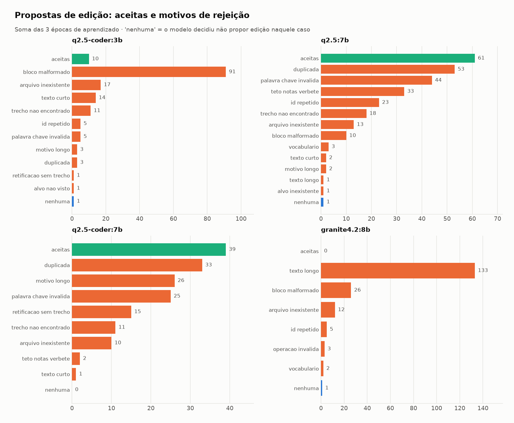

Fonte: elaborado pelos autores a partir dos registros da Fase 3 (figura 14 de `resultados_alvo/graficos/`).

**Como ler:** cada quadro é um modelo. A barra verde conta as propostas aceitas; as laranja, as recusadas, por motivo; a azul, os casos em que o modelo decidiu não propor nada. As escalas diferem de um quadro para outro.

**O que a figura mostra:** cada modelo erra de um jeito. O granite4.2:8b escreve textos longos demais, o qwen2.5-coder:3b erra o formato, e o qwen2.5:7b, o que mais teve propostas aceitas, repete o que já existe.

Hipóteses e vereditos:

- H1, "Nos 36 de avaliação, acerto com L3 > L0 nos modelos de 7–8B (McNemar exato, α = 0,05)": não confirmada, pois o maior ganho foi +8,3 pp (qwen2.5:7b, p = 0,25) e nenhum p ficou abaixo de 0,05. <!-- fonte: fase-3-relatorio-por-modelo.md §2, H1 -->
- H2, "O ganho concentra-se nas classes em que a recuperação é fraca (tradução: hit@3 = 46,7%), via aumento do hit@3 da biblioteca do modelo": não confirmada, pois o hit@3 do qwen2.5:7b nos 90 casos foi de 80,0 em L0 a 77,8 em L1. <!-- fonte: fase-3-relatorio-por-modelo.md §2, H2 -->
- H3, "Nos 54 de aprendizado o ganho é maior que nos 36; a diferença quantifica a memorização": não confirmada e, no vencedor, invertida, pois o qwen2.5:7b ganhou +11,1 pp nos 36 e +1,8 nos 54 em L1. <!-- fonte: fase-3-relatorio-por-modelo.md §2, H3 -->
- H4, "A taxa de aceitação das propostas cresce com o porte; o 3B tem mais rejeições por formato": parcial, pois o 3B teve mais rejeições por formato (bloco_malformado em 91 de 151), mas o granite4.2:8b, o maior, teve 0 de 181 propostas aceitas. <!-- fonte: fase-3-relatorio-por-modelo.md §2, H4 -->
- H5, "Autoenvenenamento (casos certos em L(n) que viram errados em L(n+1), nos 36) fica abaixo de 10%; se superar o ganho, o modelo é vetado": confirmada, pois o máximo foi 5,6% (qwen2.5:7b, de L1 para L2) e nenhum modelo foi vetado. <!-- fonte: fase-3-relatorio-por-modelo.md §2, H5 -->
- H6, "A curva não é monótona: reportar o melhor L e o L3, nunca só o último": confirmada, pois a acurácia balanceada do qwen2.5:7b nos 36 foi 81,2%, 91,7% (L1), 84,2% e 86,2%. <!-- fonte: fase-3-relatorio-por-modelo.md §2, H6 -->

Limitações declaradas: 36 casos de avaliação, com efeito mínimo detectável de 19,4 pp; os mesmos 36 casos da 2-B, de modo que só casos inéditos fecham a dúvida sobre memorização; um único revisor das edições (primeira passada por IA, aceita na decisão 56); uma execução por condição; e cada modelo ter lido a biblioteca que escreveu, o que confunde escritor e leitor, limitação que a Fase 3-B testou depois (decisão 69). <!-- fonte: analise-decisoria-modelo-final.md §9; decisoes.md, decisões 56 e 69 -->

A escolha seguiu uma regra fixada antes da bateria (decisão 36) e reafirmada antes da leitura dos resultados (decisão 46): ordenar pela acurácia balanceada nos 36 casos, vetar autoenvenenamento máximo acima de 10%, desempatar pela licença e depois pela época mais baixa, e só então examinar a robustez. <!-- fonte: analise-decisoria-modelo-final.md §2 --> Venceu o qwen2.5:7b em L1, com 91,7% de acurácia balanceada (acerto de 88,9%), à frente da própria L3 (86,2%), do qwen2.5-coder:7b em L3 (84,2%) e do granite4.2:8b (83,3%), sem veto, e foi o melhor em 77,6% das 2.000 reamostragens dos 36 casos e em 50,0% nas dos 90. <!-- fonte: analise-decisoria-modelo-final.md §3 e §4, blocos dm_regra_36 e dm_bootstrap --> A reamostragem é o bootstrap (EFRON, 1979): os casos são sorteados de novo, com reposição, formando conjuntos do mesmo tamanho em que alguns casos se repetem e outros ficam de fora, e a conta é refeita em cada conjunto; a parcela dos conjuntos em que uma combinação fica em primeiro diz o quanto a escolha depende de quais casos caíram na amostra. O projeto sorteia os casos, e não as respostas, com semente fixa, para que a conta se repita. Confirmada em 22/09/2026 (decisão 52), a escolha leva à Fase 4 o qwen2.5:7b com a cópia L1, depois da curadoria humana das 40 edições da época 1 (decisões 52 e 60). <!-- fonte: decisoes.md, decisões 52 e 60 -->

### 6.10.4 Quem escreve, quem lê e a variação entre corridas: Fase 3-B

A Fase 3-B mediu as limitações da Fase 3 que tinham teste barato (decisão 56). <!-- fonte: fase-3b-relatorio.md §1 --> Como o Ollama, servidor local que executa os modelos, se atualiza sozinho, a decisão 47 exige uma ponte de versão antes de qualquer inferência nova: repete-se a biblioteca original (L0) nos 36 casos de avaliação e contam-se os casos que só a ponte acertou (b) e os que só a Fase 3 acertou (c), e com b mais c até 2 por modelo a corrida seguinte é pareável (comparável caso a caso) com a Fase 3. <!-- fonte: decisoes.md decisão 47; fase-3b-relatorio.md §7 -->

A Fase 3 rodou em Ollama 0.34.0 e as pontes em 0.34.1, 0.34.4 e 0.40.2; em 0.34.4 o qwen2.5-coder:7b saiu do limite (b/c 3/1, p = 0,6250); em 0.40.2 os dois modelos de 7 bilhões de parâmetros ficaram pareáveis (b/c 1/0 cada); e entre corridas do mesmo modelo com a mesma entrada de 0 a 3 casos em 36 mudam de acerto, de modo que com uma corrida por versão não se separa a versão do acaso. <!-- fonte: fase-3b-relatorio.md §3 e §4.3 -->

Para testar se o ganho generaliza, escreveram-se 36 casos inéditos, só a partir do código do sistema-cobaia, que somados aos 36 oficiais formam 72 casos de avaliação; cada modelo os leu com a biblioteca original e com as versões que ele mesmo escreveu, L1 (a original mais as edições aceitas na época 1) e L3 (com as das três épocas). <!-- fonte: fase-3b-relatorio.md §4; roadmap.md §2.1 --> O ganho da L1 no qwen2.5:7b, de 77,8% a 88,9% nos oficiais, não reapareceu nos inéditos (de 75,0% a 72,2%); nos 72 casos, a L1 leva o acerto de 76,4% a 80,6% (b/c 4/1, p = 0,375) e a L3 a 83,3% (b/c 6/1, p = 0,125), abaixo do efeito mínimo detectável de 13,9 pontos, e a hipótese H1 segue não confirmada. <!-- fonte: fase-3b-relatorio.md §4 -->

Na troca cruzada, os dois modelos Coder (qwen2.5-coder:7b e qwen2.5-coder:3b) leram, nos 36 oficiais, as bibliotecas L1 e L3 escritas pelo qwen2.5:7b, o doador, contra o próprio L0 da ponte na mesma versão do Ollama (0.34.4): o Coder 7B foi de 80,6% a 83,3% (3 ganhos, 2 perdas, p = 1,0); o Coder 3B caiu de 72,2% a 61,1% (1 ganho, 5 perdas, p = 0,2188) e passou a responder corpo_nao_e_json, causa ausente dos 36 casos, em 7 respostas contra 2; lida por quem a escreveu, a mesma L1 rende 88,9%. <!-- fonte: fase-3b-relatorio.md §5 --> A decisão 69 fixou, por isso, o padrão do agente: o modelo com a biblioteca que ele mesmo escreveu, e não a biblioteca como peça independente; trocar o modelo que lê exige medir de novo. <!-- fonte: decisoes.md decisão 69 -->

O qwen2.5:7b e o qwen2.5-coder:7b foram confrontados caso a caso pelo teste de McNemar exato: nos 36 oficiais o qwen lidera com todas as versões da biblioteca (tabela), e na regra pré-registrada da decisão 36 o qwen2.5:7b com a L1 fica em primeiro, com 91,7% de acurácia balanceada, contra 84,2% da melhor combinação do Coder, em 4º. <!-- fonte: comparativo-qwen25-7b-vs-coder-7b.md §1 e §5 -->

Tabela: Confronto entre qwen2.5:7b e qwen2.5-coder:7b nos 36 casos de avaliação (Δ é Coder menos qwen)
| Fase 3 · confronto caso a caso | n | ambos acertam | nenhum | só o Coder | só o qwen | Δ | p (McNemar exato) |
|---|---|---|---|---|---|---|---|
| F3 · L0 · 36 de avaliação | 36 | 23 | 4 | 4 | 5 | -2,8 pp | 1,0000 |
| F3 · L1 · 36 de avaliação | 36 | 26 | 3 | 1 | 6 | -13,9 pp | 0,1250 |
| F3 · L3 · 36 de avaliação | 36 | 26 | 3 | 2 | 5 | -8,3 pp | 0,4531 |
Fonte: comparativo qwen2.5:7b contra qwen2.5-coder:7b (Memorial), seção 5, bloco cq_confronto_f3 gerado por comparar_qwen_coder.py. <!-- fonte: comparativo-qwen25-7b-vs-coder-7b.md §5, bloco cq_confronto_f3 -->

Nos 36 inéditos, na corrida 7, o Coder passa à frente dentro do ruído, com 86,1% contra 72,2% usando a L1 de cada um (b/c 6/1, p = 0,125), mas o placar nos 72 casos é 7/7 (p = 1,000); a repetição de 23/10/2026 (corridas 14 e 15) deu 83,3% contra 72,2% (b/c 5/1, p = 0,219) e 6/7 nos 72 casos. <!-- fonte: fase-3b-relatorio.md §4.1 e §4.3 --> A decisão 73 manteve a decisão 52 (qwen2.5:7b com a L1): o saldo é reproduzível, mas não separa os dois no teste pareado e some quando os 36 oficiais entram; fica como limitação declarada, e o plano da Fase 4 passou a prever mais casos inéditos. <!-- fonte: decisoes.md decisão 73 -->

Limitações declaradas: um doador e dois leitores da família Qwen2.5, só as versões L1 e L3 e uma corrida por condição; a direção inversa (o qwen2.5:7b lendo a biblioteca de outro modelo) não rodou, e só a diferença do 3B contra o doador com a L1 tem p abaixo de 0,05 (p = 0,002); os 36 inéditos foram escritos por IA e conferidos contra o código. <!-- fonte: fase-3b-relatorio.md §5 e §8 -->

### 6.10.5 Disco, atlas e probabilidade do rótulo: Pré-Fase 4

Na primeira frente, avaliou-se o colibri, motor de inferência para modelos de mistura de especialistas (MoE), que lê do disco, a cada token, os pesos de que o roteador precisa. Na máquina de medição (i5-1235U, 16,0 GB de RAM, 218,1 GB livres no NVMe), o GLM-5.2 pede 372,0 GB de disco e não cabe, 2 modelos grandes cabem mas ficam no mínimo de RAM declarado, sem medida publicada, e só o OLMoE roda com folga; numa máquina de 32 GB, o GLM-5.2 levaria 12,7 minutos só de geração para uma resposta do tamanho da nossa mediana, 11,4 vezes o tempo total de um diagnóstico de hoje. <!-- fonte: pre-fase-4-relatorio.md §2.2 --> A decisão 75 fechou o colibri como motor do agente e cancelou a corrida 13, mantendo a pesquisa. <!-- fonte: decisoes.md decisão 75 -->

Na segunda frente, o método do atlas de especialistas do colibri foi aplicado aos dados do projeto, com os verbetes da biblioteca no lugar dos especialistas e as classes de defeito no lugar dos tópicos: com a biblioteca original, o atlas prevê a classe de um caso pelos verbetes da rota de busca, deixando o próprio caso de fora, em 65,6% dos 90 casos da bateria oficial, contra um acaso de 16,7%, e em 63,9% dos inéditos; os verbetes que o modelo escreveu não são entregues pela busca e aparecem com zero casos. <!-- fonte: pre-fase-4-relatorio.md §3.2 e §3.3 -->

Na terceira frente, a corrida 12 (06/10/2026, Ollama 0.34.4) gravou a probabilidade de cada token do rótulo nos 72 casos que nenhuma biblioteca viu, com o qwen2.5:7b lendo a biblioteca original, a L1 inteira e a cópia curada da L1: 216 diagnósticos, 46 erros. <!-- fonte: pre-fase-4-relatorio.md §4.2 --> A AUROC, medida de quão bem um sinal separa erros de acertos, é 0,783 [0,684 a 0,882] para a probabilidade conjunta do rótulo, contra 0,541 e 0,626 de dois sinais sem custo de inferência (verbete do contexto e classe da rota); mas 23 dos 46 erros têm probabilidade acima de 0,85, e revisar os 10% de menor probabilidade pega 14 dos 46 erros (tabela), de modo que o sinal é triagem, não barreira. <!-- fonte: pre-fase-4-relatorio.md §4.2 -->

Tabela: Revisão humana dos casos de menor probabilidade do rótulo (corrida 12)
| Recorte | Parcela revisada | Casos revisados | Erros pegos | Acertos revisados à toa | Risco no que sobra |
|---|---|---|---|---|---|
| todas as versões | 10% | 22 | 14 de 46 | 8 | 16,5% |
| todas as versões | 30% | 65 | 26 de 46 | 39 | 13,2% |
Fonte: relatório da Pré-Fase 4 (Memorial), seção 4.2, bloco tb_conf_revisao gerado por analisar_confianca.py. <!-- fonte: pre-fase-4-relatorio.md §4.2, bloco tb_conf_revisao -->

A cópia curada da L1 rendeu como a L1 inteira (80,6% contra 81,9% nos 72 casos), e a decisão 71 a manteve como biblioteca de partida da Fase 4. <!-- fonte: pre-fase-4-relatorio.md §4.2; decisoes.md decisão 71 -->

A parte B da pesquisa rodou em nove tópicos e duas ondas de agentes porque nove tópicos num só Workflow passariam de 30 agentes por onda (decisão 76); a onda 1 trouxe 79 afirmações, 78 verificadas, e a onda 2, 64, todas verificadas. <!-- fonte: decisoes.md decisão 76; pre-fase-4-relatorio.md §4.3 --> A especificação da trilha de raciocínio aberta (versão 1), saída da onda 1, foi aprovada como base da Fase 4 (decisão 77): um arquivo JSONL por corrida, uma linha por evento, com cabeçalho da corrida (modelo, versão do Ollama e hashes); em cada nó de decisão, o que o programa fez, o que o modelo declarou e o que o código conferiu ficam separados; e não há segunda chamada ao modelo para explicar ou julgar, que custaria de 47 a 78 s por inferência. <!-- fonte: decisoes.md decisão 77; especificacao-trilha-e-relatorio.md §1 a §3 --> A saída restrita por gramática (23 causas) foi adiada (decisão 78), porque altera a probabilidade do rótulo, e a Fase 4 confere em código as quatro linhas da resposta. <!-- fonte: decisoes.md decisão 78 -->

Limitações declaradas: a conta do colibri usa medidas publicadas por terceiros, com outro modelo; as trilhas das corridas gravadas são remontadas; a sonda tem uma corrida por biblioteca e 46 erros em 216 diagnósticos, com intervalos largos. <!-- fonte: pre-fase-4-relatorio.md §6 -->

### 6.10.6 Tela, verbetes, prompt e tempo: corridas 16 a 19, 21 a 21d e 23

O P0 (26/10) instalou Playwright 1.64.1 e Chromium 156.0.8078.4 e levou as cobaias (os sistemas sob teste) a rodar na máquina de medição com PHP 8.2.35 e MariaDB 11.8.9 portátil, sem administrador <!-- fonte: roadmap.md §1 -->. O P1 entregou a trilha e o relatório versão 2; o P2 criou 14 modos novos de injeção de falha na CobaiaAPI, porque os antigos reproduziam na tela só 20 dos 72 casos; o P3, o diagnóstico ao vivo; o P4, a cura de seletor <!-- fonte: roadmap.md §1 e §4.6 -->; o P5, a biblioteca em produção com o ciclo de correção; o P6, os cenários da Fase 5 e o protocolo da linha de base manual; o P7, a avaliação da própria trilha; e o P8, o relatório da fase <!-- fonte: roadmap.md §2.12 a §2.15; fase-4-relatorio.md §11 e §13 -->.

<!-- ! Alteração de IA - Revisar: (25/11/2026, Pós-Fase 4, pacote Q8) a corrida 17 deixa de ser a única medida dos 36 inéditos.
     ! Motivo: o parágrafo dizia que nenhuma corrida com modelo tinha lido os inéditos da ficha 27; as corridas 18e e 24 os leram em 06/11/2026. -->
Na corrida 17 (26 e 27/10/2026, sem modelo), dos 72 casos de avaliação 37 têm tela e modo e os 37 reproduzem na tela (51,4%), com mediana de 0,275 s por cenário <!-- fonte: fase-4-relatorio.md §2 e §3, blocos tb_f4_reproducao_resumo e tb_f4_reproducao_custo -->. Essa leitura é a da regra R1 como rodou, mais larga que o texto do plano: o plano pedia o roteiro falhando no passo esperado e o campo do gabarito no caso ao vivo, e o código final conta como reprodução a chamada sair do normal ou uma conferência do roteiro falhar, sem conferir o campo, com só 12 dos 37 casos derrubando uma conferência <!-- fonte: fase-4-relatorio.md §3 e §10; plano-aprovado-fase-4.md §5 (R1) e anexo de desvios -->. Os 37 de 72 dizem, portanto, que a falha injetada muda o fio (o que passa pela rede entre a página e a API) ou a tela, e não que o campo certo aparece no caso ao vivo; essa pergunta é a das corridas 18 a 18e e 21 a 21d <!-- fonte: fase-4-relatorio.md §3 -->. Ficaram de fora 35 casos: 11 armados pelo harness, 2 sem modo para a causa dado_desatualizado e 22 sem tela, dos quais 20 são de rotas de pedidos, que nenhuma página consome, e 2 de catálogo (run-10 e semt-18), excluídos por um defeito da seleção de casos achado ao fechar o relatório da fase, sem corrida nova <!-- fonte: fase-4-relatorio.md §3 -->. Nos 36 inéditos da ficha 27 reproduzem 25 (69,4%), com 11 de fora; os 25 foram lidos da tela na corrida 18e, e os 36, em texto, na corrida 24 (seção 6.10.7).

A corrida 16 (27/10/2026, modo calibracao, Ollama 0.40.2, 90 casos oficiais) escolheu k = 3 verbetes por prompt pela regra R8, com 68 acertos em 90 contra 65 com k = 5, reaproveitou a ponte de 0.40.2 (b = 1, c = 0) e gravou os limiares do selo de confiança: baixo até p = 0,832 (15 erros em 27 casos) e alto a partir de p = 0,990 (3 erros em 37 casos) <!-- fonte: roadmap.md §2.9 -->. A probabilidade do rótulo continuou sendo triagem, não barreira: AUROC de 0,799 [0,670; 0,902] com k = 3 <!-- fonte: fase-4-relatorio.md §4 -->.

<!-- ! Alteração de IA - Revisar: (25/11/2026, Pós-Fase 4, pacote Q8) parágrafo novo com a corrida 23, o experimento de prompt da decisão 55.
     ! Motivo: a corrida 23 rodou em 05/11/2026 e o documento a dava como pendente. -->
Na corrida 23 (05/11/2026, Ollama 0.40.14, 90 casos, com a biblioteca da corrida 16), o experimento em texto que a ficha 34 mandou fazer testou os dois itens da decisão 55, com uma condição por item. Com um exemplar resolvido fixo no prompt foram 70 acertos, contra 68 na corrida 16 (b = 6, c = 4, p = 0,754); com os rótulos das causas em palavras, 67 (b = 5, c = 6, p = 1,000); nos 36 casos de avaliação, 31 na corrida 16, 29 com o exemplar e 30 com os rótulos em palavras. Nenhum dos dois se separa do acaso. O exemplar não puxa a resposta para a causa dele, respondida 3 vezes, como na corrida 16, e acrescenta cerca de 176 tokens ao prompt; com os rótulos em palavras, 87 das 90 respostas vieram em palavras. Nada muda no agente, e o prompt segue congelado (decisão 91) <!-- fonte: roadmap.md §2.18; fase-4-relatorio.md §4.1 -->.

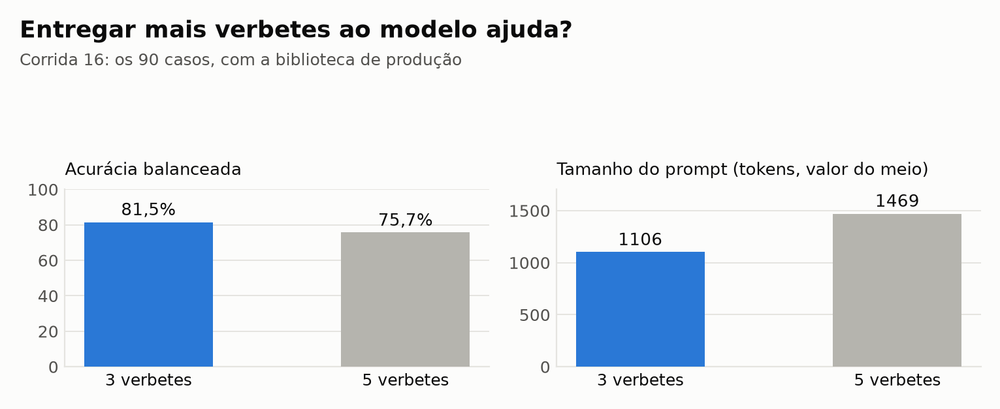

Fonte: elaborado pelos autores a partir de `fase4/calibracao.json`; dados em `Documentacao/figuras/dados-das-figuras.md`.

**Como ler:** cada par de barras compara a mesma corrida com 3 e com 5 verbetes entregues ao modelo. À esquerda, o acerto; à direita, o tamanho do prompt, em que o valor é o do meio entre os casos.

**O que a figura mostra:** 5 verbetes pedem um prompt bem maior e não trazem mais acerto, e foi assim que a regra R8 fixou k = 3.

<!-- ! Alteração de IA - Revisar: (25/11/2026, Pós-Fase 4, pacote Q8) as corridas 18 e 18b passam a histórico, e entram as corridas 18c, 18d e 18e nos três parágrafos seguintes.
     ! Motivo: o parágrafo dava a 18b como leitura vigente e a regra R2 como não cumprida; a leitura vigente é a da 18d, com a regra no limite exato. -->
Nas corridas 18 e 18b (01/11/2026, modo tela), os 37 casos que reproduzem foram diagnosticados na mesma sessão do Ollama, lidos da tela e do caso escrito (fixture), e a regra R2 admitia no máximo 3 casos de discordância (b mais c) <!-- fonte: roadmap.md §2.10 -->. Na corrida 18 o acerto foi de 43,2% na tela contra 83,8% no fixture (b = 1, c = 16, p = 0,0003), porque em 22 dos 37 casos, sem diferença de campo contra o contrato, a poda do corpo levou ao modelo o primeiro produto normal da lista, e a decisão 81 passou a levar ao caso ao vivo (o caso montado a partir da tela) o que mudou contra a referência em modo normal <!-- fonte: roadmap.md §2.10; decisoes.md decisão 81 -->. A corrida 18b, repetida em pasta nova, deu o mesmo rótulo em 26 de 37 casos, 26 acertos na tela (70,3%) contra 31 no fixture (83,8%), b = 2, c = 7, b + c = 9, p = 0,180 <!-- fonte: fase-4-relatorio.md §5, bloco tb_f4_tela_resumo -->. Com 9 casos de discordância a R2 não foi cumprida, por confusão entre rótulos vizinhos na maior parte, e ficou naquele momento como limitação declarada (decisão 82): o limite não mudou, e o molde do sintoma não passou por terceira revisão, porque descrever melhor sem citar a causa começaria a escrever a resposta no sintoma; a decisão 90 só reviu esse ponto para encurtar o molde, que perde texto e não ganha descrição <!-- fonte: fase-4-relatorio.md §5; decisoes.md decisões 82 e 90 -->. O teste pareado não separa os dois lados nesses 37 casos, mas o limite da regra é o da variação entre corridas iguais, e 9 casos é o triplo dele <!-- fonte: fase-4-relatorio.md §5 -->.

<!-- ! Alteração de IA - Revisar: (25/11/2026, Pós-Fase 4, pacote Q8) três parágrafos novos, com os valores das corridas 18c, 18d e 18e.
     ! Motivo: as três corridas rodaram em 05 e 06/11/2026 e não tinham os valores no documento. -->
Na corrida 18c (05/11/2026, Ollama 0.40.14), com o caso ao vivo encurtado (decisão 90), os 37 prompts ficaram dentro do limite, de 1069 a 1373 tokens, contra 1595 a 2034 na 18b. O rótulo foi o mesmo na tela e no fixture em 28 de 37 casos, com 27 acertos na tela e 30 no fixture, b + c = 7 e p = 0,453; o tempo por caso na tela caiu de 82,5 para 52,0 s. A corrida trocou também a versão do Ollama e a biblioteca, e no fixture a causa mudou em 1 dos 37 casos. Com o verbete certo no contexto, a tela acertava 19 de 21 e o fixture, 26 de 27; sem ele, 8 de 16 e 4 de 10. O verbete certo chegava em 21 casos na tela e em 27 no fixture, e foi esse número que a decisão 97 atacou <!-- fonte: roadmap.md §2.16 -->.

Na corrida 18d (06/11/2026), a busca do caso ao vivo passou a usar o que ele mede contra a referência em modo normal, traduzido em código para as palavras da biblioteca, sem nada a mais no prompt (decisão 97). O verbete certo chegou em 36 dos 37 casos na tela, com 32 acertos (86,5%), contra 30 no fixture (81,1%); o rótulo foi o mesmo em 28 de 37. Pela leitura da regra R2 fixada antes da corrida (decisão 98), a tela perde 3 casos para o fixture e ganha 5, e a regra fecha no limite de 3; pela soma dos dois lados, a conta usada até a 18c, são 8, com p = 0,727. No fixture, que serve de controle, a causa não mudou em nenhum dos 37 casos; na tela mudou em 7, dos quais 6 passaram a acertar e 1 deixou de acertar. Os 3 casos que a tela ainda perde são a mesma confusão, contagem inconsistente lida como resposta truncada, com o verbete certo entregue e selo baixo. O selo acertou 18 de 20 no alto, 12 de 12 no médio e 2 de 5 no baixo. Os 37 prompts ficaram entre 1069 e 1385 tokens, e o tempo por caso foi de 59,2 s na tela e 58,0 s no fixture <!-- fonte: roadmap.md §2.19; resultados_alvo/fase4/tela_v4.md -->.

Como os sinais da busca foram escritos olhando esses 37 casos, a corrida 18e (06/11/2026) leu, da tela e do fixture, os 25 inéditos da ficha 27 que reproduzem, que a busca nunca tinha visto. A tela perde 0 casos e ganha 4, com 22 acertos (88,0%) contra 18 (72,0%), mesmo rótulo em 19 de 25 e p = 0,125; o verbete certo chega em 23 de 25 na tela e em 14 no fixture. Dois dos 25 prompts passaram do limite, com 1829 e 1620 tokens, porque a lista do caso não tinha teto; com o teto da decisão 99 ficam em 1367 e 1387, e os dois casos erram também no fixture, de modo que a regra R2 não depende deles. A conferência desses casos por um dos autores veio depois da corrida e não mudou nenhum (decisão 100), e, por terem sido lidos, eles deixam de servir de conferência limpa para um ajuste futuro da busca <!-- fonte: roadmap.md §2.21; resultados_alvo/fase4/tela_ineditos.md -->.

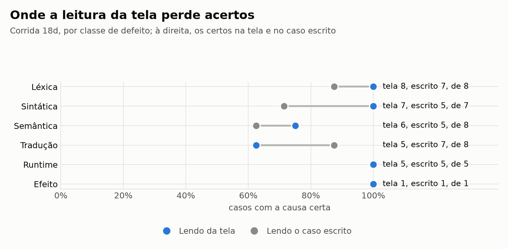

Fonte: elaborado pelos autores a partir de `fase4/tela_v4.json`; dados em `Documentacao/figuras/dados-das-figuras.md`.

**Como ler:** cada linha é uma classe de defeito. O ponto azul é o acerto lendo da tela, e o cinza, lendo o caso escrito; quanto maior o traço entre eles, maior a diferença entre os dois lados. À direita, os certos de cada lado e o total de casos da classe.

<!-- ! Alteração de IA - Revisar: (25/11/2026, Pós-Fase 4, pacote Q8) a figura por classe passa a ser lida com a corrida 18d.
     ! Motivo: a legenda e o texto descreviam a corrida 18b (semântica com 4 de 8 na tela); a figura do repositório é a da 18d desde 06/11/2026. -->
**O que a figura mostra:** na corrida 18d a tela só perde para o caso escrito na classe de tradução, com 5 de 8 contra 7 de 8; nas classes léxica, sintática e semântica ela acerta mais, e nas outras duas os lados empatam <!-- fonte: dados-das-figuras.md, "Onde a leitura da tela perde acertos" -->. Os totais por classe são pequenos, e a figura indica onde olhar, sem ordenar as classes.

<!-- ! Alteração de IA - Revisar: (25/11/2026, Pós-Fase 4, pacote Q8) o corte do caso ao vivo passa ao passado.
     ! Motivo: a frase anunciava o corte e a repetição das corridas como coisa a fazer antes da Fase 5. -->
O prompt da tela também passou do limite que o plano fixou antes de rodar: não passar o maior prompt da calibração (1281 tokens) em mais de 10% (1409 tokens), apertando a poda se passasse <!-- fonte: plano-aprovado-fase-4.md §3.3; fase-4-relatorio.md §5 -->. Na corrida 18b os 37 prompts passaram do limite, o maior com 2034 tokens, porque a revisão do caso ao vivo acrescentou texto, e nos dez cenários da corrida 21b passam 9 de 10 <!-- fonte: fase-4-relatorio.md §5 e §10; pendencias.md ficha 42 -->. A poda não apertou nessas corridas, e o limite fica registrado como não cumprido nelas <!-- fonte: fase-4-relatorio.md §5 e §10 -->. O limite importa por dois motivos: os limiares do selo foram calibrados com prompts menores, e o tempo do diagnóstico cresce com o prompt <!-- fonte: fase-4-relatorio.md §5 -->. Por isso a decisão 90 fez o limite valer: o caso ao vivo foi encurtado, sem tocar no prompt fixo, e as corridas 18 e 21 foram repetidas em pasta nova (18c e 21c), com todos os prompts dentro do limite <!-- fonte: decisoes.md decisão 90 -->. Uma medida sem modelo nos prompts guardados, com os tokens estimados, mostra que só a árvore não basta: reduzida ao título e ao que difere da referência em modo normal, ela ainda deixa 12 de 37 prompts da corrida 18b e 5 de 10 da 21b acima do limite, e sem nenhuma árvore ficam 4 e 1; tirando também a linha OBSERVAÇÃO ADICIONAL e as listas de itens a menos e a mais do sintoma, sobram 1 e 3, que o corte em código trata <!-- fonte: prompt_tela_blocos.json (cenários arvore, sem_arvore e arvore_observacao_sintoma das corridas 18b e 21b); decisoes.md decisão 90 -->.

Na corrida 19 (01/11/2026, modo cura, sem modelo), quatro roteiros do front legado, quatro modos de quebra, as duas formas da decisão 80 e cinco repetições somaram 160 execuções, todas com quebra detectada e todas curadas pela regra R3 (roteiro concluído na reexecução), pelo mesmo elemento da referência <!-- fonte: roadmap.md §2.11 -->. O MTTR do agente (da detecção da quebra à reexecução validada) teve mediana de 0,639 s (mínimo 0,355, máximo 0,887), e as duas formas deram a mesma árvore em 16 das 16 células <!-- fonte: roadmap.md §2.11 -->.

<!-- ! Alteração de IA - Revisar: (25/11/2026, Pós-Fase 4, pacote Q8) a corrida 21b passa a histórico, e entram as corridas 21c e 21d no parágrafo seguinte e na tabela.
     ! Motivo: o parágrafo dava a 21b como leitura vigente até a 21c rodar e estimava a noite da Fase 5; a leitura vigente do ensaio é a da 21d, e a Fase 5 já foi medida. -->
Na corrida 21 (04/11/2026), o agente inteiro rodou os dez cenários da ficha 36, seis de contrato e quatro de localizador, com uma repetição: 9 de 10 com Task Success e MTTR médio de 101,1 s nas 9 execuções que chegaram ao fim do cronômetro <!-- fonte: fase-4-relatorio.md §8 -->. O login ficou sem cura: a tela de login tem um recarregamento automático de 30 s, e os candidatos eram verificados na página da detecção, parada enquanto o modelo pensava; a corrida 19 não via isso porque não tinha modelo no meio, e o conserto verifica os candidatos numa página refeita até o passo que falhou, com o tempo de refazer dentro do MTTR <!-- fonte: fase-4-relatorio.md §8; roadmap.md §2.13 -->. A repetição 21b, no mesmo dia, deu 10 de 10, com o login curado e MTTR médio de 105,2 s (tabela) <!-- fonte: fase-4-relatorio.md §8, bloco tb_f4_cenarios_resumo; roadmap.md §2.14 -->. Entre as duas corridas, o rótulo se repetiu em 10 de 10 cenários e a resposta inteira em 4 de 10: com temperatura 0,1 o texto varia sem mudar a causa <!-- fonte: fase-4-relatorio.md §8 -->. O que domina o tempo é o modelo: o diagnóstico levou de 61,0 a 133,4 s, descontado ele sobram de 2,0 a 3,6 s, e a mediana de 83,1% do tempo do diagnóstico é a leitura do prompt, o que amarra o MTTR ao tamanho do prompt, de 1219 a 1950 tokens de entrada <!-- fonte: fase-4-relatorio.md §8 -->. Uma repetição por cenário dá intervalos largos, e nenhum dos dois MTTR tem linha de base: a comparação é da Fase 5 (seção 6.10.10).

<!-- ! Alteração de IA - Revisar: (25/11/2026, Pós-Fase 4, pacote Q8) parágrafo novo com as corridas 21c e 21d.
     ! Motivo: as duas corridas rodaram em 05 e 06/11/2026 e não tinham os valores no documento. -->
Na corrida 21c (05/11/2026), com o caso encurtado, o Task Success foi de 10 em 10 e o MTTR médio caiu para 72,5 s, 31% a menos que na 21b, com nenhum prompt acima do limite, o maior com 1340 tokens, e o mesmo rótulo nos 10 cenários. Na corrida 21d (06/11/2026), com os sinais novos da busca, a leitura vigente do ensaio, foram de novo 10 em 10, com MTTR médio de 74,0 s, o mesmo rótulo nos 10 cenários e o maior prompt com 1385 tokens; o verbete certo, que chegava em 9 dos 10 cenários, passou a chegar nos 10 (tabela) <!-- fonte: roadmap.md §2.17 e §2.20 -->.

<!-- ! Alteração de IA - Revisar: (25/11/2026, Pós-Fase 4, pacote Q8) a tabela do ensaio ganha as linhas das corridas 21c e 21d, copiadas por script dos blocos tb_f4_cenarios_resumo e tb_f4_cenarios_por_tipo das leituras `cenarios_v3.md` e `cenarios_v4.md`.
     ! Motivo: a tabela parava na corrida 21b, que deixou de ser a leitura vigente em 05/11/2026. -->
Tabela: Ensaio dos dez cenários da Fase 5 (corridas 21, 21b, 21c e 21d)
| Corrida e recorte | Execuções | Task Success | Wilson 95% (%) | MTTR médio (s) | Reamostragem 95% (s) | MTTR mediano (s) |
|---|---|---|---|---|---|---|
| 21, todos os cenários | 10 | 9 | 59,6 a 98,2 | 101,1 | 88,8 a 111,9 | 106,5 |
| 21b, todos os cenários | 10 | 10 | 72,2 a 100,0 | 105,2 | 90,6 a 118,0 | 114,3 |
| 21b, contrato: da detecção ao diagnóstico conferido | 6 | 6 | 61,0 a 100,0 | 114,7 | 97,1 a 128,0 | 120,3 |
| 21b, localizador: da detecção à reexecução validada | 4 | 4 | 51,0 a 100,0 | 90,8 | 70,0 a 110,5 | 90,9 |
| 21c, todos os cenários | 10 | 10 | 72,2 a 100,0 | 72,5 | 63,9 a 80,0 | 72,6 |
| 21c, contrato: da detecção ao diagnóstico conferido | 6 | 6 | 61,0 a 100,0 | 79,9 | 74,4 a 86,0 | 78,1 |
| 21c, localizador: da detecção à reexecução validada | 4 | 4 | 51,0 a 100,0 | 61,5 | 48,0 a 70,2 | 66,0 |
| 21d, todos os cenários (leitura vigente) | 10 | 10 | 72,2 a 100,0 | 74,0 | 64,9 a 81,8 | 73,3 |
| 21d, contrato: da detecção ao diagnóstico conferido | 6 | 6 | 61,0 a 100,0 | 81,5 | 75,2 a 88,5 | 79,2 |
| 21d, localizador: da detecção à reexecução validada | 4 | 4 | 51,0 a 100,0 | 62,7 | 48,9 a 71,6 | 67,6 |
Fonte: relatório da Fase 4 (Memorial), seção 8, blocos tb_f4_cenarios_resumo e tb_f4_cenarios_por_tipo gerados por avaliar_fase4.py; roadmap, seção 2.13, para a corrida 21. <!-- fonte: fase-4-relatorio.md §8, blocos tb_f4_cenarios_resumo e tb_f4_cenarios_por_tipo; roadmap.md §2.13 --> As corridas 21c e 21d vêm das leituras `cenarios_v3.md` e `cenarios_v4.md` de `resultados_alvo/fase4`, mesmos blocos.

### 6.10.7 Biblioteca em produção e casos inéditos: corridas 20 e 24

Na corrida 20 (03 e 04/11/2026, modo biblioteca), o Ollama já tinha se atualizado sozinho para 0.40.14, o executor recusou a corrida até haver ponte (regra R6), e a ponte deu b = 1, c = 0 em 35 casos, dentro do limite de 2 da decisão 47; os limiares do selo vêm da 0.40.2 e não foram recalibrados <!-- fonte: fase-4-relatorio.md §2 -->. Os 54 casos de aprendizado, 24 lidos da tela e 30 do fixture, tiveram 37 diagnósticos certos (68,5%) e 92 propostas de edição: 56 caíram no validador da Fase 3, 16 nos filtros em código da decisão 65, 1 ficou segurada para revisão humana pela regra dos 40% e 19 entraram no lote, e o modelo não se absteve em nenhum caso <!-- fonte: fase-4-relatorio.md §7, bloco tb_f4_biblioteca_resumo -->. Pela regra R5, nos 36 inéditos da Fase 3-B, o acerto foi de 75,0% com a cópia curada e de 75,0% com o lote, b = 0, c = 0: o lote foi aceito, o que quer dizer que não piorou; nenhum caso mudou de acerto, então ele também não ajudou nesses casos <!-- fonte: fase-4-relatorio.md §7 -->. A base é a corrida 12, em Ollama 0.34.4, e a reavaliação rodou em 0.40.14: as duas versões têm ponte contra a Fase 3, mas o par não rodou na mesma versão <!-- fonte: fase-4-relatorio.md §7 -->.

<!-- ! Alteração de IA - Revisar: (25/11/2026, Pós-Fase 4, pacote Q8) a biblioteca final deixa de estar sem medida em inéditos.
     ! Motivo: a frase dava a corrida 24 como pendente. -->
O que entrou na produção não é o lote inteiro. A planilha do lote, com as 19 edições e a que ficou segurada, foi pré-revisada pelo agente de apoio e aprovada sem mudança por um integrante do grupo: 2 corretas, 9 parciais e 9 erradas <!-- fonte: fase-4-relatorio.md §7 -->. A promoção aplicou as 11 que não são erradas, e os 4 verbetes aprendidos que a busca nunca entregou saíram do índice sem ser apagados (ficha 32), deixando a produção com 39 verbetes <!-- fonte: fase-4-relatorio.md §7 e §11 -->. Essa biblioteca final não passou pela reavaliação da R5; a medida dela em casos inéditos é a da corrida 24, no fim desta seção. Pela regra R4, dos 9 casos com sintoma antes, o harness desligou o modo em 4 e manteve em 5, e a marca de corrigido foi dada a 4, todas certas, com 0 falsos positivos e 0 perdidas: precisão e revocação de 100,0%, em poucos casos e com um gatilho (reexecução passando, fio mudado e árvore mudada) que um modo desligado produz por construção <!-- fonte: fase-4-relatorio.md §7 e §10 -->. A sonda de 28/09/2026, repetida com a recuperação por id em 7 casos, teve 6 diagnósticos certos, 2 propostas mudadas e 0 menções à correção registrada: como em 28/09, o modelo não percebe a correção, e por isso a marca é dada em código <!-- fonte: fase-4-relatorio.md §7 -->.

<!-- ! Alteração de IA - Revisar: (25/11/2026, Pós-Fase 4, pacote Q8) parágrafo novo com os valores da corrida 24.
     ! Motivo: a corrida 24 rodou em 06/11/2026 e não tinha os valores no documento. -->
Na corrida 24 (06/11/2026, Ollama 0.40.14, k = 3), o agente leu em texto, com a biblioteca de produção, os 36 inéditos da ficha 27: 25 certos (69,4%; intervalo de Wilson de 95% de 53,1 a 82,0), com acurácia balanceada de 71,4%. O verbete certo chega em 20 dos 36 casos; com ele são 18 de 20, e sem ele, 7 de 16, de modo que 9 dos 11 erros são de casos sem o verbete certo. A classe de tradução faz 1 de 6, e as outras, de 4 a 6 de 6; por nível de dificuldade, 9 de 12 no primeiro, 11 de 12 no segundo e 5 de 12 no terceiro. O selo acertou 12 de 13 no alto, 9 de 15 no médio e 4 de 8 no baixo. Os 25 casos que a corrida 18e também leu em texto deram o mesmo rótulo nos 25; lidos da tela, esses casos fazem 22 acertos, contra 18 em texto. Dos 10 casos que a pré-análise da conferência apontou, 5 erram; dos outros 26, 6. A corrida tem uma condição só: ela não diz quanto a biblioteca ajuda nesses casos, porque eles não foram lidos sem biblioteca (figura na seção 6.7) <!-- fonte: roadmap.md §2.22; resultados_alvo/fase4/ineditos.md -->.

### 6.10.8 A trilha contra os erros reais: corrida 22

Na corrida 22 (04 e 05/11/2026, Ollama 0.40.14, k = 3, 277 inferências), o qwen2.5:7b leu com a biblioteca de produção os 36 casos oficiais de avaliação, do fixture e sem gabarito no agente: 31 de 36 certos (86,1%) e 5 erros, o mesmo total da L1 curada na corrida 16, em comparação de totais, sem parear <!-- fonte: fase-4-relatorio.md §7 e §9; roadmap.md §2.15 -->. A primeira pergunta da avaliação é se a divergência da trilha (o declarado difere do medido, ou uma intervenção mudou o rótulo) coincide com os erros reais, e a resposta depende de como se conta (tabela; discussão na seção 6.9) <!-- fonte: fase-4-relatorio.md §9.1 -->.

Tabela: Sinais contra os erros reais na corrida 22 (36 casos, 5 erros e 31 acertos; um sinal jogado ao acaso dá 0,250)
| Sinal | Erros pegos | Acertos acusados | TPR | TNR | TPR x TNR | TPR, Wilson 95% (%) |
|---|---|---|---|---|---|---|
| Divergência, com as intervenções em todos os casos | 4 de 5 | 20 de 31 | 0,800 | 0,355 | 0,284 | 37,6 a 96,4 |
| Divergência por gatilho (contada desta corrida, não rodada assim) | 3 de 5 | 3 de 31 | 0,600 | 0,903 | 0,542 | 23,1 a 88,2 |
| Selo baixo sozinho, sem inferência a mais | 3 de 5 | 4 de 31 | 0,600 | 0,871 | 0,523 | 23,1 a 88,2 |
| Opção (b) da ficha 39 por gatilho (contada desta corrida, não rodada assim) | 3 de 5 | 2 de 31 | 0,600 | 0,935 | 0,561 | 23,1 a 88,2 |
Fonte: relatório da Fase 4 (Memorial), seção 9.1, bloco tb_f4_trilha_sinais gerado por avaliar_fase4.py. <!-- fonte: fase-4-relatorio.md §9.1, bloco tb_f4_trilha_sinais -->

A remoção do verbete citado mudou o rótulo em 13 de 36 casos, a troca por um verbete errado em 17 e a inferência sem documentação em 16; com o mesmo prompt, a repetição da base manteve o rótulo em 36 de 36, de modo que a variação natural não explica essas mudanças <!-- fonte: fase-4-relatorio.md §9.2, blocos tb_f4_trilha_intervencoes e tb_f4_trilha_mesmo_prompt -->. Em 7 das 144 intervenções o rótulo original saiu das alternativas devolvidas, e a queda de probabilidade ficou só como limite inferior <!-- fonte: fase-4-relatorio.md §9.2, bloco tb_f4_trilha_resumo -->. Na sonda de pós-racionalização, 8 de 36 casos passaram a citar o trecho plantado, 2 mudaram o rótulo, e citar com o mesmo rótulo ficou em 7 de 36 (19,4%), contra 2 de 36 (5,6%) no controle; a FONTE foi verificada pela remoção em 13 de 36 casos, e nos outros 23 tirar o verbete citado não mudou o rótulo <!-- fonte: fase-4-relatorio.md §9.2, bloco tb_f4_trilha_sonda -->.

Na segunda pergunta, o primeiro nó que divergiu da trilha da base foi o previsto em 36 de 36 no verbete trocado, 17 de 17 no contrato alterado (19 casos sem alvo) e 4 de 4 no seletor quebrado <!-- fonte: fase-4-relatorio.md §9.3, bloco tb_f4_trilha_mutacoes -->. Os 100% são esperados por construção, porque os nós da poda e da recuperação saem em código da entrada mutada e o diff é determinístico; isso prova que a trilha registra a mudança no nó certo, e o que diz algo sobre o modelo é o rótulo, que mudou em 17, 3 e 0 casos, respectivamente <!-- fonte: fase-4-relatorio.md §9.3 -->.

<!-- ! Alteração de IA - Revisar: (25/11/2026, Pós-Fase 4, pacote Q8) a medida com revisor humano remete à Pós-Fase 4.
     ! Motivo: a frase dizia que a limitação ficava declarada, sem nova sessão; a decisão 95 reabriu a medida e ela foi feita em 09 e 10/11/2026. -->
<!-- ! Alteração de IA - Revisar: (25/11/2026, Pós-Fase 4, pacote Q8) o relatório 1 da sessão de 05/11/2026 passa a respondido pelo analista de QA, com o tempo como não medido.
     ! Motivo: o texto dizia que o revisor, um integrante do grupo, tinha respondido o relatório 1 com tempo medido de 307 s; pela declaração do Eric em 25/11/2026 (ficha 105, decisão 166), quem leu foi o analista de QA, fora da página. -->
A terceira pergunta, com revisor humano, não foi medida nesta corrida (decisões 85, 86 e 87); a medida veio na Pós-Fase 4, com outro relatório e outro leitor (seção 6.10.11) <!-- fonte: fase-4-relatorio.md §9.5; decisoes.md decisões 85, 86 e 87 -->. A especificação pede o acerto da localização do erro, o tempo até a decisão e a adesão apropriada, isto é, aceitar o diagnóstico quando está certo e recusar quando está errado <!-- fonte: especificacao-trilha-e-relatorio.md §12 -->. A amostra tem 11 relatórios, não os 12 do plano, porque a corrida teve só 5 erros: são os 5 e mais 6 acertos <!-- fonte: fase-4-relatorio.md §9.5 -->. O relatório 1, o único com resposta própria, foi respondido por um analista de QA de fora do projeto, que leu fora da página, e a resposta foi passada à página por um dos autores: os 307 s que a página registrou medem essa troca, e não a leitura, e o tempo até a decisão entra como não medido (decisão 166). Depois esse autor pediu uma pré-análise ao agente de apoio, escolheu lê-la (decisão 85) e aprovou o parecer do agente nos outros 10 relatórios, sem resposta própria e sem tempo medido (decisão 86) <!-- fonte: fase-4-relatorio.md §9.5, bloco tb_f4_revisao_resumo -->. O parecer cobre os 11 relatórios, inclusive o 1, e acertou 11 de 11 decisões e 11 de 11 causas (Wilson 95% da decisão: 74,1 a 100,0%), mas isso não é essa medida: quem o escreveu sabia quantos erros a amostra tem, já tinha visto os nomes dos casos e consultou a biblioteca <!-- fonte: fase-4-relatorio.md §9.5, bloco tb_f4_revisao_parecer -->. Isso mostra que a evidência para julgar estava no relatório e na biblioteca, para um leitor forte e avisado; não mostra quanto o relatório ajuda um analista nem quanto tempo a decisão leva. Dos 5 erros, 4 estavam à vista no próprio relatório; o de semt-9 tem selo alto, nenhum conflito e todas as conferências certas, e a recusa só veio da biblioteca <!-- fonte: fase-4-relatorio.md §9.5 -->. No relatório 1, o analista marcou que achou o erro num diagnóstico que avaliou como certo, talvez lendo "erro" como o defeito do sistema, e a resposta fica como foi dada <!-- fonte: fase-4-relatorio.md §9.5; roadmap.md §2.15 -->.

### 6.10.9 A poda consertada e as regras da fase

Depois de todas as corridas, a pré-análise da sessão de revisão achou dois defeitos na poda do corpo: ela só olhava o primeiro item de uma lista e chamava todo número em campo booleano de tipo diferente, enquanto a biblioteca separa 0 e 1 (tipo diferente) dos outros números (valor fora do domínio). Os dois foram consertados, com teste, sem corrida nova (decisão 89) <!-- fonte: fase-4-relatorio.md §9.6; decisoes.md decisão 89 -->. Comparada sem modelo com a versão anterior, a poda muda em 5 dos 65 casos de texto com contrato, mas nesses casos o prompt leva o corpo inteiro e a poda não chega ao modelo, e por isso os erros de sin-5 e semt-9 na corrida 22 não vieram desses defeitos <!-- fonte: fase-4-relatorio.md §9.6; poda_antes_e_depois.json -->. Só na tela o trecho da poda vai ao prompt, e ali nenhum dos 209 corpos guardados nas 7 corridas na tela muda, 158 deles listas com mais de um item, inclusive os cenários da Fase 5 <!-- fonte: fase-4-relatorio.md §9.6; poda_antes_e_depois.json -->. As corridas continuam valendo como rodaram, e a Fase 5 sai comparável com elas, com a poda consertada <!-- fonte: fase-4-relatorio.md §9.6 -->.

A tabela seguinte reúne as regras da fase com o resultado de cada uma.

<!-- ! Alteração de IA - Revisar: (25/11/2026, Pós-Fase 4, pacote Q8) as linhas da regra R2, da R3, da R5 e do prompt na tela passam ao estado final da fase.
     ! Motivo: a tabela dava a regra R2 e o limite do prompt como não cumpridos, com as corridas 18c e 21c pendentes; a R2 fechou na corrida 18d pela leitura da decisão 98, e o limite vale da 18c em diante. -->
Tabela: Regras da Fase 4, uma a uma
| Regra | O que ela pede | Corrida | Resultado | Estado |
|---|---|---|---|---|
| R1 | Um caso reproduz quando a chamada sai do normal ou uma conferência do roteiro falha; o plano pedia também o passo esperado e o campo do gabarito | 17 | 37 de 37 nos 72 casos e 25 de 25 nos inéditos | Cumprida, com ressalva: como rodou, é mais larga que o texto do plano |
| R2 | A tela não piora: ela perde no máximo 3 casos para o fixture, pela leitura fixada antes da corrida 18d (decisão 98); até a 18c a conta era a soma dos dois lados | 18b, 18c, 18d e 18e | 18b: soma 9; 18c: soma 7; 18d: perde 3 e ganha 5; 18e, nos inéditos: perde 0 e ganha 4 | Cumprida no limite exato na 18d; até a 18c, não cumprida (decisão 82) |
| R3 | Uma cura só conta com o roteiro passando na reexecução | 19, 21b a 21d | 160 de 160 sem modelo; 4 de 4 com o modelo no meio | Cumprida, com ressalva: os 100% vêm do desenho da corrida 19 |
| R4 | Precisão e revocação da marca de corrigido contra os modos desligados | 20 | 100,0% e 100,0% em 9 casos | Medida: o plano não fixou limite |
| R5 | O lote entra se b for maior ou igual a c nos 36 inéditos | 20 | b = 0, c = 0: aceito | Cumprida, com ressalva: nenhum caso mudou, e a biblioteca promovida só foi medida em inéditos numa condição (corrida 24) |
| R6 | Ponte de versão antes de toda noite medida | todas | Pontes em 0.40.2 e 0.40.14, b + c até 2 | Cumprida |
| R7 | Limiares do selo gravados antes da primeira corrida na tela | 16 | Baixo até 0,832 e alto a partir de 0,990 | Cumprida, com ressalva: calibrados em 0.40.2 e com prompts menores |
| R8 | k = 5 só entra se acertar mais que k = 3 | 16 | k = 3 | Cumprida |
| Prompt na tela | O prompt ao vivo não passa o maior da calibração em mais de 10%; se passar, a poda aperta | 18b a 18e, 21b a 21d | Os 37 prompts acima de 1409 tokens na 18b, o maior com 2034; nenhum acima na 18c, na 18d, na 21c e na 21d; 2 de 25 na 18e, antes do teto das listas | Cumprida da 18c em diante (decisão 90), com ressalva: os 2 prompts da 18e, corrigidos pelo teto (decisão 99) |
Fonte: relatório da Fase 4 (Memorial), seção 10; leituras `tela_v3.md`, `tela_v4.md` e `tela_ineditos.md` de `resultados_alvo/fase4` para a regra R2 e o prompt.

### 6.10.10 Agente contra pessoas: a corrida 28b e as três sessões

<!-- ! Alteração de IA - Revisar: (24/11/2026, Fase 5, pacote F6) subseção nova da Análise aprofundada com os dados crus da Fase 5: a noite do agente e a execução sem Task Success; os dois lados no geral e por tipo de cenário; o tempo e o Task Success por cenário; a comparação pelas regras L8 a L11, com a segunda conta; as tentativas de cada integrante; a comparação refeita sem a sessão de cada integrante; e a conferência de que a noite rodou a frio.
     ! Motivo: o plano da Fase 5 (seção 6) manda os dados crus da fase para a Análise aprofundada, e a seção 6.8 só traz a figura e os números que respondem à pergunta. As seis tabelas são montadas por script, linha a linha, dos campos de `agente.json`, `manual.json` e `medicao.json` em `resultados_alvo/fase5`, sem número digitado; os nomes dos cenários são os da figura. A tabela da conta sem cada integrante leva no título que é exploratória e que não é o veredito da leitura (decisão 151). -->
Esta seção traz os valores da Fase 5 (seção 6.8), copiados por script dos três arquivos que a leitura grava em `resultados_alvo/fase5`: `agente.json`, `manual.json` e `medicao.json`. A noite do agente vale pelas conferências da própria leitura: 50 de 50 execuções gravadas, uma versão só do Ollama (0.40.16) e uma do navegador, o banco de dados com o mesmo hash no começo das cinco repetições e as cinco repetições a frio (última tabela desta seção). A única execução sem Task Success foi a primeira do cenário "Resposta cortada no meio": o rótulo saiu certo, mas a resposta do modelo veio sem a linha FONTE, o diagnóstico não foi conferido em código e o cronômetro não fechou; nas outras quatro repetições o cenário passou <!-- fonte: resultados_alvo/fase5/agente.json, campos noite, sem_task_success e por_cenario; fase-5-relatorio.md §4 ("Leitura do lado do agente" e "A execução sem Task Success") -->.

Tabela: O agente e as pessoas nos dez cenários da Fase 5, no geral e por tipo de cenário
| Lado e recorte | Task Success | Wilson 95% (%) | Cenários com todas as medidas certas | Medidas sem fim de cronômetro | Tempo médio (s) | Reamostragem 95% (s) | Segunda conta, com 600 s para quem não chegou ao fim (s) |
|---|---|---|---|---|---|---|---|
| Agente, os dez cenários | 49 de 50 (98,0%) | 89,5 a 99,6 | 9 de 10 | 1 | 66,3 | 60,9 a 71,5 | 76,7 |
| Agente, contrato | 29 de 30 (96,7%) | 83,3 a 99,4 | 5 de 6 | 1 | 73,0 | 67,7 a 78,4 | 90,2 |
| Agente, localizador | 20 de 20 (100,0%) | 83,9 a 100,0 | 4 de 4 | 0 | 56,4 | 44,5 a 64,2 | 56,4 |
| Pessoas, os dez cenários | 14 de 30 (46,7%) | 30,2 a 63,9 | 0 de 10 | 6 | 219,7 | 172,3 a 264,7 | 289,8 |
| Pessoas, contrato | 6 de 18 (33,3%) | 16,3 a 56,3 | 0 de 6 | 2 | 174,8 | 125,7 a 228,6 | 222,2 |
| Pessoas, localizador | 8 de 12 (66,7%) | 39,1 a 86,2 | 0 de 4 | 4 | 287,0 | 183,0 a 359,3 | 391,4 |
Fonte: leituras da Fase 5 em `resultados_alvo/fase5` (`agente.json` e `manual.json`, campos geral e por_tipo), geradas por avaliar_fase5.py; relatório da Fase 5 (Memorial), seções 4 e 5. A comparação do Task Success entre os dois lados é lida com a ressalva da decisão 151 (seção 6.8). <!-- fonte: resultados_alvo/fase5/agente.json e manual.json, campos geral e por_tipo; fase-5-relatorio.md §4 e §5, blocos tb_f5_agente_resumo, tb_f5_agente_por_tipo, tb_f5_manual_resumo e tb_f5_manual_por_tipo -->

Das 30 tentativas das pessoas, 24 chegaram ao fim do cronômetro. As 6 que não chegaram são do integrante 2: os quatro cenários de localizador e 2 de contrato. Nenhum cenário foi corrigido pelos três integrantes, e nenhuma linha da planilha foi anulada <!-- fonte: resultados_alvo/fase5/manual.json, campos geral (com_fim, sem_fim e cenarios_com_todas_certas) e linhas (sem_fim e anuladas) -->.

Tabela: Tempo e Task Success por cenário, do agente e das pessoas
| Cenário | Tipo | MTTR médio do agente (s) | Do menor ao maior, agente (s) | Tempo médio das pessoas (s) | Do menor ao maior, pessoas (s) | Diferença, pessoas menos agente (s) | Task Success, agente e pessoas |
|---|---|---|---|---|---|---|---|
| Resposta cortada no meio | contrato | 81,7 | 78,7 a 85,9 | 109,6 | 50,2 a 151,5 | 27,9 | 4 de 5 e 1 de 3 |
| Campo sumiu da resposta | contrato | 67,0 | 66,4 a 67,8 | 111,3 | 95,0 a 127,7 | 44,4 | 5 de 5 e 1 de 3 |
| Campo mudou de nome | contrato | 65,3 | 64,9 a 65,9 | 236,5 | 211,5 a 261,5 | 171,2 | 5 de 5 e 2 de 3 |
| Campo mudou de tipo | contrato | 66,7 | 66,0 a 67,6 | 189,0 | 51,4 a 260,6 | 122,3 | 5 de 5 e 0 de 3 |
| Preço na escala errada | contrato | 80,4 | 78,8 a 82,9 | 280,6 | 35,2 a 454,5 | 200,2 | 5 de 5 e 1 de 3 |
| API devolve erro 500 | contrato | 76,6 | 75,0 a 77,3 | 121,8 | 37,8 a 174,9 | 45,2 | 5 de 5 e 1 de 3 |
| Busca | localizador | 65,4 | 64,9 a 65,8 | 385,3 | 289,5 a 481,0 | 319,8 | 5 de 5 e 2 de 3 |
| Login do administrador | localizador | 39,0 | 38,5 a 40,3 | 150,1 | 144,6 a 155,7 | 111,2 | 5 de 5 e 2 de 3 |
| Lista de produtos do administrador | localizador | 60,3 | 60,1 a 60,6 | 331,2 | 258,7 a 403,7 | 270,9 | 5 de 5 e 2 de 3 |
| Reserva do cliente | localizador | 61,0 | 60,0 a 63,1 | 281,6 | 167,7 a 395,4 | 220,6 | 5 de 5 e 2 de 3 |
Fonte: leitura da comparação em `resultados_alvo/fase5/medicao.json` (campos tempo.por_cenario e task_success.por_cenario), gerada por avaliar_fase5.py; os nomes dos cenários são os da figura da seção 6.8. A comparação do Task Success entre os dois lados é lida com a ressalva da decisão 151 (seção 6.8). <!-- fonte: resultados_alvo/fase5/medicao.json, campos tempo.por_cenario e task_success.por_cenario; fase-5-relatorio.md §6, blocos tb_f5_medicao_tempo_por_cenario e tb_f5_medicao_task_success_por_cenario; Documentacao/figuras/dados-das-figuras.md (nomes dos cenários) -->

A tabela seguinte reúne a comparação. Só com as medidas que tiveram Task Success, conta que a regra L13 dá como descrição, o tempo médio do agente é de 66,3 s, em 10 cenários, e o das pessoas, de 246,0 s, em 9: diferença de 179,7 s <!-- fonte: resultados_alvo/fase5/medicao.json, campo tempo.estrita; fase-5-relatorio.md §6, bloco tb_f5_medicao_descricao -->.

Tabela: A comparação do tempo e do Task Success pelas regras L8 a L11
| Conta | Diferença média por cenário, pessoas menos agente (s) | Reamostragem 95% (s) | Razão entre as médias | Cenários a favor do agente, das pessoas e empatados | p do teste dos sinais | Leitura |
|---|---|---|---|---|---|---|
| Tempo, os dez cenários (regra L9) | 153,4 | 109,0 a 196,1 | 3,31 | 10, 0 e 0 | 0,0020 | veredito: o agente mais rápido |
| Tempo, segunda conta, com 600 s para quem não chegou ao fim (piso) | 213,1 | 149,2 a 272,8 | 3,78 | 9, 1 e 0 | 0,0215 | a regra L9 daria o mesmo veredito; não é o veredito da leitura |
| Tempo, cenários de contrato (regra L10) | 101,9 | 52,0 a 156,4 | 2,40 | 6, 0 e 0 | não se calcula | sem veredito por tipo |
| Tempo, cenários de localizador (regra L10) | 230,6 | 138,5 a 295,4 | 5,09 | 4, 0 e 0 | não se calcula | sem veredito por tipo |
| Task Success, os dez cenários (regra L11) | não se aplica | não se aplica | não se aplica | 10, 0 e 0 | 0,0020 | veredito: o agente resolveu mais, com a ressalva da decisão 151 |
Fonte: leitura da comparação em `resultados_alvo/fase5/medicao.json` (campos tempo.geral, tempo.piso, tempo.por_tipo e task_success), gerada por avaliar_fase5.py. No Task Success, a coluna dos cenários conta em quantos a parcela de cada lado foi maior e em quantos foi igual. <!-- fonte: resultados_alvo/fase5/medicao.json, campos tempo.geral, tempo.piso, tempo.por_tipo, task_success e regras; fase-5-relatorio.md §6, blocos tb_f5_medicao_resumo, tb_f5_medicao_piso, tb_f5_medicao_tempo_por_tipo e tb_f5_medicao_task_success -->

Os três integrantes saíram muito diferentes. Os integrantes 1 e 3 chegaram ao fim do cronômetro nos dez cenários e corrigiram 5 e 9 de 10. O integrante 2 não corrigiu nenhum: entregou 4 cenários de contrato, com 43,6 s de média, e deixou 6 sem entrega. No contrato o cronômetro para na entrega da causa e do campo, certa ou errada. Por isso as entregas rápidas e erradas dessa sessão puxam para baixo o tempo médio das pessoas nesses cenários, o que favorece as pessoas na comparação do tempo, e puxam para baixo o Task Success delas, o que favorece o agente na comparação do Task Success <!-- fonte: resultados_alvo/fase5/manual.json, campos por_integrante e linhas.sem_fim; fase-5-relatorio.md §5 ("Os três integrantes saíram muito diferentes") -->.

Tabela: As tentativas de cada integrante (só descrição; o integrante é um número)
| Integrante | Tentativas | Corrigidas | Com fim de cronômetro | Tempo médio de quem chegou ao fim (s) |
|---|---|---|---|---|
| 1 | 10 | 5 | 10 | 213,9 |
| 2 | 10 | 0 | 4 | 43,6 |
| 3 | 10 | 9 | 10 | 278,2 |
Fonte: leitura das pessoas em `resultados_alvo/fase5/manual.json` (campo por_integrante), gerada por avaliar_fase5.py. <!-- fonte: resultados_alvo/fase5/manual.json, campo por_integrante; fase-5-relatorio.md §5, bloco tb_f5_manual_por_integrante -->

A tabela seguinte é a conta exploratória da decisão 151: a mesma comparação, com as mesmas regras, refeita sem a sessão de um integrante por vez. Cada linha tira uma sessão. Ela mostra do que cada veredito depende, e o veredito da leitura continua sendo o das três sessões.

Tabela: A comparação refeita sem a sessão de cada integrante (conta exploratória, feita depois de ver os números; não é o veredito da leitura)
| Sessão retirada | Corrigidas das pessoas que sobram | Diferença média do tempo, pessoas menos agente (s) | Cenários com o agente mais rápido | p do teste dos sinais no tempo | Cenários com a parcela do agente maior, e iguais | p do teste dos sinais no Task Success | O que a regra L11 daria |
|---|---|---|---|---|---|---|---|
| a do integrante 1 | 9 de 20 | 171,1 | 10 | 0,0020 | 10 e 0 | 0,0020 | veredito: o agente resolveu mais |
| a do integrante 2 | 14 de 20 | 179,7 | 10 | 0,0020 | 5 e 5 | 0,0625 | sem veredito (menos de 6 cenários diferentes) |
| a do integrante 3 | 5 de 20 | 109,3 | 10 | 0,0020 | 10 e 0 | 0,0020 | veredito: o agente resolveu mais |
Fonte: leitura da comparação em `resultados_alvo/fase5/medicao.json` (campo sem_um_integrante), gerada por avaliar_fase5.py. Nas três linhas a regra L9 daria o veredito do tempo a favor do agente. <!-- fonte: resultados_alvo/fase5/medicao.json, campos sem_um_integrante e nota_sem_um_integrante; fase-5-relatorio.md §6, bloco tb_f5_medicao_sem_um_integrante; decisoes.md decisão 151 -->

A última tabela é a conferência de validade da noite (seção 5.7). Em cada repetição, 1505 dos 11966 tokens de entrada vieram do que o Ollama tinha guardado (12,6%), nenhum deles na primeira inferência: é o começo do prompt que os cenários dividem, reaproveitado de um cenário para o outro dentro da repetição. A leitura do prompt somou de 468,8 a 474,4 s por repetição <!-- fonte: resultados_alvo/fase5/agente.json, campo noite.frio.por_repeticao (tokens_entrada, tokens_em_cache, parcela_em_cache_pct, cache_na_primeira_inferencia e prefill_s) -->.

Tabela: A conferência de que cada repetição da corrida 28b rodou a frio
| Repetição | Tokens de entrada | Tokens que vieram do que o Ollama tinha guardado | Parcela guardada (%) | Guardados na primeira inferência | Leitura do prompt, somada (s) | A frio |
|---|---|---|---|---|---|---|
| 1 | 11966 | 1505 | 12,6 | 0 | 474,2 | sim |
| 2 | 11966 | 1505 | 12,6 | 0 | 473,8 | sim |
| 3 | 11966 | 1505 | 12,6 | 0 | 468,8 | sim |
| 4 | 11966 | 1505 | 12,6 | 0 | 471,0 | sim |
| 5 | 11966 | 1505 | 12,6 | 0 | 474,4 | sim |
Fonte: leitura do agente em `resultados_alvo/fase5/agente.json` (campo noite.frio.por_repeticao), gerada por avaliar_fase5.py. <!-- fonte: resultados_alvo/fase5/agente.json, campo noite.frio; fase-5-relatorio.md §4, bloco tb_f5_agente_frio -->

<!-- ! Alteração de IA - Revisar: (25/11/2026, Pós-Fase 4, pacote Q8) seções novas 6.10.11 e 6.10.12, com os valores da Pós-Fase 4: relatórios, árvores, barra de progresso, revisão humana, os três experimentos em texto, o hub e a seleção pelo Git.
     ! Motivo: o plano da Pós-Fase 4 (pacote Q8) pede a fase na análise aprofundada, e o documento não trazia nenhum valor dela. As linhas da tabela da revisão e da tabela do Git são copiadas por script dos blocos das leituras; o parágrafo do trace espera a corrida curta da ficha 99. -->
### 6.10.11 O que chega ao analista e os experimentos em texto: Pós-Fase 4

A Pós-Fase 4 foi feita em pacotes, de Q0 a Q7, sem mudar o prompt, a biblioteca, a busca, a poda nem a cura. O relatório por caso na versão 3, no molde da seção 5.5 do syllabus, foi regerado das trilhas gravadas das três corridas vigentes, sem corrida nova: são 120 relatórios, 74 da corrida 18d (os 37 casos, lidos da tela e do caso escrito), 10 da 21d e 36 da 24. A camada de leitura tem um texto para cada um dos 39 verbetes da biblioteca de produção. Nos filtros de texto, os 120 relatórios da versão 3 passam, e os da versão 2 reprovavam todos; das 39 leituras, 30 passavam como saíram do código. Na curadoria, o analista de QA aprovou 13 como estavam e reescreveu 26 <!-- fonte: roadmap.md §1, linha da Pós-Fase 4, e §4.8, parágrafos do Q1, do Q2 e da curadoria -->. Os limiares de palavras por frase são os calibrados no corpus de referência, e não os que o plano antecipou, de 20 na média e 30 na frase mais longa, porque os textos do corpus são quase sempre uma frase só; o desvio está declarado (decisão 108) <!-- fonte: plano-aprovado-pos-fase-4.md, anexo, desvio 1 -->.

As árvores de decisão cobrem as mesmas 120 trilhas: 364 decisões e 3153 afirmações, das quais 2091 observadas, 698 conferidas, 360 declaradas e 4 desconhecidas; 22 casos têm divergência entre o que o modelo declarou e o que o código conferiu. A árvore não separa, dentro da busca por palavras, o que veio do contrato, da referência e do sintoma, porque a trilha não guarda quanto cada termo pesou, e isso fica como limitação declarada <!-- fonte: roadmap.md §4.8, parágrafo do Q3; plano-aprovado-pos-fase-4.md, anexo, desvio 2 -->.

A barra de progresso foi conferida de duas formas. Sobre as 120 inferências gravadas, estimando cada uma com as taxas das outras corridas, a soma da leitura do prompt com a geração erra 10,3 s na mediana (16,2% do tempo medido). Numa execução de verdade, com um caso, a estimativa foi de 61,7 s contra 59,4 s medidos, erro de 2,3 s (3,9%); o relógio marcou 70,0 s, porque a carga do modelo na primeira chamada, de 8,5 s, não entra na estimativa <!-- fonte: roadmap.md §4.8, parágrafos do Q4 e da fumaça; resultados_alvo/fase4/erro_progresso.md e fumaca_progresso.md -->.

A tabela seguinte é a leitura da revisão humana. Dos 25 diagnósticos certos, o analista aceitou 20; dos 11 errados, recusou 10, e nesses 10 apontou onde estava o erro. Os 5 diagnósticos certos que ele recusou são, pelos comentários, respostas cuja causa não estava em nenhum dos verbetes entregues pela busca, tratadas como erro do agente embora a causa estivesse certa <!-- fonte: roadmap.md §4.8, parágrafo do Q5 -->.

Tabela: A revisão dos 36 relatórios da corrida 24 por um analista de QA de fora do projeto
| Relatórios | Diagnósticos certos | Diagnósticos errados | Decisões apropriadas | Apropriadas (%) | Wilson 95% (%) | Tempo até a decisão | Erros localizados, nos diagnósticos errados | Utilidade mediana, de 1 a 5 |
|---|---|---|---|---|---|---|---|---|
| 36 | 25 | 11 | 30 | 83,3 | 68,1 a 92,1 | não medido | 10 de 11 | 5,0 |
Fonte: leitura da sessão de revisão em `resultados_alvo/fase4/leitura_revisao_v3.md`, bloco tb_f4_revisao_v3_resumo, gerada por avaliar_fase4.py. As 36 respostas são do analista, passadas à página por um dos autores (decisões 114 e 117).

Os três experimentos em texto estão na tabela a seguir. Na corrida 25, a causa respondida foi a mesma em 64 dos 72 casos, 2 passaram a acertar e 4 a errar, e a mediana do texto entregue ao modelo caiu de 1181 para 1087,5 tokens <!-- fonte: roadmap.md §2.23 -->. Na corrida 26, o segundo pedido só foi feito nos 24 casos em que um sinal em código acendeu na primeira resposta, o selo baixo ou a FONTE divergente; se a segunda resposta valesse sempre, ela consertaria 2 dos 10 erros com sinal e estragaria 6 dos 14 acertos com sinal <!-- fonte: roadmap.md §2.24 -->. Na corrida 27, nos 54 casos de aprendizado, o modelo devolveu 34 propostas, 19 sinais de busca e 15 notas, e 20 respostas sem proposta válida; 8 propostas passam nos filtros em código da biblioteca, e 4, nos cinco portões de edição. Cada chamada leu 1153,5 tokens e escreveu 110 na mediana, em 49,36 s, contra 2358, 361 e 158,22 s na corrida 20. Na revisão às cegas, das 8 propostas o analista julgou 3 corretas, 4 parciais e 1 errada; as 20 edições da corrida 20, julgadas de novo sem a origem, ficaram em 1 correta, 9 parciais e 10 erradas <!-- fonte: roadmap.md §2.25 -->.

Tabela: Os três experimentos em texto da Pós-Fase 4, cada um contra a regra fixada antes de rodar
| Corrida e pergunta | Referência | Com a mudança | Teste | Leitura pela regra |
|---|---|---|---|---|
| 25, a biblioteca sem as notas do modelo | 56 certos em 72 | 54 certos em 72 | p = 0,6875 | dentro do ruído: a biblioteca segue com as notas |
| 26, um segundo pedido nos casos com sinal | 56 certos em 72 | 54 certos em 72, pela regra de escolha | p = 0,625 | dentro do ruído: fica a primeira resposta |
| 27, o analista de documentação: abstenções | 0 de 54 na corrida 20 | 0 de 54 | sem diferença | dentro do ruído |
| 27, propostas com texto que afirmam um fato | 6 de 92 na corrida 20 | 14 de 15 | teste exato, corte de 0,05 | sai do ruído |
| 27, propostas julgadas corretas às cegas | 1 de 20 na corrida 20 | 3 de 8 | p = 0,0581 | dentro do ruído |
Fonte: roadmap do projeto (Memorial), seções 2.23, 2.24 e 2.25; leituras `sem_notas.md`, `segundo_passe.md` e `analista.md` de `resultados_alvo/fase4`, e `revisao_as_cegas.md` de `resultados_alvo/fase4_analista`.

### 6.10.12 Hub de revisão e seleção de cenários pelo Git

<!-- ! Alteração de IA - Revisar: (26/11/2026, Pós-Fase 4, pacote Q8) sai a marca A_PREENCHER da seção 6.10.12: a frase do trace remete à corrida curta, e a seção ganha o parágrafo dos testes da central e, no fim, a corrida curta de 25/11/2026 com a tabela cenário a cenário.
     ! Motivo: a ficha 99 foi fechada com a corrida curta lida, e o hub virou a central (decisão 170); os valores dos dois ficam aqui, na análise aprofundada, lidos por script dos registros da corrida e do arquivo de testes. -->
O hub junta 170 casos com diagnóstico de 4 corridas: 74 da corrida 18d, 10 da 21d, 36 da 24 e 50 da 28b. São 83 casos distintos, e 47 deles têm mais de uma iteração. Cada caso abre com o relatório em 17 blocos, os 11 campos da seção 5.5 do syllabus e 6 do que o agente fez. A bateria de testes do hub tem 44 testes, 11 deles com a página aberta num navegador sem janela <!-- fonte: resultados_alvo/fase4/hub.md -->. O trace do Playwright na falha foi provado primeiro numa página local que falha de propósito e nos pontos em que o executor o chama, sem as aplicações-alvo e sem o banco de dados <!-- fonte: plano-aprovado-pos-fase-4.md, anexo, desvio 10 -->, e depois na corrida curta descrita no fim desta seção.

<!-- ! Alteração de IA - Revisar: (26/11/2026, Pós-Fase 4, pacote Q8) parágrafo novo na seção 6.10.12: o que a bateria de testes da central cobre e o que ela não prova.
     ! Motivo: a seção só trazia os testes do hub de revisão; a central (ficha 109) tem bateria própria, `testar_central.py`, e o limite dela, o botão sem uma corrida com o modelo, precisa estar junto do número. -->
<!-- ! Alteração de IA - Revisar: (26/11/2026, Pós-Fase 4, pacote Q8) o parágrafo da bateria da central passa de 9 a 23 testes, com o que entrou depois (o molde visual, a hora de cada etapa e o painel servido pelo hub), e ganha a prova do botão com o modelo; sai a marca RECONFERIR.
     ! Motivo: o parágrafo dizia que o botão não tinha sido visto lançando uma corrida com o modelo; as duas corridas de 26/11/2026 estão registradas em `resultados_alvo/fase4/botao_do_hub.json`, e os números saem dele por script. São uso do produto, e o texto diz isso junto do número. -->
A central aberta pelo `Cobaia.exe` (seção 5.8) tem uma bateria própria, de 23 testes, que roda sem o modelo, sem o banco de dados e sem abrir as portas de verdade: o lançador subindo o hub e encerrando os três processos; a aba única, com a volta ao site e à API quando o hub não sobe; a opção do executor que usa as aplicações já no ar, desligada por padrão; a conferência do Ollama antes de a corrida ser lançada; a corrida lançada pelo hub entrando na lista de casos; as vistas Início e Métricas lendo os registros gravados; os diagramas do molde visual; as marcas da hora de cada etapa, que vêm desligadas e não mudam o que o diagnóstico responde; e o painel do projeto servido pelo hub <!-- fonte: Programacao/AgenteCore/experimentos/testar_central.py, 23 testes ok em 26/11/2026 -->. O botão foi provado com o modelo em 26/11/2026: lançou 2 corridas na máquina de medição, de 10 execuções em 10 cenários cada, e nas duas o agente chegou ao resultado em 10 de 10. Na segunda, lançada com a opção que grava a hora de cada etapa, ficaram 80 marcas, e os 10 casos têm o tempo das seis etapas no diagrama <!-- fonte: resultados_alvo/fase4/botao_do_hub.json, campos total e corridas -->. São corridas de uso do produto, fora das condições de medida: não entram em nenhum resultado deste trabalho, e as pastas delas ficam fora do repositório, que guarda só o registro.

A tabela seguinte é a conta retrospectiva da seleção pelo Git (seção 6.7): para cada par de commits consecutivos que mexeram nas aplicações-alvo, o que a seleção decidiria e o que a rodada completa da corrida 28b mostra dos cenários que ela deixaria de fora. A falha perdida nas duas linhas não seguras é a mesma, a do cenário de resposta cortada no meio, que teve 1 execução sem sucesso em 5 na corrida 28b.

Tabela: A seleção de cenários pelo Git conferida contra a rodada completa da corrida 28b (conta sobre o histórico; nenhuma destas seleções rodou)
| Commit testado | Commit atual | Data | Veredito da seleção | Cenários selecionados | Deixados de fora | Falhas perdidas | Segura |
|---|---|---|---|---|---|---|---|
| `e854a0eb` | `ab4da6a1` | 2026-08-31 | roda tudo | 10 | 0 | nenhuma | sim |
| `ab4da6a1` | `26432d2c` | 2026-08-31 | nada a rodar | 0 | 10 | contrato-malformed_json | não |
| `26432d2c` | `084fce09` | 2026-09-01 | roda tudo | 10 | 0 | nenhuma | sim |
| `084fce09` | `603c423e` | 2026-09-03 | seleção parcial | 6 | 4 | nenhuma | sim |
| `603c423e` | `3e8cfc14` | 2026-10-23 | nada a rodar | 0 | 10 | contrato-malformed_json | não |
| `3e8cfc14` | `4f3b3e26` | 2026-10-27 | seleção parcial | 6 | 4 | nenhuma | sim |
| `4f3b3e26` | `633ebb27` | 2026-11-03 | seleção parcial | 10 | 0 | nenhuma | sim |
| `633ebb27` | `717f68c2` | 2026-11-12 | roda tudo | 10 | 0 | nenhuma | sim |
Fonte: leitura `conferencia_git.md` de `resultados_alvo/fase4`, bloco tb_f4_conferencia_pares, gerada por impacto_git.py. Os commits são os do repositório do projeto.

<!-- ! Alteração de IA - Revisar: (26/11/2026, Pós-Fase 4, pacote Q8) parágrafo e tabela novos no fim da seção 6.10.12: a corrida curta de 25/11/2026 (ficha 99), com a seleção pelo Git decidindo a corrida e o trace gravado na falha.
     ! Motivo: a seção dizia que nenhuma seleção tinha rodado e que o trace só tinha sido provado numa página local; a corrida curta rodou, e os números dela vêm dos registros da pasta `fase4_fumaca_q7`, conferidos por script antes de entrar no texto. -->
A corrida curta de 25/11/2026 pôs a seleção pelo Git e o trace na falha numa corrida de verdade, com as aplicações-alvo e o modelo: os dez cenários, uma execução de cada, com a seleção ligada a partir do commit `717f68c2` e o trace ligado. Entre esse commit e o da corrida, `35617a47`, mudaram 1034 arquivos, nenhum deles das aplicações-alvo; como nenhuma rodada completa estava registrada, a regra da rodada completa mandou rodar os dez cenários, e nenhum ficou de fora <!-- fonte: resultados_alvo/fase4_fumaca_q7/impacto_git.json, campos decisao.alterados, decisao.modo e decisao.motivo -->. O commit da corrida entrou no registro dos commits testados, e a decisão seguinte, com ele registrado, foi não rodar nada <!-- fonte: resultados_alvo/hub/commits_testados.jsonl; pendencias.md, ficha 99; conferido em 26/11/2026 com impacto_git.py --decidir -->. A conferência contra a corrida 28b tem um resultado diferente, o do cenário de resposta cortada no meio, que teve sucesso aqui e em 4 de 5 execuções lá <!-- fonte: resultados_alvo/fase4_fumaca_q7/conferencia_git.json, campo resumo.discordancias -->. O trace foi gravado em 8 das 10 execuções, as dos cenários em que o roteiro falhou, cerca de 40 MB ao todo, e em nenhuma das 2 em que a falha só aparece na resposta da API e o roteiro passa <!-- fonte: a pasta traces e o campo origem_deteccao de cenarios.jsonl, em resultados_alvo/fase4_fumaca_q7 -->. As 10 execuções tiveram Task Success; os tempos não valem como medida, porque o trace estava ligado e a corrida teve uma execução por cenário. Continua sem prova uma seleção parcial rodando de verdade.

Tabela: A corrida curta de 25/11/2026, cenário a cenário (uma execução de cada; os tempos não valem como medida)
| Cenário | Tipo | Como a falha foi detectada | Task Success | Trace gravado |
|---|---|---|---|---|
| Resposta cortada no meio | contrato | a conferência do roteiro falhou | sim | sim |
| Campo sumiu da resposta | contrato | a conferência do roteiro falhou | sim | sim |
| Campo mudou de nome | contrato | a conferência do roteiro falhou | sim | sim |
| Campo mudou de tipo | contrato | só na resposta da API; o roteiro passou | sim | não |
| Preço na escala errada | contrato | só na resposta da API; o roteiro passou | sim | não |
| API devolve erro 500 | contrato | a conferência do roteiro falhou | sim | sim |
| Busca | localizador | o passo do localizador falhou | sim | sim |
| Login do administrador | localizador | o passo do localizador falhou | sim | sim |
| Lista de produtos do administrador | localizador | o passo do localizador falhou | sim | sim |
| Reserva do cliente | localizador | o passo do localizador falhou | sim | sim |
Fonte: registros `cenarios.jsonl` e `impacto_git.json` e a pasta `traces` de `resultados_alvo/fase4_fumaca_q7`; os nomes dos cenários são os da figura da seção 6.8.

# 7 CONCLUSÃO

<!-- ! Alteração de IA - Revisar: (05/11/2026, versão 2) estado dos objetivos 3 e 4 até 05/11/2026 e parágrafo "O que falta" sem os pacotes P5 a P8 e as corridas 20 a 22; ficam as corridas 18c, 21c, 23 e 24, a Fase 5, a interface para o analista, com o que a decisão 93 mandou para ela, a revisão humana das marcações e a revisão final das referências. Itens 9 e 11 da seção 15 do relatório da Fase 4.
     ! Motivo: a conclusão dizia "em investigação" e listava como futuro o que já rodou; as decisões 90 a 93 mandam tratar as corridas 23 e 24 como pendentes, e não como não feitas, e o trace e o painel ao vivo como não feitos na Fase 4. -->
<!-- ! Alteração de IA - Revisar: (24/11/2026, Fase 5, pacote F6) o quinto objetivo, que o parágrafo dava como "é a Fase 5, com o protocolo escrito e o ensaio feito", passou a cumprido, com o resultado do tempo e o do Task Success com a ressalva.
     ! Motivo: a Conclusão retoma os cinco objetivos e dizia que o quinto ainda era uma fase por fazer; a medida foi lida em 24/11/2026. Os números saem por script de `medicao.json`. O que o parágrafo diz dos objetivos 3 e 4, com as corridas ainda por repetir, é do pacote Q8 e não foi tocado. -->
<!-- ! Alteração de IA - Revisar: (25/11/2026, Pós-Fase 4, pacote Q8) o estado dos objetivos 3 e 4 passa ao das leituras vigentes; a Conclusão ganha o parágrafo das limitações e o dos trabalhos futuros, no lugar de "o que falta".
     ! Motivo: a Conclusão dizia que as corridas 18b e 21b seriam repetidas, que o diagnóstico na tela ficava abaixo do caso escrito e que faltavam as corridas 18c, 21c, 23 e 24; a seção 1.3 promete as limitações na Conclusão, e ela não tinha esse parágrafo. -->
<!-- ! Alteração de IA - Revisar: (25/11/2026, Pós-Fase 4, pacote Q8) (revisão) a Conclusão e a lista de limitações da seção 6.7 ganham a ressalva dos 2 prompts da corrida 18e.
     ! Motivo: a seção 6.7 e a tabela das regras registram 2 de 25 prompts acima do limite na corrida 18e; a Conclusão e o item da lista diziam "da corrida 18c em diante" sem a ressalva. -->
O trabalho propôs um agente de QA E2E autônomo com autocura de localizadores e diagnóstico de causa raiz na fronteira de integração, executando um modelo de linguagem inteiramente na máquina do usuário. Dos cinco objetivos específicos, o primeiro (fundamentação e ambiente) e o segundo (camada de inferência local, com o modelo e a biblioteca escolhidos por regra pré-registrada) estão cumpridos; o terceiro (filtragem de contexto) está cumprido: a poda e o corte do caso ao vivo deixaram o prompt na tela dentro do limite fixado no plano da corrida 18c em diante (decisão 90), salvo 2 dos 25 prompts da corrida 18e, corrigidos depois pelo teto das listas (decisão 99) <!-- fonte: roadmap.md §2.16 e §2.19 -->; o quarto (interceptação, cura e diagnóstico ao vivo) está cumprido: a cura resolveu as 160 quebras armadas sem modelo e os 4 cenários de localizador com o modelo no meio, o ensaio dos dez cenários teve Task Success em 10 de 10, e o diagnóstico na tela acertou 32 de 37 casos, contra 30 dos mesmos casos lidos do arquivo, com a regra que compara os dois lados cumprida no limite exato (decisões 97 e 98) <!-- fonte: roadmap.md §2.11, §2.19 e §2.20 -->; o quinto (medição contra a linha de base manual) está cumprido na Fase 5: nos dez cenários medidos o agente reparou mais rápido que as pessoas, com MTTR médio de 66,3 s contra 219,7 s e na frente nos 10 cenários (teste dos sinais, p = 0,0020), e teve Task Success em 49 de 50 execuções contra 14 de 30 tentativas das pessoas, resultado que depende da sessão de um integrante e é lido com essa ressalva (decisão 151) <!-- fonte: resultados_alvo/fase5/medicao.json, campos lados, tempo.geral e task_success; fase-5-relatorio.md §1; decisoes.md decisão 151 -->.

<!-- ! Alteração de IA - Revisar: (24/11/2026, Fase 5, pacote F6) parágrafo novo com a resposta à expectativa da seção 4 do projeto de pesquisa (reduzir o MTTR "significativamente" contra a correção manual) e com o alcance dessa resposta.
     ! Motivo: o plano da Fase 5 (seção 6) manda a Conclusão responder ao quinto objetivo e a essa expectativa. O texto afirma o que a regra fixada antes da medida deu e diz, na mesma frase, o que o desenho não deixa generalizar. Os números saem por script de `medicao.json`. -->
A expectativa do projeto de pesquisa era que o agente reduzisse o MTTR significativamente em relação à correção manual dos mesmos cenários. Ela se confirmou nos dez cenários medidos: o tempo médio do agente foi cerca de um terço do das pessoas, a diferença média por cenário foi de 153,4 s, com intervalo de 95% de 109,0 a 196,1 s, e a regra que diz quando um lado foi mais rápido foi fixada antes de qualquer medida. O alcance é o do desenho: falhas armadas, dez cenários escolhidos pelo grupo, uma máquina, e três estudantes do grupo no começo da prática como linha de base, e não analistas de teste (seção 6.9) <!-- fonte: Projeto de Pesquisa V3 §4; resultados_alvo/fase5/medicao.json, campo tempo.geral; fase-5-relatorio.md §1, §6 e §7 -->.

<!-- ! Alteração de IA - Revisar: (26/11/2026, Pós-Fase 4, pacote Q8) na lista de artefatos, o hub passa a ser contado como central do projeto e página de revisão.
     ! Motivo: a decisão 170 fez do hub a central aberta pelo `Cobaia.exe`; a Conclusão o listava só como hub de revisão. -->
As contribuições são de método e de artefato. De método: uma taxonomia de 23 causas raiz em seis classes e três níveis, com casos fixos reproduzíveis; a comparação de modelos locais sob regra fixada antes dos testes, com acurácia balanceada, intervalos de Wilson e testes pareados; a biblioteca de documentação editada pelo próprio modelo atrás de validação em código, com o limite medido; a probabilidade do rótulo como sinal de triagem; a trilha de raciocínio aberta com um nó por decisão; o relatório por caso no molde do relatório de defeitos do syllabus CTFL 4.0, com a origem de cada afirmação; e regras de leitura pré-registradas para cada corrida. De artefato: o repositório público com as duas aplicações-alvo, o instalador, o harness de experimentos, as bibliotecas por modelo e época, o hub, que serve de central do projeto e de página de revisão, a seleção de cenários pelo Git, o painel do projeto e o Memorial com todas as decisões.

<!-- ! Alteração de IA - Revisar: (24/11/2026, Fase 5, pacote F6) em "O que falta", saiu a Fase 5 com a sessão "ainda a marcar" e entrou o que a medida deixou em aberto: uma linha de base com analistas de teste de fora do grupo e com mais integrantes.
     ! Motivo: a Fase 5 foi medida e lida em 24/11/2026, e deixou de ser coisa que falta. O que ela não teve está declarado nas limitações (seção 6.9). As corridas 18c, 21c, 23 e 24, que o parágrafo ainda lista como pendentes, são do pacote Q8 e não foram tocadas. -->
As limitações estão detalhadas nas seções 6.7 e 6.9, e as principais são seis. As falhas são armadas, e não ocorridas, em duas aplicações sob controle do grupo. As medidas valem para uma máquina, com um modelo e uma versão da biblioteca, e trocar o modelo que lê obriga a medir de novo. Os conjuntos são pequenos, de 25 a 90 casos e de dez cenários, e várias diferenças não se separam do acaso. A linha de base manual são três estudantes do grupo no começo da prática, e o veredito do sucesso da tarefa depende da sessão de um deles (decisão 151). A leitura dos relatórios por uma pessoa foi medida com um leitor só, de fora do projeto, sem o tempo (decisões 114 e 117). E parte do código e do texto foi escrita com um agente de apoio de inteligência artificial, com cada trecho marcado no repositório para revisão.

<!-- ! Alteração de IA - Revisar: (26/11/2026, Pós-Fase 4, pacote Q8) sai a marca A_PREENCHER dos trabalhos futuros: o item da seleção pelo Git passa a dizer o que a corrida curta não exercitou, e entra o item do botão do hub.
     ! Motivo: a ficha 99 foi fechada com a seleção decidindo uma corrida em que a regra mandou rodar tudo; o que fica para depois é a seleção parcial e a prova do botão do hub com o modelo (ficha 109). -->
<!-- ! Alteração de IA - Revisar: (26/11/2026, Pós-Fase 4, pacote Q8) sai dos trabalhos futuros a prova do botão do hub com o modelo, e sai a marca RECONFERIR dela.
     ! Motivo: o botão lançou duas corridas com o modelo em 26/11/2026 (`resultados_alvo/fase4/botao_do_hub.json`), de modo que o item deixou de ser trabalho por fazer. -->
Ficam como trabalhos futuros: uma linha de base manual com analistas de teste de fora do grupo e com mais participantes, que a Fase 5 não teve (seção 6.9) <!-- fonte: fase-5-relatorio.md §7 -->; a medida do tempo de decisão de quem revisa, com mais de um leitor e com o hub de revisão em uso; a conferência em código do diagnóstico como regra do agente, decidida para depois da Fase 5 e não feita (decisão 119) <!-- fonte: decisoes.md decisões 119 e 152 -->; o analista de documentação, que a corrida 27 deixou como base de desenho, sem entrar no agente (decisão 121) <!-- fonte: decisoes.md decisão 121; roadmap.md §2.25 -->; a seleção pelo Git escolhendo só parte dos cenários em mudanças de verdade do código das aplicações-alvo, o que a corrida curta de 25/11/2026 não exercitou, com o mapa conferido contra rodadas completas; a prova do instalador no Windows de máquina nova, que não passou no GitHub Actions até a segunda execução, e num Windows recém-instalado e num Windows 10 em uso, que não foram testados (decisão 153) <!-- RECONFERIR NA GERAÇÃO: terceira execução do instalador -->; e as técnicas de fuzzing de API, que o quinto objetivo reservou como complemento à injeção determinística e que não foram exploradas.

# REFERÊNCIAS

<!-- ! Alteração de IA - Revisar: (25/11/2026, Pós-Fase 4, pacote Q8) quinze referências novas, das seções 4.1.11, 4.1.12 e 5.8: AMERSHI et al. (2019), BACCHELLI e BIRD (2013), CYNTHIA et al. (2026), DUBOIS et al. (2024), FLESCH (1948), GLIGORIC, ELOUSSI e MARINOV (2015), HARRISON et al. (2007), ISTQB (2023), LEAL et al. (2023), MEMON et al. (2017), MICROSOFT ([2026]), MILLER (2019), MYERS (1985), NIELSEN (1993) e ROTHERMEL e HARROLD (1997).
     ! Motivo: as chamadas novas do texto precisam da entrada na lista; cada entrada foi copiada de `Documentacao/memorial/2-pesquisa-e-literatura/referencias.md`, onde está com a data de acesso da conferência, e posta no formato da lista (título ou periódico em negrito). -->

ALIZADEH, K.; MIRZADEH, I.; BELENKO, D.; KHATAMIFARD, K.; CHO, M.; DEL MUNDO, C. C.; RASTEGARI, M.; FARAJTABAR, M. LLM in a flash: efficient large language model inference with limited memory. In: **Annual Meeting of the Association for Computational Linguistics**, 62., 2024. Proceedings [...]. [S. l.]: ACL, 2024. Disponível em: https://arxiv.org/abs/2312.11514. Acesso em: 01 out. 2026.

AMERSHI, S. et al. Guidelines for human-AI interaction. In: **CHI Conference on Human Factors in Computing Systems**, 2019. Disponível em: https://www.microsoft.com/en-us/research/publication/guidelines-for-human-ai-interaction/. Acesso em: 7 nov. 2026.

ARIZE AI. **OpenInference: Decision Spans (spec/decision_spans.md)**. Repositório Arize-ai/openinference, branch main, 2026. Disponível em: https://github.com/Arize-ai/openinference/blob/main/spec/decision_spans.md. Acesso em: 23 out. 2026.

AUTOPSIAS. **Brainiac: a local second brain for any LLM (README.md)**. Repositório GitHub Autopsias/brainiac, 2026a. Disponível em: https://raw.githubusercontent.com/Autopsias/brainiac/main/README.md. Acesso em: 23 out. 2026.

AUTOPSIAS. **CHANGELOG.md**. Versão 0.20.44. Repositório GitHub Autopsias/brainiac, 2026b. Disponível em: https://raw.githubusercontent.com/Autopsias/brainiac/main/CHANGELOG.md. Acesso em: 23 out. 2026.

AUTOPSIAS. **docs/benchmark-results.md**. Repositório GitHub Autopsias/brainiac, 2026c. Disponível em: https://raw.githubusercontent.com/Autopsias/brainiac/main/docs/benchmark-results.md. Acesso em: 23 out. 2026.

BACCHELLI, A.; BIRD, C. Expectations, outcomes, and challenges of modern code review. In: **International Conference on Software Engineering (ICSE)**, 35., 2013, São Francisco. p. 712-721. DOI: 10.1109/ICSE.2013.6606617. Disponível em: https://2013.icse-conferences.org/content/expectations-outcomes-and-challenges-modern-code-review.html. Acesso em: 7 nov. 2026.

BISWAS, S. Enhancing End-to-End Test Stability Through AI-Assisted Self-Healing: A Case Study of Playwright Healer Agent Implementation. **International Journal of Scientific Engineering and Research**, v. 14, n. 1, p. 1-12, jan. 2026. Disponível em: https://www.researchgate.net/publication/399515915. Acesso em: 23 set. 2026.

BOPOF. **[Performance]: native Windows 11 (MinGW), i5-12600K / 32 GB / WD SN770, 0.08 a 0.14 tok/s**. Issue n. 113, repositório JustVugg/colibri, GitHub, 2026. Disponível em: https://github.com/JustVugg/colibri/issues/113. Acesso em: 01 out. 2026.

BOWYER, S.; AITCHISON, L.; IVANOVA, D. R. Position: Don't Use the CLT in LLM Evals With Fewer Than a Few Hundred Datapoints. In: **International Conference on Machine Learning (ICML)**, 42., 2025. Disponível em: https://arxiv.org/abs/2503.01747. Acesso em: 11 set. 2026.

<!-- ! Alteração de IA - Revisar: (11/11/2026) onze referências novas nesta lista, cada uma no lugar da ordem alfabética: BRODERSEN et al. (2010), COCHRAN (1950), COHEN (1988), EFRON (1979), FAWCETT (2006), HOLM (1979), MANGIAFICO (2024), McNEMAR (1947), RASCHKA (2018), ROBERTSON e ZARAGOZA (2009) e WILSON (1927).
     ! Motivo: são as fontes dos métodos que as seções 4.1.8, 4.1.9, 5.7 e 6.10.3 passaram a citar na chamada de cada um (pedido do Eric em 11/11/2026). As originais foram conferidas em 11/11/2026 no registro do DOI; a de Holm, sem DOI confirmado, vai sem número do fascículo e sem endereço; as de Cohen, Mangiafico, Raschka, Robertson e Zaragoza e Wilson já estavam em `referencias.md`, desde os levantamentos de 11/09 e 21/09/2026. -->
BRODERSEN, K. H.; ONG, C. S.; STEPHAN, K. E.; BUHMANN, J. M. The balanced accuracy and its posterior distribution. In: **International Conference on Pattern Recognition (ICPR)**, 20., 2010, Istambul. Proceedings [...]. IEEE, 2010. p. 3121-3124. Disponível em: https://doi.org/10.1109/ICPR.2010.764. Acesso em: 11 nov. 2026.

CHEN, Y.; BENTON, J.; RADHAKRISHNAN, A.; UESATO, J.; DENISON, C.; SCHULMAN, J.; SOMANI, A.; HASE, P.; WAGNER, M.; ROGER, F.; MIKULIK, V.; BOWMAN, S. R.; LEIKE, J.; KAPLAN, J.; PEREZ, E. Reasoning models don't always say what they think. **arXiv preprint** arXiv:2505.05410, 2025. Disponível em: https://arxiv.org/abs/2505.05410. Acesso em: 23 out. 2026.

COCHRAN, W. G. The comparison of percentages in matched samples. **Biometrika**, v. 37, n. 3/4, p. 256-266, 1950. Disponível em: https://doi.org/10.1093/biomet/37.3-4.256. Acesso em: 11 nov. 2026.

COHEN, J. **Statistical power analysis for the behavioral sciences**. 2. ed. New York: Routledge, 1988.

COHEN-WANG, B.; SHAH, H.; GEORGIEV, K.; MĄDRY, A. ContextCite: Attributing Model Generation to Context. In: **Advances in Neural Information Processing Systems (NeurIPS)**, 2024. arXiv:2409.00729. Disponível em: https://arxiv.org/abs/2409.00729. Acesso em: 23 out. 2026.

COLLOT, S.; FRASER, C.; ZHAO, J.; SHEN, W. F.; WILLI, T.; LEONTIADIS, I. Balanced Accuracy: The Right Metric for Evaluating LLM Judges, Explained through Youden's J statistic. In: **Conference of the European Chapter of the Association for Computational Linguistics (EACL): Industry Track**, 2026, Rabat, Marrocos. p. 927-936. Disponível em: https://aclanthology.org/2026.eacl-industry.69/. Acesso em: 11 set. 2026.

CORRÊA, N. K.; FALK, S.; FATIMAH, S.; SEN, A.; OLIVEIRA, N. de. TeenyTinyLlama: Open-Source Tiny Language Models Trained in Brazilian Portuguese. **Machine Learning with Applications**, v. 16, art. 100558, 2024. Disponível em: https://arxiv.org/abs/2401.16640. Acesso em: 11 set. 2026.

CORRÊA, N. K.; SEN, A.; FATIMAH, S.; FALK, S.; LANDGRAF, L.; KASTNER, J.; FLEK, L. Tucano 2 Cool: Better Open Source LLMs for Portuguese. **arXiv preprint** arXiv:2603.03543, 2026. Disponível em: https://arxiv.org/abs/2603.03543. Acesso em: 11 set. 2026.

CUCONASU, F.; TRAPPOLINI, G.; SICILIANO, F.; FILICE, S.; CAMPAGNANO, C.; MAAREK, Y.; TONELLOTTO, N.; SILVESTRI, F. The Power of Noise: Redefining Retrieval for RAG Systems. In: **International ACM SIGIR Conference on Research and Development in Information Retrieval (SIGIR)**, 47., Washington, DC. Nova York: ACM, 2024. p. 719-729. Disponível em: https://arxiv.org/abs/2401.14887. Acesso em: 11 set. 2026.

CYNTHIA, S. T. et al. **"Go Home Copilot, You're Drunk": understanding developer responses to agent-generated code review comments**. arXiv:2607.21997, 2026. Preprint. Disponível em: https://arxiv.org/abs/2607.21997. Acesso em: 7 nov. 2026.

DESHPANDE, D.; GANGAL, V.; MEHTA, H.; KRISHNAN, J.; KANNAPPAN, A.; QIAN, R. TRAIL: Trace Reasoning and Agentic Issue Localization. **arXiv preprint** arXiv:2505.08638v3, 2025. Disponível em: https://arxiv.org/abs/2505.08638. Acesso em: 23 out. 2026.

<!-- ! Alteração de IA - Revisar: (16/11/2026, Fase 5, adiantamento do pacote F6) referência nova nesta lista, no lugar da ordem alfabética: DIXON e MOOD (1946), copiada por script de `referencias.md` pela chave `DIXON, W. J.` (a mesma que o glossário do painel usa), só com o nome da revista em negrito, como nas outras entradas de periódico desta lista.
     ! Motivo: é a fonte original do teste dos sinais, que a seção 5.7 passou a citar na chamada da regra L8 da Fase 5; o pedido de 11/11/2026 é que todo método venha com a citação original. A entrada foi conferida em 16/11/2026, no registro do DOI no Crossref, pela sessão que cuida de `referencias.md`; este documento só a copia, para a mesma fonte não ser escrita em dois lugares. -->
DIXON, W. J.; MOOD, A. M. The statistical sign test. **Journal of the American Statistical Association**, v. 41, n. 236, p. 557-566, 1946. DOI: 10.1080/01621459.1946.10501898. Disponível em: https://doi.org/10.1080/01621459.1946.10501898. Acesso em: 16 nov. 2026.

DUBOIS, Y.; GALAMBOSI, B.; LIANG, P.; HASHIMOTO, T. B. **Length-Controlled AlpacaEval: a simple way to debias automatic evaluators**. arXiv:2404.04475, 2024. Disponível em: https://arxiv.org/abs/2404.04475. Acesso em: 7 nov. 2026.

DUTTA, A.; KRISHNAN, S.; KWATRA, N.; RAMJEE, R. Accuracy is Not All You Need. In: **Advances in Neural Information Processing Systems (NeurIPS)**, 37., 2024. Disponível em: https://arxiv.org/abs/2407.09141. Acesso em: 11 set. 2026.

EFRON, B. Bootstrap methods: another look at the jackknife. **The Annals of Statistics**, v. 7, n. 1, p. 1-26, 1979. Disponível em: https://doi.org/10.1214/aos/1176344552. Acesso em: 11 nov. 2026.

FACELI, K.; LORENA, A. C.; GAMA, J.; ALMEIDA, T. A.; CARVALHO, A. C. P. L. F. **Inteligência Artificial: uma abordagem de aprendizado de máquina**. 3. ed. Rio de Janeiro: LTC, 2025. Disponível em: https://www.grupogen.com.br/livro-inteligencia-artificial-uma-abordagem-de-aprendizado-de-maquina-katti-faceli-ana-carolina-lorena-joao-gama-tiago-a-de-almeida-e-andre-c-p-l-f-de-carvalho-editora-ltc-9788521639206. Acesso em: 11 set. 2026.

FARQUHAR, S.; KOSSEN, J.; KUHN, L.; GAL, Y. Detecting hallucinations in large language models using semantic entropy. **Nature**, v. 630, p. 625-630, 2024. DOI: 10.1038/s41586-024-07421-0. Acesso em: 23 out. 2026.

FAWCETT, T. An introduction to ROC analysis. **Pattern Recognition Letters**, v. 27, n. 8, p. 861-874, 2006. Disponível em: https://doi.org/10.1016/j.patrec.2005.10.010. Acesso em: 11 nov. 2026.

FLESCH, R. A new readability yardstick. **Journal of Applied Psychology**, v. 32, n. 3, p. 221-233, 1948. DOI: 10.1037/h0057532. Disponível em: https://doi.org/10.1037/h0057532. Acesso em: 11 nov. 2026.

GARCÍA, S.; HERRERA, F. An Extension on "Statistical Comparisons of Classifiers over Multiple Data Sets" for all Pairwise Comparisons. **Journal of Machine Learning Research**, v. 9, p. 2677-2694, 2008. Disponível em: https://www.jmlr.org/papers/volume9/garcia08a/garcia08a.pdf. Acesso em: 11 set. 2026.

GLIGORIC, M.; ELOUSSI, L.; MARINOV, D. Practical regression test selection with dynamic file dependencies. In: **International Symposium on Software Testing and Analysis (ISSTA)**, 2015, Baltimore. New York: ACM, 2015. DOI: 10.1145/2771783.2771784. Disponível em: https://users.ece.utexas.edu/~gligoric/papers/abstracts/GligoricETAL15Ekstazi.txt. Acesso em: 7 nov. 2026.

<!-- ! Alteração de IA - Revisar: (11/11/2026) entrada nova para o Projeto CHULETA, o site legado da aplicação-alvo, citado nas seções 5.3 e 6.1.
     ! Motivo: o Eric pediu a citação do projeto de origem também no texto do TCC (decisão 128); autor, endereço e ano foram conferidos pela API do GitHub em 11/11/2026, e ele confirmou no quadro de quem é a conta. -->
GONÇALVES, P. H. T. **Projeto CHULETA**. Repositório GitHub pedrohtgoncalvesgit/Projeto-CHULETA, 2024. Disponível em: https://github.com/pedrohtgoncalvesgit/Projeto-CHULETA. Acesso em: 11 nov. 2026.

<!-- ! Alteração de IA - Revisar: (05/11/2026, versão 2) entrada nova para a métrica TPR vezes TNR citada na seção 5.7.
     ! Motivo: a medida da avaliação da trilha vem de Guan et al. (levantamento de 01/10/2026, afirmação 12, suporte parcial), e a citação nova precisa estar na lista. Referência copiada do levantamento, com o nome abreviado como as demais. -->
GUAN, M. Y. et al. Monitoring monitorability. **arXiv preprint** arXiv:2512.18311, 2025. Disponível em: https://arxiv.org/abs/2512.18311. Acesso em: 23 out. 2026.

HAMMOUDI, M. **Why do record/replay tests of web applications break?** 2016. Dissertação (Mestrado em Ciência da Computação) - University of Nebraska-Lincoln, Lincoln, 2016. Disponível em: https://digitalcommons.unl.edu/computerscidiss/100/. Acesso em: 26 nov. 2026.

HARRISON, C.; AMENTO, B.; KUZNETSOV, S.; BELL, R. Rethinking the progress bar. In: **ACM Symposium on User Interface Software and Technology (UIST)**, 20., 2007, Newport. New York: ACM, 2007. p. 115-118. Disponível em: https://chrisharrison.net/projects/progressbars/ProgBarHarrison.pdf. Acesso em: 7 nov. 2026.

HOLM, S. A simple sequentially rejective multiple test procedure. **Scandinavian Journal of Statistics**, v. 6, p. 65-70, 1979.

HSU, D.; NEU, M.; FARRAG, M.; KINDI, R. **Leveraging AI for efficient incident response**. Engineering at Meta, 24 jun. 2024. Disponível em: https://engineering.fb.com/2024/06/24/data-infrastructure/leveraging-ai-for-efficient-incident-response/. Acesso em: 23 out. 2026.

HUANG, J.; CHEN, X.; MISHRA, S.; ZHENG, H. S.; YU, A. W.; SONG, X.; ZHOU, D. Large Language Models Cannot Self-Correct Reasoning Yet. In: **International Conference on Learning Representations (ICLR)**, 2024. arXiv:2310.01798. Disponível em: https://arxiv.org/abs/2310.01798. Acesso em: 23 out. 2026.

HUSAKOVSKYI, A. Emerging trends in QA automation: AI-driven test strategies. **International Journal of Engineering and Computer Science**, v. 14, n. 7, p. 27555-27571, 2025. DOI: 10.18535/ijecs.v14i07.5189. Disponível em: https://ijecs.in/index.php/ijecs/article/view/5189. Acesso em: 26 nov. 2026.

INSTATUNNEL. **Automated Contract Testing: How to Detect API Drift Before It Reaches Production**. Medium, abr. 2026. Disponível em: https://medium.com/@instatunnel/automated-contract-testing-how-to-detect-api-drift-before-it-reaches-production-6c2a77baa2a3. Acesso em: 29 set. 2026.

ISTQB. **Certified Tester Foundation Level (CTFL) Syllabus: versão 4.0**. Tradução: BSTQB. [S. l.]: International Software Testing Qualifications Board, 2023. 66 p. Versão de lançamento de 21 abr. 2023; tradução revisada em 6 jan. 2025. Disponível em: https://bstqb.qa/. Acesso em: 7 nov. 2026.

JACOBS, R. A.; JORDAN, M. I.; NOWLAN, S. J.; HINTON, G. E. Adaptive Mixtures of Local Experts. **Neural Computation**, v. 3, n. 1, p. 79-87, 1991. DOI: 10.1162/neco.1991.3.1.79. Acesso em: 01 out. 2026.

JOSEPH, R. N. Beyond LLM-based test automation: a zero-cost self-healing approach using DOM accessibility tree extraction. **arXiv preprint** arXiv:2603.20358 [cs.SE], 2026. Disponível em: https://arxiv.org/abs/2603.20358. Acesso em: 11 set. 2026.

JÚNIOR, E.; VALEJO, A. D. B.; VALVERDE-REBAZA, J.; NEVES, V. GenIA-E2ETest: A Generative AI-Based Approach for End-to-End Test Automation. In: **Simpósio Brasileiro de Engenharia de Software (SBES)**, set. 2025, Recife, PE. Disponível em: https://sol.sbc.org.br/index.php/sbes/article/view/37006. Acesso em: 23 set. 2026.

JUSTVUGG. **colibri: motor de inferência com especialistas transmitidos do disco**. Versão 1.12.1, 2026. Disponível em: https://github.com/JustVugg/colibri. Acesso em: 01 out. 2026.

KIM, S. S. Y.; VAUGHAN, J. W.; LIAO, Q. V.; LOMBROZO, T.; RUSSAKOVSKY, O. Fostering Appropriate Reliance on Large Language Models: The Role of Explanations, Sources, and Inconsistencies. In: **CHI CONFERENCE ON HUMAN FACTORS IN COMPUTING SYSTEMS**, 2025, New York. Proceedings [...]. New York: ACM, 2025. Disponível em: https://arxiv.org/abs/2502.08554. Acesso em: 23 out. 2026.

KULIGOWSKI, A. **Chat History and Embedding Truncation Happens Silently with No User-Visible Indication**. Issue n. 14259, repositório ollama/ollama, GitHub, fev. 2026. Disponível em: https://github.com/ollama/ollama/issues/14259. Acesso em: 11 set. 2026.

LEAL, S. E. et al. NILC-Metrix: assessing the complexity of written and spoken language in Brazilian Portuguese. **Language Resources and Evaluation**, v. 58, 2023. DOI: 10.1007/s10579-023-09693-w. Disponível em: https://arxiv.org/abs/2201.03445. Acesso em: 7 nov. 2026.

LEE, H. Practical Limits of Autonomous Test Repair: A Multi-Agent Case Study with LLM-Driven Discovery and Self-Correction. **arXiv preprint** arXiv:2605.01471, 2026. DOI: 10.48550/arXiv.2605.01471. Disponível em: https://arxiv.org/abs/2605.01471. Acesso em: 11 set. 2026.

LERCHER, A.; GLOCK, J.; MACHO, C.; PINZGER, M. Microservice API evolution in practice: a study on strategies and challenges. **Journal of Systems and Software**, v. 215, art. 112110, 2024. DOI: 10.1016/j.jss.2024.112110. Disponível em: https://doi.org/10.1016/j.jss.2024.112110. Acesso em: 26 nov. 2026.

LI, H.; APPLEBY, G.; ALPERIN, K.; GOMEZ, S. R.; SUH, A. The Role of Visualization in LLM-Assisted Knowledge Graph Systems: Effects on User Trust, Exploration, and Workflows. **arXiv preprint** arXiv:2505.21512, 2025. Disponível em: https://arxiv.org/abs/2505.21512. Acesso em: 23 out. 2026.

LI, Y. et al. Investigating Context-Faithfulness in Large Language Models: The Roles of Memory Strength and Evidence Style. In: **ACL**, 2025. Disponível em: https://arxiv.org/abs/2409.10955. Acesso em: 03 nov. 2026.

LIU, N. F.; LIN, K.; HEWITT, J.; PARANJAPE, A.; BEVILACQUA, M.; PETRONI, F.; LIANG, P. Lost in the Middle: How Language Models Use Long Contexts. **Transactions of the Association for Computational Linguistics**, v. 12, p. 157-173, 2024. Disponível em: https://aclanthology.org/2024.tacl-1.9/. Acesso em: 11 set. 2026.

MADSEN, A.; CHANDAR, S.; REDDY, S. Are self-explanations from large language models faithful? In: **Findings of the Association for Computational Linguistics: ACL 2024**, 2024. Disponível em: https://arxiv.org/abs/2401.07927. Acesso em: 23 out. 2026.

MANGIAFICO, S. S. **cohenG: Cohen's g and odds ratio for paired contingency tables**. Manual do pacote rcompanion (CRAN), 2024. Disponível em: https://rdrr.io/cran/rcompanion/man/cohenG.html. Acesso em: 11 set. 2026.

McNEMAR, Q. Note on the sampling error of the difference between correlated proportions or percentages. **Psychometrika**, v. 12, n. 2, p. 153-157, 1947. Disponível em: https://doi.org/10.1007/BF02295996. Acesso em: 11 nov. 2026.

MEMON, A. et al. Taming Google-scale continuous testing. In: **International Conference on Software Engineering: Software Engineering in Practice Track (ICSE-SEIP)**, 39., 2017, Buenos Aires. Piscataway: IEEE, 2017. p. 233-242. DOI: 10.1109/ICSE-SEIP.2017.16. Disponível em: https://huang.isis.vanderbilt.edu/cs4278/readings/googletest.pdf. Acesso em: 7 nov. 2026.

MICROSOFT. **Playwright: release notes (release-notes-js.md)**. Versões 1.51 a 1.60, 2025. Disponível em: https://raw.githubusercontent.com/microsoft/playwright/main/docs/src/release-notes-js.md. Acesso em: 23 out. 2026.

MICROSOFT. **Use Test Impact Analysis**. Microsoft Learn, Azure Pipelines, [2026]. Disponível em: https://learn.microsoft.com/en-us/azure/devops/pipelines/test/test-impact-analysis. Acesso em: 7 nov. 2026.

MILLER, T. Explanation in artificial intelligence: insights from the social sciences. **Artificial Intelligence**, v. 267, p. 1-38, 2019. Disponível em: https://arxiv.org/abs/1706.07269. Acesso em: 7 nov. 2026.

MYERS, B. A. Using percent-done progress indicators to enhance user interfaces. In: **Graphics Interface '85**, 1985, Montréal. p. 167-170. DOI: 10.20380/GI1985.24. Disponível em: https://graphicsinterface.org/wp-content/uploads/2015/03/gi1985-24.pdf. Acesso em: 7 nov. 2026.

NAÇÕES UNIDAS. **Transformando nosso mundo: a Agenda 2030 para o Desenvolvimento Sustentável**. Resolução A/RES/70/1 da Assembleia Geral, 2015. Tradução das Nações Unidas no Brasil. Disponível em: https://brasil.un.org/pt-br/91863-agenda-2030-para-o-desenvolvimento-sustentavel. Acesso em: 25 nov. 2026.

NIELSEN, J. **Response times: the 3 important limits**. Nielsen Norman Group, 1993. Trecho de Usability Engineering, atualizado em 2014. Disponível em: https://www.nngroup.com/articles/response-times-3-important-limits/. Acesso em: 7 nov. 2026.

OLLAMA. **Ollama API: generate a completion; release v0.12.11**. Documentação oficial e notas de release no GitHub, 2025. Disponível em: https://docs.ollama.com/api/generate. Acesso em: 23 out. 2026.

OPENTELEMETRY GENAI SIG. **Semantic conventions for generative client AI spans (gen-ai-spans.md)**. In: OPENTELEMETRY. semantic-conventions-genai: especificação de convenções semânticas para IA generativa. 2026. Disponível em: https://github.com/open-telemetry/semantic-conventions-genai. Acesso em: 23 out. 2026.

OPITZ, J. A Closer Look at Classification Evaluation Metrics and a Critical Reflection of Common Evaluation Practice. **Transactions of the Association for Computational Linguistics**, v. 12, p. 820-836, 2024. Disponível em: https://aclanthology.org/2024.tacl-1.46/. Acesso em: 11 set. 2026.

PARCALABESCU, L.; FRANK, A. On measuring faithfulness or self-consistency of natural language explanations. In: **Annual Meeting of the Association for Computational Linguistics**, 62., 2024. Proceedings [...]. ACL, 2024. Disponível em: https://arxiv.org/abs/2311.07466. Acesso em: 23 out. 2026.

PROSKURINA, I.; BRUN, L.; METZLER, G.; VELCIN, J. When quantization affects confidence of large language models? In: **Findings of the Association for Computational Linguistics: NAACL 2024**, 2024. Disponível em: https://arxiv.org/abs/2405.00632. Acesso em: 23 out. 2026.

RASCHKA, S. **Model Evaluation, Model Selection, and Algorithm Selection in Machine Learning**. arXiv:1811.12808, 2018. Disponível em: https://arxiv.org/abs/1811.12808. Acesso em: 11 set. 2026.

ROBERTSON, S. E.; ZARAGOZA, H. The probabilistic relevance framework: BM25 and beyond. **Foundations and Trends in Information Retrieval**, v. 3, n. 4, p. 333-389, 2009. Disponível em: https://doi.org/10.1561/1500000019. Acesso em: 21 set. 2026.

ROTHERMEL, G.; HARROLD, M. J. A safe, efficient regression test selection technique. **ACM Transactions on Software Engineering and Methodology**, v. 6, n. 2, p. 173-210, 1997. DOI: 10.1145/248233.248262. Disponível em: https://www.cs.purdue.edu/homes/xyzhang/spring07/Papers/p173-rothermel.pdf. Acesso em: 7 nov. 2026.

SCLAR, M.; CHOI, Y.; TSVETKOV, Y.; SUHR, A. Quantifying Language Models' Sensitivity to Spurious Features in Prompt Design or: How I Learned to Start Worrying about Prompt Formatting. In: **International Conference on Learning Representations (ICLR)**, 12., 2024, Viena. Disponível em: https://arxiv.org/abs/2310.11324. Acesso em: 11 set. 2026.

SHAZEER, N.; MIRHOSEINI, A.; MAZIARZ, K.; DAVIS, A.; LE, Q.; HINTON, G.; DEAN, J. Outrageously Large Neural Networks: The Sparsely-Gated Mixture-of-Experts Layer. In: **International Conference on Learning Representations (ICLR)**, 2017. Disponível em: https://arxiv.org/abs/1701.06538. Acesso em: 01 out. 2026.

SHI, X.; LI, Z.; CHEN, A. R. Enhancing LLM-based Fault Localization with a Functionality-Aware Retrieval-Augmented Generation Framework. **arXiv preprint**, 2025.

SOUZA, R.; GUEROUDJI, A.; DEWITT, S.; ROSENDO, D.; GHOSAL, T.; ROSS, R.; BALAPRAKASH, P.; FERREIRA DA SILVA, R. PROV-AGENT: Unified Provenance for Tracking AI Agent Interactions in Agentic Workflows. In: **IEEE International Conference on e-Science**, 21., 2025, Chicago. arXiv:2508.02866, 2025. Disponível em: https://arxiv.org/abs/2508.02866. Acesso em: 23 out. 2026.

SPRAGUE, Z.; YIN, F.; RODRIGUEZ, J. D.; JIANG, D.; WADHWA, M.; SINGHAL, P.; ZHAO, X.; YE, X.; MAHOWALD, K.; DURRETT, G. To CoT or not to CoT? Chain-of-thought helps mainly on math and symbolic reasoning. In: **International Conference on Learning Representations (ICLR)**, 2025. arXiv:2409.12183. Disponível em: https://arxiv.org/abs/2409.12183. Acesso em: 23 out. 2026.

STEYVERS, M.; TEJEDA, H.; KUMAR, A.; BELEM, C.; KARNY, S.; HU, X.; MAYER, L.; SMYTH, P. What large language models know and what people think they know. **Nature Machine Intelligence**, 2025. DOI: 10.1038/s42256-024-00976-7. Disponível em: https://arxiv.org/abs/2401.13835. Acesso em: 23 out. 2026.

STOCCO, A.; YANDRAPALLY, R.; MESBAH, A. Visual web test repair. In: **Proceedings of the 2018 26th ACM Joint Meeting on European Software Engineering Conference and Symposium on the Foundations of Software Engineering (ESEC/FSE 2018)**, Lake Buena Vista, FL, USA. New York: ACM, 2018. p. 503-514. DOI: 10.1145/3236024.3236063. Disponível em: https://dl.acm.org/doi/10.1145/3236024.3236063. Acesso em: 11 set. 2026.

SUZGUN, M.; YUKSEKGONUL, M.; BIANCHI, F.; JURAFSKY, D.; ZOU, J. Dynamic Cheatsheet: Test-Time Learning with Adaptive Memory. **arXiv preprint** arXiv:2504.07952, 2025. Disponível em: https://arxiv.org/abs/2504.07952. Acesso em: 11 set. 2026.

TURPIN, M.; MICHAEL, J.; PEREZ, E.; BOWMAN, S. R. Language models don't always say what they think: unfaithful explanations in chain-of-thought prompting. In: **Advances in Neural Information Processing Systems (NeurIPS)**, 2023. Disponível em: https://arxiv.org/abs/2305.04388. Acesso em: 23 out. 2026.

VASCONCELOS, H.; JÖRKE, M.; GRUNDE-MCLAUGHLIN, M.; GERSTENBERG, T.; BERNSTEIN, M. S.; KRISHNA, R. Explanations Can Reduce Overreliance on AI Systems During Decision-Making. **Proceedings of the ACM on Human-Computer Interaction (CSCW)**, v. 7, 2023. DOI: 10.1145/3579605. Disponível em: https://arxiv.org/abs/2212.06823. Acesso em: 23 out. 2026.

VOGEL, M.; MEYER-ESCHENBACH, F.; KOHLER, S.; GRÜNEWALD, E.; BALZER, F. Codebase-Memory: Tree-Sitter-Based Knowledge Graphs for LLM Code Exploration via MCP. **arXiv preprint** arXiv:2603.27277, 2026. Disponível em: https://arxiv.org/abs/2603.27277. Acesso em: 23 out. 2026.

WALLAT, J.; HEUSS, M.; DE RIJKE, M.; ANAND, A. Correctness is not faithfulness in RAG attributions. **arXiv preprint** arXiv:2412.18004, 2024. Disponível em: https://arxiv.org/abs/2412.18004. Acesso em: 23 out. 2026.

WANG, G.; XIE, Y.; JIANG, Y.; MANDLEKAR, A.; XIAO, C.; ZHU, Y.; FAN, L.; ANANDKUMAR, A. Voyager: An Open-Ended Embodied Agent with Large Language Models. **arXiv preprint** arXiv:2305.16291, 2023. DOI: 10.48550/arXiv.2305.16291. Disponível em: https://arxiv.org/abs/2305.16291. Acesso em: 11 set. 2026.

WANG, J.; HUANG, Y.; CHEN, C.; LIU, Z.; WANG, S.; WANG, Q. Software Testing with Large Language Models: Survey, Landscape, and Vision. **IEEE Transactions on Software Engineering**, v. 50, n. 4, p. 911-936, 2024. DOI: 10.1109/TSE.2024.3368208. Disponível em: https://arxiv.org/abs/2307.07221. Acesso em: 13 set. 2026.

WANG, X.; MA, B.; HU, C.; WEBER-GENZEL, L.; RÖTTGER, P.; KREUTER, F.; HOVY, D.; PLANK, B. "My answer is C": first-token probabilities do not match text answers in instruction-tuned language models. In: **Findings of the Association for Computational Linguistics: ACL 2024**, 2024. Disponível em: https://arxiv.org/abs/2402.14499. Acesso em: 23 out. 2026.

WILSON, E. B. Probable inference, the law of succession, and statistical inference. **Journal of the American Statistical Association**, v. 22, n. 158, p. 209-212, 1927.

WU, K.; WU, E.; ZOU, J. ClashEval: Quantifying the Tug-of-War Between an LLM's Internal Prior and External Evidence. In: **Advances in Neural Information Processing Systems (NeurIPS), Datasets and Benchmarks Track**, 37., 2024. Disponível em: https://arxiv.org/abs/2404.10198. Acesso em: 11 set. 2026.

XIONG, Z.; LIN, Y.; XIE, W.; HE, P.; LIU, Z.; TANG, J.; LAKKARAJU, H.; XIANG, Z. How Memory Management Impacts LLM Agents: An Empirical Study of Experience-Following Behavior. **arXiv preprint** arXiv:2505.16067v2, 2025. Disponível em: https://arxiv.org/abs/2505.16067. Acesso em: 23 out. 2026.

ZHANG, G.; JIANG, W.; WANG, X.; BEHR, A.; ZHAO, K.; FRIEDMAN, J.; CHU, X.; ANOUN, A. Adaptive Memory Admission Control for LLM Agents. **arXiv preprint** arXiv:2603.04549, 2026. Disponível em: https://arxiv.org/abs/2603.04549. Acesso em: 11 set. 2026.

ZHANG, J. et al. Prune4Web: DOM Tree Pruning Programming for Web Agent. In: **AAAI Conference on Artificial Intelligence**, 2026.

ZHANG, Q.; HU, C.; UPASANI, S.; MA, B.; HONG, F.; KAMANURU, V.; RAINTON, J.; WU, C.; JI, M.; LI, H.; THAKKER, U.; ZOU, J.; OLUKOTUN, K. Agentic Context Engineering: Evolving Contexts for Self-Improving Language Models. **arXiv preprint** arXiv:2510.04618 [cs.CL], 6 out. 2025. Disponível em: https://arxiv.org/abs/2510.04618. Acesso em: 11 set. 2026.

ZHAO, A.; HUANG, D.; XU, Q.; LIN, M.; LIU, Y.-J.; HUANG, G. ExpeL: LLM Agents Are Experiential Learners. In: **Proceedings of the AAAI Conference on Artificial Intelligence (AAAI-24)**, v. 38, n. 17, p. 19632-19642, 2024. DOI: 10.1609/aaai.v38i17.29936. Disponível em: https://arxiv.org/abs/2308.10144. Acesso em: 11 set. 2026.

ZOU, W.; GENG, R.; WANG, B.; JIA, J. PoisonedRAG: Knowledge Corruption Attacks to Retrieval-Augmented Generation of Large Language Models. In: **USENIX Security Symposium**, 34., 2025, Seattle. p. 3827-3844. Disponível em: https://www.usenix.org/conference/usenixsecurity25/presentation/zou-poisonedrag. Acesso em: 11 set. 2026.

# GLOSSÁRIO

<!-- ! Alteração de IA - Revisar: (24/11/2026, Fase 5, pacote F6) entrada nova, a frio (noite a frio).
     ! Motivo: as seções 5.7, 6.8 e 6.10.10 dizem que a noite do agente rodou a frio (decisão 146), e o glossário não dizia o que isso quer dizer nem por que foi preciso. -->
**A frio (noite a frio):** forma de rodar a noite do agente na Fase 5 em que cada repetição dos dez cenários começa com o modelo descarregado do Ollama, para o prompt ser lido de novo. Sem isso, o Ollama reaproveita o prompt já lido quando o mesmo cenário se repete, e o tempo do agente sai menor que o de uma falha que aparece pela primeira vez.

**Acurácia balanceada:** média das revocações obtidas em cada classe, isto é, da proporção de acertos dentro de cada classe verdadeira, com o mesmo peso para todas elas. Diferentemente da acurácia simples, não é inflada quando o modelo passa a responder sempre o rótulo mais frequente, razão pela qual é a métrica primária de comparação.

**API (Application Programming Interface):** conjunto de definições e protocolos padronizados que permite a comunicação e a troca de dados entre diferentes sistemas de software.

**Árvore de acessibilidade (accessibility tree):** estrutura derivada do DOM que expõe apenas a semântica dos elementos de uma página (seu papel, nome acessível e valor), originalmente destinada a tecnologias assistivas. Por ser bem menor que a árvore HTML completa, é a base da filtragem de contexto e da geração de candidatos na cura de seletor.

<!-- ! Alteração de IA - Revisar: (25/11/2026, Pós-Fase 4, pacote Q8) termo novo: árvore de decisão.
     ! Motivo: o plano da Pós-Fase 4 (pacote Q8) pede os termos da fase no glossário, e o texto passou a usá-los nas seções 5.8, 6.7 e 6.10.11. -->
**Árvore de decisão (do caso):** leitura de um caso na ordem em que o agente decidiu (o que a poda manteve, que verbetes entraram no prompt, a causa escolhida e a cura), gerada em código a partir da trilha, com um rótulo de origem em cada afirmação: observado, conferido, declarado ou desconhecido.

**Biblioteca de documentação (L0, L1, L2, L3):** a base de conhecimento sobre a aplicação-alvo, organizada em verbetes (contratos, erros, defeitos conhecidos, regras de negócio). L0 é a biblioteca original, escrita pelo grupo; L1, L2 e L3 são as cópias ao fim de cada época da Fase 3, editadas pelo modelo atrás de validação em código.

<!-- ! Alteração de IA - Revisar: (25/11/2026, Pós-Fase 4, pacote Q8) termo novo: camada de leitura.
     ! Motivo: o plano da Pós-Fase 4 (pacote Q8) pede os termos da fase no glossário, e o texto passou a usá-los nas seções 5.8, 6.7 e 6.10.11. -->
**Camada de leitura:** texto por verbete da biblioteca, gerado em código e curado por uma pessoa, que o relatório e o hub mostram a quem revisa. Não entra no prompt, e os verbetes que o modelo lê não mudam.

<!-- ! Alteração de IA - Revisar: (05/11/2026, versão 2) entrada nova, carimbo de conflito.
     ! Motivo: a seção 6.9 discute as duas contas desse sinal (decisão 88). -->
**Carimbo de conflito:** a marca do relatório por caso que acende quando uma conferência em código não confere ou quando uma intervenção muda o rótulo; a sua leitura depende de as intervenções rodarem em todos os casos ou só por gatilho.

**Caso ao vivo:** o caso de diagnóstico montado pelo agente a partir da tela, com a chamada de rede, a árvore de acessibilidade podada, o sintoma descrito por molde e o que mudou contra a corrida de referência em modo normal; contrapõe-se ao caso escrito (fixture), redigido à mão no banco de casos.

**Casos inéditos:** casos de diagnóstico escritos depois das bibliotecas e nunca vistos por nenhum modelo nem usados em nenhuma edição, para medir o que o modelo generaliza.

<!-- ! Alteração de IA - Revisar: (16/11/2026, Fase 5, adiantamento do pacote F6) entrada nova, cenário (Fase 5).
     ! Motivo: as regras de leitura da Fase 5 na seção 5.7 tratam o cenário como a unidade da comparação (decisão 132), e o glossário não dizia o que é um cenário nem por que se contam dez, e não as 50 execuções. -->
**Cenário (Fase 5):** cada uma das dez falhas armadas em que o agente e as pessoas são medidos, seis de quebra de contrato e quatro de quebra de localizador, cada uma com o modo de falha fixo. É a unidade da comparação da Fase 5: os intervalos do tempo e o veredito contam dez cenários, e não as 50 execuções do agente nem as 30 tentativas das pessoas.

<!-- ! Alteração de IA - Revisar: (05/11/2026, versão 2) entrada nova, ciclo de correção.
     ! Motivo: a seção 5.5 e a corrida 20 usam o termo, que não estava no glossário. -->
**Ciclo de correção:** a marcação, em código, de um verbete como corrigido quando o caso ligado a ele volta a passar, com a evidência do que mudou no fio e na árvore; acrescenta a solução aplicada ao verbete sem remover texto.

<!-- ! Alteração de IA - Revisar: (24/11/2026, Fase 5, pacote F6) entrada nova, conta exploratória.
     ! Motivo: a seção 6.8 apoia a ressalva do Task Success numa conta feita depois de ver os números (decisão 151), e o leitor precisa saber que esse tipo de conta não muda o veredito da leitura (regra L15). -->
**Conta exploratória:** conta pensada depois de ver os números, fora das regras fixadas antes da medida. Entra no texto marcada como exploratória e não muda o veredito da leitura. Na Fase 5 é a comparação refeita sem a sessão de um integrante por vez.

**Corrida:** uma execução numerada do harness de experimentos, com comando, duração, regra de leitura e resultado registrados no roadmap do projeto.

**Contract drift (deriva de contrato):** alteração silenciosa ou não documentada na estrutura dos dados devolvidos por uma API (como a mudança de um tipo numérico para texto), quebrando as expectativas da interface que consome esses dados.

**Cura de seletor:** a correção automática do localizador de um elemento da tela quando o roteiro de teste deixa de encontrá-lo: candidatos gerados da árvore de acessibilidade, verificados em código e aplicados numa reexecução do roteiro.

**DOM (Document Object Model):** representação estruturada em forma de árvore do conteúdo de um documento HTML, utilizada pelos navegadores para renderizar páginas e permitir interações via scripts.

<!-- ! Alteração de IA - Revisar: (25/11/2026, Pós-Fase 4, pacote Q8) o termo E2E alinhado ao syllabus.
     ! Motivo: o plano da Pós-Fase 4 (seção 4) pede que o glossário alinhe "E2E" ao texto do syllabus CTFL 4.0. -->
**End-to-end (E2E):** abordagem de teste de software que valida o fluxo completo de uma aplicação, de ponta a ponta, simulando o comportamento de um usuário real desde a interface gráfica até a camada de banco de dados. No syllabus CTFL 4.0, as tarefas de ponta a ponta são o conteúdo funcional do teste de sistema, e não um nível de teste (seção 4.1.11).

**Época (Fase 3):** cada passagem completa do conjunto de casos pelo agente durante a Fase 3, ao final da qual as edições aprovadas pela conferência em código são consolidadas em uma nova cópia da biblioteca. Não há atualização dos pesos do modelo entre épocas: o que muda é o texto da biblioteca.

**FastAPI:** framework web em Python para a construção de APIs. Neste trabalho, é a tecnologia da API da aplicação-alvo submetida aos testes.

**Fertilidade (tokens por palavra):** razão entre o número de tokens produzidos pelo tokenizador e o número de palavras do texto original. Quanto maior a fertilidade, mais caro em contexto e em tempo fica o mesmo texto; para os tokenizadores de uso corrente ela é maior em português do que em inglês.

<!-- ! Alteração de IA - Revisar: (16/11/2026, Fase 5, adiantamento do pacote F6) entrada nova, ficha da falha.
     ! Motivo: a seção 5.7 diz que a página da sessão leva a ficha da falha, e a seção 6.9 declara como limitação que a pessoa parte dela; sem a entrada, o leitor não saberia que a ficha é o texto da detecção do agente. -->
**Ficha da falha:** a frase que a detecção do agente acusou num cenário: a conferência ou o passo do roteiro que falhou, ou o que a chamada à API mostrou fora do contrato. É o ponto de partida da pessoa na linha de base manual, e por isso a detecção não é medida nela.

**Fuzzing:** técnica de teste que fornece dados inválidos, inesperados ou aleatórios como entrada para um sistema, a fim de expor falhas de validação ou exceções não tratadas.

<!-- ! Alteração de IA - Revisar: (25/11/2026, Pós-Fase 4, pacote Q8) termo novo: hub de revisão.
     ! Motivo: o plano da Pós-Fase 4 (pacote Q8) pede os termos da fase no glossário, e o texto passou a usá-los nas seções 5.8, 6.7 e 6.10.11. -->
<!-- ! Alteração de IA - Revisar: (26/11/2026, Pós-Fase 4, pacote Q8) o verbete do hub ganha a central aberta pelo `Cobaia.exe`.
     ! Motivo: decisão 170: o hub deixou de ser só a página de revisão. -->
<!-- ! Alteração de IA - Revisar: (26/11/2026, Pós-Fase 4, pacote Q8) o verbete do hub ganha os diagramas do molde visual.
     ! Motivo: decisão 175: a página deixou de mostrar a árvore de decisão só em texto, e o texto do documento passou a falar em linha de produção e em rede da decisão. -->
**Hub de revisão:** página local, à imagem da revisão de uma pull request, em que o analista vê o relatório do caso com a evidência ao lado, comenta no trecho e dá o veredito; o agente só comenta. Desde 25/11/2026 é também a central do projeto, aberta pelo `Cobaia.exe`, com as vistas Início, Métricas e Corrida ao vivo. Cada caso abre em diagramas desenhados pela própria página: a linha de produção do agente, com as seis etapas e as saídas, e a rede da decisão, que liga o que o agente viu aos verbetes, às causas possíveis e ao resultado.

<!-- ! Alteração de IA - Revisar: (16/11/2026, Fase 5, adiantamento do pacote F6) entrada nova, linha de base manual.
     ! Motivo: o termo aparece desde o resumo e a seção 5.7 passou a descrever o método dela (protocolo versão 3, decisão 136); o glossário não o definia. -->
**Linha de base manual:** os mesmos dez cenários da Fase 5 resolvidos por três integrantes do grupo, com o limite de 10 minutos por cenário e o tempo gravado pela página em que a sessão é feita. É o termo de comparação do MTTR e do Task Success do agente.

**LLM (Large Language Model, modelo de linguagem grande):** modelo de inteligência artificial treinado em grande volume de texto, capaz de interpretar contexto e gerar linguagem natural e código estruturado.

<!-- ! Alteração de IA - Revisar: (05/11/2026, versão 2) MTTR e Task Success com o critério das quebras de contrato (ficha 35), poda com o que vai ao prompt (decisão 89) e entrada nova de recuperação por id.
     ! Motivo: as definições antigas valiam só para a quebra de localizador, e a de poda dizia que ela sempre reduz o que vai ao modelo, o que a decisão 89 mostrou não valer para os casos de texto. -->
**MTTR (Mean Time To Repair, tempo médio de reparo):** intervalo entre a detecção de uma falha e a restauração verificada do funcionamento. Neste trabalho, é medido entre a detecção da falha pelo agente e a validação bem-sucedida da correção proposta na reexecução. Nas quebras de contrato, que não têm cura, vai da detecção ao diagnóstico conferido em código.

**Ollama:** runtime de código aberto para execução local de modelos de linguagem, responsável por baixar, carregar e executar os modelos na própria máquina, sem serviço em nuvem.

<!-- ! Alteração de IA - Revisar: (16/11/2026, Fase 5, adiantamento do pacote F6) entrada nova, piso (segunda conta do tempo).
     ! Motivo: as seções 5.7 e 6.9 passaram a citar a segunda conta da regra L6 pelo nome, e o leitor precisa saber que ela não é a conta principal nem o veredito da leitura. -->
**Piso (segunda conta do tempo):** a conta da Fase 5 em que cada medida que não chegou ao fim, seja a execução do agente sem fim de cronômetro, seja a tentativa da pessoa que estourou o limite, entra com 600 s, dos dois lados. É mostrada ao lado da conta principal, que deixa essas medidas fora da média do tempo.

**Playwright:** framework de automação de navegadores, com interceptação nativa do tráfego de rede e leitura da árvore de acessibilidade; neste trabalho, usado em Python com o Chromium.

**Poda (DOM pruning):** redução de contexto que descarta, antes do envio ao modelo, os nós da árvore de acessibilidade e as partes do corpo da resposta que não importam para o passo em análise, preservando chaves, tipos e o caminho até o elemento de interesse. Só nas corridas na tela o trecho podado vai ao prompt; nos casos lidos do arquivo, o prompt leva o corpo inteiro, e a poda alimenta a trilha e o relatório.

**Ponte de versão:** corrida de controle repetida numa versão nova do runtime de inferência, para saber se a mudança de versão por si só altera os rótulos antes de comparar resultados obtidos em versões diferentes.

**Probabilidade do rótulo:** a probabilidade que o modelo atribui ao primeiro token da causa escolhida, lida antes da amostragem; usada como sinal de confiança e de triagem para revisão humana.

**QA (Quality Assurance, garantia de qualidade):** conjunto de atividades e processos de engenharia de software voltados a garantir que a aplicação atenda aos requisitos antes do lançamento.

**Quantização:** compressão de modelos de linguagem que reduz a precisão numérica dos pesos, diminuindo o consumo de memória e viabilizando a inferência em hardware modesto, ao custo de uma perda controlada de precisão.

**Qwen2.5 e Qwen2.5-Coder:** família de modelos de linguagem de código aberto avaliada neste projeto em variante quantizada: a variante de instrução geral (Qwen2.5) e a variante voltada a programação (Qwen2.5-Coder); o porte e a variante adotados foram definidos experimentalmente.

**RAG (Retrieval-Augmented Generation, geração aumentada por recuperação):** técnica em que se recupera, de uma base de conhecimento externa, apenas o material pertinente à pergunta, fornecendo-o ao modelo junto com a solicitação.

<!-- ! Alteração de IA - Revisar: (16/11/2026, Fase 5, adiantamento do pacote F6) entrada nova, reamostragem (bootstrap).
     ! Motivo: a seção 5.7 passou a usar a reamostragem para o intervalo do tempo médio da Fase 5 (regra L7), e o método, explicado nas seções 5.7 e 6.10.3, não tinha entrada no glossário. -->
**Reamostragem (bootstrap):** forma de calcular um intervalo de confiança sem supor como os valores se distribuem: as unidades medidas são sorteadas de novo, com reposição, muitas vezes, a conta é refeita em cada sorteio, e o intervalo sai dos percentis dos resultados. Na Fase 5 sorteiam-se os cenários, dentro de cada tipo, com semente fixa.

**Recuperação por id:** a entrega ao contexto, depois dos verbetes da busca, dos verbetes ligados a um caso pelas notas ou pelo caso de origem, sem depender da busca por palavras; usada quando um caso é reapresentado.

<!-- ! Alteração de IA - Revisar: (25/11/2026, Pós-Fase 4, pacote Q8) termo novo: relatório por caso.
     ! Motivo: o plano da Pós-Fase 4 (pacote Q8) pede os termos da fase no glossário, e o texto passou a usá-los nas seções 5.8, 6.7 e 6.10.11. -->
**Relatório por caso (relatório de defeitos):** relatório que o agente gera de cada caso, com os campos do relatório de defeitos da seção 5.5 do syllabus CTFL 4.0; severidade, prioridade e estado ficam para o analista.

<!-- ! Alteração de IA - Revisar: (25/11/2026, Pós-Fase 4, pacote Q8) termo novo: seleção pelo Git.
     ! Motivo: o plano da Pós-Fase 4 (pacote Q8) pede os termos da fase no glossário, e o texto passou a usá-los nas seções 5.8, 6.7 e 6.10.11. -->
**Seleção pelo Git (seleção de testes de regressão):** escolha dos cenários a rodar a partir dos arquivos que mudaram desde o último commit testado, pelo mapa de arquivos e rotas que os verbetes da biblioteca declaram; arquivo fora do mapa roda tudo.

**Selo de confiança:** a faixa (alta, média ou baixa) em que a probabilidade do rótulo cai, com os limiares lidos da curva risco-cobertura na corrida de calibração; decide se o diagnóstico vai para revisão humana.

**Self-healing (autocura):** capacidade de um sistema, ou de um script de automação, de detectar falhas de execução e aplicar correções para continuar operando sem intervenção humana imediata; neste trabalho, restrita ao localizador, com a correção apresentada ao desenvolvedor como sugestão.

**Task Success (sucesso da tarefa):** proporção de cenários de falha em que o agente restaurou o fluxo de execução e o roteiro de teste concluiu sem erro, sobre o total de cenários submetidos. Nas quebras de contrato, conta o diagnóstico com a causa e o campo certos.

<!-- ! Alteração de IA - Revisar: (16/11/2026, Fase 5, adiantamento do pacote F6) entrada nova, teste dos sinais.
     ! Motivo: é o teste que a regra L8 da Fase 5 usa para dizer se um lado foi mais rápido (decisão 132), descrito na seção 5.7; o glossário trazia os outros métodos de medida e não este. -->
**Teste dos sinais:** teste estatístico para medidas em pares que olha só para que lado cada par pendeu: conta quantos pares pendem para cada lado e calcula, pela distribuição binomial, a probabilidade de uma divisão tão desigual aparecer por acaso. Na Fase 5 os pares são os dez cenários, e a diferença menor que 5 s conta como empate e sai do teste.

**Tokenização:** conversão do texto em unidades discretas (tokens) antes de qualquer processamento pelo modelo de linguagem; é a unidade em que se contam a janela de contexto e o custo de cada inferência.

<!-- ! Alteração de IA - Revisar: (25/11/2026, Pós-Fase 4, pacote Q8) termo novo: trace.
     ! Motivo: o plano da Pós-Fase 4 (pacote Q8) pede os termos da fase no glossário, e o texto passou a usá-los nas seções 5.8, 6.7 e 6.10.11. -->
**Trace (do Playwright):** gravação passo a passo que o navegador faz da execução de um roteiro; o agente pode gravá-la só quando o roteiro falha.

**Trilha de raciocínio aberta:** o registro, em arquivo de linhas JSON, de tudo o que o agente viu, fez e decidiu num caso, com um nó por decisão (alternativas, evidências, contraste, divergência e probabilidade do rótulo), de onde sai o relatório por caso para o desenvolvedor.

**Validação em código:** conferência determinística, escrita em código e não feita por outro modelo de linguagem, pela qual toda edição proposta na biblioteca precisa passar antes de ser incorporada.

# APÊNDICE A - Taxonomia de causas raiz

A taxonomia organiza as causas raiz em seis classes, cada uma com a pergunta que o analista faz para chegar a ela, e em três níveis de dificuldade. O modelo escolhe a causa de uma lista fechada de 23 nomes de domínio.

Tabela: As seis classes da taxonomia e a pergunta de cada uma
| Classe | Pergunta | O que cobre |
|---|---|---|
| Léxica | O corpo da resposta é sequer legível? | Falhas em que o dado não chega em forma processável |
| Sintática | A forma da resposta bate com a esperada? | Estrutura divergente: campo ausente, renomeado, aninhamento errado |
| Semântica | Os tipos e os domínios fazem sentido? | Forma correta, conteúdo incompatível: tipo trocado, valor fora do domínio, formato de data |
| Tradução | O mapeamento entre as camadas está correto? | Dado válido, porém traduzido errado: escala, unidade, chave de junção trocada |
| Tempo de execução | O comportamento no tempo e no estado está correto? | Latência, limite de requisições, cache servindo dado velho, duplicação |
| Efeito | O que o usuário de fato vê está correto? | Falha observável só na interface, sem erro de rede aparente |
Fonte: módulo taxonomia.py do harness de experimentos (dicionário CLASSES), elaborado pelos autores.

Tabela: Os três níveis de dificuldade
| Nível | Critério |
|---|---|
| Fácil | Sinal local e explícito: status de erro, corpo que não parseia, campo claramente ausente. Detectável por regra determinística |
| Médio | HTTP 200 e corpo válido, mas o contrato divergiu (tipo, enum, formato). Exige comparar com o contrato esperado |
| Difícil | HTTP 200, corpo válido e tipos corretos. A falha é de lógica ou estado, normalmente só visível cruzando duas requisições ou requisição contra a tela |
Fonte: módulo taxonomia.py do harness de experimentos (dicionário NIVEIS), elaborado pelos autores.

<!-- ! Alteração de IA - Revisar: (16/11/2026, Fase 5, adiantamento do pacote F6) a tabela das 23 causas passa de duas metades lado a lado (número e nome, duas vezes) a três colunas, com a explicação de uma linha de cada causa, e ganha o parágrafo acima dela, que diz de onde a explicação vem e o que ela não traz; o título e a fonte da tabela citam a coluna nova. As 23 linhas foram coladas por script a partir de `linha_de_base_manual.DEFINICAO_DAS_CAUSAS` e de `taxonomia.CAUSAS_RAIZ`, lidas do código-fonte, e conferidas pelo mesmo script depois (23 linhas, nenhuma diferente).
     ! Motivo: decisão 134 (ficha 76). O plano da Fase 5 dizia que a definição de cada causa entregue aos integrantes da linha de base manual viria deste apêndice, mas o apêndice só trazia os 23 nomes; as 23 explicações foram escritas no pacote F2 e aceitas pelo Eric como estão, e a decisão manda o apêndice ganhar a mesma coluna, para o documento e a folha do integrante dizerem a mesma coisa. Copiar por script evita que uma explicação digitada aqui fique diferente da que as pessoas recebem. -->
A tabela a seguir traz, ao lado de cada nome, a explicação de uma linha que os integrantes da linha de base manual recebem (seção 5.7). Ela diz só o que o nome significa: não cita campo, página nem a forma como a falha é armada nos cenários, e os exemplos são de fora das aplicações-alvo <!-- fonte: linha_de_base_manual.py (DEFINICAO_DAS_CAUSAS e o comentário acima dela); decisoes.md decisão 134; pendencias.md ficha 76 -->.

Tabela: As 23 causas raiz, na ordem da lista fechada que o modelo recebe, com o que cada nome quer dizer
| Número | Causa raiz | O que o nome quer dizer |
|---|---|---|
| 1 | corpo_nao_e_json | a resposta chega, mas o corpo não é JSON: vem uma página HTML ou um texto solto |
| 2 | corpo_vazio | a resposta chega sem nada no corpo |
| 3 | resposta_truncada | o corpo começa como JSON e é cortado antes do fim |
| 4 | codificacao_incorreta | as letras acentuadas chegam trocadas por outros símbolos |
| 5 | campo_ausente | um campo que o contrato exige não vem na resposta |
| 6 | campo_renomeado | o valor vem, mas num campo com um nome diferente do que o contrato diz |
| 7 | estrutura_aninhada_divergente | o campo vem dentro de outro objeto, ou num nível diferente do que o contrato diz |
| 8 | colecao_no_lugar_de_objeto | vem uma lista onde o contrato pede um objeto só, ou o inverso |
| 9 | tipo_divergente | o campo vem com um tipo diferente do que o contrato declara |
| 10 | valor_fora_do_dominio | o tipo está certo, mas o valor não é um dos permitidos, como uma opção que não existe |
| 11 | formato_de_data_divergente | a data vem escrita num formato diferente do que o contrato pede |
| 12 | nulo_inesperado | um campo obrigatório vem com o valor nulo |
| 13 | escala_ou_unidade_errada | o número vem em outra escala ou unidade, como gramas no lugar de quilos |
| 14 | chave_de_juncao_errada | o registro vem ligado ao item errado de outra tabela |
| 15 | contagem_inconsistente | a quantidade de itens que vem não é a que deveria vir |
| 16 | tempo_de_resposta_excedido | a resposta chega certa, mas demora mais do que o tempo aceito |
| 17 | limite_de_requisicoes | o servidor recusa a chamada por excesso de requisições (status 429) |
| 18 | dado_desatualizado | a resposta traz um dado antigo, que já mudou no banco |
| 19 | registro_duplicado | o mesmo registro vem mais de uma vez na resposta |
| 20 | erro_interno_do_servidor | o servidor falha ao atender a chamada e responde com erro (status 500) |
| 21 | recurso_inexistente | o endereço ou o registro pedido não existe (status 404) |
| 22 | localizador_quebrado | a página mudou e o seletor que o teste usa não acha mais o elemento |
| 23 | estado_da_tela_divergente | a resposta da API está certa, mas a tela mostra outra coisa |
Fonte: módulos taxonomia.py (lista CAUSAS_RAIZ) e linha_de_base_manual.py (dicionário DEFINICAO_DAS_CAUSAS) do harness de experimentos, elaborado pelos autores.

# APÊNDICE B - Onde está cada coisa no repositório

<!-- ! Alteração de IA - Revisar: (05/11/2026, versão 3) duas linhas novas na tabela: as figuras e os detalhes técnicos.
     ! Motivo: a seção 6 passou a usar essas figuras, e o apêndice é onde o leitor confere de onde elas vêm. -->

<!-- ! Alteração de IA - Revisar: (05/11/2026, versão 2) três linhas novas na tabela: o relatório da Fase 4, as leituras em resultados_alvo/fase4 e a sessão de revisão da corrida 22. Item 12 da seção 15 do relatório da Fase 4.
     ! Motivo: as seções 6.7 e 6.9 passaram a depender desses arquivos, e o apêndice é onde o leitor confere de onde vieram os números. -->
<!-- ! Alteração de IA - Revisar: (24/11/2026, Fase 5, pacote F6) três linhas novas na tabela: o relatório da Fase 5, as leituras e os registros da fase em `resultados_alvo`, e o protocolo da linha de base manual com o tutorial e a planilha.
     ! Motivo: as seções 5.7, 6.8, 6.9 e 6.10.10 passaram a depender desses arquivos, e o apêndice é onde o leitor confere de onde vieram os números e o método. -->
O repositório público do projeto (EricDerre/TCC) tem uma cópia fiel no repositório da disciplina, na pasta projeto/. A tabela indica onde cada parte deste documento pode ser conferida.

<!-- ! Alteração de IA - Revisar: (26/11/2026, Pós-Fase 4, pacote Q8) a linha do hub, no mapa do Apêndice B, ganha os arquivos dos diagramas e da hora de cada etapa e o registro das corridas do botão.
     ! Motivo: `hub_molde.py`, `etapas_ao_vivo.py` e `botao_do_hub.md` nasceram em 26/11/2026 (decisões 175 e 176) e o mapa não dizia onde estão. -->
<!-- ! Alteração de IA - Revisar: (26/11/2026, Pós-Fase 4, pacote Q8) a linha do hub e da seleção pelo Git, no mapa do Apêndice B, ganha os arquivos da central e a pasta da corrida curta.
     ! Motivo: a linha só apontava os arquivos do hub de revisão e as leituras da conta sobre o histórico; a central (decisão 170) e a corrida curta de 25/11/2026 (ficha 99) têm arquivos próprios, que o leitor do mapa não acharia. -->
<!-- ! Alteração de IA - Revisar: (25/11/2026, Pós-Fase 4, pacote Q8) linhas novas no mapa: relatório da Pós-Fase 4, relatórios versão 3, árvores e camada de leitura, hub e seleção pelo Git, revisões humanas.
     ! Motivo: o mapa não apontava onde conferir o que as seções 5.8, 6.7 e 6.10.11 contam. -->
Tabela: Mapa do repositório
| O que | Onde |
|---|---|
| Aplicações-alvo e instalador | Programacao/CobaiaFront, Programacao/CobaiaAPI, install.py e run.py na raiz |
| Origem do site legado e o que este trabalho mudou nele | Programacao/CobaiaFront/ORIGEM.md |
| Harness de experimentos, taxonomia e bancos de casos | Programacao/AgenteCore/experimentos |
| Bibliotecas de documentação: original, por modelo e época, e cópia curada | Programacao/AgenteCore/base_conhecimento (original), Programacao/AgenteCore/experimentos/resultados_alvo/fase3/bibliotecas (por modelo e época) e Programacao/AgenteCore/biblioteca_producao (cópia curada) |
| Resultados das corridas na máquina-alvo | Programacao/AgenteCore/experimentos/resultados_alvo |
| Decisões numeradas e histórico por commit | Documentacao/memorial/1-decisoes-e-historico |
| Levantamentos bibliográficos e referências | Documentacao/memorial/2-pesquisa-e-literatura |
| Relatórios por fase, análise decisória e achados | Documentacao/memorial/3-resultados-e-analises |
| Relatório da Fase 4, com as regras R1 a R8 e as limitações | Documentacao/memorial/3-resultados-e-analises/fase-4-relatorio.md |
| Relatório da Fase 5, com as regras L1 a L15, as limitações, os desvios do plano e o incidente da corrida 28 | Documentacao/memorial/3-resultados-e-analises/fase-5-relatorio.md |
| Relatório da Pós-Fase 4, com os desvios do plano | Documentacao/memorial/3-resultados-e-analises/pos-fase-4-relatorio.md |
| Relatórios por caso na versão 3, árvores de decisão e camada de leitura dos verbetes | Programacao/AgenteCore/experimentos/resultados_alvo: pastas relatorios_v3 e arvores de fase4_tela_v4, fase4_ensaio_v4 e fase4_ineditos; Programacao/AgenteCore/biblioteca_producao_leitura |
| Hub de revisão e seleção de cenários pelo Git | Programacao/AgenteCore/experimentos: hub.py, hub_dados.py, hub_pagina.py, hub_revisao.py, hub_molde.py (os diagramas), etapas_ao_vivo.py (a hora de cada etapa) e impacto_git.py; leituras hub.md e conferencia_git.md em resultados_alvo/fase4; a central: run.py e Cobaia.py, na raiz, e testar_central.py; a corrida curta de 25/11/2026 em resultados_alvo/fase4_fumaca_q7; o registro das corridas lançadas pelo botão em resultados_alvo/fase4/botao_do_hub.md |
| Revisão humana dos relatórios e revisão às cegas das propostas da corrida 27 | Programacao/AgenteCore/experimentos/resultados_alvo: fase4/leitura_revisao_v3.md e fase4_analista/revisao_as_cegas.md |
| Instalador único: versões testadas e a prova em máquina limpa | install.py, instalador/, versoes.json e Documentacao/memorial/5-metodo-e-ferramental/relatorio-instalador-maquina-limpa.md |
| Figuras do documento e a tabela de cada uma | Documentacao/figuras e Documentacao/figuras/dados-das-figuras.md, gerados por Programacao/AgenteCore/experimentos/gerar_figuras_documentos.py |
| Scripts, configurações e valores de cada rodada | DETALHES-TECNICOS.md |
| Leituras das corridas da Fase 4 (tabelas e dados de cada corrida) | Programacao/AgenteCore/experimentos/resultados_alvo/fase4 |
| Leituras da Fase 5 (o agente, as pessoas e a comparação) e os registros da noite e das sessões | Programacao/AgenteCore/experimentos/resultados_alvo: fase5 (as três leituras), fase5_agente_b (corrida 28b), fase5_incidente_28 (leitura da corrida 28) e fase5_manual (sessões e perfil dos integrantes) |
| Sessão de revisão da corrida 22 (planilha, resposta do revisor, parecer do agente e relatórios) | Programacao/AgenteCore/experimentos/resultados_alvo/fase4: revisao_trilha.md, revisao_trilha_respostas.json, pre_analise_revisao_trilha.md e relatorios_revisao_trilha. Página gerada por ferramentas/sessao_revisao.py, em https://claude.ai/artifact/7UrQ4gaqHj9qnvo22tfDgS |
| Especificação da trilha de raciocínio aberta e ferramental | Documentacao/memorial/5-metodo-e-ferramental |
| Protocolo da linha de base manual, tutorial do integrante e planilha das sessões | Documentacao/memorial/5-metodo-e-ferramental: protocolo-linha-de-base-manual.md, tutorial-do-integrante.md e planilha-linha-de-base-manual.csv |
| Roadmap, pendências em fichas e painel do projeto | Documentacao/memorial/roadmap.md, pendencias.md e Documentacao/dashboard |
| Este documento (texto fonte e gerador) | Documentacao/TCC - ABNT 14724 - V1.md e ferramentas/gerar_tcc_docx.py |
Fonte: elaborado pelos autores.
