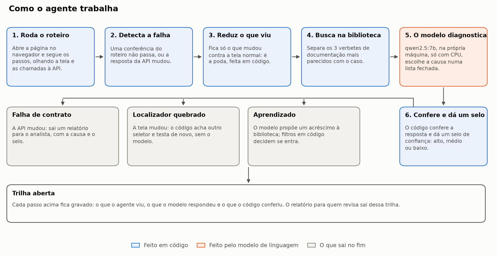
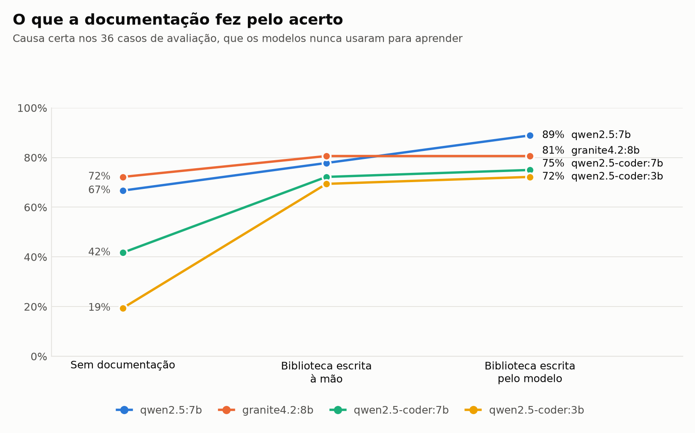
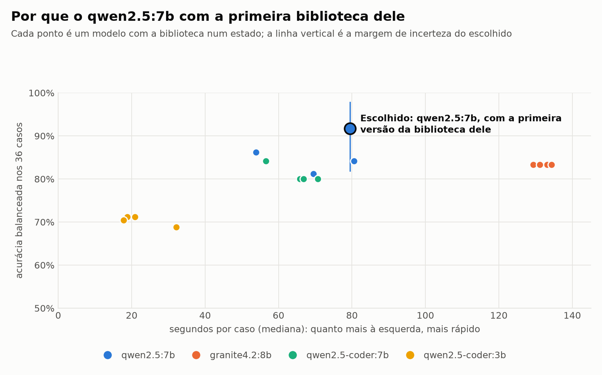
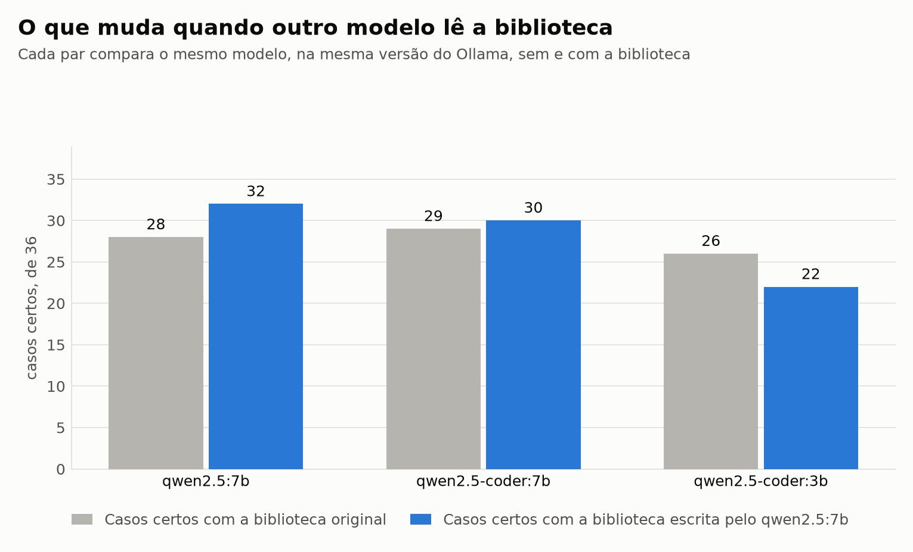
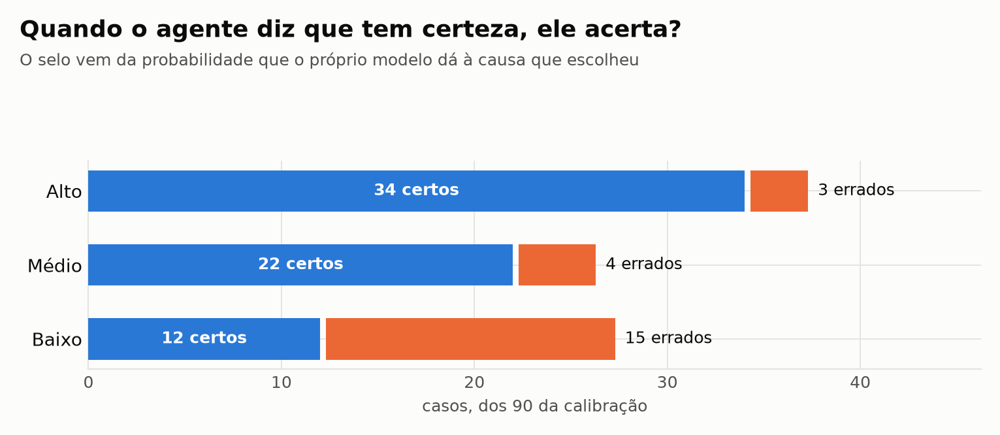
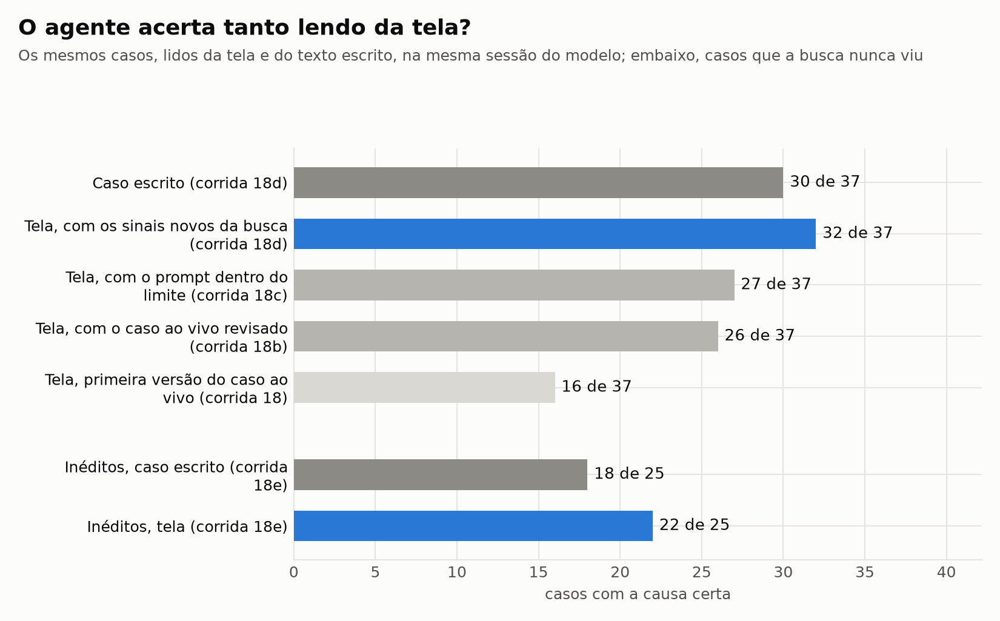
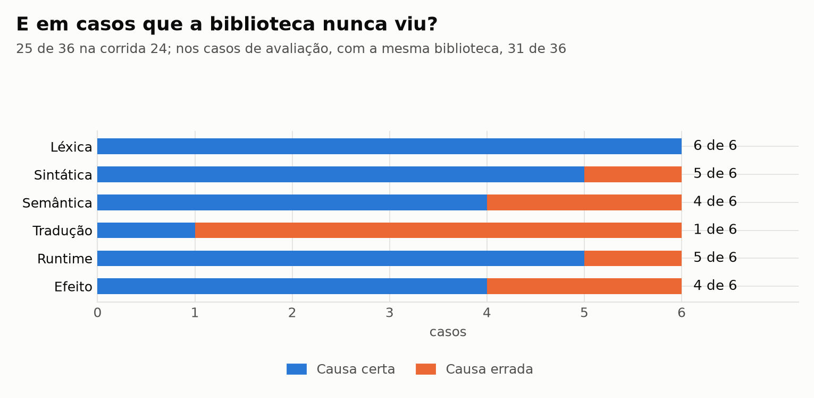
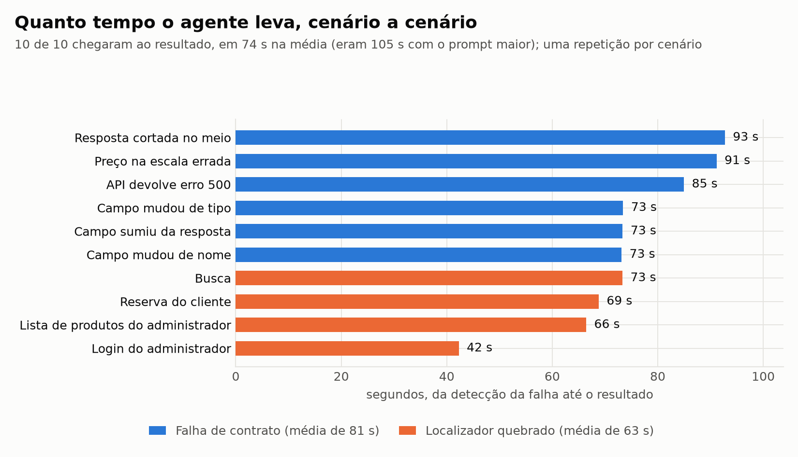
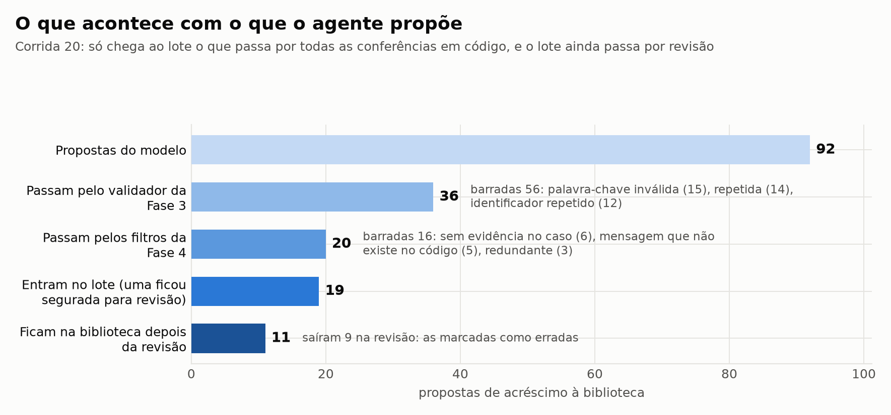
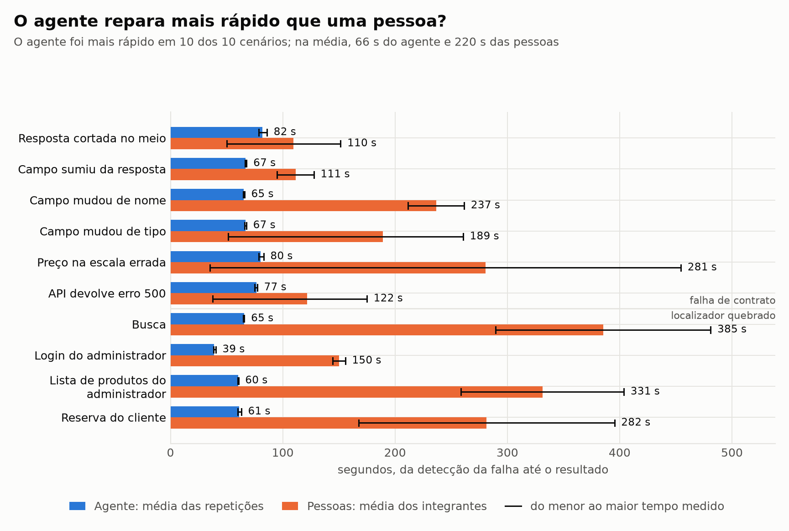

<!-- ! Alteração de IA - Revisar: (05/11/2026) README refeito como porta de entrada: o que é o projeto, como o agente trabalha, onde está, o que já descobriu (figura, como ler e o que mostra) e como rodar. O detalhe técnico saiu para `DETALHES-TECNICOS.md`, com as tags antigas de cada trecho.
     ! Motivo: o Eric pediu (05/11/2026) uma revisão geral: o README tinha 96 mil caracteres, com tabelas cujas células passavam de 4 mil, e quem chegava não achava o resultado no meio dos dados. O pedido foi deixar a leitura com gráficos e a explicação de cada um, em linguagem direta, e os valores de cada rodada num documento à parte. O histórico das versões anteriores está no git. -->
# Agente de QA E2E Autônomo com Self-Healing

[](LICENSE)
[](Programacao/CobaiaAPI/requirements.txt)
[](Programacao/CobaiaFront)
[](Programacao/AgenteCore/experimentos)
[](https://claude.ai/artifact/LhXeAccx5NMk1HprycHApN)

Trabalho de Conclusão de Curso em Ciência da Computação (Universidade Cidade de São Paulo, 2026). É um agente de testes que abre um sistema web como uma pessoa abriria, percebe quando algo quebrou, diz por que quebrou e, quando a causa é só um seletor que mudou, conserta o próprio teste. Tudo roda na máquina de quem testa: o modelo de linguagem é local (Ollama, só CPU, sem nuvem).

<!-- ! Alteração de IA - Revisar: (11/11/2026) a linha de estado passa a dizer a Fase 4 concluída e a Pós-Fase 4 em andamento, como a tabela "Onde o projeto está".
     ! Motivo: a linha ainda dizia, com data de 05/11/2026, que a Fase 4 estava em andamento com uma corrida por fazer; a fase fechou em 06/11/2026, e a tabela logo abaixo já dizia isso. -->
<!-- ! Alteração de IA - Revisar: (16/11/2026) a linha de estado passa a dizer que as três corridas previstas antes da Fase 5 rodaram e que a revisão às cegas das propostas de uma delas foi feita.
     ! Motivo: a linha dizia "com três corridas por rodar"; as corridas 25, 26 e 27 rodaram na noite de 11 para 12/11/2026, e a revisão às cegas foi gravada em 16/11/2026 (roadmap, §2.23 a §2.25); nenhuma muda o agente. -->
<!-- ! Alteração de IA - Revisar: (25/11/2026, fechamento da Fase 5) a frase de estado do alto passou de 16/11/2026 a 25/11/2026 e diz que a Fase 5 está concluída, com o resultado central.
     ! Motivo: a frase parava na Pós-Fase 4 de 16/11/2026 e tratava a Fase 5 como futura; a fase foi medida em 18 e 24/11/2026 e fechada em 25/11/2026 (decisão 156). O número vem de `resultados_alvo/fase5/medicao.json`, lido por script. -->
> **Em 25/11/2026:** a Fase 4, em que o agente passou a trabalhar na tela de verdade, e a Fase 5, que mediu o agente contra pessoas, estão concluídas: nos dez cenários medidos o agente reparou mais rápido que as pessoas, 66,3 s contra 219,7 s na média. A Pós-Fase 4, que cuida do que o agente entrega a quem lê, está em andamento: as três corridas previstas antes da Fase 5 rodaram e nenhuma muda o agente; o hub de revisão e a seleção de cenários pelo Git foram feitos em 25/11/2026, uma corrida curta com o modelo confirmou os dois em 25/11/2026, e falta a documentação final.

| Quero... | Vá para |
|---|---|
| Entender o projeto e ver os resultados | as seções abaixo |
| Explorar cada resultado, um assunto por aba | [Painel do projeto](https://claude.ai/artifact/LhXeAccx5NMk1HprycHApN) |
| Ler o trabalho formal, nas normas da ABNT | [Documento do TCC em Word](Documentacao/TCC_v3_20261105.docx) e a [fonte em Markdown](Documentacao/TCC%20-%20ABNT%2014724%20-%20V1.md) |
| Ver scripts, configurações e os valores de cada rodada | [Detalhes técnicos](DETALHES-TECNICOS.md) |
| Ver o número exato por trás de cada figura | [Dados das figuras](Documentacao/figuras/dados-das-figuras.md) |
| Saber o que foi decidido e por quê | [Memorial](Documentacao/Memorial%20de%20Desenvolvimento.md), [roadmap](Documentacao/memorial/roadmap.md), [pendências](Documentacao/memorial/pendencias.md) e [relatório da Fase 4](Documentacao/memorial/3-resultados-e-analises/fase-4-relatorio.md) |
| Ver a cópia no repositório da disciplina | [squad-24-projeto](https://github.com/unicid-projeto-software-2026-2/squad-24-projeto) (privado; este repositório é o principal) |
| Instalar e rodar | [Instalar e rodar](#instalar-e-rodar) |

## O problema

<!-- ! Alteração de IA - Revisar: (26/11/2026, decisão 173) os dois primeiros parágrafos ganharam uma frase cada, com o dado da literatura que um coautor trouxe para a seção 1.1 do documento do TCC: as entrevistas de Lercher e outros (2024) para a deriva de contrato e o estudo de Hammoudi (2016) para o localizador.
     ! Motivo: o Eric pediu que o README acompanhasse a mudança do documento; sem as frases, o README diria que os dois problemas existem sem mostrar de onde vem essa afirmação. "Quase três em cada quatro" está no lugar de 73,62% porque o percentual exato só foi visto em fonte secundária (o PDF da dissertação não abriu); as 1.065 quebras estão na página da dissertação e as 11 empresas no resumo do artigo. -->
Quando o front-end e a API de um sistema evoluem separados, a API pode mudar o formato de uma resposta sem avisar: um campo some, muda de nome ou de tipo. O teste de ponta a ponta falha, mas a mensagem raramente diz o motivo, e alguém precisa abrir o navegador, comparar a resposta com o combinado e achar a causa. Esse desencontro se chama **deriva de contrato**, e é o foco deste trabalho. Não é um caso raro: em entrevistas com profissionais de 11 empresas, [Lercher e outros (2024)](https://doi.org/10.1016/j.jss.2024.112110) ouviram que o difícil é saber o que uma mudança na API vai quebrar e avisar as outras equipes a tempo.

O segundo problema é mais simples. A tela muda um `id` ou um texto, o **localizador** do teste não acha mais o botão, e o teste quebra sem que o sistema tenha defeito nenhum. É a quebra mais comum: num estudo com oito aplicações web, quase três em cada quatro das 1.065 quebras de teste vieram do localizador ([Hammoudi, 2016](https://digitalcommons.unl.edu/computerscidiss/100/)).

O agente trata os dois: explica a causa da deriva de contrato e conserta sozinho o localizador. Ele também mantém a própria **biblioteca**, um conjunto de **verbetes**, fichas curtas de documentação sobre o sistema testado (um contrato, um erro conhecido, uma regra de negócio).

## Como o agente trabalha



**Como ler:** siga as setas a partir do passo 1. O azul é código comum, que dá sempre o mesmo resultado. O laranja é o passo em que o modelo responde. As caixas cinza são o que sai no fim, e a trilha, embaixo, guarda tudo para quem for revisar.

**A ideia central:** o modelo dá a opinião e o código confere. Nada que o modelo escreve vai para a biblioteca, nem chega a quem lê como certeza, sem passar por uma conferência em código.

## Onde o projeto está

| Fase | A pergunta que ela responde | Estado |
|---|---|---|
| 1 | Temos um ambiente de teste controlado, com falhas que se repetem? | Concluída |
| 2-A | Um modelo local consegue diagnosticar sem documentação nenhuma? | Concluída |
| 2-B | Documentação escrita por pessoas ajuda? | Concluída |
| 3 | O próprio modelo consegue manter essa documentação? Qual modelo fica? | Concluída |
| 3-B | O resultado se sustenta com casos novos e com outro modelo lendo? | Concluída |
| Pré-Fase 4 | Modelos maiores cabem nesta máquina? Dá para abrir o raciocínio do agente? | Concluída |
| 4 | O agente funciona na tela de verdade, e não só em casos escritos? | Concluída |
<!-- ! Alteração de IA - Revisar: (07/11/2026, pacote Q1) a linha da Pós-Fase 4 passa a "Em andamento" e o item da lista abaixo diz o que já existe.
     ! Motivo: o pacote Q1 gerou o relatório por caso no molde do syllabus e a camada de leitura dos verbetes; "Não iniciada" e "hoje os verbetes são difíceis de entender" sozinhos ficariam atrasados. -->
<!-- ! Alteração de IA - Revisar: (08/11/2026, pacote Q3) a linha da Pós-Fase 4 diz que o Q3 também está feito.
     ! Motivo: o pacote Q3 gerou a árvore de decisão de cada caso; sem a frase, a tabela pararia no Q2. -->
<!-- ! Alteração de IA - Revisar: (08/11/2026, pacote Q4) a linha da Pós-Fase 4 diz que o Q4 também está feito.
     ! Motivo: o pacote Q4 entregou a barra de progresso e o protótipo da seleção pelo diff do Git; sem a frase, a tabela pararia no Q3. -->
<!-- ! Alteração de IA - Revisar: (10/11/2026, pacote Q5) a linha da Pós-Fase 4 diz que o Q5 também está feito.
     ! Motivo: o pacote Q5 fez a medida com revisor humano dos relatórios; sem a frase, a tabela pararia no Q4. -->
| Pós-Fase 4 | O que o agente entrega é fácil de ler e de usar? | Em andamento (Q1 e Q2 feitos em 07/11/2026; Q3 e Q4 em 08/11/2026; Q5 em 10/11/2026; Q6 e Q7 em 25/11/2026) |
<!-- ! Alteração de IA - Revisar: (16/11/2026) a linha da Fase 5 passa de "Não iniciada" a "Em andamento", com o que já existe: o plano aprovado; nenhuma medida feita ainda.
     ! Motivo: o plano da Fase 5 foi aprovado em 16/11/2026 (decisão 133) e o roadmap passou a dizer "Em andamento"; o painel mostra o estado curto desta tabela ao lado da etiqueta do roadmap, e a visão da fase dizia "Em andamento" e "Não iniciada" ao mesmo tempo. -->
<!-- ! Alteração de IA - Revisar: (18/11/2026, corrida 28) a linha da Fase 5 diz que a noite do agente rodou e vai ser refeita, e que falta a medida com as pessoas.
     ! Motivo: a corrida 28 (a noite do agente) rodou em 18/11/2026 com o aplicativo Claude aberto, e o Eric decidiu refazê-la (decisão 145; roadmap §2.26); a linha dizia só que nenhuma medida tinha sido feita, e o painel mostra este estado curto na visão da Fase 5, ao lado da célula do roadmap que já fala da corrida. -->
<!-- ! Alteração de IA - Revisar: (19/11/2026, corrida 28b) a linha da Fase 5 diz que o agente foi medido e que falta a medida com as pessoas.
     ! Motivo: a noite do agente foi refeita em 18/11/2026 com o aplicativo Claude e o VS Code fechados e a frio (corrida 28b, decisões 145 e 146) e está lida no roadmap §2.27; a linha dizia que a noite ia ser refeita, e o painel mostra este estado curto na visão da Fase 5. -->
<!-- ! Alteração de IA - Revisar: (24/11/2026, comparação da Fase 5) a linha da Fase 5 diz que as duas medidas estão feitas e o que a comparação deu no tempo.
     ! Motivo: as sessões das pessoas chegaram em 24/11/2026 e a comparação foi lida no mesmo dia (roadmap §5); a linha dizia que a medida com as pessoas não tinha sido feita. O número vem de `resultados_alvo/fase5/medicao.json`, lido por script. A fase segue em andamento porque faltam a descoberta com a figura, mais abaixo neste arquivo, e o texto do TCC. -->
<!-- ! Alteração de IA - Revisar: (24/11/2026, à noite) a linha da Fase 5 deixou de dizer que falta a figura.
     ! Motivo: a descoberta da fase entrou em "O que já descobrimos", com a figura `agente-e-pessoas.png`; da fase falta o texto do documento do TCC. -->
<!-- ! Alteração de IA - Revisar: (25/11/2026) a linha da Fase 5 deixou de dizer que falta o texto do TCC.
     ! Motivo: as seções da Fase 5 entraram no documento do TCC em 24/11/2026 (pacote F6) e foram conferidas em 25/11/2026 contra os registros da fase; da fase falta o fechamento, que é decisão do Eric. -->
<!-- ! Alteração de IA - Revisar: (25/11/2026, fechamento da Fase 5) a linha da Fase 5 passou de "Em andamento" a "Concluída".
     ! Motivo: o Eric fechou a fase em 25/11/2026 (ficha 96, decisão 156), com os pacotes F0 a F6 feitos; o painel mostra este estado curto na visão da fase, ao lado da célula do roadmap. -->
| 5 | Ele resolve mais rápido que uma pessoa? | Concluída em 25/11/2026 (o agente reparou mais rápido que as pessoas nos dez cenários, 66,3 s contra 219,7 s na média) |

<!-- ! Alteração de IA - Revisar: (25/11/2026, fechamento da Fase 5) o título da lista abaixo deixou de dizer "antes da Fase 5".
     ! Motivo: a Fase 5 foi concluída em 25/11/2026; os dois itens são da Pós-Fase 4, parte feita antes da Fase 5 e parte ainda por fazer. -->
<!-- ! Alteração de IA - Revisar: (25/11/2026, Pós-Fase 4, pacote Q8) o título da lista deixa de falar no que falta da Pós-Fase 4.
     ! Motivo: os pacotes Q0 a Q7 estão feitos desde 25/11/2026; a lista abaixo já conta cada um, e o último item ainda descrevia a fase como ideia para o futuro. -->
**O que a Pós-Fase 4 fez:**

<!-- ! Alteração de IA - Revisar: (07/11/2026, pacote Q2) a linha da Pós-Fase 4 na tabela acima diz que o Q2 também está feito, e o item abaixo ganhou os filtros de texto.
     ! Motivo: o pacote Q2 passou a medir em código cada texto que chega ao analista e ajustou o molde do relatório até passar; sem a frase, o leitor acharia que só a camada de leitura existe. -->
<!-- ! Alteração de IA - Revisar: (08/11/2026, pacote Q4) o item abaixo ganhou a barra de progresso e o protótipo da seleção pelo diff do Git.
     ! Motivo: são as duas entregas do pacote Q4 (plano da Pós-Fase 4, seções 3.5 e 3.7); sem a frase, o leitor não saberia que existem. -->
<!-- ! Alteração de IA - Revisar: (10/11/2026, depois das fichas 62 e 63) o item abaixo passou a dizer que os 36 relatórios foram lidos por um analista de QA da empresa.
     ! Motivo: o Eric declarou no quadro quem é o analista e que as 36 respostas são dele (decisão 117, que fecha a ficha 62). -->
<!-- ! Alteração de IA - Revisar: (10/11/2026, tarde) o item abaixo passou a dizer que quase todos os relatórios foram lidos por um analista, que o tempo de leitura não foi medido e que as leituras dos verbetes foram curadas.
     ! Motivo: o texto da manhã dizia que o Eric tinha lido os 36 relatórios; ele declarou que passou os relatórios a um analista (decisão 114), e a curadoria das 39 leituras foi aplicada com consertos (decisão 115). -->
<!-- ! Alteração de IA - Revisar: (10/11/2026, pacote Q5) o item abaixo ganhou a sessão com revisor humano dos relatórios.
     ! Motivo: é a medida da especificação da trilha que a Fase 4 deixou em aberto (ficha 40, decisão 113); sem a frase, o leitor acharia que ninguém leu os relatórios novos. -->
<!-- ! Alteração de IA - Revisar: (08/11/2026, pacote Q3) o item abaixo ganhou a árvore de decisão por caso.
     ! Motivo: o pacote Q3 é a terceira entrega do que chega ao analista (plano da Pós-Fase 4, seção 3.4); sem a frase, o leitor não saberia que a árvore existe. -->
<!-- ! Alteração de IA - Revisar: (25/11/2026, Pós-Fase 4, pacote Q8) o item deixa de ser um "rever" com o que foi feito entre parênteses e passa a contar o que foi feito.
     ! Motivo: a frase começava como tarefa por fazer ("rever ... porque hoje os verbetes são difíceis") e trazia o trabalho já feito num parêntese de 1400 caracteres. -->
- o que o agente entrega ao analista, porque os verbetes eram difíceis de entender: desde 07/11/2026 existe uma camada de leitura dos verbetes, gerada por código e curada em 10/11/2026 por um analista, com consertos no que era fato errado; o relatório por caso segue o molde do relatório de defeitos do syllabus CTFL 4.0; e filtros em código medem cada texto que chega ao analista, com limiares calibrados nos comentários deste repositório: todos os relatórios passam, e as leituras dos verbetes passam todas depois da curadoria; e, desde 08/11/2026, cada caso tem uma árvore de decisão lida da trilha gravada, com o que o modelo leu, que verbetes entraram, a causa contra a segunda, a cura quando houve e a origem de cada afirmação: o que o código mediu, o que ele conferiu, o que o modelo só declarou e o que faltou; e, também desde 08/11/2026, enquanto o modelo pensa uma barra de progresso diz quanto falta, estimando pelas taxas das corridas anteriores desta máquina, com o erro medido nos registros gravados, e um protótipo lê o que mudou no Git para dizer quais cenários rodar e por quê, provado no histórico do próprio repositório; e, em 09 e 10/11/2026, os 36 relatórios da corrida 24 foram lidos no formato novo, um por vez e às cegas, todos por um analista de QA da empresa, que não participou do projeto, a quem o Eric passou os relatórios: ele decidiu certo na maior parte deles e deu a nota máxima de utilidade à maioria, mas o tempo de leitura não foi medido e é um leitor só;
<!-- ! Alteração de IA - Revisar: (25/11/2026, pacotes Q6 e Q7) item novo com o hub de revisão e a seleção de cenários pelo Git; a frase de estado no alto e a linha da Pós-Fase 4 na tabela acompanharam. Os números vêm de `resultados_alvo/fase4/hub.json` e de `conferencia_git.json`, lidos por script.
     ! Motivo: a decisão 152 pôs os dois antes do texto final, e eles foram feitos em 25/11/2026; a frase de estado ainda dizia que faltavam, e o leitor não saberia que existem nem como abrir o hub. -->
- o hub de revisão, desde 25/11/2026: uma página local, à imagem da revisão de uma mudança de código, que junta 170 casos diagnosticados pelo agente e mostra, para cada um, o relatório em blocos, a evidência ao lado, a árvore de decisão e os eventos gravados. O analista comenta um trecho, responde, resolve a conversa e dá o veredito; o agente só comenta. Para abrir: `python hub.py`, em `Programacao/AgenteCore/experimentos`. Detalhes no painel, aba "Hub e Git", e em [DETALHES-TECNICOS.md](DETALHES-TECNICOS.md);
<!-- ! Alteração de IA - Revisar: (25/11/2026, ficha 109, decisão 170) item novo: o hub como central aberta pelo `Cobaia.exe`.
     ! Motivo: o Eric pediu que o hub seja a central de tudo, aberta quando o `.exe` roda, de onde se rodam os testes e se veem as métricas; sem o item, o leitor continuaria achando que o `.exe` abre o site e a API e que o hub só abre pela linha de comando. -->
- o hub como central do projeto, também desde 25/11/2026: o `Cobaia.exe` sobe o hub junto com o site e a API e abre o navegador nele. A primeira tela diz o que está no ar (o site, a API, o Ollama e o próprio hub) e leva ao site, à API e ao painel; a vista "Métricas" mostra, por corrida, as execuções, o Task Success e o tempo de reparo, lidos dos registros gravados, e o resultado da comparação com as pessoas; e o botão de rodar os dez cenários usa o site e a API que o `.exe` já subiu. A corrida lançada dali é uso do produto, não medida do TCC, e aparece na lista de casos. O caminho do botão está coberto por teste sem o modelo; com o modelo, ele ainda não rodou;
- a escolha dos cenários pelo que mudou no código, também desde 25/11/2026: com `--selecao git`, a corrida roda só os cenários atingidos pelo que mudou nas cobaias, roda tudo na dúvida e registra o que deixou de fora. Numa conta sobre o histórico do repositório, 2 de 8 mudanças deixariam de fora um cenário que falhou na rodada completa, e é por isso que a rodada completa volta em prazo fixo. Nenhuma seleção parcial rodou de verdade ainda;
<!-- ! Alteração de IA - Revisar: (25/11/2026, Pós-Fase 4, pacote Q8) o último item da lista passa a contar o painel por fase, no lugar da Pós-Fase 4 descrita como ideia.
     ! Motivo: o item repetia o texto da decisão 94, de 05/11/2026, que anunciava a Pós-Fase 4 como "ajustes e ideias" e "talvez gráficos"; a fase foi planejada em 07/11/2026 e feita. -->
- o painel do projeto reorganizado por fase, com uma aba de visão em cada fase e um glossário dos termos e dos métodos (decisão 124).

## O que já descobrimos

Cada figura responde a uma pergunta. O número exato de cada uma está em [Dados das figuras](Documentacao/figuras/dados-das-figuras.md), e as condições de cada rodada, em [Detalhes técnicos](DETALHES-TECNICOS.md).

<!-- fonte dos números desta seção: Documentacao/figuras/dados-das-figuras.md, gerado de resultados_alvo/ por gerar_figuras_documentos.py; adesão ao verbete errado: fase3/comparacao_fases.json, adesao_cega_2B_A5_pct; margem do ensaio: fase4/cenarios_v4.json, geral; verbete certo no contexto: fase4/tela_v4.json e tela_ineditos.json, verbete_certo; a regra da tela: campos b e c de tela_v4.json e tela_ineditos.json; a corrida 24: fase4/ineditos.json; erros pegos pelo selo baixo: fase4/calibracao.json, limiares; lote nos inéditos: fase4/biblioteca.json, regra_r5 e relatório da Fase 4, seção 7; a medição da Fase 5: fase5/medicao.json (lados, tempo.geral e task_success) e fase5/manual.json (por_integrante). -->

### A documentação faz diferença?



**Como ler:** cada linha é um modelo, e cada ponto é quanto ele acertou nos mesmos 36 casos. Da esquerda para a direita, o modelo recebe mais ajuda. Linha subindo quer dizer mais causas certas.

**O que isso mostra:** a documentação certa ajuda os quatro modelos da figura, e quem acertava menos ganha mais: o `qwen2.5-coder:3b` sai de 19% para 69%. Só o `qwen2.5:7b` ganha mais de um caso com a biblioteca que ele mesmo escreveu, de 78% para 89%, e mesmo isso fica abaixo do que 36 casos conseguem comprovar. A linha do `granite4.2:8b` fica reta no último trecho porque nenhuma edição dele foi aceita. O outro lado é o risco: na Fase 2-B, o `granite4.2:8b` e o `qwen2.5-coder:3b` seguiram um verbete errado, acompanhado de um registro de incidente falso, em 93% e 96% dos casos. É por isso que nada entra na biblioteca sem conferência.

### Qual modelo ficou?



**Como ler:** cada ponto é um modelo com a biblioteca num certo estado. Quanto mais alto, mais acerta; quanto mais à esquerda, mais rápido. A **acurácia balanceada** é o acerto calculado causa por causa, com o mesmo peso para todas, para que responder sempre a causa mais comum não pareça bom. A linha vertical no ponto escolhido mostra a incerteza: com só 36 casos, o valor verdadeiro pode estar em qualquer lugar dela. Entre versões da biblioteca de um mesmo modelo, o tempo não se compara, porque foi medido em momentos diferentes da corrida.

**O que isso mostra:** pela regra fixada antes de rodar, ficou o `qwen2.5:7b` com a primeira versão da biblioteca escrita por ele (decisão 52), depois curada e guardada em `Programacao/AgenteCore/biblioteca_producao/`. O `qwen2.5-coder:3b` é bem mais rápido, mas acerta menos, e o `granite4.2:8b` acerta perto, mas leva mais de 120 segundos por caso.

### A biblioteca serve para qualquer modelo?



**Como ler:** cada par de barras é o mesmo modelo lendo os mesmos 36 casos. A barra cinza usa a biblioteca original, e a azul, a que o `qwen2.5:7b` escreveu.

**O que isso mostra:** quem escreveu ganha 4 casos, o `qwen2.5-coder:7b` ganha 1 e o `qwen2.5-coder:3b` perde 4. Por isso o padrão do agente é o modelo com a biblioteca que ele mesmo escreveu (decisão 69). E o ganho não é garantido em casos novos: em 36 casos inéditos, essa versão fez 26 certos, contra 27 da biblioteca original ([figura dos casos inéditos](Documentacao/figuras/casos-ineditos.png)).

### O agente sabe quando pode estar errado?



**Como ler:** cada barra reúne os casos que receberam o mesmo selo. O azul são os certos, e o laranja, os errados. O selo vem da probabilidade que o próprio modelo dá à causa que escolheu.

**O que isso mostra:** o selo separa os extremos. No alto, são 3 erros em 37 casos; no baixo, 15 em 27. Mandar para revisão só o selo baixo pega 15 dos 22 erros olhando 27 dos 90 casos. Os cortes de cada selo foram calculados nesses mesmos casos, então esse resultado ainda precisa se repetir em casos novos.

### Ler da tela é tão bom quanto ler um caso escrito?



**Como ler:** as cinco barras de cima são os mesmos 37 casos. A primeira é o modelo lendo o caso escrito à mão, e as outras, o mesmo caso montado a partir da tela, da versão mais nova para a primeira. As duas de baixo são 25 casos inéditos, que a busca nunca tinha visto. Mais casos certos é melhor.

<!-- ! Alteração de IA - Revisar: (06/11/2026, decisões 97 a 99) este parágrafo e o item sobre a leitura da tela passam às corridas 18d e 18e; a regra é dita pelos casos que a tela perde, com a soma citada.
     ! Motivo: a regra fechou com os sinais novos da busca, pela leitura fixada antes da corrida, e o texto antigo dizia que a tela ainda perdia. Números de `tela_v3.json`, `tela_v4.json` e `tela_ineditos.json`, lidos por script. -->
**O que isso mostra:** ler da tela passou à frente do caso escrito: 32 contra 30 nos 37 casos, e 22 contra 18 nos 25 inéditos. A primeira versão dava 16, porque a montagem não dizia o que tinha mudado contra a tela normal. O que mudou por último foi a busca: ela passou a usar o que o caso mede contra a tela normal, e o verbete certo foi de 21 para 36 dos 37 casos, sem nada a mais no texto que o modelo recebe. Isso não quer dizer que o modelo lê melhor da tela: o caso da tela leva uma medida que o caso escrito não tem, e com tão poucos casos a diferença entre os dois lados não se separa do acaso.

A regra aceita que a tela perca no máximo 3 casos para o caso escrito. Ela perdeu 3 e ganhou 5, e nos inéditos perdeu 0 e ganhou 4: a regra fecha, no limite exato (decisões 97 e 98). Até a rodada anterior a conta somava os dois lados, o que daria 8; a leitura que olha só o que a tela perde foi fixada antes desta rodada, sem saber o resultado dela. Os 3 casos perdidos são a mesma confusão: item faltando na lista lido como resposta cortada. E o prompt, o texto que o modelo recebe, cabe no limite do plano ([figura do limite](Documentacao/figuras/prompt-e-limite.png)): dois casos inéditos passaram, porque a lista não tinha teto, e isso foi corrigido sem mudar os outros (decisão 99).

<!-- ! Alteração de IA - Revisar: (06/11/2026) subseção nova com a corrida 24, e a Fase 4 marcada como concluída na tabela de fases, com a Pós-Fase 4 na linha seguinte.
     ! Motivo: era a última pendência da fase, e é a única medida da biblioteca final em casos que ela nunca viu. Números de `ineditos.json`, lidos por script. -->
### E em casos que a biblioteca nunca viu?



**Como ler:** cada barra é uma classe de defeito, com seis casos que nenhuma biblioteca tinha visto, lidos em texto. O azul são as causas certas, e o laranja, as erradas. Mais azul é melhor.

**O que isso mostra:** a biblioteca final acerta 25 dos 36, contra 31 de 36 nos casos de avaliação. Não são os mesmos casos, então a diferença não mede só a biblioteca, e o número fica perto do que a Fase 3-B mediu em outros 36 inéditos (26 de 36). O que mais pesa é de novo o verbete certo: quando ele chega ao modelo, são 18 de 20; quando não chega, 7 de 16. A classe de tradução é a mais fraca, com 1 de 6.

### Quanto tempo o agente leva?



**Como ler:** cada barra é um cenário de falha, rodado uma vez, do momento em que o agente percebe a falha até ter o resultado. No azul, o resultado é o diagnóstico conferido. No laranja, é o teste passando de novo depois do conserto.

**O que isso mostra:** os 10 cenários chegaram ao resultado, em 74 segundos na média. Encurtar o prompt tirou cerca de 30% do tempo (eram 105 segundos), sem mudar nenhuma causa respondida, e os sinais novos da busca não mudaram esse resultado. Quase todo esse tempo é o modelo pensando ([figura de onde vai o tempo](Documentacao/figuras/onde-vai-o-tempo.png)): o conserto de localizador só em código levou 0,64 segundo e funcionou nas 160 quebras armadas.

### O que o agente escreve entra na biblioteca sem controle?



**Como ler:** de cima para baixo, quantas propostas sobrevivem a cada conferência. Ao lado de cada etapa, o motivo mais comum de quem ficou pelo caminho.

**O que isso mostra:** das 92 propostas do modelo, 19 chegaram ao lote, e 11 ficaram na biblioteca depois da revisão. Esse lote não mudou nenhum acerto nos 36 casos inéditos. O que encurtou a distância da tela foi revisar a montagem do caso e a busca, não a biblioteca.

<!-- ! Alteração de IA - Revisar: (24/11/2026) descoberta nova, a da Fase 5: o tempo de reparo do agente contra o das pessoas, com a figura `agente-e-pessoas.png`, o "Como ler" e o texto. Na lista do que não dá para afirmar, logo abaixo, saíram as duas frases que a medida respondeu (que não havia medida com pessoas; que os 10 de 10 do ensaio eram de uma repetição só) e entraram os limites da medida nova.
     ! Motivo: a corrida 28b do agente e as três sessões das pessoas foram lidas em 24/11/2026 pelas regras fixadas antes. O Eric decidiu (ficha 91, decisão 151) que o resultado central é o do tempo e que o do Task Success é declarado com a ressalva de que depende da sessão de um integrante só: por isso o Task Success não tem figura e vem num parágrafo à parte, com a ressalva. Os números foram copiados por script de `resultados_alvo/fase5/medicao.json` e `manual.json`; o dado cru está em `Documentacao/figuras/dados-das-figuras.md`. -->
### O agente repara mais rápido que uma pessoa?



**Como ler:** cada cenário de falha tem duas barras. A azul é o tempo médio do agente, em cinco repetições. A laranja é o tempo médio de três pessoas do grupo, cada uma resolvendo o cenário uma vez. O traço preto vai do menor ao maior tempo medido de cada lado. Barra mais curta é reparo mais rápido. Nos 6 cenários de cima, de falha de contrato, o resultado é o diagnóstico conferido; nos 4 de baixo, de localizador quebrado, é o teste passando de novo.

**O que isso mostra:** o agente foi mais rápido nos 10 cenários. Na média, levou 66,3 segundos, e as pessoas, 219,7: cerca de um terço do tempo. É o resultado central do trabalho, e passa na regra escrita antes de medir: a diferença média por cenário foi de 153,4 segundos, com margem de 109,0 a 196,1, e, se os dois lados fossem iguais, dez cenários na mesma direção sairiam por acaso 2 vezes em mil.

O agente também chegou ao resultado em mais cenários: 49 de 50 execuções, contra 14 de 30 tentativas das pessoas. Esse segundo resultado tem uma ressalva: ele depende da sessão de um integrante só, que não corrigiu nenhum cenário (os outros dois corrigiram 5 e 9 de 10). Sem essa sessão, numa conta feita depois de ver os números, a vantagem do agente em chegar ao resultado deixa de se separar do acaso, e a do tempo continua. Por isso o trabalho afirma o resultado do tempo e declara a ressalva no outro (decisão 151).

<!-- ! Alteração de IA - Revisar: (05/11/2026) a medida com revisor humano passou a em aberto (decisão 95), e a lista do que falta antes da Fase 5 ganhou a Pós-Fase 4 (decisão 94).
     ! Motivo: o Eric pediu "em aberto" nesta data, porque a revisão será feita depois de as respostas serem normalizadas; o texto dizia só que ela não foi feita. -->
### O que ainda não dá para afirmar

- **Que o agente é mais rápido que um analista de testes.** As três pessoas da medida são estudantes do grupo, e não analistas de fora; leram o material de cada cenário numa página, em vez de investigar o site no ar; e os dez cenários são falhas ligadas de propósito. O tempo do agente é o desta máquina, só com CPU.
- **Que o agente resolve mais cenários que uma pessoa.** A medida deu essa vantagem, mas ela depende da sessão de um integrante que não corrigiu nenhum cenário; sem ela, numa conta feita depois de ver os números, a diferença não se separa do acaso (decisão 151).
- **Que o agente chega sempre ao resultado.** Nas cinco repetições dos dez cenários, 1 das 50 execuções não chegou: foi no cenário da resposta cortada no meio.
- **Que o conserto de localizador funciona em qualquer quebra.** As 160 quebras foram armadas de propósito, com o elemento certo ainda na página.
- **Que o modelo lê melhor da tela do que de um caso escrito.** A tela passou à frente nas duas medidas, mas o caso da tela leva uma medida contra a tela normal que o caso escrito não tem, e a diferença não se separa do acaso nesse número de casos. A regra que compara os dois lados fechou sem folga: a tela perde 3 casos, e o limite é 3. Os sinais novos da busca foram escritos olhando os 37 casos, e a conferência são 25 casos inéditos.
- **Que um exemplar resolvido ou os rótulos em palavras ajudam o modelo.** Testamos os dois nos 90 casos: trocam a resposta em alguns casos, para os dois lados, e o saldo não se separa do acaso (decisão 91).
- **Quanto a biblioteca ajuda nos casos que ela nunca viu.** A última corrida mede só a biblioteca final; esses casos não foram lidos sem ela.
- **Que os sinais da trilha apontam os erros.** A corrida teve só 5 erros, poucos para pôr os sinais em ordem ([figura dos sinais](Documentacao/figuras/sinais-da-trilha.png)).
<!-- ! Alteração de IA - Revisar: (25/11/2026, Pós-Fase 4, pacote Q8) o item da medida com revisor humano passa a dizer o que foi medido e o que continua sem resposta.
     ! Motivo: o item dizia que a medida seria feita depois que a Pós-Fase 4 melhorasse as respostas; ela foi feita em 09 e 10/11/2026 (`resultados_alvo/fase4/leitura_revisao_v3.md`: 30 de 36). -->
- **Que o relatório ajuda qualquer pessoa que revise, e em quanto tempo.** A medida foi feita com um leitor só, um analista de QA de fora do projeto, que decidiu certo em 30 de 36 relatórios; o tempo de leitura não foi medido, e o que ele recebeu para ler não foi declarado (decisões 114 e 117).

## Os dois sistemas de teste

Medir sem depender de opinião pede um ambiente controlado. Por isso o repositório traz dois sistemas "cobaia", que compartilham o mesmo banco de dados, e falhas que podem ser ligadas e desligadas sempre do mesmo jeito.

| Sistema | O que é | Para que serve |
|---|---|---|
| **CobaiaFront** | Site PHP legado de um restaurante, mantido como veio | Falhas de página completa e erros clássicos de sistema antigo |
| **CobaiaAPI** | API JSON em Python (FastAPI), com injeção de falhas | Deriva de contrato em respostas reais, o foco do agente |

<!-- ! Alteração de IA - Revisar: (11/11/2026) parágrafo novo com a origem do CobaiaFront, o Projeto CHULETA, e o caminho da nota que lista o que este trabalho acrescentou e mudou nele.
     ! Motivo: o Eric pediu a citação correta do projeto de onde veio a parte PHP da cobaia; nenhum arquivo do repositório dizia de onde o site veio, e a tabela acima diz "mantido como veio" sem dizer de quem. O repositório de origem foi conferido pela API do GitHub em 11/11/2026. -->
O CobaiaFront é o [Projeto CHULETA](https://github.com/pedrohtgoncalvesgit/Projeto-CHULETA), de Pedro Henrique Torres Gonçalves, integrante do grupo, cedido pelo autor para servir de sistema sob teste. O que este trabalho acrescentou e mudou no site está em [`Programacao/CobaiaFront/ORIGEM.md`](Programacao/CobaiaFront/ORIGEM.md).

A avaliação usa 90 casos de falha com a resposta certa conhecida, e as regras de decisão são fixadas antes de cada rodada. A arquitetura e o detalhe de cada sistema estão em [Detalhes técnicos](DETALHES-TECNICOS.md#arquitetura).

## Instalar e rodar

<!-- ! Alteração de IA - Revisar: (25/11/2026, pacote I7 do instalador único, decisão 153) a frase "Precisa de Windows 10/11, Linux ou macOS" saiu; no lugar entram o que o instalador pede em cada sistema hoje, o parágrafo "O que foi provado" com o bloco gerado por `ferramentas/instalador_matriz/relatorio.py`, o que não foi testado e como conferir a própria instalação.
     ! Motivo: o texto prometia Windows 10/11, Linux e macOS, e a prova gravada cobre só o Windows da máquina-alvo e o Linux pelo WSL (o Linux do Windows); as células do GitHub Actions ainda não rodaram. No Linux o instalador é o novo (traz o próprio Python pelo `uv` quando falta); no Windows e no macOS ele ainda segue os passos antigos, que nunca rodaram em máquina nova. -->
Precisa de internet: o instalador baixa PHP, MariaDB e os pacotes Python que faltarem. O que ele pede em cada sistema:

<!-- ! Alteração de IA - Revisar: (25/11/2026, consertos da primeira execução do instalador no GitHub Actions) a linha do Windows ganha o que acontece numa máquina que já tem o MySQL e de onde vem o Ollama.
     ! Motivo: na célula CI-WIN (execução 45650086543) o instalador aceitou o `mysql.EXE` do MySQL 8.4 da máquina como cliente do MariaDB e parou em "Não foi possível subir o MariaDB"; ele passou a aceitar só executável do MariaDB e a trazer o MariaDB pelo zip quando há um MySQL. O Ollama passou a vir do instalador oficial, na versão testada do `versoes.json`. Nenhum dos dois foi visto rodando ainda: a segunda execução do fluxo é a prova. -->
- **Windows:** `install.cmd` ou `Cobaia.exe`. Usa o `winget` (o gerenciador de pacotes do Windows) para trazer o Python e o PHP quando faltam, e o MariaDB pelo `winget` ou, sem administrador, pelo zip oficial. Se a máquina já tem um MySQL, o instalador não mexe nele e traz o MariaDB pelo zip, ao lado; com o serviço do MySQL ligado na porta 3306, ele para e pede para desligar esse serviço. O Ollama vem do instalador oficial, na versão testada.
- **Linux de `apt` (Ubuntu, Debian) ou de `dnf` (Fedora):** `./install.sh`. Usa o `sudo` para instalar os pacotes do sistema. Se não houver um Python 3.12 ou mais novo, o próprio `install.sh` traz um para dentro da pasta do projeto (`.ferramentas/`), sem mexer no Python do sistema. Outras distribuições recebem a lista do que instalar à mão.
<!-- ! Alteração de IA - Revisar: (25/11/2026, consertos da primeira execução do Actions) a linha do macOS passa a dizer que o instalador usa o Homebrew pelos mesmos passos do Linux, sem `sudo`.
     ! Motivo: nas células M-15 e M-15I (macOS 15) de 25/11/2026 o caminho antigo parou em "Não foi possível subir o MariaDB"; o macOS agora instala o PHP e o MariaDB 11.8 pelo Homebrew no fluxo por pacotes. Ainda sem rodada que passe. -->
- **macOS:** `./install.sh`, com o [Homebrew](https://brew.sh) já instalado. O instalador usa o Homebrew (sem `sudo`) para trazer o PHP e o MariaDB 11.8, pelos mesmos passos do Linux. O Mac com processador Intel entra como melhor esforço: o Homebrew deixou de publicar pacote pronto do PHP e do MariaDB para ele, e a instalação pode compilar os dois (mais de uma hora).
<!-- ! Alteração de IA - Revisar: (25/11/2026, consertos da primeira execução do Actions, tarefa E) a linha do macOS ganha o Mac Intel como melhor esforço, com o motivo em uma frase.
     ! Motivo: decisão do dono do projeto de 25/11/2026: o bloco `bottle` das fórmulas `php`, `mariadb` e `mariadb@11.8` do Homebrew só traz pacote pronto para Apple Silicon e Linux; não observado em execução. -->


<!-- ! Alteração de IA - Revisar: (25/11/2026, conserto da revisão do I5/I7) a frase de abertura de "O que foi provado" deixa de dizer que o instalador rodou em todas as linhas e passa a dizer que cada linha é uma célula de teste e que na `ALVO` só a prova rodou.
     ! Motivo: a `ALVO` é a máquina do projeto com a instalação que já existia; o roteiro dela (`celula_alvo.ps1`) roda só a prova, e a frase antiga fazia o leitor entender que o instalador também tinha sido testado nela. -->
**O que foi provado:** cada linha abaixo é uma célula de teste, e a coluna "Como a máquina nasce" diz o que ela é; nas máquinas e imagens novas o instalador rodou e a prova da instalação conferiu até que ponto o sistema subiu, mas na célula `ALVO` (a máquina do projeto) só a prova rodou, sobre a instalação que já existia (a tabela é gerada por `ferramentas/instalador_matriz/relatorio.py` a partir dos arquivos de evidência, nada é digitado à mão).

<!-- tb_inst_resumo:inicio -->
| Célula | Sistema | Como a máquina nasce | Onde rodou | Nível alcançado na última rodada | Prova pedida até | Maior nível em rodada novo |
|---|---|---|---|---|---|---|
| ALVO | Windows 11 da máquina-alvo | a máquina do projeto como está: o instalador não rodou nesta célula, só a prova, sobre a instalação que já existia | máquina-alvo | N4 | N4 | N4 |
| L-U2404 | Ubuntu 24.04 | WSL: imagem oficial importada e apagada no fim | WSL | N3 | N3 | N4 |
| L-U2404-SS | Ubuntu 24.04 sem systemd | WSL: imagem oficial, com o systemd desligado na instância | WSL | N3 | N3 | N3 |
| L-U2204 | Ubuntu 22.04 | WSL: imagem oficial importada e apagada no fim | WSL | N3 | N3 | N3 |
| L-U2604 | Ubuntu 26.04 | WSL: imagem oficial importada e apagada no fim | WSL | N3 | N3 | N3 |
| L-D12 | Debian 12 | WSL: imagem oficial importada e apagada no fim | WSL | N3 | N3 | N3 |
| L-D13 | Debian 13 | WSL: imagem oficial importada e apagada no fim | WSL | N3 | N3 | N3 |
| L-F45 | Fedora 45 (melhor esforço) | WSL: imagem oficial importada e apagada no fim | WSL | N1 | N3 | N1 |
| L-ARCH | Arch Linux (sem suporte) | WSL: imagem oficial importada e apagada no fim | WSL | N0 | N1 | N0 |
| L-SUSE | openSUSE (sem suporte) | WSL: imagem oficial importada e apagada no fim | WSL | N0 | N1 | N0 |
| CI-UBU | Ubuntu 24.04 do GitHub Actions | executor do GitHub; já traz Python, PHP e o MySQL 8.0, e a célula remove o MySQL antes do instalador; não é limpo | GitHub Actions | N4 | N4 | N4 |
| CI-WIN | Windows Server 2025 do GitHub Actions | executor do GitHub; já traz Python, PHP e banco, não é limpo | GitHub Actions | N0 | N4 | N0 |
| M-15 | macOS 15, Apple Silicon | executor do GitHub; já traz o Homebrew e o Python, não é limpo | GitHub Actions | N3 | N3 | N3 |
| M-15I | macOS 15, Intel (melhor esforço) | executor do GitHub; já traz o Homebrew e o Python, não é limpo | GitHub Actions | N4 | N4 | N4 |

Cada linha é uma célula de teste, e a coluna "Como a máquina nasce" diz o que ela é: na `ALVO` só a prova rodou. Nível alcançado é o maior nível da prova que passou sem nenhum nível abaixo dele ter falhado; N0 quer dizer que nenhum nível passou, "sem prova" quer dizer que a rodada parou antes de gravar o `registro.json`, e "não terminou" quer dizer que o GitHub cortou a tarefa antes do fim. Rodada `novo` é a que roda o instalador já com os consertos; `como-esta` é a que roda o instalador antes deles, para gravar a falha. A última coluna olha todas as rodadas `novo` da célula, porque a última rodada pode ter pedido menos níveis que uma anterior.
<!-- tb_inst_resumo:fim -->

Ficaram sem teste: Windows recém-instalado, Windows 10 e Linux instalado fora do WSL (decisão 153). No Windows e no macOS o instalador segue os passos antigos, que nunca rodaram em máquina nova; o fluxo do GitHub Actions (`.github/workflows/instalador.yml`) foi escrito para provar o Windows e o macOS, mas começa a rodar depois do commit e do push, e o resultado entra na tabela acima quando for trazido para o repositório. O relatório com cada rodada, o que falhou e o que nenhuma célula prova está em [relatório do instalador](Documentacao/memorial/5-metodo-e-ferramental/relatorio-instalador-maquina-limpa.md).

**Para conferir a sua instalação** depois de instalar: `./install.sh --conferir` (Linux e macOS) ou `python install.py --conferir` (Windows). A prova sobe o site e a API, abre o site no navegador do agente, pede uma resposta a um modelo pequeno e, por último, ao `qwen2.5:7b`, e grava o resultado em `.ferramentas/prova/registro.json`.

<!-- ! Alteração de IA - Revisar: (25/11/2026, ficha 109, decisão 170) a frase passa a dizer que o `Cobaia.exe` abre o navegador no hub central.
     ! Motivo: o launcher deixou de abrir o site e a documentação da API em duas abas; abre uma só, no hub, que leva às duas. Se o hub não subir, ele abre o site e a API, como antes. -->
**No Windows, o caminho mais curto** é dar dois cliques em `Cobaia.exe`: ele instala, sobe tudo e abre o navegador no hub central (`http://127.0.0.1:8765`), de onde se chega ao site, à API, às métricas e ao botão de rodar os cenários. Na primeira vez, o Windows pode mostrar "Windows protegeu seu PC", porque o arquivo não é assinado; clique em "Mais informações" e depois em "Executar assim mesmo".

**Por partes**, na raiz do repositório:

```
# Windows (clique duplo ou pelo terminal)
install.cmd
run.cmd
```

```bash
# Linux / macOS
./install.sh
./run.sh
```

Depois de subir:

- **CobaiaFront:** http://localhost:8080
- **CobaiaAPI (documentação interativa):** http://localhost:8000/docs

`Ctrl+C` encerra tudo. As contas de teste já vêm no banco:

| Login | Senha | Uso |
|---|---|---|
| `admin` | `admin123` | Painel do administrador (`/admin/login.php`) |
| `11122233344` | `123456` | Área do cliente, com reservas (mesmo formulário) |

Máquina sem administrador, o que o instalador faz passo a passo, os testes e as soluções para erros comuns estão em [Detalhes técnicos](DETALHES-TECNICOS.md#instalação-em-detalhe).

## Estrutura do repositório

<!-- ! Alteração de IA - Revisar: (25/11/2026, pacote I7) a árvore abaixo ganhou `instalador/`, `versoes.json`, `restaurar_banco.py` e `testar_instalador.py`, e a linha de `install.* / run.*` deixou de dizer "nos três sistemas".
     ! Motivo: essas peças existem desde o pacote do instalador único e não apareciam na árvore; e a linha antiga prometia o instalador nos três sistemas, sem prova em Windows recém-instalado nem em macOS (decisão 153). -->
```
TCC/
├── README.md                 # esta página
├── DETALHES-TECNICOS.md      # scripts, configurações e os valores de cada rodada
├── Cobaia.exe                # Windows: instala, roda e abre o navegador
├── install.* / run.*         # instalador e inicialização (o Windows e o macOS ainda sem prova em máquina nova)
├── instalador/               # peças do instalador: sistema, ferramentas, versões e a prova (N1 a N4)
├── versoes.json              # versão testada e faixa aceita de cada ferramenta
├── restaurar_banco.py        # restaura o banco das corridas
├── testar_instalador.py      # bateria de testes do instalador
├── ferramentas/              # scripts locais: painel, documento do TCC, conferências
├── claude-memoria/           # memória do Claude e os registros de passagem entre sessões
├── Documentacao/
│   ├── TCC - ABNT 14724 - V1.md   # fonte do documento do TCC (o nome fica "V1" em todas as versões)
│   ├── TCC_v3_20261105.docx       # documento do TCC em Word
│   ├── figuras/                   # as figuras desta página e a tabela de cada uma
│   ├── dashboard/                 # o painel do projeto
│   └── memorial/                  # decisões, pesquisa, relatórios, roadmap e pendências
└── Programacao/
    ├── AgenteCore/               # o agente, a biblioteca e as baterias de avaliação
    ├── CobaiaFront/              # o site PHP legado
    └── CobaiaAPI/                # a API com injeção de falhas
```

A árvore completa está em [Detalhes técnicos](DETALHES-TECNICOS.md#estrutura-do-repositório).

<!-- ! Alteração de IA - Revisar: (25/11/2026, ficha 98, decisão 159) seção nova com os três Objetivos de Desenvolvimento Sustentável a que o projeto se relaciona.
     ! Motivo: o orientador pediu que cada equipe informe o ODS considerado no projeto, e o README não dizia nenhum; o Eric escolheu os três, com o destaque no código aberto e documentado. Sem número nesta tabela: os números e o texto oficial das metas ficam no levantamento, para não serem digitados duas vezes. -->
## Objetivos de Desenvolvimento Sustentável (ODS)

O projeto se relaciona com três metas da Agenda 2030 da ONU, por afinidade e sem medir os indicadores delas.

| ODS | Meta | Por que |
|---|---|---|
| 9: Indústria, Inovação e Infraestrutura | 9.5 | Pesquisa aplicada e inovação em teste de software, numa máquina comum, só em CPU. |
| 8: Trabalho Decente e Crescimento Econômico | 8.2 | Produtividade por modernização tecnológica: nos dez cenários medidos, o reparo pelo agente foi mais rápido que o manual. |
| 17: Parcerias e Meios de Implementação | 17.6 | Acesso aberto ao conhecimento: o código, os registros de cada medida e a documentação são públicos, sob licença MIT. |

**Como ler.** A coluna "Por que" diz o que no projeto sustenta cada meta. O destaque do grupo é a terceira linha: tudo o que foi feito pode ser lido, reproduzido e reaproveitado por outra equipe. O levantamento completo, com o texto oficial de cada meta e as que foram descartadas, está em [ODS do projeto](Documentacao/memorial/2-pesquisa-e-literatura/ods-do-projeto.md).

## Segurança

Este é um **ambiente de teste**: as senhas fracas, a injeção de SQL no CobaiaFront e o CORS liberado na CobaiaAPI são conhecidos e ficam de propósito, porque fazem parte do que o agente precisa enfrentar. Não reutilize esses padrões fora deste projeto. Problemas reais nos instaladores e nas ferramentas seguem a [política de segurança](SECURITY.md).

## Como contribuir

Leia o [guia de contribuição](CONTRIBUTING.md) (fluxo de trabalho, convenções,
o que nunca muda e os testes obrigatórios) e o
[código de conduta](CODE_OF_CONDUCT.md). Defeitos e propostas entram por issue,
com os modelos em `.github/ISSUE_TEMPLATE/`; pull requests seguem o modelo em
`.github/PULL_REQUEST_TEMPLATE.md`. Problemas de segurança reais seguem a
[política de segurança](SECURITY.md), pelo canal privado do GitHub.

## Como citar

O arquivo [`CITATION.cff`](CITATION.cff) alimenta o botão "Cite this repository"
do GitHub. Em texto:

> DERRE, E. C. et al. **Desenvolvimento de um agente de QA end-to-end (E2E)
> autônomo com capacidades de self-healing: focado na fronteira de integração.**
> Trabalho de Conclusão de Curso (Ciência da Computação). Universidade Cidade de
> São Paulo, São Paulo, 2026. Repositório: https://github.com/EricDerre/TCC.

<!-- ! Alteração de IA - Revisar: (11/11/2026) a seção passa a dizer como citar o projeto de origem do CobaiaFront, e o `CITATION.cff` ganhou a mesma referência.
     ! Motivo: pedido do Eric em 11/11/2026: o site PHP da cobaia é o Projeto CHULETA, e quem usa essa parte do repositório precisa citar o autor dela. -->
O site de teste em PHP tem origem própria. Quem usar o CobaiaFront deve citar
também o projeto de onde ele veio:

> GONÇALVES, P. H. T. **Projeto CHULETA.** 2024. Repositório:
> https://github.com/pedrohtgoncalvesgit/Projeto-CHULETA.

## Licença

O código e a documentação deste repositório estão sob a [licença MIT](LICENSE).
<!-- ! Alteração de IA - Revisar: (11/11/2026) frase nova sobre a licença do CobaiaFront, que vem do Projeto CHULETA.
     ! Motivo: o repositório de origem não traz arquivo de licença (conferido em 11/11/2026); sem a frase, não ficava dito sob que licença o site é distribuído aqui nem que o autor dele assina a licença deste repositório. -->
O CobaiaFront vem do Projeto CHULETA
([origem](Programacao/CobaiaFront/ORIGEM.md)): o repositório de origem não traz
arquivo de licença, e aqui o site é distribuído sob a licença MIT deste
repositório, da qual o autor do site é um dos titulares.
Componentes de terceiros mantêm as próprias licenças: Bootstrap 3.3.7 e jQuery
(MIT) e PHPMailer 5.2.27 (LGPL 2.1, com o texto em
`Programacao/CobaiaFront/PHPMailer/LICENSE`) no CobaiaFront; AngularJS 1.6.9 e
Chart.js 4.4.1 carregados de CDN (MIT). Os notebooks de apoio do livro-texto
(Faceli et al., 3. ed., 2025) são material dos autores e da editora, ficam fora
do repositório e não estão cobertos por esta licença. Os modelos de
linguagem não são distribuídos aqui: o Ollama os baixa sob a licença de cada um
(Apache 2.0 para o `qwen2.5:7b` e o `qwen2.5-coder:7b`; Qwen Research License
para o `qwen2.5-coder:3b`).

## Autores

Grupo de Ciência da Computação da Universidade Cidade de São Paulo (UNICID),
2026: Eric Conde Derre, Erick do Carmo Esteves, Guilherme Penha dos Santos,
João Victor Fonseca Silva, Kennedy Fernando de Oliveira Gundim, Leandro
Henrique da Silva Patricio e Pedro Henrique Torres Gonçalves. O repositório é
mantido por
[@EricDerre](https://github.com/EricDerre).

## Convenções para alterações por IA

Ver [`.claude/CLAUDE.md`](.claude/CLAUDE.md) para as regras completas de
colaboração com IA neste repositório (não commitar automaticamente, marcar
alterações com `! Alteração de IA - Revisar`, conferir colunas reais antes
de escrever SQL, priorizar causa raiz sobre contorno).
